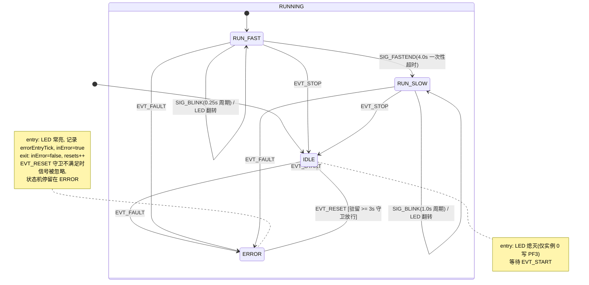

# fsm_demo 状态机状态图

来源:`Core/SRC/fsm_demo.c`。同一硬件模型被实例化为 `FSM_NUM_INSTANCES` 个完全独立的状态机,
在 QuarkTS 协作式调度器下并行运行:所有实例共享同一套状态回调与监督任务,每个实例独享自己的
`qSM_t`、状态对象、信号队列(深度 8)与超时表。只有实例 0 是 LED 所有者(`isLedOwner`),物理驱动 PF3。

## 状态图

## 状态说明

| 状态 | 层级 | entry / exit 动作 | 行为 |
|---|---|---|---|
| `IDLE` | 顶层 | entry:LED 熄灭 | 等待 `EVT_START` 启动 |
| `RUNNING` | 复合父状态 | 无(仅结构性状态) | 不处理信号,逻辑全在子状态 |
| `RUN_FAST` | RUNNING 初始子状态 | — | 0.25 s 快闪;4 s 超时后转 `RUN_SLOW` |
| `RUN_SLOW` | RUNNING 子状态 | — | 1.0 s 慢闪 |
| `ERROR` | 顶层 | entry:LED 常亮并记录进入时刻;exit:`resets++` | 等待 `EVT_RESET`(受守卫约束) |

## 信号一览

| 信号 | 取值 | 类型 | 生产者 | 说明 |
|---|---|---|---|---|
| `EVT_START` | 1 | 用户信号 | 监督任务(1 Hz 脚本) | `IDLE → RUNNING`(进入初始子状态 `RUN_FAST`) |
| `EVT_STOP` | 2 | 用户信号 | 监督任务 | `RUN_FAST/RUN_SLOW → IDLE`;其他状态忽略 |
| `EVT_FAULT` | 3 | 用户信号 | 监督任务 | `IDLE/RUN_FAST/RUN_SLOW → ERROR` |
| `EVT_RESET` | 4 | 用户信号 | 监督任务 | 仅 `ERROR` 处理;守卫(驻留 ≥ 3 s)放行才迁移到 `IDLE` |
| `SIG_BLINK` | `QSM_SIGNAL_TIMEOUT(0)` | 超时信号 | QuarkTS 超时引擎 | 0.25 s(`RUN_FAST`)/ 1.0 s(`RUN_SLOW`)周期翻转 LED |
| `SIG_FASTEND` | `QSM_SIGNAL_TIMEOUT(1)` | 超时信号 | QuarkTS 超时引擎 | 4.0 s 一次性超时,`RUN_FAST → RUN_SLOW` |

信号经 `qStateMachine_SendSignal()` 异步投递到各实例的信号队列(深度 8),由状态机任务(100 ms 周期,
中优先级)消费;监督任务为 1 Hz、高优先级。

## 监督脚本时间轴(每个周期循环一轮)

`Supervisor_Cb` 按 `s_script[]` 固定脚本向**所有实例**广播信号,证明多实例同步运行(lock-step):

| t (s) | 信号 | 各实例当时所处状态 | 效果 |
|---|---|---|---|
| 1 | `EVT_START` | `IDLE` | → `RUN_FAST`,0.25 s 快闪 |
| 5 | *(超时)* `SIG_FASTEND` | `RUN_FAST` | → `RUN_SLOW`,改 1.0 s 慢闪 |
| 8 | `EVT_STOP` | `RUN_SLOW` | → `IDLE`,LED 熄灭 |
| 9 | `EVT_START` | `IDLE` | → `RUN_FAST` |
| 13 | *(超时)* `SIG_FASTEND` | `RUN_FAST` | → `RUN_SLOW` |
| 15 | `EVT_FAULT` | `RUN_SLOW` | → `ERROR`,LED 常亮 |
| 20 | `EVT_RESET` | `ERROR`(已驻留 5 s ≥ 3 s,守卫放行) | → `IDLE`,`resets++` |

t=21 时脚本计数器清零,下一轮从 t=22 重新开始(整轮周期约 21 s)。若 `EVT_RESET` 在进入
`ERROR` 后不足 3 s 到达,守卫 `fsm_Reset_Guard()` 拒绝迁移,信号被忽略。

## 附注

- **多实例 RAM 成本**(摘自 `fsm_demo.c` 头注释):
  `RAM(instance) = qTask_t + qSM_t + 5*qSM_State_t + FSM_InstanceData_t + qQueue_t + 8*qSM_Signal_t + qSM_TimeoutSpec_t`
  迁移/超时逻辑在共享函数与 flash 常量表中,不随实例数增长。
- 当前工作区 `FSM_NUM_INSTANCES` 为 **1**(未提交改动,由 4 改回),即只有实例 0(LED 所有者)。
- 超时表 `s_fastTO[] / s_slowTO[]` 为 `const`(存于 flash),传给库 API 时按其非 const 形参做了强制转换。
- tick 基准:SysTick 1 kHz(`qOS_Setup(..., 0.001f, ...)`),守卫中的 3000 ms 即 3000 个 tick。
