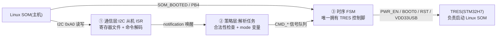

# TRES 电源/启动时序控制器 — 状态机分解与完整状态图

角色分工:PY32F030(本文固件)是常电的**电源/启动监控器**;TRES(STM32H7)上电后
正常启动,并**负责 Linux SOM 的启动控制**;Linux SOM 启动完成后成为 **I2C 主机**
(从机地址 0xA0),之后才能命令 PY32 对 TRES 做改主意操作(DFU / 关断 / 复位)。

**启动链条**:板上电 → PY32 上电即自动启动 TRES(BOOT0=0,从 FLASH 启动)
→ TRES 运行 → TRES 启动 Linux SOM → SOM_BOOTED(PB4)拉高 → Linux 接管。

## 控制信号一览(见 `gpio.h`)

| 信号 | 引脚 | 方向 | 默认态 | 作用 |
|---|---|---|---|---|
| `TRES_PWR_EN` | PB6 | 输出 | 低(断电) | TRES 主电源使能 |
| `TRES_RST` | PA8 | 输出 | 低(保持复位) | TRES NRST,推挽驱动,低=复位 |
| `TRES_BOOT0` | PB5 | 输出 | 低 | 启动模式选择,在 RST 释放瞬间被 H7 采样 |
| `TRES_VDD33USB_CTRL` | PA15 | 输出 | 低(关断) | TRES 的 USB 3V3 轨;DFU 必须为 1 |
| `SOM_BOOTED` | PB4 | 输入(下拉) | 低 | Linux SOM 启动完成信号 |

## 三层分解

**反馈通路的现实**:PY32 对 TRES 没有任何直接反馈(4 个控制脚全是输出)。
但因为 TRES 负责 SOM 的启动,**`SOM_BOOTED` 上升沿是"整条启动链成功"的链式
间接确认**——冷启动监督靠它;TRES app 层面的失败则由 Linux 经 I2C 上报闭环。

- **① 通信层**:I2C1 从机 ISR 收字节进寄存器文件,收完一条命令
  `qTask_Notification_Send()` 唤醒解析任务(模式来自 `notification_demo`)。ISR 内不做决策。
- **② 策略层**:校验命令合法性(见下方矩阵)、维护 `mode` / 重试计数,然后把
  `CMD_*` 信号投给时序 FSM(`qStateMachine_SendSignal`,管道同 `fsm_demo` 的 Supervisor)。
- **③ 时序层**:核心状态机,10 ms 周期任务轮询,全部延时走 QuarkTS 超时,无阻塞。
  `SOM_BOOTED` 电平/边沿直接作为它的迁移条件。

## ③ 时序层完整状态图

```mermaid
stateDiagram-v2
    direction TB

    [*] --> OFF : 冷启动, init 注入 CMD_PWR_ON(NORMAL)

    OFF --> PWR_UP : CMD_PWR_ON(mode) / PWR_EN=1
    PWR_UP --> BOOT_SETUP : 超时 t_rail
    BOOT_SETUP --> BOOT_WAIT_NORMAL : mode=NORMAL / 超时 t_setup
    BOOT_SETUP --> BOOT_WAIT_DFU : mode=DFU / 超时 t_setup
    BOOT_WAIT_NORMAL --> RUNNING : SOM_BOOTED 上升沿(链式确认)
    BOOT_WAIT_NORMAL --> RUNNING : SOM_BOOTED 已为高 / 超时 t_appboot(宽限)
    BOOT_WAIT_NORMAL --> SHUTDOWN : SOM_BOOTED=0 持续 t_hostboot(retries++, next_mode=NORMAL)
    BOOT_WAIT_NORMAL --> FAULT : 同上且 retries >= N_MAX
    BOOT_WAIT_NORMAL --> SHUTDOWN : CMD_POWER_OFF 或 CMD_REPORT_FAIL
    BOOT_WAIT_DFU --> DFU_ACTIVE : 超时 t_enum
    BOOT_WAIT_DFU --> SHUTDOWN : CMD_POWER_OFF

    RUNNING --> PULSE_RESET : CMD_RESET / RST=0
    RUNNING --> SHUTDOWN : CMD_POWER_OFF 或 CMD_REBOOT_NORMAL(next_mode=NORMAL)
    RUNNING --> SHUTDOWN : CMD_PWR_ON_DFU(next_mode=DFU)
    RUNNING --> SHUTDOWN : CMD_REPORT_FAIL(retries < N_MAX, next_mode=当前 mode)
    RUNNING --> FAULT : CMD_REPORT_FAIL(retries >= N_MAX)
    DFU_ACTIVE --> PULSE_RESET : CMD_RESET(BOOT0 保持 1, 重进 DFU)
    DFU_ACTIVE --> SHUTDOWN : CMD_POWER_OFF 或 CMD_REBOOT_NORMAL(next_mode=NORMAL)
    DFU_ACTIVE --> SHUTDOWN : CMD_REPORT_FAIL(retries < N_MAX, next_mode=DFU)
    DFU_ACTIVE --> FAULT : CMD_REPORT_FAIL(retries >= N_MAX)
    PULSE_RESET --> BOOT_WAIT_NORMAL : mode=NORMAL / 超时 t_rst
    PULSE_RESET --> BOOT_WAIT_DFU : mode=DFU / 超时 t_rst
    SHUTDOWN --> OFF : 超时 t_discharge
    FAULT --> OFF : CMD_POWER_OFF(清除锁定)
    FAULT --> PWR_UP : CMD_PWR_ON(清重试计数)
    FAULT --> PWR_UP : 可选 RETRY_IN_FAULT / 慢速周期自愈

    PWR_UP --> SHUTDOWN : CMD_POWER_OFF(上电中途取消)
    BOOT_SETUP --> SHUTDOWN : CMD_POWER_OFF

    OFF : entry: PWR_EN=0, RST=0, BOOT0=0, VDD33USB=0
    OFF : 所有控制脚保持低电平(防倒灌)
    OFF : 冷启动时由 init 自动注入 CMD_PWR_ON(NORMAL), 不等主机
    PWR_UP : entry: PWR_EN=1; RST 继续保持 0
    BOOT_SETUP : entry: BOOT0=(mode==DFU); VDD33USB=按模式配置表
    BOOT_WAIT_NORMAL : entry: 释放 RST(BOOT0=0 已被 H7 采样)
    BOOT_WAIT_NORMAL : 冷启动: 等 SOM_BOOTED 上升沿 = 整链启动成功
    BOOT_WAIT_NORMAL : 复位重启: SOM_BOOTED 已高, t_appboot 宽限后进入
    BOOT_WAIT_DFU : entry: 释放 RST(BOOT0=1 已被采样, H7 进系统 DFU)
    RUNNING : TRES app + Linux 均在运行; host_ready=1
    DFU_ACTIVE : 等待主机 dfu-util; VDD33USB 必须保持 1
    PULSE_RESET : entry: RST=0; 超时后释放, BOOT0 电平不变
    SHUTDOWN : entry: RST=0 -> VDD33USB=0 -> PWR_EN=0(顺序固定)
    FAULT : entry: 全部关断, 置 fault 锁定位

    note right of OFF
        SOM_BOOTED(PB4) 是 Linux SOM 的启动完成信号,
        因 TRES 负责 SOM 启动, 它同时是 TRES 冷启动
        成功的链式间接确认; 不用于 DFU 流程
    end note

    note left of DFU_ACTIVE
        DFU 时 TRES 不再启动 SOM, SOM_BOOTED 不会上升,
        DFU 进程由主机(dfu-util)驱动, PY32 只负责电源时序
    end note
```

### 关键设计决策

1. **上电自启动(autoboot)**:冷启动不依赖主机存在——初始化完成后直接向 FSM 注入
   `CMD_PWR_ON(NORMAL)`。主机上线后的角色是"改主意":DFU、关断、复位、上报失败。
2. **mode 是数据不是状态**。NORMAL 与 DFU 的序列只差 `BOOT_SETUP` 里的引脚电平,
   `mode` 放 InstanceData,加新启动模式不膨胀状态数。
3. **进 DFU 必须整周期掉电重上电**(RUNNING 收到 `CMD_PWR_ON_DFU` → 先 `SHUTDOWN`
   再按 DFU 走序列),USB 需要干净的重枚举。
4. **SOM_BOOTED 的双重身份**:
   - 冷启动:`BOOT_WAIT_NORMAL` 等它的**上升沿**作为 TRES→SOM 整链成功的确认;
     `t_hostboot` 内不出现 → 自动断电重试,`N_MAX` 次后进 FAULT(冷启动无人报错的闭环)。
   - 运行期:维护 `host_ready` 位(STATUS 可读);下降沿=Linux 重启/崩溃,
     默认仅记录,可选 `REBOOT_CHAIN` 策略(见下)。
   - **复位重启场景不重复确认**:TRES 复位不影响已运行的 SOM,SOM_BOOTED 保持高,
     此时 `t_appboot` 宽限超时后直接进 RUNNING,成功与否由主机观察闭环。
5. **SHUTDOWN 的 t_discharge 是"放电守卫"**:关断后必须等电容放完才能进 OFF,
   否则下一次上电是伪复位——同 `fsm_demo` 中 ERROR 驻留 ≥3 s 才允许 RESET 的守卫模式。
6. **FAULT 锁定 + 可选自愈**:默认仅主机命令可离开;若 FAULT 发生在冷启动
   (Linux 没起来,没人解锁),可开 `RETRY_IN_FAULT` 慢速周期重试(如每 60 s),
   主机一旦上线读 STATUS 即可干预。

### 状态-引脚矩阵(对着原理图审查用)

| 状态 | PWR_EN | RST | BOOT0 | VDD33USB |
|---|---|---|---|---|
| OFF / SHUTDOWN / FAULT | 0 | 0(复位保持) | 0 | 0 |
| PWR_UP | **1** | 0 | 不动 | 0 |
| BOOT_SETUP | 1 | 0 | **按 mode** | **按模式表** |
| BOOT_WAIT_NORMAL / RUNNING | 1 | 1(释放) | 保持 0 | 按模式表 |
| BOOT_WAIT_DFU / DFU_ACTIVE | 1 | 1(释放) | 保持 1 | **1** |
| PULSE_RESET | 1 | 0(脉冲) | 保持 | 保持 |

## ①② 层接口设计

### 命令与合法性矩阵(解析任务强制执行,FSM 收到的必是合法信号)

| 命令 | OFF | 上电序列中 | RUNNING | DFU_ACTIVE | SHUTDOWN | FAULT |
|---|---|---|---|---|---|---|
| `CMD_PWR_ON_NORMAL` | ✓ | 忽略+错误位 | 忽略+错误位 | 忽略+错误位 | 忽略(busy) | ✓(重试) |
| `CMD_PWR_ON_DFU` | ✓(生产烧录) | 忽略+错误位 | **✓(→SHUTDOWN, next=DFU)** | 忽略+错误位 | 忽略(busy) | ✓ |
| `CMD_POWER_OFF` | 忽略(已是) | ✓ | ✓ | ✓ | 忽略(busy) | ✓(去 OFF) |
| `CMD_RESET` | ✗ | ✗ | ✓ | ✓(BOOT0=1) | ✗ | ✗ |
| `CMD_REBOOT_NORMAL` | ✗ | ✗ | ✓ | ✓ | ✗ | ✗ |
| `CMD_REPORT_FAIL` | ✗ | ✗ | ✓ | ✓ | 忽略(busy) | ✗(已锁定) |

### I2C 寄存器映射建议(从机地址 0xA0,已在 `i2c.c` 配好)

| 地址 | 名称 | R/W | 内容 |
|---|---|---|---|
| 0x00 | CMD | W | 3 字节生效:`0xA5, 命令码, 参数(mode)`,魔数防误触发 |
| 0x10 | STATUS | R | bit[3:0]=FSM 状态号, bit4=host_ready, bit5=fault, bit6=busy, bit7=last_cmd_err |
| 0x11 | RETRIES | R | 当前连续失败计数 |
| 0x12 | PINS | R | 四个控制脚电平快照 |
| 0x14 | VERSION | R | 固件版本 |

主机轮询 STATUS 即可知道时序层走到哪一步;busy/非法命令的行为都体现在错误位。

### SOM_BOOTED 处理策略

| 事件 | 默认行为 | 可选策略 |
|---|---|---|
| 上升沿(BOOT_WAIT_NORMAL 中) | 迁移到 RUNNING(整链成功) | — |
| 运行中下降沿(Linux 重启/崩溃) | 清 host_ready 位,记录 | `REBOOT_CHAIN`:`t_hostlost`(给 Linux 重启留时间,含消抖)后自动断电重启整条链 |
| BOOT_WAIT_NORMAL 中持续为低 | `t_hostboot` 超时自动重试 | — |

注意:Linux 重启期间其 I2C 外设可能短暂钳住总线,PY32 硬件从机按外设超时释放即可,
不进状态机逻辑。

## 时间常量(初值为占位,必须实测)

| 常量 | 状态 | 建议初值 | 说明 |
|---|---|---|---|
| `t_rail` | PWR_UP | 50 ms | 主电源爬升,示波器实测 |
| `t_setup` | BOOT_SETUP | 5 ms | BOOT0/VDD33USB 稳定时间 |
| `t_appboot` | BOOT_WAIT_NORMAL | 2 s | 复位重启场景的宽限(SOM_BOOTED 已高) |
| `t_hostboot` | BOOT_WAIT_NORMAL | 60 s | 冷启动监督窗:覆盖 TRES 启动 + 启动 SOM + Linux 起到拉高 PB4 |
| `t_enum` | BOOT_WAIT_DFU | 3 s | USB 枚举窗,别设太短 |
| `t_rst` | PULSE_RESET | 20 ms | NRST 最小脉宽 + 外部电容充电 |
| `t_discharge` | SHUTDOWN | 300 ms | 放电守卫,实测掉电曲线 |
| `t_hostlost` | RUNNING(可选策略) | 90 s | SOM_BOOTED 下降沿后的重启宽限,含 Linux 重启时间 |
| `N_MAX` | 重试策略 | 3 | 冷启动/REPORT_FAIL 连续失败次数上限 |

## QuarkTS 实现映射

- 时序 FSM:`qOS_Add_StateMachineTask(10 ms, qMedium_Priority)`;超时全部用
  `const qSM_TimeoutStateDefinition_t` 表(照抄 `fsm_demo` 的 `s_fastTO` 写法,表存 flash);
  `SOM_BOOTED` 上升/下降沿在 10 ms 轮询里做电平比较即可,不必占 EXTI。
- 命令管道:解析任务 → `qStateMachine_SendSignal()`;I2C ISR → 解析任务用
  `qTask_Notification_Send()`(`notification_demo` 已验证该通路)。
- **autoboot 注入**:FSM 注册完成后直接 `qStateMachine_SendSignal(CMD_PWR_ON, NORMAL)`,
  对 FSM 而言与主机命令无异,代码路径统一。
- InstanceData 字段:`mode`、`next_mode`、`retries`、`host_ready`、`som_booted_prev`
  (边沿检测)、`fault_latched`、引脚快照、`error_bits`。
- 每次状态迁移后刷新 STATUS 镜像变量,保证主机读 0x10 时数据一致。
- 若未来 MIX3 一路(PB7/PB8)也要管,同一套回调 + 引脚表实例化第二份
  (`fsm_demo` 多实例模式,增量 RAM 见其文档开头公式)。

## 硬件检查点

1. **防倒灌**:OFF 时四个输出脚全部保持低(现有 GPIO 初始化已满足:输出 0 + 下拉),
   避免推挽高电平经 ESD 二极管给未上电的 H7 供电。
2. **【需确认的关键假设】TRES 断电不影响已运行 Linux SOM 的供电**:SOM 电源须独立于
   TRES(TRES 只控制其*启动*,不负责其*供电*)。若 TRES 断电会连带 SOM 断电,
   DFU 期间就没有活着的 dfu-util 主机,整个 DFU 方案要重新设计。
3. **NRST 冲突**:H7 自身也能驱动 NRST;若 app 不会主动拉 NRST,推挽可用;否则改开漏+上拉。
4. **VDD33USB 时序**:核对 H7 datasheet 中 VDDUSB 与主电源的上下电顺序要求;
   VDD33USB 关断期间主机侧不得驱动 DP/DM。
5. **DFU 前提**:确认 H7 选项字节 `BOOT_ADD1` 指向系统 bootloader(出厂默认通常是),
   否则 BOOT0=1 释放复位不会进 DFU。
