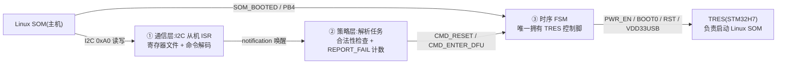

# TRES 电源/启动时序控制器 — 状态机分解与状态图(最终版)

角色分工:PY32F030(本文固件)是常电的**启动/复位控制器**;TRES(STM32H7)负责 **Linux SOM 的启动控制**;Linux SOM 启动完成后成为 **I2C 主机**(从机地址 0xA0),之后才能命令 PY32 对 TRES 做复位 / 进 DFU 等操作。

**启动链条**:板上电 → PY32 直接在 `PWR_UP` 态启动 TRES(BOOT0=0,从 FLASH 启动)→ TRES 运行 → TRES 启动 Linux SOM → SOM_BOOTED(PB4)拉高 → Linux 接管。

**无电源管理**:没有 OFF / SHUTDOWN / FAULT 状态,没有软关机。机器上电后一直带电运行;TRES 是否存活由 Linux 主机自行观察,PY32 只负责启动与复位/DFU 时序。

## 控制信号一览(见 `gpio.h`)

| 信号 | 引脚 | 方向 | 默认态 | 作用 |
|---|---|---|---|---|
| `TRES_PWR_EN` | PB6 | 输出 | 低(断电) | TRES 主电源使能(常开) |
| `TRES_RST` | PA8 | 输出 | 低(保持复位) | TRES NRST,推挽驱动,低=复位 |
| `TRES_BOOT0` | PB5 | 输出 | 低 | 启动模式选择,在 RST 释放瞬间被 H7 采样 |
| `TRES_VDD33USB_CTRL` | PA15 | 输出 | 低(关断) | TRES USB 3V3 轨;**仅进 DFU 时置 1** |
| `SOM_BOOTED`(输入) | PB4 | 下拉输入 | 低 | Linux SOM 启动完成信号,兼作启动链确认 |

## 三层分解

**反馈通路**:PY32 对 TRES 没有任何直接反馈(4 个控制脚全是输出)。因为 TRES 负责 SOM 启动,`SOM_BOOTED` 上升沿是"整条启动链成功"的链式间接确认;TRES app 层面的失败由 Linux 经 `CMD_REPORT_FAIL` **只计数上报**,PY32 不据此做任何动作。

- **① 通信层**:I2C1 从机 ISR 收字节进寄存器文件,收完一条命令 `qTask_Notification_Send()` 唤醒解析任务。ISR 内不做决策。
- **② 策略层**:校验命令合法性、维护 `REPORT_FAIL` 计数,把合法的 `CMD_RESET` / `CMD_ENTER_DFU` 投给时序 FSM。
- **③ 时序层**:核心状态机,10 ms 周期任务轮询,全部延时走 QuarkTS 超时,无阻塞。

## ③ 时序层完整状态图(最终版)

```mermaid
stateDiagram-v2
    direction TB

    [*] --> PWR_UP

    PWR_UP --> BOOT_WAIT_NORMAL : 超时 t_rail
    BOOT_WAIT_NORMAL --> RUNNING : SOM_BOOTED 上升沿(链式确认)
    BOOT_WAIT_NORMAL --> RUNNING : SOM_BOOTED 已为高 / 超时 t_appboot(宽限)

    RUNNING --> PULSE_RESET : CMD_RESET [BOOT0=0, VDD33USB=0]
    RUNNING --> PULSE_RESET : CMD_ENTER_DFU [BOOT0=1, VDD33USB=1]
    DFU_ACTIVE --> PULSE_RESET : CMD_RESET [BOOT0=0, VDD33USB=0](烧完重启回 app)

    PULSE_RESET --> BOOT_WAIT_NORMAL : BOOT0=0 / 超时 t_rst
    PULSE_RESET --> BOOT_WAIT_DFU : BOOT0=1 / 超时 t_rst
    BOOT_WAIT_DFU --> DFU_ACTIVE : 超时 t_enum

    PWR_UP : entry: PWR_EN=1, VDD33USB=0, BOOT0=0; RST 保持 0
    BOOT_WAIT_NORMAL : entry: 释放 RST(BOOT0=0 已采样)
    BOOT_WAIT_NORMAL : 等 SOM_BOOTED; 无超时, 起不来就一直等(C1)
    BOOT_WAIT_DFU : entry: 释放 RST(BOOT0=1 已采样, H7 进系统 DFU)
    RUNNING : TRES app + Linux 均在运行; VDD33USB=0; host_ready=1
    DFU_ACTIVE : 等待主机 dfu-util; VDD33USB 必须保持 1
    PULSE_RESET : entry: RST=0; 进门前按命令设好 BOOT0/VDD33USB

    note right of RUNNING
        REPORT_FAIL: 只把失败计数 +1(暴露在 STATUS/RETRIES
        给主机读), 不触发任何迁移 —— TRES 是否存活由主机判断
    end note

    note left of DFU_ACTIVE
        DFU 时 TRES 不再启动 SOM, SOM_BOOTED 不会上升;
        烧完由主机发 CMD_RESET(BOOT0=0, VDD33USB=0) 重启回 app,
        USB 轨随之关断
    end note
```

### 关键设计决策

1. **冷启动无条件 NORMAL,无电源管理**。初始状态就是 `PWR_UP`,机器上电即自启动 BOOT0=0,不需要主机、也不需要注入开机命令;不存在 OFF/关机/FAULT 路径。
2. **DFU 是"复位进入",不是"掉电进入"**。因为 SOM 由 TRES 启动、TRES 由 PY32 启动,冷启动阶段没有主机在线、不可能进 DFU;DFU 只在 SOM 起来后由主机发 `CMD_ENTER_DFU` 触发:源状态先置 `BOOT0=1`、`VDD33USB=1`,再进 `PULSE_RESET` 拉低 RST,超时后释放——H7 在 RST 释放瞬间采样 BOOT0=1,进系统 bootloader。全程不断电。
3. **BOOT0/VDD33USB 由源状态在进 `PULSE_RESET` 前置位**,保证它们在 RST 断言期间稳定;`PULSE_RESET` 超时后按 BOOT0 电平分流到正常启动或 DFU。因此不再需要 `mode` 变量。
4. **`REPORT_FAIL` 只计数、不迁移**。命令层直接 `s_failCnt++`,主机读 `RETRIES` 得知失败次数,PY32 不做任何自动动作(不重启、不锁存)。
5. **冷启动无监督超时**。`BOOT_WAIT_NORMAL` 只等 `SOM_BOOTED`,若 TRES 起不来就一直等,不留自动干预。

### 状态-引脚矩阵(对着原理图审查用)

| 状态 | PWR_EN | RST | BOOT0 | VDD33USB |
|---|---|---|---|---|
| PWR_UP | 1 | 0(复位保持) | 0 | 0 |
| BOOT_WAIT_NORMAL / RUNNING | 1 | 1(释放) | 0(保持) | 0 |
| PULSE_RESET(CMD_RESET) | 1 | 0(脉冲) | 0 | 0 |
| PULSE_RESET(CMD_ENTER_DFU) | 1 | 0(脉冲) | 1 | 1 |
| BOOT_WAIT_DFU / DFU_ACTIVE | 1 | 1(释放) | 1(保持) | 1 |

## ①② 层接口设计

### 命令与合法性矩阵(解析任务强制执行)

| 命令 | PWR_UP/BOOT_WAIT_NORMAL | RUNNING | PULSE_RESET | BOOT_WAIT_DFU | DFU_ACTIVE |
|---|---|---|---|---|---|
| `CMD_RESET` | ✗ | ✓(BOOT0=0) | ✗ | ✗ | ✓(退出 DFU,BOOT0=0) |
| `CMD_ENTER_DFU` | ✗ | ✓(BOOT0=1) | ✗ | ✗ | ✗(已在 DFU) |
| `CMD_REPORT_FAIL` | ✓(计数) | ✓(计数) | ✓(计数) | ✓(计数) | ✓(计数) |

`CMD_REPORT_FAIL` 在所有状态都接受、只计数不迁移;其余两条命令仅在 RUNNING / DFU_ACTIVE 有效。

### I2C 寄存器映射建议(从机地址 0xA0,已在 `i2c.c` 配好)

| 地址 | 名称 | R/W | 内容 |
|---|---|---|---|
| 0x00 | CMD | W | 3 字节生效:`0xA5, 命令码, 参数`;第三个字节(参数)被忽略,三条命令都不带参 |
| 0x10 | STATUS | R | bit[3:0]=FSM 状态号, bit4=host_ready, bit7=last_cmd_err |
| 0x11 | RETRIES | R | `CMD_REPORT_FAIL` 计数 |
| 0x12 | PINS | R | 四个控制脚 + SOM_BOOTED 快照 |
| 0x13 | LASTERR | R | 最近被拒命令的详细码(ILLEGAL / MAGIC) |
| 0x14 | VERSION | R | 接口版本(`TRES_IF_VERSION`) |

## 时间常量(初值为占位,必须实测)

| 常量 | 状态 | 建议初值 | 说明 |
|---|---|---|---|
| `t_rail` | PWR_UP | 50 ms | 主电源爬升,示波器实测 |
| `t_appboot` | BOOT_WAIT_NORMAL | 2 s | 复位重启场景的宽限(SOM_BOOTED 已高) |
| `t_rst` | PULSE_RESET | 20 ms | NRST 最小脉宽 + 外部电容充电 |
| `t_enum` | BOOT_WAIT_DFU | 3 s | DFU USB 枚举窗,别设太短 |

## QuarkTS 实现映射

- 时序 FSM:`qOS_Add_StateMachineTask(10 ms, qMedium_Priority)`;三处固定延时(`t_rail`/`t_rst`/`t_enum`)用 `const qSM_TimeoutStateDefinition_t` 表(照抄 `fsm_demo` 的 `s_fastTO` 写法,表存 flash);`BOOT_WAIT_NORMAL` 的 `t_appboot` 用 tick 手工比较。
- 命令管道:解析任务 → `qStateMachine_SendSignal()`;I2C ISR → 解析任务用 `qTask_Notification_Send()`。
- `REPORT_FAIL` 计数直接住在命令层(`s_failCnt`),不进 FSM,故永不触发迁移。
- `TRES_Data_t` 字段:`hostReady`、`somPrev`、`somRise`、`somFall`、`stateId`、`entryTick`——不再有 `mode` / `pendingNext` / `retries`。
- 若未来 MIX3 一路(PB7/PB8)也要管,同一套回调 + 引脚表实例化第二份(`fsm_demo` 多实例模式)。

## 硬件检查点

1. **防倒灌**:本版无 OFF/关机态,但上电瞬间 GPIO 默认低电平,`PWR_UP` 才拉高 PWR_EN——避免推挽高电平经 ESD 二极管给未上电的 H7 供电。
2. **【需确认的关键假设】TRES 复位不影响已运行 Linux SOM 的供电**:SOM 电源须独立于 TRES(TRES 只控制其*启动*,不负责其*供电*);复位进入 DFU 期间 SOM 需保持在线以驱动 dfu-util。
3. **NRST 冲突**:H7 自身也能驱动 NRST;若 app 不会主动拉 NRST,推挽可用;否则改开漏+上拉。
4. **VDD33USB 时序**:核对 H7 datasheet 中 VDDUSB 与主电源的上下电顺序要求;VDD33USB 关断期间主机侧不得驱动 DP/DM。
5. **DFU 前提**:确认 H7 选项字节 `BOOT_ADD1` 指向系统 bootloader(出厂默认通常是),否则 BOOT0=1 释放复位不会进 DFU。
