# 工作日志

> 本文件流式记录本项目（PY32F030 固件 + QuarkTS）的核心开发过程、实现方式与核心流程图。
> 新章节追加在文件末尾（不修改已记录的历史）。

---

## 2026-09-22 — AHT20 露点读取任务化：QuarkTS 周期测量（非阻塞）

### 工作时间

2026-09-22（当天完成，含需求澄清与方案确认）。

### 工作内容（背景与目标）

1. **新增 AHT20 露点 API**（阶段一，已撤换）：最初提供一个同步便捷 API，内部完成"读取温湿度 → 计算露点 → 直接返回"。
2. **改造为 QuarkTS 周期任务**（阶段二/最终）：读取过程做成一个 QuarkTS 定时器状态机任务，**每 10 s 测量一次露点**，外部通过缓存 getter 读取最新值。
3. **彻底去除忙等阻塞**（核心约束）：`aht20_delay_ms` 的毫秒级忙等必须消除，测量过程中的长等待必须让出 CPU，不能卡住其它 QuarkTS 任务（尤其是 TRES 时序 FSM）。
4. **初始化仅上电一次**：初始化（校准检查 + 0xBE 校准）只在启动时做一次；并修正**上电后需等待 ≥100 ms 才能访问传感器**的手册要求。

### 设计关键点与实现方式

**（1）QuarkTS 协作式没有同步让出原语**
确认该 QuarkTS 版本无 `vTaskDelay` 类原语，协作式调度的"让出"唯一方式 = **任务返回后由状态机 timeout 表决定下次激活**。因此把长延时全部编码为**状态机超时**（timeout 让出），而非忙等。

**（2）驱动层拆成非阻塞分步原语**
`aht20.c` 重构：删除 `aht20_delay_ms` 及同步测量链（`AHT20_Read` / `AHT20_ReadRaw`），改为：
- `AHT20_Init()` —— 读状态字判校准位 Bit[3]，未校准才发 0xBE，**不等待**；
- `AHT20_StartMeasure()` —— 仅发 0xAC 触发命令；
- `AHT20_ReadResult()` —— 读 7 字节 + busy 判断 + CRC8 + 20bit 换算。
以上内部只含 soft_i2c 位级 I2C 事务（约 0.1 ms，I2C 位时序必需，无法让出）。

**（3）QuarkTS 状态机任务 `aht20_task.c`**
- 一次性 `PWUP_WAIT`(≥100ms) → `INIT`(初始化) → 周期循环 `IDLE`(10s) → `MEAS_SEND`(0xAC,80ms) → `ST_READ`(读+算露点写缓存)；
- 优先级 `qLowest_Priority`，不干扰 TRES 的 `qMedium`；
- 失败只记录 `last_status`、缓存保留旧值，按下一 10s 周期重测（不做快速重试）。

**（4）缓存 + getter（外部零阻塞读取）**
新 `AHT20_Get_LastDewPointMilliCelsius()` 返回最近一次成功露点（未就绪返回 `INT32_MIN`）；`AHT20_Get_LastStatus()` 返回最近一次测量结果码。

**（5）main.c 精简**
移除调度前的同步测试 `Main_AHT20_DewPointTest`，改为在 TRES 之后注册 `AHT20_Task_Init()`。因为初始化已收进状态机，main 中不再需要调度前的 AHT20 初始化逻辑。

### 核心流程（最终状态机，Mermaid）

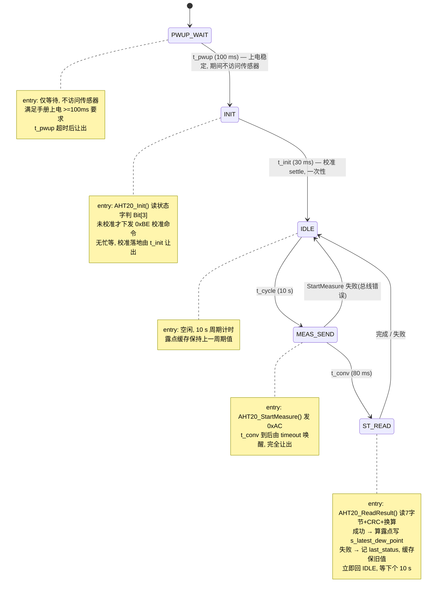

### 时间常量

| 常量 | 值 | 说明 |
|---|---|---|
| `t_pwup` | 100 ms | 上电稳定，手册要求 ≥100ms 后才能访问传感器 |
| `t_init` | 30 ms | 初始化（校准命令）后 settle |
| `t_cycle` | 10 s | 测量周期 |
| `t_conv` | 80 ms | 0xAC 触发后转换等待（手册明确"延 80ms 以上再读"） |

### 数据手册依据（奥松电子 AHT20 规格书，中文版）

- **5.1 启动传感器**：上电后需不少于 100ms 达到空闲状态才能接收命令（因此新增 `PWUP_WAIT`）。
- **5.4 读取流程**：上电后读状态字，`状态字 & 0x18 == 0x18` 判已校准；第一次校准时检查**只需上电时做一次**，正常采集无需操作（因此初始化收进一次性 `INIT`）。
- **测量**：发 0xAC（参数 0x33、0x00）后延时 80ms 以上再读，读取前判断 Bit[7]（busy）。
- 状态字：Bit[7]=busy，Bit[3]=CAL enable（校准使能）。

### 文件改动清单

| 文件 | 改动 |
|---|---|
| `Core/INC/aht20.h` | API 重构：保留 `Init`/`IsCalibrated`/`DewPointMilliCelsius`；删除 `AHT20_Read`/`ReadRaw`/`ReadDewPointMilliCelsius`；新增 `StartMeasure`/`ReadResult` |
| `Core/SRC/aht20.c` | 非阻塞化：删除 `aht20_delay_ms`；`Init` 只发命令不等待；`StartMeasure`/`ReadResult` 仅位级 I2C 事务 |
| `Core/INC/aht20_task.h`（新） | `AHT20_Task_Init` + 缓存 getter `Get_LastDewPointMilliCelsius`/`Get_LastStatus` |
| `Core/SRC/aht20_task.c`（新） | 状态机：`PWUP_WAIT → INIT →` 10s 周期测量循环 |
| `Core/SRC/main.c` | 移除调度前同步测试，改注册 `AHT20_Task_Init()` |
| `EIDE/.eide/eide.yml` | 登记 `aht20_task.c` |

### 验证与遗留

- **已通过静态校验**：删除符号无残留引用；头文件声明与实现一一对应；状态机 API/宏均在 `qfsm.h`/`qkernel.h` 中确认（`qLowest_Priority`、`QSM_TSOPT_*`、`QSM_SIGNAL_*`）。
- **待验证**：本环境无 EIDE/工具链 CLI，需在 PY32Studio / EIDE 实际编译烧录验证。
- `aht20.mmd`、`.zcodeignore` 等为独立会话遗留文件，未改动。

---

## 2026-09-22 — BUG 修复：`ST_READ` 的 entry 内状态迁移无效（实测卡死）

### 现象

上电后约 10.2s（100ms + 30ms + 10s + 80ms 后）第一次进入 `ST_READ`，之后**再也不会进入** `ST_READ`，测量循环终止。

### 根因（引擎源码确认）

QuarkTS 状态机引擎中，**进入状态的 entry 动作由 `qStateMachine_StateOnEntry()` 调用**（`qfsm.c`），该函数只 `InvokeStateCallback` 并**不检查 `h->NextState`**；只有 `qStateMachine_StateOnSignal()`（处理普通/超时信号）在处理完回调后才检查 `h->NextState` 并迁移。因此**在 `QSM_SIGNAL_ENTRY` 回调里赋值 `h->NextState` 会被引擎忽略**：

- `ST_READ` 的 entry 里 `h->NextState = &stIdle` 无效；
- `ST_READ` 未配超时表、也无其它信号 → 状态机永久卡死在 `ST_READ`；
- 同处隐患：`MEAS_SEND` entry 里的失败迁移也同样无效。

### 修复：所有迁移只走 timeout 信号

- **删除 `ST_READ` 状态**，把"读取 + 算露点 + 写缓存"合并进 `MEAS_SEND` 的 `t_conv` 超时回调；
- `MEAS_SEND`：entry 仅发触发命令（不迁移）；`t_conv` 超时时按 `lastStatus` 分流——失败跳过读取、成功则读取+算露点+缓存——然后迁回 `IDLE`；
- 全状态机所有 `h->NextState` 只出现在 `AHT20_TIMEOUT` 分支（经 `StateOnSignal`，迁移生效）；
- 在 `aht20_task.c` 头部注释记下该坑，防止回归。

### 修正后状态机（Mermaid）

```mermaid
stateDiagram-v2
    direction TB

    [*] --> PWUP_WAIT
    PWUP_WAIT --> INIT : t_pwup (100 ms) — 上电稳定
    INIT --> IDLE : t_init (30 ms) — 校准 settle, 一次性
    IDLE --> MEAS_SEND : t_cycle (10 s)
    MEAS_SEND --> IDLE : t_conv (80 ms) — 读取+算露点+缓存, 成败均回

    note right of PWUP_WAIT
        entry: 仅等待, 不访问传感器
    end note
    note right of INIT
        entry: AHT20_Init() 读状态字判 Bit[3], 未校准才下发 0xBE
    end note
    note right of MEAS_SEND
        entry: StartMeasure() 发 0xAC (不迁移)
        t_conv 超时: 成功→读取+算露点+缓存, 失败→跳过读取; 均回 IDLE
    end note
```

### 验证

- 静态校验：`ST_READ`/`stRead` 全消失；`h->NextState` 仅出现在 `AHT20_TIMEOUT` 分支；entry 分支无迁移。
- 循环应恢复为 10s 周期持续测量；需在硬件/EIDE 重新烧录实测确认。

---

## 2026-09-22 — AHT20 状态机 RAM 占用分析

> 本次为**评估存档**：分析一个 QuarkTS 状态机任务的 RAM 构成与可裁剪项，**不实施任何优化**。

### RAM 构成拆解（字段级，32 位 Cortex-M0+ 自然对齐）

`s_aht`（`AHT20_Task_t`）合计 **324 B**：

| 组成 | 类型 | 字节 |
|---|---|---|
| `task` | `qTask_t`（TCB） | 72 |
| `machine` | `qSM_t`（内嵌 top 状态 36 + handler 40 + 指针/队列槽） | 116 |
| `timeoutSpec` | `qSM_TimeoutSpec_t`（Q_FSM_MAX_TIMEOUTS=4 → 8×4+4） | 36 |
| `sigQueue` | `qQueue_t` | 28 |
| `sigStack[8]` | `qSM_Signal_t`×8 | 64 |
| `latestDewPointC` + `lastStatus` | int32 + int | 8 |

另加 4 个非 const 状态对象 `stPwup/stInit/stIdle/stMeasSend`（各 36 B）= **144 B**。

**归属本状态机合计 ≈ 468 B**（用户观察到的 ~400 主要为 `s_aht` 的 324 B）。

### 设计解释

`qTask_t`(72B TCB) + `qSM_t`(116B 完整状态机上下文，内嵌 top 状态和 handler) 是 QuarkTS 用成熟 FSM 内核换取**调度/让出/状态隔离**能力的固定成本，属设计取舍而非浪费。

### 优化空间（仅供后续参考，本次未实施）

**配置层（改 `Core/INC/qconfig.h`，影响整个内核）**

| 优化 | 省 RAM | 风险 |
|---|---|---|
| `Q_FSM_MAX_TIMEOUTS` 4→1 | 每 FSM 24 B（timeoutSpec 36→12） | 低：TRES 每状态也只用 INDEX(0) |
| 关订阅 `Q_FSM_PS_SIGNALS_MAX=0` / `Q_FSM_PS_SUB_PER_SIGNAL_MAX=0` | 文件级 160 B（psSignals[8]+psSubs[8][4]） | 低：TRES/AHT20 均未用发布/订阅 |
| `Q_TASK_COUNT_CYCLES=0` | 每任务 4 B | 低：无人读 cycles |
| `Q_ALLOW_TASK_NAMING=0` | 每任务 4 B | 低：无人 setName |
| `Q_TRACE_VARIABLES=0` | trace 缓冲 | 低（丢调试信息） |
| `Q_MEMORY_MANAGER=0` | 全局 ~1024 B 堆 | 需先确认无人用 `qMemAlloc` |

**应用层（改 `Core/SRC/aht20_task.c`，仅本任务）**

| 优化 | 省 RAM | 风险 |
|---|---|---|
| `sigStack[8]→[4]` | 32 B | 低：AHT20 只有 timeout 信号，8 条深度冗余 |

**澄清**：`Q_BYTE_ALIGNMENT=8` 仅作用于内存管理器的堆对齐，**不放大**这些结构体布局（对齐仍由编译器按 4 B 自然对齐决定）。

**决策记录**：用户确认本次不改代码、仅存档分析。

---

## TRES 电源/启动时序控制器 — 状态机分解与状态图（最终版）

> 以下内容于 2026-09-22 合并自独立设计文档 `tres_sequencer_state_diagram.md`（该文档同步归档入工作日志）。为贴合本日志结构，标题层级统一降一级。

角色分工：PY32F030（本文固件）是常电的**启动/复位控制器**；TRES（STM32H7）负责 **Linux SOM 的启动控制**；Linux SOM 启动完成后成为 **I2C 主机**（从机地址 0xA0），之后才能命令 PY32 对 TRES 做复位 / 进 DFU 等操作。

**启动链条**：板上电 → PY32 直接在 `PWR_UP` 态启动 TRES（BOOT0=0，从 FLASH 启动）→ TRES 运行 → TRES 启动 Linux SOM → SOM_BOOTED(PB4) 拉高 → Linux 接管。

**无电源管理**：没有 OFF / SHUTDOWN / FAULT 状态，没有软关机。机器上电后一直带电运行；TRES 是否存活由 Linux 主机自行观察，PY32 只负责启动与复位/DFU 时序。

### 控制信号一览（见 `gpio.h`）

| 信号 | 引脚 | 方向 | 默认态 | 作用 |
|---|---|---|---|---|
| `TRES_PWR_EN` | PB6 | 输出 | 低(断电) | TRES 主电源使能(常开) |
| `TRES_RST` | PA8 | 输出 | 低(保持复位) | TRES NRST，推挽驱动，低=复位 |
| `TRES_BOOT0` | PB5 | 输出 | 低 | 启动模式选择，在 RST 释放瞬间被 H7 采样 |
| `TRES_VDD33USB_CTRL` | PA15 | 输出 | 低(关断) | TRES USB 3V3 轨；**仅进 DFU 时置 1** |
| `SOM_BOOTED`(输入) | PB4 | 下拉输入 | 低 | Linux SOM 启动完成信号，兼作启动链确认 |

### 三层分解

**反馈通路**：PY32 对 TRES 没有任何直接反馈（4 个控制脚全是输出）。因为 TRES 负责 SOM 启动，`SOM_BOOTED` 上升沿是"整条启动链成功"的链式间接确认；TRES app 层面的失败由 Linux 经 `CMD_REPORT_FAIL` **只计数上报**，PY32 不据此做任何动作。

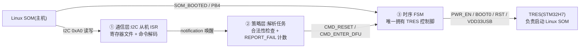

- **① 通信层**：I2C1 从机 ISR 收字节进寄存器文件，收完一条命令 `qTask_Notification_Send()` 唤醒解析任务。ISR 内不做决策。
- **② 策略层**：校验命令合法性、维护 `REPORT_FAIL` 计数，把合法的 `CMD_RESET` / `CMD_ENTER_DFU` 投给时序 FSM。
- **③ 时序层**：核心状态机，10 ms 周期任务轮询，全部延时走 QuarkTS 超时，无阻塞。

### ③ 时序层完整状态图（最终版）

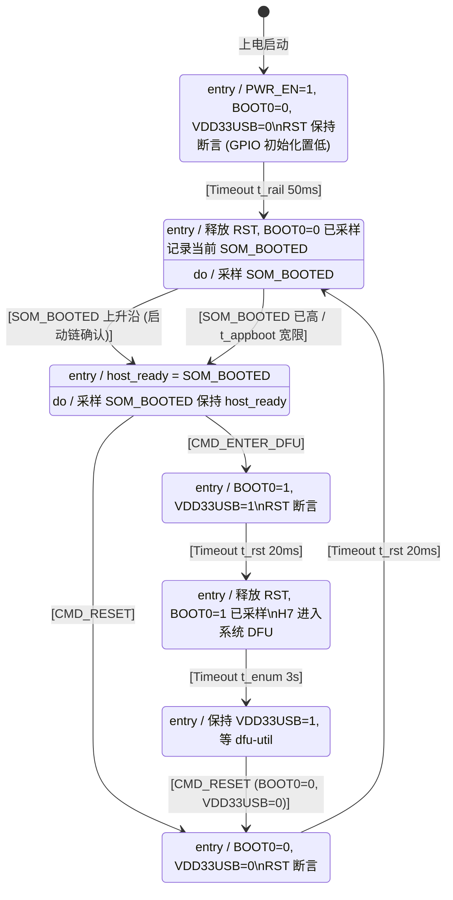

#### 关键设计决策

1. **冷启动无条件 NORMAL，无电源管理**。初始状态就是 `PWR_UP`，机器上电即自启动 BOOT0=0，不需要主机、也不需要注入开机命令；不存在 OFF/关机/FAULT 路径。
2. **DFU 是"复位进入"，不是"掉电进入"**。因为 SOM 由 TRES 启动、TRES 由 PY32 启动，冷启动阶段没有主机在线、不可能进 DFU；DFU 只在 SOM 起来后由主机发 `CMD_ENTER_DFU` 触发：源状态先置 `BOOT0=1`、`VDD33USB=1`，再进 `PULSE_RESET` 拉低 RST，超时后释放——H7 在 RST 释放瞬间采样 BOOT0=1，进系统 bootloader。全程不断电。
3. **BOOT0/VDD33USB 由源状态在进 `PULSE_RESET` 前置位**，保证它们在 RST 断言期间稳定；`PULSE_RESET` 超时后按 BOOT0 电平分流到正常启动或 DFU。因此不再需要 `mode` 变量。
4. **`REPORT_FAIL` 只计数、不迁移**。命令层直接 `s_failCnt++`，主机读 `RETRIES` 得知失败次数，PY32 不做任何自动动作（不重启、不锁存）。
5. **冷启动无监督超时**。`BOOT_WAIT_NORMAL` 只等 `SOM_BOOTED`，若 TRES 起不来就一直等，不留自动干预。

#### 状态-引脚矩阵（对着原理图审查用）

| 状态 | PWR_EN | RST | BOOT0 | VDD33USB |
|---|---|---|---|---|
| PWR_UP | 1 | 0(复位保持) | 0 | 0 |
| BOOT_WAIT_NORMAL / RUNNING | 1 | 1(释放) | 0(保持) | 0 |
| PULSE_RESET(CMD_RESET) | 1 | 0(脉冲) | 0 | 0 |
| PULSE_RESET(CMD_ENTER_DFU) | 1 | 0(脉冲) | 1 | 1 |
| BOOT_WAIT_DFU / DFU_ACTIVE | 1 | 1(释放) | 1(保持) | 1 |

### ①② 层接口设计

#### 命令与合法性矩阵（解析任务强制执行）

| 命令 | PWR_UP/BOOT_WAIT_NORMAL | RUNNING | PULSE_RESET | BOOT_WAIT_DFU | DFU_ACTIVE |
|---|---|---|---|---|---|
| `CMD_RESET` | ✗ | ✓(BOOT0=0) | ✗ | ✗ | ✓(退出 DFU,BOOT0=0) |
| `CMD_ENTER_DFU` | ✗ | ✓(BOOT0=1) | ✗ | ✗ | ✗(已在 DFU) |
| `CMD_REPORT_FAIL` | ✓(计数) | ✓(计数) | ✓(计数) | ✓(计数) | ✓(计数) |

`CMD_REPORT_FAIL` 在所有状态都接受、只计数不迁移；其余两条命令仅在 RUNNING / DFU_ACTIVE 有效。

#### I2C 寄存器映射建议（从机地址 0xA0，已在 `i2c.c` 配好）

| 地址 | 名称 | R/W | 内容 |
|---|---|---|---|
| 0x00 | CMD | W | 3 字节生效：`0xA5, 命令码, 参数`；第三个字节(参数)被忽略，三条命令都不带参 |
| 0x10 | STATUS | R | bit[3:0]=FSM 状态号， bit4=host_ready， bit7=last_cmd_err |
| 0x11 | RETRIES | R | `CMD_REPORT_FAIL` 计数 |
| 0x12 | PINS | R | 四个控制脚 + SOM_BOOTED 快照 |
| 0x13 | LASTERR | R | 最近被拒命令的详细码(ILLEGAL / MAGIC) |
| 0x14 | VERSION | R | 接口版本(`TRES_IF_VERSION`) |

### 时间常量（初值为占位，必须实测）

| 常量 | 状态 | 建议初值 | 说明 |
|---|---|---|---|
| `t_rail` | PWR_UP | 50 ms | 主电源爬升，示波器实测 |
| `t_appboot` | BOOT_WAIT_NORMAL | 2 s | 复位重启场景的宽限(SOM_BOOTED 已高) |
| `t_rst` | PULSE_RESET | 20 ms | NRST 最小脉宽 + 外部电容充电 |
| `t_enum` | BOOT_WAIT_DFU | 3 s | DFU USB 枚举窗，别设太短 |

### QuarkTS 实现映射

- 时序 FSM：`qOS_Add_StateMachineTask(10 ms, qMedium_Priority)`；三处固定延时（`t_rail`/`t_rst`/`t_enum`）用 `const qSM_TimeoutStateDefinition_t` 表（照抄 `fsm_demo` 的 `s_fastTO` 写法，表存 flash）；`BOOT_WAIT_NORMAL` 的 `t_appboot` 用 tick 手工比较。
- 命令管道：解析任务 → `qStateMachine_SendSignal()`；I2C ISR → 解析任务用 `qTask_Notification_Send()`。
- `REPORT_FAIL` 计数直接住在命令层（`s_failCnt`），不进 FSM，故永不触发迁移。
- `TRES_Data_t` 字段：`hostReady`、`somPrev`、`somRise`、`somFall`、`stateId`、`entryTick`——不再有 `mode` / `pendingNext` / `retries`。
- 若未来 MIX3 一路(PB7/PB8)也要管，同一套回调 + 引脚表实例化第二份（`fsm_demo` 多实例模式）。

### 硬件检查点

1. **防倒灌**：本版无 OFF/关机态，但上电瞬间 GPIO 默认低电平，`PWR_UP` 才拉高 PWR_EN——避免推挽高电平经 ESD 二极管给未上电的 H7 供电。
2. **【需确认的关键假设】TRES 复位不影响已运行 Linux SOM 的供电**：SOM 电源须独立于 TRES（TRES 只控制其*启动*，不负责其*供电*）；复位进入 DFU 期间 SOM 需保持在线以驱动 dfu-util。
3. **NRST 冲突**：H7 自身也能驱动 NRST；若 app 不会主动拉 NRST，推挽可用；否则改开漏+上拉。
4. **VDD33USB 时序**：核对 H7 datasheet 中 VDDUSB 与主电源的上下电顺序要求；VDD33USB 关断期间主机侧不得驱动 DP/DM。
5. **DFU 前提**：确认 H7 选项字节 `BOOT_ADD1` 指向系统 bootloader（出厂默认通常是），否则 BOOT0=1 释放复位不会进 DFU。

---

## 2026-09-22 — 风扇 RPM 测量周期任务化 + TEC 风扇控制架构

### 工作时间

2026-09-22。

### 背景与目标

- 把风扇 RPM 测量从忙等的 `Fan_GetRPM()` 改为**非阻塞**（Run-to-complete）。
- 采纳架构结论：风扇**用普通周期任务而非状态机**。
- 采样配置：**周期 = 窗口 = 2 s**，本地缓存 + getter，不接 I2C。

### 架构结论（回答"风扇后期结合 TEC 电流/温度如何维护"）

采用**分层「采集层 + 控制层」**，用普通周期任务而非状态机：

- **采集层（测量）**：RPM 采样（本任务）、未来 TEC 电流 ADC / NTC 温度，各自为普通周期任务，只做"读采样→存缓存"，非阻塞；
- **控制层（策略）**：未来一个普通周期任务，每周期读各缓存 getter（电流/温度/RPM）算 duty → `Fan_SetDutyPercent`，纯计算无阻塞；
- 两层仅通过**缓存 getter 单向通信**；层次状态机留作后期"工作模式+保护"（IDLE/RUN/OVERTEMP/FAULT）用。
- **为什么不用状态机**：风扇 RPM 是**单一均匀采样窗口**，不像 AHT20 单次测量内含多个不等时长等待阶段，普通周期任务即可非阻塞采样，状态机只会增加无谓开销。

### 实现方式

1. 新增 `Core/INC/fan_task.h` + `Core/SRC/fan_task.c`（普通周期任务）：
   - `Fan_Task_Init()`：`qOS_Add_Task( Fan_Task_Cb, qLowest_Priority, 2.0f, qPeriodic, qEnabled, NULL )`；
   - `Fan_Task_Cb()` 每 2s 一次：读 tach 增量算 RPM 存缓存（首次只设基线，防脉冲累计误读）；`pulses - prevPulses` 无符号减法处理回绕；
   - `uint32_t Fan_Get_LastRPM(void)` 缓存 getter（风扇关闭时 RPM=0 为合法读值）。
2. 改造 `Core/SRC/fan.c` / `Core/INC/fan.h`：删除忙等 `Fan_GetRPM()`，移除冗余 include `qport_py32.h`；保留即时控制 API（`Fan_SetDutyPercent`/`Fan_SetEnabled`/`Fan_GetTachPulses` 等）供未来控制层使用。
3. `Core/SRC/main.c`：在 `AHT20_Task_Init()` 后注册 `Fan_Task_Init()`。
4. `EIDE/.eide/eide.yml`：登记 `fan_task.c`。

### 流程（Mermaid）

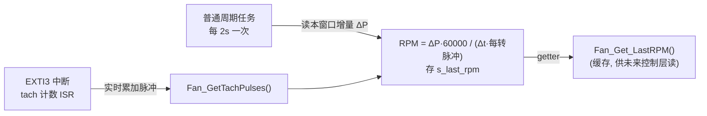

### 时间常量

| 常量 | 值 | 说明 |
|---|---|---|
| 任务周期 | 2 s | 同时也是 RPM 采样窗口 |
| `FAN_TACH_PULSES_PER_REV` | 2 | tach 每转脉冲数 |

### 文件改动清单

| 文件 | 改动 |
|---|---|
| `Core/INC/fan_task.h`（新） | `Fan_Task_Init` + `Fan_Get_LastRPM` |
| `Core/SRC/fan_task.c`（新） | 普通周期任务 RPM 采样 |
| `Core/INC/fan.h` / `Core/SRC/fan.c` | 删除忙等 `Fan_GetRPM`；移除冗余 include |
| `Core/SRC/main.c` | 注册 `Fan_Task_Init` |
| `EIDE/.eide/eide.yml` | 登记 `fan_task.c` |

### 验证与遗留

- 静态校验通过（无忙等残留、声明与接线一致）。
- 控制层（TEC 结合电流/温度）本次不实现，仅预留 `Fan_Get_LastRPM` 缓存 getter 出口；未来新增 ADC/NTC 采样任务 + 控制任务即可，测量层无需改动。

---

## 2026-09-22 — TRES 状态机更新：PULSE_RESET 拆分为两个状态

### 工作时间

2026-09-22。

### 变更内容

将原单一 `PULSE_RESET` 状态拆分为**两个目标唯一**的状态：

- `PULSE_RESET_NORMAL`：entry 置 `BOOT0=0`、`VDD33USB=0`、`RST=0`；`t_rst` 超时后**固定**流向 `BOOT_WAIT_NORMAL`；
- `PULSE_RESET_DFU`：entry 置 `BOOT0=1`、`VDD33USB=1`、`RST=0`；`t_rst` 超时后**固定**流向 `BOOT_WAIT_DFU`；
- 不再需要"按 BOOT0 电平分流"逻辑（`Pins_Boot0Level()` 已删除）；BOOT0/VDD33USB 的控制线归属改为在各自状态 entry 中设置，保证 RST 断言期间稳定。

### 影响

- `Core/INC/tres_seq.h`：`TRES_State_t` 枚举由 `TRES_PULSE_RESET` 拆为 `TRES_PULSE_RESET_NORMAL`(3) / `TRES_PULSE_RESET_DFU`(4)，后续状态顺延（原 3 号由 NORMAL 承继，保持兼容）。
- `Core/SRC/tres_seq.c`：状态对象/回调/订阅/超时拆分；`st_Running` 的 `CMD_RESET→NORMAL`、`CMD_ENTER_DFU→DFU`；`st_DfuActive` 退出 DFU → `PULSE_RESET_NORMAL`（entry 负责清 BOOT0/USB）。
- `tres_sequencer_state_diagram.md`：状态图、关键设计决策、状态-引脚矩阵、命令合法性矩阵、时间常量均已同步。

### 更新后状态机（Mermaid）

```mermaid
stateDiagram-v2
    direction TB
    [*] --> PWR_UP
    PWR_UP --> BOOT_WAIT_NORMAL : t_rail
    BOOT_WAIT_NORMAL --> RUNNING : SOM_BOOTED 上升沿
    BOOT_WAIT_NORMAL --> RUNNING : SOM_BOOTED 已高 / t_appboot
    RUNNING --> PULSE_RESET_NORMAL : CMD_RESET
    RUNNING --> PULSE_RESET_DFU    : CMD_ENTER_DFU
    DFU_ACTIVE --> PULSE_RESET_NORMAL : CMD_RESET
    PULSE_RESET_NORMAL --> BOOT_WAIT_NORMAL : t_rst
    PULSE_RESET_DFU    --> BOOT_WAIT_DFU    : t_rst
    BOOT_WAIT_DFU      --> DFU_ACTIVE       : t_enum
    note right of PULSE_RESET_NORMAL
        entry: BOOT0=0, VDD33USB=0, RST=0; 超时释放, 唯一去向 BOOT_WAIT_NORMAL
    end note
    note right of PULSE_RESET_DFU
        entry: BOOT0=1, VDD33USB=1, RST=0; 超时释放, 唯一去向 BOOT_WAIT_DFU
    end note
```

### 验证

- 静态校验通过：旧的 `stPulseReset` / `Pins_Boot0Level` / `TRES_PULSE_RESET` 无任何残留；新符号在枚举、迁移、订阅、超时处引用齐全。
- 待 PY32Studio/EIDE 编译烧录验证。

---

## 2026-09-22 — 状态命名统一：AHT20 去 `ST_` 前缀 + TRES 枚举去 `ST_` 段

### 工作时间

2026-09-22。

### 变更内容（统一状态机命名风格）

消除容易引起歧义的 `ST_` 风格命名，统一为语义化命名：

- **AHT20 状态机**（mermaid / 文档引用）：
  - `ST_PWUP_WAIT` → `PWUP_WAIT`
  - `ST_INIT` → `INIT`
  - `ST_IDLE` → `IDLE`
  - `ST_MEAS_SEND` → `MEAS_SEND`
  - 代码变量 `stPwup` / `stInit` / `stIdle` / `stMeasSend` 保持不变（小写风格，与 TRES 的 `stRunning` 一致）。
- **TRES 状态枚举**（`TRES_State_t`）：
  - `TRES_ST_PWR_UP` → `TRES_PWR_UP`
  - `TRES_ST_BOOT_WAIT_NORMAL` → `TRES_BOOT_WAIT_NORMAL`
  - `TRES_ST_RUNNING` → `TRES_RUNNING`
  - `TRES_ST_PULSE_RESET_NORMAL` → `TRES_PULSE_RESET_NORMAL`
  - `TRES_ST_PULSE_RESET_DFU` → `TRES_PULSE_RESET_DFU`
  - `TRES_ST_BOOT_WAIT_DFU` → `TRES_BOOT_WAIT_DFU`
  - `TRES_ST_DFU_ACTIVE` → `TRES_DFU_ACTIVE`
  - 枚举**数值顺序不变**，主机读 `STATUS` bit[3:0] 的数值兼容。

### 影响文件

| 文件 | 改动 |
|---|---|
| `Core/SRC/aht20_task.c` / `Core/INC/aht20_task.h` | mermaid 与注释去 `ST_` 前缀 |
| `Core/INC/tres_seq.h` | 枚举值 `TRES_ST_*` → `TRES_*` |
| `Core/SRC/tres_seq.c` / `Core/SRC/tres_cmd.c` | 同步枚举引用 |
| `WORKLOG.md` | 同步历史章节命名 |

### 验证

- 全项目（代码/头文件）`TRES_ST_` 无残留；AHT20 现存状态 `ST_*` 无残留。
- 枚举数值不变，主机接口兼容。
- 待 PY32Studio/EIDE 编译烧录验证。

---

## 2026-09-22 — 状态机状态图风格统一（`STATE_*` + 复合子状态）

### 工作时间

2026-09-22。

### 变更内容

将状态机的**可视化状态图**统一为「`STATE_*` 前缀 + 复合子状态（`state { ... }`）」风格。**仅修改文档图，不改动任何状态机代码逻辑**。

- **AHT20 状态图**（`Core/SRC/aht20.mmd`）：按数据手册测量流程展开为 `STATE_*` + 复合子状态，见下图。
- **TRES 时序层状态图**（`tres_sequencer_state_diagram.md`）：改为 `STATE_*` + 复合子状态风格，迁移逻辑不变（7 个 enum 状态对应 `STATE_*` 顶层状态）。

### AHT20 状态图（Mermaid，示例风格）

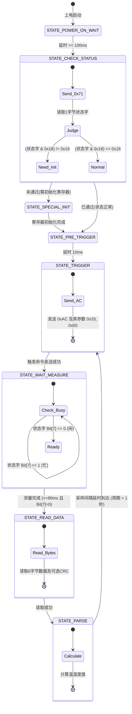

### TRES 状态图（Mermaid，STATE_* + 复合风格）

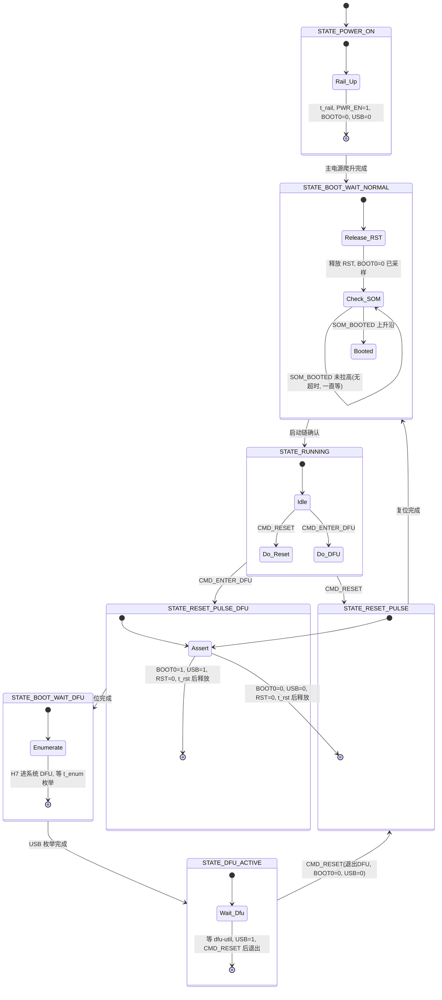

### 影响文件

| 文件 | 改动 |
|---|---|
| `Core/SRC/aht20.mmd` | AHT20 状态图 → `STATE_*` + 复合子状态风格 |
| `tres_sequencer_state_diagram.md` | TRES 时序层状态图 → `STATE_*` + 复合子状态风格 |
| `WORKLOG.md` | 本节记录 |

### 验证

- 仅改文档图（`.mmd`、`.md`）；**未改任何 `.c`/`.h` 代码文件**，状态机逻辑无任何变动。

---

## 2026-09-23 — AHT20 状态图命名与代码对齐（附录：实际 FSM 映射）

### 背景

为让 AHT20 状态机与数据手册测量流程直接对应（不再把流程压缩进 4 个状态），本次把 `Core/SRC/aht20_task.c` 重构为**对齐数据手册 8 个主状态**的方框状态机。8 个主状态一一对应数据手册方框，另加 1 个 `SAMPLE_WAIT` 承载采样周期（数据手册上表现为 `PARSE → TRIGGER` 那条"采样间隔延时到达"边缘，在 QuarkTS 中必须由某状态持有超时）。校准判定按数据手册改用 `0x18`。

按本日志「不修改历史」约定，以追加章节归档；本节即实际实现（以本节为准）。

### 实际状态机（方框图，与 `aht20_task.c` 一致）

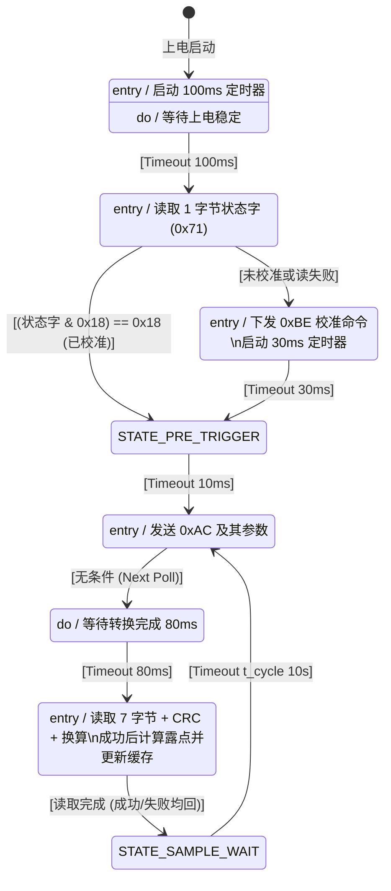

### 命名映射（文档 ↔ 代码）

| 状态图名 | 状态对象 | 回调 | 超时 | 说明 |
|---|---|---|---|---|
| `STATE_POWER_ON_WAIT` | `stPowerOnWait` | `st_PowerOnWait_Cb` | `t_pwup` (100 ms) | 上电稳定, 不访问传感器 |
| `STATE_CHECK_STATUS` | `stCheckStatus` | `st_CheckStatus_Cb` | (决策) | 读状态字判 `0x18` |
| `STATE_SPECIAL_INIT` | `stSpecialInit` | `st_SpecialInit_Cb` | `t_init` (30 ms) | 下发 0xBE 校准 |
| `STATE_PRE_TRIGGER` | `stPreTrigger` | `st_PreTrigger_Cb` | `t_pre` (10 ms) | 触发前延时 |
| `STATE_TRIGGER` | `stTrigger` | `st_Trigger_Cb` | (决策) | 发 0xAC 触发 |
| `STATE_WAIT_MEASURE` | `stWaitMeasure` | `st_WaitMeasure_Cb` | `t_conv` (80 ms) | 转换等待 |
| `STATE_READ_DATA` | `stReadData` | `st_ReadData_Cb` | (决策) | 读 7 字节 + CRC + 换算, 成功后算露点缓存 |
| `STATE_SAMPLE_WAIT` | `stSampleWait` | `st_SampleWait_Cb` | `t_cycle` (10 s) | 采样周期承载 |

### 澄清

- **7 个主状态** + `SAMPLE_WAIT` 承载采样周期；`SAMPLE_WAIT` 是数据手册 `PARSE → TRIGGER` 边上"采样间隔延时到达(周期>1s)"的承载状态，为满足 QuarkTS 非阻塞而存在（露点计算已在 `READ_DATA` 内完成，无需独立 `PARSE` 状态）。
- **决策状态**（`CHECK_STATUS` / `TRIGGER` / `READ_DATA`）不设超时表：entry 只读/动作，在 `QSM_SIGNAL_NONE` 轮询分支设 `h->NextState` 完成分流（引擎在 `StateOnSignal` 检查 `NextState`，因此进态即决策；不违反"ENTRY 内不迁移"约束）。
- **恒定延时状态**（`POWER_ON_WAIT` / `SPECIAL_INIT` / `PRE_TRIGGER` / `WAIT_MEASURE` / `SAMPLE_WAIT`）用 flash 超时表让出 CPU。
- **校准判定按数据手册用 `0x18`**（Bit[3]+Bit[4] 同时置位才算已校准），影响 `AHT20_Init` / `AHT20_IsCalibrated`；驱动新增 `AHT20_ReadStatus()` 供 `CHECK_STATUS` 独立读状态字。
- 数据手册的 busy 轮询在非阻塞设计中改为固定 `t_conv`(80ms) 超时；`READ_DATA` 失败时保持旧缓存值进 `SAMPLE_WAIT`，不快速重试。

---

## 2026-09-23 — 风扇 RPM 周期任务流程状态图（附录）

> fan_task 是**普通周期任务**（`qOS_Add_Task(..., qPeriodic, 2.0f)`），不是 QuarkTS 状态机。下图用状态机风格（`STATE_X : entry/do` + `[Timeout]`）表达其**每 2s 一次的采样流程**，便于与 AHT20/TRES 图统一阅读；图中的"状态"实为同一回调 `Fan_Task_Cb` 内的一次次调用。tach 计数由 EXTI3 中断实时累加，与任务回调并行。

### 周期任务流程（Mermaid，对应 `Core/SRC/fan_task.c`）

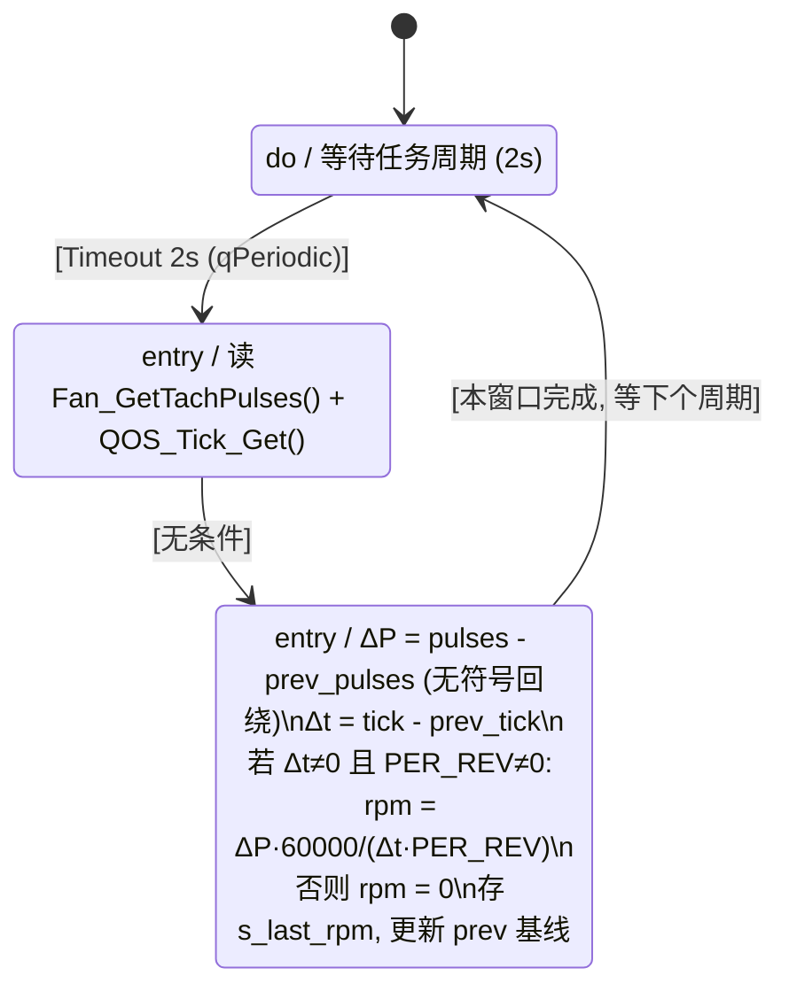

### 说明

- **非阻塞**：回调 run-to-complete 即返回，无忙等；`SAMPLE_WAIT` 的 2s 由 QuarkTS 周期调度让出 CPU。
- **首次调用**：`prev_*` 初始为 0 → 首窗口 ΔP 偏大但不影响长期测量；风扇关闭时 ΔP 恒 0 → RPM=0（合法读值）。
- **getter**：`Fan_Get_LastRPM()` 返回 `s_last_rpm` 缓存，供未来控制层读取。
- 之所以用普通周期任务而非状态机：风扇 RPM 是单一均匀采样窗口，不像 AHT20 单次测量内含多个不等时长等待阶段。

---

## 2026-09-23 — FLASH 参数持久化 API（nv_params）

### 工作时间

2026-09-23。

### 背景与目标

新增一个读写内部 FLASH 的 API，用于持久化一些固定/校准参数（非易失）。选型结论：**类型化参数表 + 单块直写 + 顶部 4KB 扇区预留**。

### 硬件事实

- 目标 **PY32F030K28U6**：FLASH 64KB、页 128B、扇区 4KB（基址 `0x08000000`）。
- 原无参数预留区，本次从顶部划最后一个扇区 `0x0800F000`~`0x0800FFFF`。
- flash 读写走 **HAL 封装**（`HAL_FLASH_Erase`/`HAL_FLASH_Program`），内部自动配置 32MHz 时序并忙等，规避 raw LL 缺 32M 时序宏的问题。页写要求地址 128B 页对齐、一次性写满 32 字整页。

### 设计

- 新模块 `Core/INC/nv_params.h` + `Core/SRC/nv_params.c`，命名 `NvParams_*`。
- **块布局**（恰好一页 128B）：`magic(4) + version(4) + crc32(4) + params[29](116)`。
- **API**：`NvParams_Init`（上电读 flash→校验 magic/version/crc→填缓存，失败载默认值，不写 flash）、`NvParams_Get/Set`（RAM 缓存）、`NvParams_Save`（擦页+写整页，先算 CRC，加临界区）、`NvParams_RestoreDefaults`。
- **写策略**：单块直写（每次擦同一页重写，约 1 万次擦写寿命），适合参数低频写入（校准/配置）。
- **CRC-32**：反射式 ISO-HDLC（poly `0xEDB88320`，检查值 `crc32("123456789")==0xCBF43926`），对 `params[]` 原始字节计算；经往返模拟验证一致。

### 文件改动清单

| 文件 | 改动 |
|---|---|
| `Core/INC/nv_params.h`（新） | 参数槽枚举 + API 声明 |
| `Core/SRC/nv_params.c`（新） | 块结构、CRC、Init/Get/Set/Save/RestoreDefaults |
| `Core/SRC/main.c` | `Fan_Init` 后调用 `NvParams_Init()` |
| `EIDE/PY32F030K28U6-E.ld` | `FLASH LENGTH 64K→60K` 预留参数扇区并注释 |
| `EIDE/.eide/eide.yml` | 登记 `nv_params.c` |
| `WORKLOG.md` | 本节记录 |

### 验证与遗留

- 静态校验通过：API 声明/实现一致、块大小 128B（`_Static_assert`）、CRC 往返自洽、链接脚本改动生效。
- 待 PY32Studio/EIDE 编译烧录实测：读写正确性、掉电保持、以及 `HAL_FLASH_Program` 对整页缓冲的对齐要求。
- 默认值 `s_defaults[]` 目前全为 0，需按实际生产参数填充。

---

## 2026-09-23 — 集成 EPID（Embedded-PID）库 + TEC PID 封装

### 背景与目标

为 TEC 温度控制引入 PID 库。经对比 GitHub 多个候选（`abderraouf-adjal/Embedded-PID`、`pms67/PID`、`rubinsteina13/C_PID...`、`br3ttb/Arduino-PID`），选定 **Embedded-PID**：纯 C99、ISC 许可、零依赖、抗积分饱和 + 输出限幅 + D 项 IIR 滤波，契合 TEC 控制（电流饱和与温度噪声是主要问题）。Arduino 版（C++、依赖框架）不适用裸机工程，已排除。

### 库特性（Type-C 增量式）

- `P[k]=Kp·(x[k-1]-x[k])`；`I[k]=Ki·(SP-x[k])`；`D[k]=Kd·(2·x[k-1]-x[k-2]-x[k])`
- `y[k]=y[k-1]+Δy`（增量累积），`epid_util_ilim` 抗积分饱和，`epid_pid_sum` 输出限幅，`epid_util_lpf_*` D 项低通。
- `#if 1` 强制开启 `EPID_FEATURE_VALID_FLT`（`isfinite/isnan`，GCC 内建宏，裸机 M0 可用，无需额外 libm 符号）。

### 集成内容

| 文件 | 来源/改动 |
|---|---|
| `Core/INC/pid.h` + `Core/SRC/pid.c`（新） | 克隆自 Embedded-PID v1.1.3，保留 ISC 头 |
| `Core/INC/tec_pid.h` + `Core/SRC/tec_pid.c`（新） | 本项目的 TEC 封装：`TecPid_Init/Update/GetOutput/Reset/SetSetpoint`，内置抗积分饱和与输出限幅，可选 D 项滤波 |
| `EIDE/.eide/eide.yml` | 登记 `pid.c`、`tec_pid.c` |

### 说明

- 编译配置：C11、`softfp`、newlib-nano、`-lm`（已在 linker `LIB_FLAGS`），满足 `isnan/isfinite` 与浮点。
- `pid.h` 用 `#if 1` 硬开校验宏；如需进一步精简（如省 `-lm` 依赖）可改为 `#if 0`，但会失去 NaN/INF 防护，暂不这么做。
- `TecPid_t` 的封装接口以"设定目标温度 + 注入实测温度 + 取输出（已限幅于 `[out_min,out_max]`）"组织，输出为有符号量（冷却/加热方向由调用方映射到 H 桥/PWM 极性）。

### 待办

- 待 PY32Studio/EIDE 编译烧录；接入 TEC 控制任务（工作日志规划的"采集层→控制层"）时再定增益标定与输出极性映射。

---

## 2026-09-27 — SDM845 启动控制状态机（修订版）

### 背景

新增高通 SDM845 启动控制流程，核心是控制两个 GPIO：`PWRKEY`（电源键）与 `RST_KEY`（Vol- / 复位键）。流程目标：上电→按电源键开机→串口探测启动成功→成功移交控制权；若探测不到则"强杀"重启重试。

本修订版针对初稿的 3 处逻辑缺陷做了修复（**无重试上限**、**释放按键依赖 exit**、**成功判据与超时纠缠**）；缺陷 4"成功即 `[*]` 一次性结束"为刻意设计，予以保留。

### 修订后状态机（Mermaid）

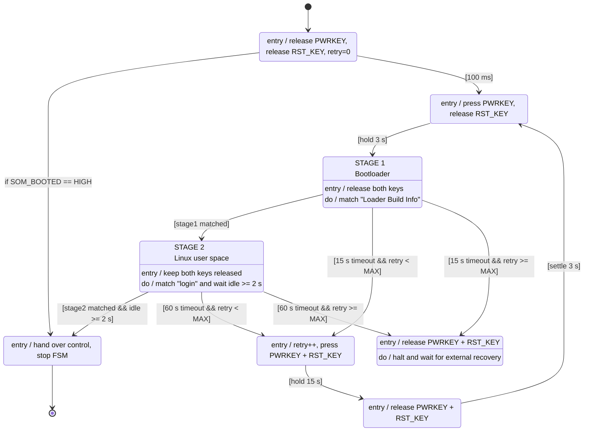

### 修复点

1. **重试上限（缺陷 1）**：`retry_count` 在 `POWER_ON_WAIT` 清零、进 `BOOT_RESET` 递增；`BOOT_CHECK` 超时后分流——`< MAX` 强杀重试，`≥ MAX` 进 `STATE_STRAP_FAIL` 挂起，不再无限 15s 强杀。`MAX` 用宏 `SDM845_BOOT_MAX_RETRIES`（建议 3）。
2. **释放按键改为"进态即置"（缺陷 2）**：删除 `PWR_PRESS`/`BOOT_RESET` 的 `exit` 松键，改为 `BOOT_CHECK`/`PMIC_SETTLE` 的 entry 显式拉回释放，避免依赖 exit 回调未触发导致按键滞留。
3. **成功判据明确 + 成功优先于超时（缺陷 3）**：成功 = `RCV_COUNT≥阈值` 且在窗口 `W` 内有增量；每次轮询先判成功，仅当一直不成功拖到 15s timeout 才走失败分支。

### 硬件待确认

- **`RST_KEY` 引脚物理接法**：若接 `RESIN_N`，15s PWRKEY+RST 为 PMIC 强制断电重启，与"强杀"意图一致；若实际是 VOL 键复用，15s 长按可能进 Fastboot/EDL 而非重启，需在原理图确认后决定是否调整流程。
- `PMIC_SETTLE` 3s 可能偏短，SDM845 断电/重上电序列建议放宽到 5~8s 并实测。

### 状态

该状态机目前为**文档定义**，尚未落地为 QuarkTS 代码（未新建源文件）。待确认硬件接法与是否需要落地实现后，再按 `tres_seq.c` 的超时表 + NONE 轮询决策写法新建 `sdm845_boot` 模块。

---

## 2026-09-28 — USART2（PA0/PA1）DMA 接收实例

### 背景与目标

新增一个串口 **USART2（PA0=TX、PA1=RX）** 的 DMA 接收实例，用于不定长串口帧接收。基于新增的英文参考手册（`datasheet/PY32F030_Reference_Manual_V1.6.pdf`）确认了 PY32F030 的 DMA 请求机制。

### 手册关键结论

- **PY32F030 的 DMA 请求映射不是每通道固定，而是用 `SYSCFG_CFGR3` 寄存器的 `DMAx_MAP` 字段路由**（参考手册 10.1.3）：每个 DMA 通道通过 `DMA1_MAP`/`DMA2_MAP`/`DMA3_MAP` 选择外设请求。
- **`USART2_RX` 请求码 = `0b01000`（0x08）**，`USART2_TX` = `0b00111`（DMA 请求映射表 11-3）。
- **DMA1 只有 3 个通道**（`DMA1_Channel1/2/3`）。
- **USART_CR3 的 `DMAR`(bit6)** 使能 DMA 接收（26.5.6）。
- 中断入口：`DMA1_Channel1_IRQn`、`USART2_IRQn`。

### 实现方式

- 新模块 `Core/INC/usart2_dma.h` + `Core/SRC/usart2_dma.c`：
  - `USART2_DMA_Start()`：`SYSCFG->CFGR3.DMA1_MAP = 0x08`（路由到 USART2_RX）→ 配置 `DMA1_Channel1` **环形模式**（外设→内存、字节/字节、内存递增）→ 源地址 `LL_USART_DMA_GetRegAddr(USART2)`，目的 256B 缓存 → 使能 USART2 `DMAR` 与 IDLE 中断 + NVIC。
  - `USART2_DMA_HandleIdle()`：USART2 **IDLE 中断**判定一帧结束，读回 DMA 剩余计数 `LL_DMA_GetDataLength` 计算新增字节，调用可选用户回调。
  - `USART2_DMA_Read()`：按环形指针读出缓存中新增字节。
  - `USART2_DMA_Stop()` / `USART2_DMA_SetCallback()`。
- `Core/SRC/py32f030_it.c`：新增 `USART2_IRQHandler` → `USART2_DMA_HandleIdle()`。
- `Core/SRC/main.c`：`Studio_USART2_Init()` 后调用 `USART2_DMA_Start()`。
- `EIDE/.eide/eide.yml`：登记 `usart2_dma.c`。

### 文件改动清单

| 文件 | 改动 |
|---|---|
| `Core/INC/usart2_dma.h`（新） | API + 说明 |
| `Core/SRC/usart2_dma.c`（新） | SYSCFG 路由 + DMA1_CH1 环形接收 + IDLE 帧边界 |
| `Core/SRC/py32f030_it.c` | 新增 `USART2_IRQHandler` |
| `Core/SRC/main.c` | 调用 `USART2_DMA_Start()` |
| `EIDE/.eide/eide.yml` | 登记 `usart2_dma.c` |

### 验证与遗留

- 静态校验通过：19 个 LL DMA/USART API 均在头文件存在、头/实现 5 个 API 一一对应、中断/main/eide 接线齐全。
- 待 PY32Studio/EIDE 编译烧录实测：`SYSCFG_CFGR3` 请求码映射与环形读逻辑是重点验证点；帧边界判定依赖 IDLE 中断，波特率/帧间空闲需实测。

---

## 2026-09-28 — SDM845 探测重构：IDLE 帧边界 → 内容匹配 + 空闲超时

### 背景 / 问题

USART2 DMA 接收最初用于 SDM845 启动判断（工作日志 §SDM845 启动控制状态机），但**用 IDLE 中断做帧边界不可靠**：

- 手册（USART_SR）确认 IDLE = **RX 线保持高电平满一个完整字符帧（约 10 bit / 波特率）**才触发，即"字节流出现停顿"事件，**不是行结束**；
- `\r\n` 只是两个普通字节，不会让 RX 线空闲；Linux shell **持续输出时 IDLE 根本不触发**；
- 因此"接 Linux shell、大量回车换行输出"场景下，IDLE 无法作为分隔，且会因输出不停而读不到数据/环形缓冲溢出。

### 新架构

接收层与判定层解耦：

| 层 | 文件 | 职责 |
|---|---|---|
| 接收层 | `Core/INC/usart2_dma.h` + `usart2_dma.c` | **去掉 IDLE 中断/回调**，只保留 DMA1_CH1 环形缓冲 + `USART2_DMA_Read()`（按 DMA 写指针 = `BUF_LEN - CNDTR` 推导读位置，环形回绕处理） |
| 判定层 | `sdm845_detect.h`（新）+ `sdm845_detect.c`（新） | QuarkTS 周期任务（20ms）轮询环形缓冲，喂 **KMP 流式匹配自动机**（`fail[]` 表 + 跨调用保持状态 `s_q`），匹配目标串 `"Loader Build Info"`；同时用 `QOS_Tick_Get()` 记录最后收字节时刻，计算空闲时长 |

**启动成功判定** = 目标串 `"Loader Build Info"` 已匹配 **且** 线路已空闲 ≥ `SDM845_BOOT_IDLE_MS`（默认 2s，锁存）；`Sdm845_Detect_IsBooted()` / `GetIdleMs()` 供 SDM845 状态机查询。

### 关键正确性验证（本地模拟）

用 Python 复刻 KMP `feed()` 逐字节流式匹配，验证：

- 目标串被 `\r\n` 噪声包围 / 跨多次分片读取 / 环形回绕 → 均正确命中；
- 目标串**内部**被插入 `\r\n`（非连续子串）→ 正确判为不匹配（目标串是 shell 中完整的连续一行）；
- 纯 `\r\n` 风暴 → 无误报。

### 文件改动

| 文件 | 改动 |
|---|---|
| `usart2_dma.h` / `usart2_dma.c` | 删 IDLE 中断/`HandleIdle`/`SetCallback`；改按 DMA 写指针读取环形缓冲 |
| `sdm845_detect.h` / `sdm845_detect.c`（新） | KMP 流式匹配 + 空闲超时 + QuarkTS 周期任务 |
| `py32f030_it.c` | 移除 `USART2_IRQHandler` / `usart2_dma.h` include（不再用 IDLE 中断） |
| `main.c` | `USART2_DMA_Start()` 后注册 `Sdm845_Detect_Init()` |
| `EIDE/.eide/eide.yml` | 登记 `sdm845_detect.c` |

### 待办

- 待 PY32Studio/EIDE 编译烧录实测：SYSCFG 请求码映射、KMP 命中、空闲超时判定。
- `SDM845_BOOT_BANNER` / `SDM845_BOOT_IDLE_MS` 需按实际 shell 输出与启动节奏标定。

---

## 2026-09-28 — SDM845 启动状态机实例化（sdm845_boot）

### 背景

将 WORKLOG 中"SDM845 启动控制状态机（修订版）"的下单为 QuarkTS 状态机代码，并把"启动成功"判断接到上一阶段实现的内容匹配探测层（`sdm845_detect`）。

### 引脚映射（gpio.h）

| 逻辑信号 | 实际 GPIO | 低电平含义 |
|---|---|---|
| `PWRKEY` | `MIX3_BOOTKEY` (PB7) | 按下（power on） |
| `RST_KEY` | `MIX3_RST` (PB8) | 按下（强杀/Vol-） |

对应修订版状态机两路控制脚；`gpio.c` 已把这俩脚初始化为输出带上拉。

### 实现（`Core/INC/sdm845_boot.h` + `Core/SRC/sdm845_boot.c`）

7 态 QuarkTS 状态机，参照 `tres_seq.c` 模板（超时表 + NONE 分支决策 + ENTRY 不迁移）：

```
[*] --> POWER_ON_WAIT --t_pwup(100ms)--> PWR_PRESS --t_hold(3s)--> BOOT_CHECK
BOOT_CHECK --Sdm845_Detect_IsBooted()--> BOOT_SUCCESS (terminal, done)
BOOT_CHECK --15s无响应 & retry<MAX--> BOOT_RESET --t_kill(15s)--> PMIC_SETTLE --t_settle(3s)--> PWR_PRESS
BOOT_CHECK --15s无响应 & retry>=MAX--> STRAP_FAIL (terminal)
```

- **成功判定**：`BOOT_CHECK` 每次轮询（NONE 分支）优先查 `Sdm845_Detect_IsBooted()`（banner"Loader Build Info" + 空闲≥2s），成功优先于 15s 超时（修复缺陷 3）。
- **进态即松键**：`BOOT_CHECK`/`PMIC_SETTLE` 的 entry 置释放，不依赖 exit（修复缺陷 2）。
- **重试上限**：`POWER_ON_WAIT` 清零 `retryCount`、`BOOT_RESET` 递增；`BOOT_CHECK` 超时按 `retryCount<3` 分流到 RESET 或 STRAP_FAIL（修复缺陷 1）。
- 定时参数：`SDM845_T_*`（100ms/3s/15s/15s/3s），轮询 10ms，`qLowest_Priority`。

### 文件改动清单

| 文件 | 改动 |
|---|---|
| `Core/INC/sdm845_boot.h`（新） | 状态枚举 + `Sdm845_Boot_Init/IsDone/GetState/GetRetries` |
| `Core/SRC/sdm845_boot.c`（新） | 7 态 QuarkTS 状态机 + 引脚原语 + 超时表 |
| `Core/SRC/main.c` | include + 注册 `Sdm845_Boot_Init()` |
| `EIDE/.eide/eide.yml` | 登记 `sdm845_boot.c` |

### 验证与遗留

- 静态校验通过：头/实现 4 个 API 一一对应、QuarkTS 14 个 API 可用、引脚宏存在、eide.yml 登记（期间发现 `sdm845_detect.c` 曾重复登记，已去重）。
- 待 PY32Studio/EIDE 编译烧录实测：引脚时序、banner 命中、重试/STRAP 逻辑。
- `SDM845_BOOT_MAX_RETRIES`（3）与各定时为初值，需实测标定；`RST_KEY` 物理接法（RESIN_N vs VOL 复用）影响强杀行为，待原理图确认。

---

## 2026-09-28 — 状态机回调风格统一：`if(Signal)` → `switch(h->Signal)`

### 变更内容

统一三个 QuarkTS 状态机的状态回调风格：信号分派一律用 `switch ( h->Signal )`，消除散落的 `if ( QSM_SIGNAL_ENTRY == h->Signal )` / `if ( h->Signal == XXX_TIMEOUT )` 判断。**仅改代码风格，不改任何状态机迁移逻辑与引脚行为。**

| 文件 | 改动 | 回调数 |
|---|---|---|
| `Core/SRC/sdm845_boot.c` | 7 个状态回调全部改为 `switch`（决策状态 `BOOT_CHECK` 的 NONE 轮询分支放 `default`） | 7/7 |
| `Core/SRC/tres_seq.c` | `st_BootWaitNormal_Cb` 的 ENTRY if → switch；`st_Running_Cb` 的 ENTRY if 与信号 switch 合并为单个 switch | 7/7 |
| `Core/SRC/aht20_task.c` | `st_CheckStatus_Cb` / `st_Trigger_Cb` / `st_ReadData_Cb` 的 ENTRY if → switch | 8/8 |

统一后的模板结构：

```c
static qSM_Status_t st_X_Cb( qSM_Handler_t h )
{
    switch ( h->Signal ) {
        case QSM_SIGNAL_ENTRY:
            /* entry 动作，不迁移 */
            break;
        case XXX_TIMEOUT:
            h->NextState = ...;
            return qSM_STATUS_SIGNAL_HANDLED;
        default:
            /* NONE 轮询决策（如适用） */
            break;
    }
    return qSM_STATUS_EXIT_SUCCESS;
}
```

### 验证

- 静态校验：三个文件 `grep "== h->Signal"` **0 残留**；`switch(h->Signal)` 数与状态回调数一一对应（7/7、7/7、8/8）。
- 逻辑零改动：ENTRY 不迁移、超时迁移、NONE 决策优先级均与改动前一致。

---

## 2026-09-28 — SDM845 启动探测：KMP 流式匹配自动机，算法原理与实现解析

> 对应实现：`Core/SRC/sdm845_detect.c`（`sdm845_kmp_build` / `sdm845_feed`），目标串 `"Loader Build Info"`（17 字节）。本文记录算法选型依据、原理、逐行实现解析与实测验证数据。

### 1. 问题定义：为什么需要"流式自动机"

探测层面对的输入是**无界字节流**（Linux shell 输出，可任意长、可持续不断），约束：

- **RAM 只有 8KB**：不可能缓存整段启动日志再做一次 `strstr`；
- **分片到达**：banner 可能被切在任意两次 `USART2_DMA_Read` 之间（任务 20ms 读一次、每次 ≤64B，DMA 环形缓冲 256B），匹配进度必须**跨调用存活**；
- **实时性**：逐字节摊还常数时间，不能随日志总量增长。

朴素做法（攒缓冲 → 全文搜索）在内存与进度保持上都不成立。把"搜索进度"压缩成**一个整数状态**、逐字节驱动的自动机是唯一自然解。

### 2. 形式化：KMP 就是一个确定性有限自动机（DFA）

KMP（Knuth–Morris–Pratt）可以完全等价地看成一个 DFA：

| 要素 | 本实现中的对应 |
|---|---|
| 状态集 | `q ∈ [0, m]`——**当前已匹配上的 pattern 前缀长度**（m=17） |
| 输入字母表 | 一个字节 `b` |
| 转移函数 δ(q,b) | `sdm845_feed()` 里的回退+推进逻辑 |
| 接受状态 | `q == m` → banner 命中 |
| 初始状态 | `q = 0` |

关键洞察：**自动机把"我匹配到哪了"这个进度信息压缩为单个状态 `s_q`**。任务每次轮询读到多少字节，就对着当前状态转移多少次——banner 跨多少次分片、流多长都无所谓，进度不丢。这就是"流式"的全部含义，也是它与"攒缓冲再搜"的本质区别。

### 3. 核心原理：失配时为什么不用回退重读文本

朴素匹配的病根：在文本位置 i 失配后，把文本指针退回 i-q+1 重新比对，最坏 O(n·m)。

KMP 的观察：失配时，已匹配部分 `P[0..q-1]` 恰好是文本刚读过的末尾。如果 `P` 自身存在 **border**（既是前缀又是后缀的真子串），那么失配后无需重读任何文本字节——直接把已匹配长度降到**最长 border 的长度**继续比对即可，因为那段 border 已经天然是文本的末尾。

这个"失配后应退到哪"被预先计算成**前缀函数**（本文代码叫 `s_fail[]`）：

```
fail[i] = P[0..i] 的最长相等"真前缀 = 真后缀"的长度
```

运行时查表回退，整个算法 **O(n+m)**、文本指针永不回退。

### 4. fail 表构建（`sdm845_kmp_build`）逐行解析

构建是"**自己匹配自己**"的动态规划，两个指针：

- `len`：当前候选 border 长度（同时是"正在比对的 pattern 内部位置"）；
- `i`：正在确定 fail[i] 的位置。

```
P[i] == P[len]  → border 延长：len++，fail[i]=len，i++
P[i] != P[len]  → len 回退：len = fail[len-1]（找次长 border），直到 len==0 → fail[i]=0
```

回退步 `len = fail[len-1]` 是精髓：它沿 border 链逐级缩短，保证不漏任何可能的次长 border。复杂度 O(m)（m=17，构建代价可忽略）。

### 5. 流式转移（`sdm845_feed`）逐行解析

```c
while ( s_q > 0u && b != s_pattern[ s_q ] ) s_q = s_fail[ s_q - 1u ];  /* 回退 */
if ( b == s_pattern[ s_q ] ) s_q++;                                    /* 推进 */
if ( s_q == m ) { s_banner_seen = 1; s_q = s_fail[ m-1u ]; }           /* 命中 */
```

- **回退（while）**：b 对不上下一期望字节时，沿 fail 链缩短已匹配长度，直到 b 可衔接或 q 归零；
- **推进（if）**：能衔接则已匹配长度 +1；
- **命中**：置锁存标志；`s_q = fail[m-1]` 使自动机**不停机**——若 banner 紧接着再次出现（或 pattern 有自重叠结构）也能继续计数。

### 6. 本例实测：fail 表与转移轨迹

对 `"Loader Build Info"` 实测：**fail 表全 0**。原因：首字符 `L` 在串中不再出现，任何真后缀都不可能等于真前缀。含义：**任何失配都直接归零重试**（没有可复用的部分前缀）。

用 Python 复刻 `feed()` 的转移轨迹验证：

| 输入流 | q 轨迹（关键段） | 结果 |
|---|---|---|
| `Loader Build Info`（干净） | 1,2,…,16,**命中** | ✅ 命中 1 次 |
| `LoadeX` + 真banner | 1,2,3,4,5,**0**（X 失配归零），1,2,…,命中 | ✅ 假启动被打断、真 banner 命中 |
| `Loa` + `Loader Build Info` | 1,2,3,**1,2,3**（归零后重推进），…命中 | ✅ 命中 |
| banner**连续出现两次** | 两次都进命中分支 | ✅ 命中 2 次（`q=fail[m-1]` 不停机） |
| banner 内部插 `\r\n`（`Loader Build\r\n Info`） | 永远到不了 17 | ✅ 不命中（banner 必须是连续字节流，正确语义） |
| 纯 `\r\n` ×300 | q 恒 0 | ✅ 零误报 |

> **诚实备注**：fail 全 0 意味着对本 banner，KMP 的"部分重匹配"优化退化为完全归零——对本应用无影响（17 字节重扫代价可忽略），且**框架保持通用**：将来换任何含重复结构的 banner（fail 表非零）依然 O(n+m)，代码零改动。

### 7. 复杂度与资源占用

| 项 | 量 | 说明 |
|---|---|---|
| `feed()` 单字节 | **摊还 O(1)** | 势能分析：q 每字节至多 +1，while 回退的总量不超过历史累计增量，故回退可摊还 |
| 全流处理 | O(n + m) | n 为日志总字节数，与日志长度线性 |
| 构建 | O(m) | 一次，`Sdm845_Detect_Init` 里 |
| RAM | ≈ 21 B | `fail[17]` + 状态 `q` + 两个标志，与日志量**无关** |
| 与任务的耦合 | 无 | 自动机不感知 20ms 周期/分片大小，任何调用节奏都正确 |

### 8. 边界与陷阱备忘

1. **banner 内部被破坏 ≠ 命中**：`\r\n` 插进 banner 中间会正确地阻断匹配——目标串必须是连续子串，这符合"shell 一次性打印 banner 行"的物理事实。
2. **命中不停机**：`s_q = fail[m-1]` 而非归零后锁死，保证重复 banner/自重叠 pattern 都能被逐次捕获。
3. **跨调用状态**：`s_q`/`s_banner_seen` 是文件级静态量——自动机状态**活在两次任务调用之间**，这是流式设计的核心，重构时不可改为局部变量。
4. ** DMA 环形配合**：匹配器只消费 `USART2_DMA_Read` 吐出的增量字节，与 DMA 缓冲大小/回绕解耦；唯一要求是消费节奏别让环形缓冲整圈覆盖未读数据（20ms/256B 远快于 115200 的 ~11.5KB/s）。

---

## 2026-09-28 — USART2 收不到/收错数据：两步定位（DMA1 时钟 + HSE_VALUE 宏污染）

### 故障一：RX 有波形但 DMA 完全不搬

**根因：DMA1 外设时钟从未使能**（`LL_AHB1_GRP1_PERIPH_DMA1` 全项目零调用）。时钟未开时对 DMA 寄存器的所有写入被静默忽略——通道使能位进不去、CNDTR 不递减。修复：`USART2_DMA_Start()` 第 0 步加 `LL_AHB1_GRP1_EnableClock( LL_AHB1_GRP1_PERIPH_DMA1 )`。同时按决策去除 IDLE 架构残留，`usart2_dma.c` 统一为纯环形接收（无 `HandleIdle`/`SetCallback`/IDLE 中断，帧判定全部交给 `sdm845_detect` 轮询）。

### 故障二：能收到数据但与实际完全不符（无一字符正确）

**排除过程**：晶振 16M（用户确认）→ 时钟链理论 32M；CH343 并接 RX 正常读 boot log → 线上确为 115200-8N1；PY32 同为 1.8V 电压域、CH343.RX 高阻无冲突；DMA 已在搬数据；数据手册确认 fHCLK 上限 48MHz 与 VDD 无关（1.8V 下 32M 合法）。

**实锤证据：仿真读 `USART2->BRR = 0x1A1`（417），而按 32M 应为 0x116（278）。** 417×115200 ≈ 48MHz——LL 库计算 BRR 时认为 PCLK1=48M！

**根因：LL 库头文件 `py32f0xx_ll_rcc.h:115` 默认 `HSE_VALUE=24MHz`**（`#if !defined` 守卫的默认值）。链路：

```
ll_rcc.c 编译时看到 HSE_VALUE=24M
→ RCC_PLL_GetFreqDomain_SYS() = 24M × 2 = 48M
→ LL_USART_Init 用 GetSystemClocksFreq() 的 PCLK1=48M
→ BRR = 48M/115200 = 417 (0x1A1)          ← 实测吻合
硬件实际 PLL = 16M晶振 × 2 = 32MHz
→ 实际波特率 = 32M/417 ≈ 76.7k，偏差 -33%  ← 一个字符都不会对
```

`system_py32f030.c` 里的 `HSE_VALUE=16M` 定义带 `#if !defined` 守卫，但**只在该编译单元内可见**，救不了 `ll_rcc.c`（它看到的是头文件默认 24M）。LL 头文件注释自己也警告："user has to ensure that HSE_VALUE is same as the real frequency"。

**修复**：EIDE `defineList` 全局增加 `HSE_VALUE=16000000U`（命令行定义优先于两处 `#if !defined` 守卫，rcc/usart/i2c/spi/utils 所有编译单元统一生效，不改 vendor 文件）。

### 受污染面（同一根因）

| 外设 | 影响 |
|---|---|
| USART1 / USART2 BRR | 按 48M 算（都错），修复后 = 0x116 |
| `LL_I2C_Init` 的 FREQ/TRISE/CCR | 同样按 48M 算，修复后一并纠正 |
| soft_i2c / QuarkTS tick | 不走该计算（GPIO 延时 / 硬编码 32M），本就正常 |

### 验证要点

重编译烧录后：仿真 `USART2->BRR` 应变为 **0x116**；接收缓冲应出现正确 ASCII（含 `"Loader Build Info"`）；SDM845 探测/状态机随之可实测。

### 教训

1. **vendor 库的时钟常量默认值必须与本板晶振核对**——`HSE_VALUE` 错误不报错、不崩溃，只让所有"按计算配置"的外设静默错配。
2. **仿真器读 BRR 是串口乱码的一线诊断**：BRR×目标波特率 ≈ LL 假想的时钟频率，直接暴露假设与实际的偏差。
3. `#if !defined` 守卫的宏定义作用域是**编译单元**，头文件默认值只有全局编译定义能可靠覆盖。

---

## 2026-09-29 — SDM845 两级启动检测（stage1=Loader, stage2=login）

### 需求

单一 banner（"Loader Build Info"）只能证明 bootloader 活着；把 **stage1 = `"Loader Build Info"`（bootloader 横幅）** 与 **stage2 = `"login"`（getty 提示符）** 分开检测，可实现更精确的启动判定：loader 出了但 login 超时 = 卡在内核/init 阶段 → 有针对性的强杀重试，而不是笼统的"没等到 banner"。

### 探测层重构（`sdm845_detect`）

单匹配器泛化为**双目标独立 KMP 自动机**：`Sdm845_Matcher_t`（pattern/fail[]/状态 q/seen 锁存）两个实例，`sdm845_matcher_init/feed()` 参数化，同一字节流并行喂给两个自动机（无共享状态、互不干扰）。

- 新 API：`Sdm845_Detect_IsStage1Seen()` / `IsStage2Seen()`；
- `IsBooted()` 语义升级：**stage2 seen + 空闲 ≥ 2s**（两级齐备才叫 boot 成功）；
- 逻辑验证（Python 复刻）：完整流双命中；仅 login 无 loader → stage1 不误报；`xxloginxx` 连续子串命中；CRLF 风暴无误报。

### 状态机扩展（`sdm845_boot`）

新增 `SDM845_STAGE2_WAIT` 态（枚举插在 BOOT_CHECK 之后）：

```
BOOT_CHECK   --stage1 "Loader Build Info"-->  STAGE2_WAIT
BOOT_CHECK   --15s 无响应-->                  BOOT_RESET / STRAP_FAIL (按 retry)
STAGE2_WAIT  --stage2 "login" + idle 2s-->    BOOT_SUCCESS (terminal)
STAGE2_WAIT  --t_login(60s) 无响应-->          BOOT_RESET / STRAP_FAIL (按 retry)
```

- `BOOT_CHECK` 成功条件改判 `IsStage1Seen()`（15s 超时不变）；
- `STAGE2_WAIT` 独立超时 `SDM845_T_LOGIN_S`（60s 初值，Linux 内核+init+getty 启动较慢）；
- 成功判定优先于超时的约束保持；8 回调全部 switch 风格。

### 状态号变更说明

`Sdm845_State_t` 插入 `SDM845_STAGE2_WAIT=3`，`BOOT_SUCCESS` 及其后顺延为 4~7。状态号仅内部诊断用（无主机协议依赖），无兼容问题。

---
---

## 2026-10-01 — tres_i2c_slave 用起来：集成核对 + 构建验证 + 主机侧探针

### 目标

`tres_i2c_slave.c/.h`（I2C1 从机寄存器文件，层 1）已随 TRES 时序器提交，本次把它真正跑通：核对全部集成点、全量重建固件验证、补一个 Linux 主机侧的端到端探针脚本。

### 集成核对清单（全部通过）

| 环节 | 结论 |
| --- | --- |
| 外设初始化 | `Studio_I2C1_Init()` 已把 I2C1 配为从机：PA2/PA3 AF12 开漏+上拉，OAR1=0xA0（7 位地址 **0x50**），时钟拉伸使能 |
| 初始化顺序 | `main.c`：`TRES_Cmd_Init()`（先建解析任务，邮箱才有接收方）→ `TRES_Seq_Init()` → `TRES_I2C_Slave_Init()`（最后才开 NVIC + EVT/BUF/ERR 中断） |
| 中断向量 | `I2C1_IRQHandler` 仅 `tres_i2c_slave.c` 定义一处；启动文件里是 weak 别名到 `Default_Handler`，强符号正确覆盖；`py32f030_it.c` 无冲突 |
| 邮箱接口 | ISR 调用的 `TRES_Cmd_PostFromISR` / `PostBadMagicFromISR`，寄存器读数调用的 `StatusByte/Retries/LastErr`、`TRES_Seq_GetPinsSnapshot` 全部存在 |
| 构建注册 | `eide.yml` 已含 `tres_i2c_slave.c` 与 `py32f0xx_ll_i2c.c` |

### 构建验证（复现 EIDE Debug 配置，GCC 10.2.1，Cortex-M0+）

53 个 C 文件全量重编译 **0 失败 0 警告**，startup 汇编 + 链接成功：
RAM 4688/8 KB（57%）、FLASH 22112/60 KB（36%）。`nm` 确认 `I2C1_IRQHandler`、`TRES_I2C_Slave_Init` 均为强符号落位。

### 主机侧探针（`test/tres_i2c_probe.py`，在 SDM845 上运行）

依赖 `smbus2`，默认只做无损验证，真实电源命令需显式 `--reset` / `--dfu`：

```bash
python3 tres_i2c_probe.py --bus 0            # 探针 + 读寄存器 + REPORT_FAIL 计数回路
python3 tres_i2c_probe.py --bus 0 --reset    # 再发 CMD_RESET（会脉冲复位 SDM845）
python3 tres_i2c_probe.py --bus 0 --dfu      # 再发 CMD_ENTER_DFU
```

三步验证对应三条链路：①寄存器读（regPtr 写 → RS → 连读 0x10..0x14 验证指针自增）；②命令写全链路（I2C ISR → 邮箱 → 通知唤醒解析任务 → 计数器 +2）；③电源命令（合不合法看 STATUS bit7/LASTERR）。

### 协议速查（调试时抄这里）

- 地址：7 位 **0x50**（写 0xA0 / 读 0xA1）。
- 写：`[regPtr][data...]`；读：写 regPtr → 重复启动 → 连读，指针自动加一。
- 命令：往 reg 0x00 写 `[0xA5][cmdId][param]`，cmdId：1=RESET、2=ENTER_DFU、3=REPORT_FAIL。
- 寄存器：0x10 STATUS（bit[3:0]=状态、bit4=host_ready、bit7=last_err）、0x11 RETRIES、0x12 PINS、0x13 LASTERR（0 无/1 状态不合法/2 坏 magic）、0x14 VERSION=0x02。
- 状态号（STATUS 低 4 位）：0 PWR_UP、1 BOOT_WAIT_NORMAL、2 RUNNING、3 PULSE_RESET_NORMAL、4 PULSE_RESET_DFU、5 BOOT_WAIT_DFU、6 DFU_ACTIVE。

### 设计注记

- 读方向首字节在 ADDR 中断里装载（`SR1→SR2` 读序清 ADDR）；F1 风格 I2C 在地址阶段 TxE 不置位，所以同一份 SR1 快照不会同时命中 ADDR+TXE 分支造成双重装载，后续字节由 TXE 中断续载——这是纯软件评审易错、实测依赖硬件时序的点，探针脚本步骤①顺带回归它。
- General Call 使能无害：探测地址 0x00 的写落在非 CMD 寄存器被忽略，命令还需 3 字节且首字节 0xA5 才会入邮箱。

---

## 2026-09-28 — SDM845 两阶段状态机落地核对 + USART2 改 RX-only（CH343 并接）

### 背景

SDM845 启动状态机的 mermaid 更新为**两阶段**判定（STAGE 1 Bootloader `"Loader Build Info"` → STAGE 2 Linux user space `"login"`），且 USART2 因并接 CH343 USB-UART 桥需改为**纯接收**。本次核对代码与新版图的差异并补全缺失。

### 1. USART2 RX-only（`Core/SRC/usart.c`）

手动改法有一处会导致**收不到任何数据**的关键问题，已修正：

- ❌ 原改法：PA1 第二次 `LL_GPIO_Init` 配成 `LL_GPIO_MODE_INPUT` 普通输入——普通输入只进 IDR 寄存器，**信号进不了 USART2 外设**；
- ❌ PA0 仍保持复用推挽——推挽驱动会与 CH343 的 TX 驱动打架（正是要避免的）；
- ✅ 修正后：**PA0 = 浮空输入（高阻，彻底让出线路）**；**PA1 = 保持 `LL_GPIO_MODE_ALTERNATE` + AF9 + 上拉（RX 必须复用模式）**；`TransferDirection = LL_USART_DIRECTION_RX`（TE 关闭、RE 开启）。

### 2. 两阶段状态机核对（`sdm845_boot.c` / `sdm845_detect.c`）

`sdm845_detect` 已含**双 KMP 匹配器**（`"Loader Build Info"` 与 `"login"` 各自独立 fail 表与状态，逐字节同喂，互不遮蔽），`IsStage1Seen`/`IsStage2Seen`/`IsBooted`(stage2+idle≥2s)/`GetIdleMs` API 齐备，与头文件一致。

`sdm845_boot` 8 态实现对照新图逐条核对，发现并补全一处遗漏：

- **缺失**：新图 `POWER_ON_WAIT --> BOOT_SUCCESS : if SOM_BOOTED == HIGH`（SoC 已在运行、例如 PY32 单独复位重启时应跳过重新上电）——原 `st_PowerOnWait_Cb` 的 NONE 轮询分支为空；
- **补全**：`default` 分支轮询 `LL_GPIO_IsInputPinSet(GPIOB, SOM_BOOTED_Pin)`，高电平直接进 `BOOT_SUCCESS`（成功优先于 100ms 超时，与其它决策态同风格）。

其余核对一致：BOOT_CHECK（15s 超时、`IsStage1Seen` → STAGE2_WAIT）、STAGE2_WAIT（60s `t_login` 超时、`IsBooted` → BOOT_SUCCESS）、双超时均按 `retry<3` 分流 BOOT_RESET / STRAP_FAIL、BOOT_SUCCESS 终态停机、进态即松键、ENTRY 不迁移。

### 设计注记

- 两阶段判定的诊断价值：**stage1 见而 stage2 超时**指向内核/init 挂起（loader 活着），与**全程无输出**（SoC 没起来）区分开，重试才有针对性。
- `POWER_ON_WAIT` 的 `SOM_BOOTED` 出口依赖 PB4 网络确实接到 SDM845 侧的 boot 完成信号；若该网络实际属于 TRES 的 Linux SOM，则此出口永不触发（无害），需按原理图确认。
- "login" 仅 5 字节，KMP 对任意含该子串的文本都会锁存（如启动日志中提前出现）——按图设计接受此宽松性，若需收紧可改为匹配 `login:` 或行首提示符。

### 验证

- 静态校验：`sdm845_boot` 头/实现 4 API 一致；超时表 6 组全部挂接；eide.yml 登记 2 个新文件；main.c 顺序 `Studio_USART2_Init → USART2_DMA_Start → … → Sdm845_Detect_Init → Sdm845_Boot_Init` 正确。
- 待 PY32Studio/EIDE 编译烧录实测：RX-only 下 CH343 共线的电气行为、两阶段 banner 命中时序、SOM_BOOTED 出口。

---

## 2026-09-28 — USART2 单线/双线拓扑可选化（`USART2_RX_ONLY`）

### 背景

USART2 因并接 CH343 当前必须 RX-only（PA0 推挽会与桥的 TX 驱动打架），但后期 PY32 可能要向 SoC 发送指令，需要双线。两者是**板级接线事实**，做成构建期开关最合适（零运行时开销、未用路径不进 flash），与项目 `#ifndef` 宏调参风格一致。

### 实现

- `Core/INC/usart.h`：新增 `USART2_RX_ONLY`（默认 `1` = RX-only；改 `0` = TX+RX，重编即切换，无需其它改动）。
- `Core/SRC/usart.c` `Studio_USART2_Init` 两处 `#if (USART2_RX_ONLY == 1)` 条件编译：

| | RX-only（=1） | TX+RX（=0） |
|---|---|---|
| PA0 | 浮空输入（高阻，不驱动共享线） | 复用 AF9 推挽 = USART2_TX |
| PA1 | 复用 AF9 上拉 = USART2_RX（不变） | 同左 |
| TransferDirection | `LL_USART_DIRECTION_RX`（TE 关、RE 开） | `LL_USART_DIRECTION_TX_RX` |

### 注意

- RX 引脚必须处于 `ALTERNATE` 模式（普通 GPIO 输入信号进不了 USART 外设）——此前手动改法踩过这个坑，已在两种拓扑下都保持正确。
- `USART2_DMA_Start()`（DMA1_CH1 → RX）与拓扑无关，两种配置下均有效；将来双线发指令时再加 TX 通道/发送 API（届时与 TRES_CMD 的命令邮箱模式对齐），本次不含发送功能。
- USART1（PA9/PA10）保持 TX_RX 不受影响。


### 【更正】改为运行时带参函数动态切换（撤销上一节宏方案）

上一节 `USART2_RX_ONLY` 构建期宏方案**已撤销**：后期需要运行时动态切换单/双线，宏无法满足。最终方案：

- **新增 `void USART2_SetLineMode(uint8_t rx_only)`**（`usart.h` Prototypes 区原型 / `usart.c` 实现）：
  - `rx_only=1`：PA0 → 浮空输入（高阻），`LL_USART_SetTransferDirection(RX)`（清 TE 留 RE）；
  - `rx_only=0`：PA0 → 复用 AF9 推挽 = USART2_TX，方向 `TX_RX`（TE+RE）；
  - PA1 恒为复用 RX，不受切换影响；可反复调用。
- **`Studio_USART2_Init()` 恢复生成器原生配置**（PA0|PA1 复用、TX_RX），末尾 USER CODE 区调 `USART2_SetLineMode(1u)` 声明初始 RX-only——拓扑逻辑收敛在这一个函数里。
- 切换原理：GPIO 模式重配 PA0 + CR1 的 TE/RE 位切换（`LL_USART_SetTransferDirection` 即 `MODIFY_REG(CR1, RE|TE, dir)`）；TE 0→1 / 1→0 在 UE=1 下均安全（发送器在当前帧边界生效）。
- 与 DMA 接收无冲突：`USART2_DMA_Start()` 的 RX 通道独立于拓扑，两种模式下持续有效。
- 发送路径本次未实现：切到双线后可用轮询 `LL_USART_TransmitData8`，或后续按 TRES_CMD 命令邮箱模式加 TX DMA——等发送需求成形再做。
