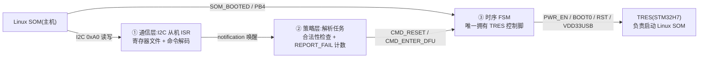
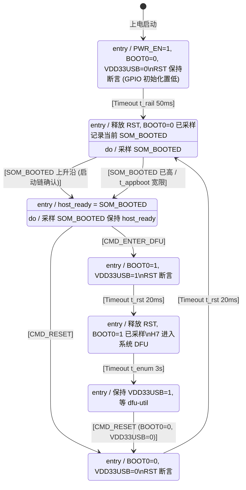
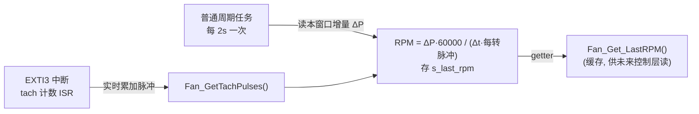
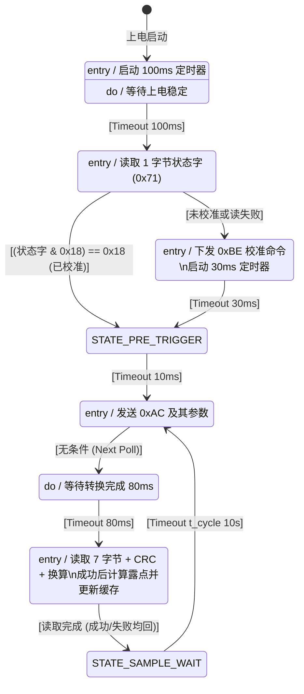
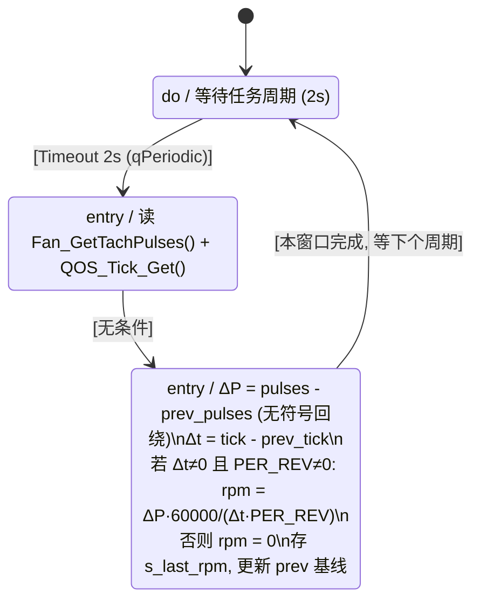
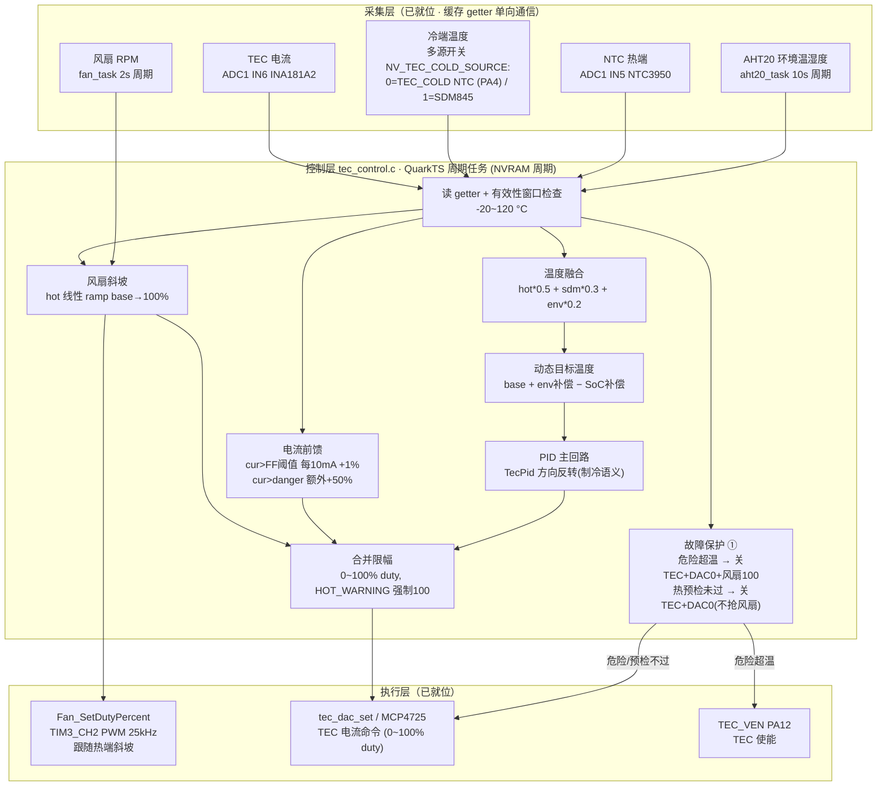
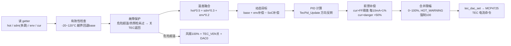
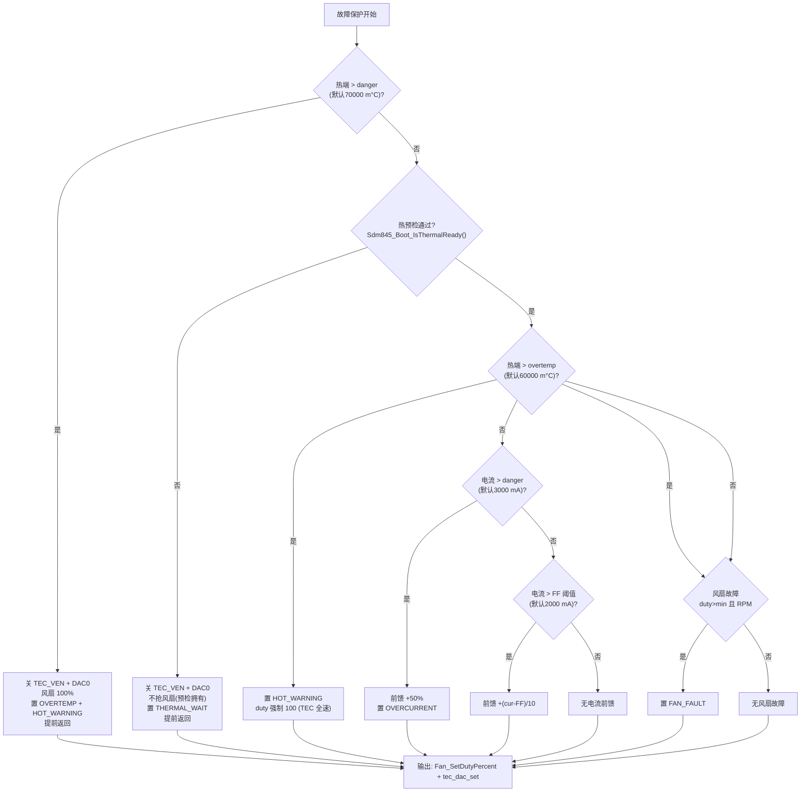
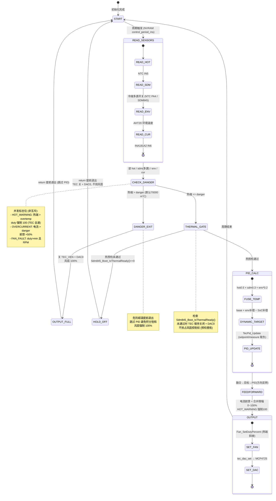
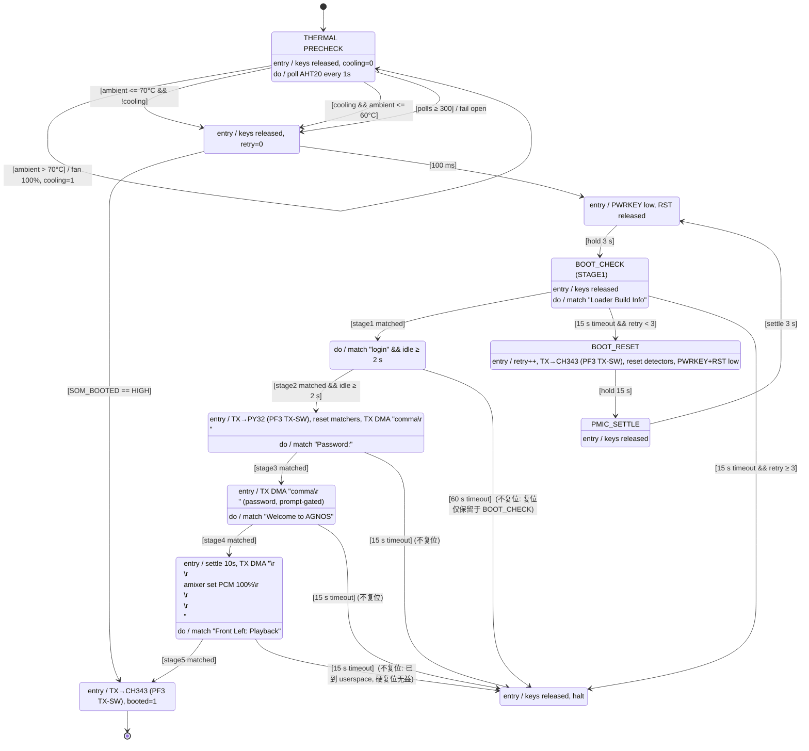

# 工作日志

> 本文件流式记录本项目（PY32F030 固件 + QuarkTS）的核心开发过程、实现方式与核心流程图。
> 新章节追加在文件末尾（不修改已记录的历史）。

---

## 2026-09-22 — AHT20 露点读取任务化：QuarkTS 周期测量（非阻塞）

### 工作时间

2026-09-22（当天完成，含需求澄清与方案确认）。

### 工作内容（背景与目标）

1. **新增 AHT20 露点 API**（阶段一，已撤换）：最初提供一个同步便捷 API，内部完成"读取温湿度 → 计算露点 → 直接返回"。
2. **改造为 QuarkTS 周期任务**（阶段二/最终）：读取过程做成一个 QuarkTS 定时器状态机任务，**每 10 s 测量一次露点**，外部通过缓存 getter 读取最新值。
3. **彻底去除忙等阻塞**（核心约束）：`aht20_delay_ms` 的毫秒级忙等必须消除，测量过程中的长等待必须让出 CPU，不能卡住其它 QuarkTS 任务（尤其是 TRES 时序 FSM）。
4. **初始化仅上电一次**：初始化（校准检查 + 0xBE 校准）只在启动时做一次；并修正**上电后需等待 ≥100 ms 才能访问传感器**的手册要求。

### 设计关键点与实现方式

**（1）QuarkTS 协作式没有同步让出原语**
确认该 QuarkTS 版本无 `vTaskDelay` 类原语，协作式调度的"让出"唯一方式 = **任务返回后由状态机 timeout 表决定下次激活**。因此把长延时全部编码为**状态机超时**（timeout 让出），而非忙等。

**（2）驱动层拆成非阻塞分步原语**
`aht20.c` 重构：删除 `aht20_delay_ms` 及同步测量链（`AHT20_Read` / `AHT20_ReadRaw`），改为：
- `AHT20_Init()` —— 读状态字判校准位 Bit[3]，未校准才发 0xBE，**不等待**；
- `AHT20_StartMeasure()` —— 仅发 0xAC 触发命令；
- `AHT20_ReadResult()` —— 读 7 字节 + busy 判断 + CRC8 + 20bit 换算。
以上内部只含 soft_i2c 位级 I2C 事务（约 0.1 ms，I2C 位时序必需，无法让出）。

**（3）QuarkTS 状态机任务 `aht20_task.c`**
- 一次性 `PWUP_WAIT`(≥100ms) → `INIT`(初始化) → 周期循环 `IDLE`(10s) → `MEAS_SEND`(0xAC,80ms) → `ST_READ`(读+算露点写缓存)；
- 优先级 `qLowest_Priority`，不干扰 TRES 的 `qMedium`；
- 失败只记录 `last_status`、缓存保留旧值，按下一 10s 周期重测（不做快速重试）。

**（4）缓存 + getter（外部零阻塞读取）**
新 `AHT20_Get_LastDewPointMilliCelsius()` 返回最近一次成功露点（未就绪返回 `INT32_MIN`）；`AHT20_Get_LastStatus()` 返回最近一次测量结果码。

**（5）main.c 精简**
移除调度前的同步测试 `Main_AHT20_DewPointTest`，改为在 TRES 之后注册 `AHT20_Task_Init()`。因为初始化已收进状态机，main 中不再需要调度前的 AHT20 初始化逻辑。


### 时间常量

| 常量 | 值 | 说明 |
|---|---|---|
| `t_pwup` | 100 ms | 上电稳定，手册要求 ≥100ms 后才能访问传感器 |
| `t_init` | 30 ms | 初始化（校准命令）后 settle |
| `t_cycle` | 10 s | 测量周期 |
| `t_conv` | 80 ms | 0xAC 触发后转换等待（手册明确"延 80ms 以上再读"） |

### 数据手册依据（奥松电子 AHT20 规格书，中文版）

- **5.1 启动传感器**：上电后需不少于 100ms 达到空闲状态才能接收命令（因此新增 `PWUP_WAIT`）。
- **5.4 读取流程**：上电后读状态字，`状态字 & 0x18 == 0x18` 判已校准；第一次校准时检查**只需上电时做一次**，正常采集无需操作（因此初始化收进一次性 `INIT`）。
- **测量**：发 0xAC（参数 0x33、0x00）后延时 80ms 以上再读，读取前判断 Bit[7]（busy）。
- 状态字：Bit[7]=busy，Bit[3]=CAL enable（校准使能）。

### 文件改动清单

| 文件 | 改动 |
|---|---|
| `Core/INC/aht20.h` | API 重构：保留 `Init`/`IsCalibrated`/`DewPointMilliCelsius`；删除 `AHT20_Read`/`ReadRaw`/`ReadDewPointMilliCelsius`；新增 `StartMeasure`/`ReadResult` |
| `Core/SRC/aht20.c` | 非阻塞化：删除 `aht20_delay_ms`；`Init` 只发命令不等待；`StartMeasure`/`ReadResult` 仅位级 I2C 事务 |
| `Core/INC/aht20_task.h`（新） | `AHT20_Task_Init` + 缓存 getter `Get_LastDewPointMilliCelsius`/`Get_LastStatus` |
| `Core/SRC/aht20_task.c`（新） | 状态机：`PWUP_WAIT → INIT →` 10s 周期测量循环 |
| `Core/SRC/main.c` | 移除调度前同步测试，改注册 `AHT20_Task_Init()` |
| `EIDE/.eide/eide.yml` | 登记 `aht20_task.c` |

### 验证与遗留

- **已通过静态校验**：删除符号无残留引用；头文件声明与实现一一对应；状态机 API/宏均在 `qfsm.h`/`qkernel.h` 中确认（`qLowest_Priority`、`QSM_TSOPT_*`、`QSM_SIGNAL_*`）。
- **待验证**：本环境无 EIDE/工具链 CLI，需在 PY32Studio / EIDE 实际编译烧录验证。
- `aht20.mmd`、`.zcodeignore` 等为独立会话遗留文件，未改动。

---

## 2026-09-22 — BUG 修复：`ST_READ` 的 entry 内状态迁移无效（实测卡死）

### 现象

上电后约 10.2s（100ms + 30ms + 10s + 80ms 后）第一次进入 `ST_READ`，之后**再也不会进入** `ST_READ`，测量循环终止。

### 根因（引擎源码确认）

QuarkTS 状态机引擎中，**进入状态的 entry 动作由 `qStateMachine_StateOnEntry()` 调用**（`qfsm.c`），该函数只 `InvokeStateCallback` 并**不检查 `h->NextState`**；只有 `qStateMachine_StateOnSignal()`（处理普通/超时信号）在处理完回调后才检查 `h->NextState` 并迁移。因此**在 `QSM_SIGNAL_ENTRY` 回调里赋值 `h->NextState` 会被引擎忽略**：

- `ST_READ` 的 entry 里 `h->NextState = &stIdle` 无效；
- `ST_READ` 未配超时表、也无其它信号 → 状态机永久卡死在 `ST_READ`；
- 同处隐患：`MEAS_SEND` entry 里的失败迁移也同样无效。

### 修复：所有迁移只走 timeout 信号

- **删除 `ST_READ` 状态**，把"读取 + 算露点 + 写缓存"合并进 `MEAS_SEND` 的 `t_conv` 超时回调；
- `MEAS_SEND`：entry 仅发触发命令（不迁移）；`t_conv` 超时时按 `lastStatus` 分流——失败跳过读取、成功则读取+算露点+缓存——然后迁回 `IDLE`；
- 全状态机所有 `h->NextState` 只出现在 `AHT20_TIMEOUT` 分支（经 `StateOnSignal`，迁移生效）；
- 在 `aht20_task.c` 头部注释记下该坑，防止回归。


### 验证

- 静态校验：`ST_READ`/`stRead` 全消失；`h->NextState` 仅出现在 `AHT20_TIMEOUT` 分支；entry 分支无迁移。
- 循环应恢复为 10s 周期持续测量；需在硬件/EIDE 重新烧录实测确认。

---

## 2026-09-22 — AHT20 状态机 RAM 占用分析

> 本次为**评估存档**：分析一个 QuarkTS 状态机任务的 RAM 构成与可裁剪项，**不实施任何优化**。

### RAM 构成拆解（字段级，32 位 Cortex-M0+ 自然对齐）

`s_aht`（`AHT20_Task_t`）合计 **324 B**：

| 组成 | 类型 | 字节 |
|---|---|---|
| `task` | `qTask_t`（TCB） | 72 |
| `machine` | `qSM_t`（内嵌 top 状态 36 + handler 40 + 指针/队列槽） | 116 |
| `timeoutSpec` | `qSM_TimeoutSpec_t`（Q_FSM_MAX_TIMEOUTS=4 → 8×4+4） | 36 |
| `sigQueue` | `qQueue_t` | 28 |
| `sigStack[8]` | `qSM_Signal_t`×8 | 64 |
| `latestDewPointC` + `lastStatus` | int32 + int | 8 |

另加 4 个非 const 状态对象 `stPwup/stInit/stIdle/stMeasSend`（各 36 B）= **144 B**。

**归属本状态机合计 ≈ 468 B**（用户观察到的 ~400 主要为 `s_aht` 的 324 B）。

### 设计解释

`qTask_t`(72B TCB) + `qSM_t`(116B 完整状态机上下文，内嵌 top 状态和 handler) 是 QuarkTS 用成熟 FSM 内核换取**调度/让出/状态隔离**能力的固定成本，属设计取舍而非浪费。

### 优化空间（仅供后续参考，本次未实施）

**配置层（改 `Core/INC/qconfig.h`，影响整个内核）**

| 优化 | 省 RAM | 风险 |
|---|---|---|
| `Q_FSM_MAX_TIMEOUTS` 4→1 | 每 FSM 24 B（timeoutSpec 36→12） | 低：TRES 每状态也只用 INDEX(0) |
| 关订阅 `Q_FSM_PS_SIGNALS_MAX=0` / `Q_FSM_PS_SUB_PER_SIGNAL_MAX=0` | 文件级 160 B（psSignals[8]+psSubs[8][4]） | 低：TRES/AHT20 均未用发布/订阅 |
| `Q_TASK_COUNT_CYCLES=0` | 每任务 4 B | 低：无人读 cycles |
| `Q_ALLOW_TASK_NAMING=0` | 每任务 4 B | 低：无人 setName |
| `Q_TRACE_VARIABLES=0` | trace 缓冲 | 低（丢调试信息） |
| `Q_MEMORY_MANAGER=0` | 全局 ~1024 B 堆 | 需先确认无人用 `qMemAlloc` |

**应用层（改 `Core/SRC/aht20_task.c`，仅本任务）**

| 优化 | 省 RAM | 风险 |
|---|---|---|
| `sigStack[8]→[4]` | 32 B | 低：AHT20 只有 timeout 信号，8 条深度冗余 |

**澄清**：`Q_BYTE_ALIGNMENT=8` 仅作用于内存管理器的堆对齐，**不放大**这些结构体布局（对齐仍由编译器按 4 B 自然对齐决定）。

**决策记录**：用户确认本次不改代码、仅存档分析。

---

## TRES 电源/启动时序控制器 — 状态机分解与状态图（最终版）

> 以下内容于 2026-09-22 合并自独立设计文档 `tres_sequencer_state_diagram.md`（该文档同步归档入工作日志）。为贴合本日志结构，标题层级统一降一级。

角色分工：PY32F030（本文固件）是常电的**启动/复位控制器**；TRES（STM32H7）负责 **Linux SOM 的启动控制**；Linux SOM 启动完成后成为 **I2C 主机**（从机地址 0xA0），之后才能命令 PY32 对 TRES 做复位 / 进 DFU 等操作。

**启动链条**：板上电 → PY32 直接在 `PWR_UP` 态启动 TRES（BOOT0=0，从 FLASH 启动）→ TRES 运行 → TRES 启动 Linux SOM → SOM_BOOTED(PB4) 拉高 → Linux 接管。

**无电源管理**：没有 OFF / SHUTDOWN / FAULT 状态，没有软关机。机器上电后一直带电运行；TRES 是否存活由 Linux 主机自行观察，PY32 只负责启动与复位/DFU 时序。

### 控制信号一览（见 `gpio.h`）

| 信号 | 引脚 | 方向 | 默认态 | 作用 |
|---|---|---|---|---|
| `TRES_PWR_EN` | PB6 | 输出 | 低(断电) | TRES 主电源使能(常开) |
| `TRES_RST` | PA8 | 输出 | 低(保持复位) | TRES NRST，推挽驱动，低=复位 |
| `TRES_BOOT0` | PB5 | 输出 | 低 | 启动模式选择，在 RST 释放瞬间被 H7 采样 |
| `TRES_VDD33USB_CTRL` | PA15 | 输出 | 低(关断) | TRES USB 3V3 轨；**仅进 DFU 时置 1** |
| `SOM_BOOTED`(输入) | PB4 | 下拉输入 | 低 | Linux SOM 启动完成信号，兼作启动链确认 |

### 三层分解

**反馈通路**：PY32 对 TRES 没有任何直接反馈（4 个控制脚全是输出）。因为 TRES 负责 SOM 启动，`SOM_BOOTED` 上升沿是"整条启动链成功"的链式间接确认；TRES app 层面的失败由 Linux 经 `CMD_REPORT_FAIL` **只计数上报**，PY32 不据此做任何动作。



- **① 通信层**：I2C1 从机 ISR 收字节进寄存器文件，收完一条命令 `qTask_Notification_Send()` 唤醒解析任务。ISR 内不做决策。
- **② 策略层**：校验命令合法性、维护 `REPORT_FAIL` 计数，把合法的 `CMD_RESET` / `CMD_ENTER_DFU` 投给时序 FSM。
- **③ 时序层**：核心状态机，10 ms 周期任务轮询，全部延时走 QuarkTS 超时，无阻塞。

### ③ 时序层完整状态图（最终版）



#### 关键设计决策

1. **冷启动无条件 NORMAL，无电源管理**。初始状态就是 `PWR_UP`，机器上电即自启动 BOOT0=0，不需要主机、也不需要注入开机命令；不存在 OFF/关机/FAULT 路径。
2. **DFU 是"复位进入"，不是"掉电进入"**。因为 SOM 由 TRES 启动、TRES 由 PY32 启动，冷启动阶段没有主机在线、不可能进 DFU；DFU 只在 SOM 起来后由主机发 `CMD_ENTER_DFU` 触发：源状态先置 `BOOT0=1`、`VDD33USB=1`，再进 `PULSE_RESET` 拉低 RST，超时后释放——H7 在 RST 释放瞬间采样 BOOT0=1，进系统 bootloader。全程不断电。
3. **BOOT0/VDD33USB 由源状态在进 `PULSE_RESET` 前置位**，保证它们在 RST 断言期间稳定；`PULSE_RESET` 超时后按 BOOT0 电平分流到正常启动或 DFU。因此不再需要 `mode` 变量。
4. **`REPORT_FAIL` 只计数、不迁移**。命令层直接 `s_failCnt++`，主机读 `RETRIES` 得知失败次数，PY32 不做任何自动动作（不重启、不锁存）。
5. **冷启动无监督超时**。`BOOT_WAIT_NORMAL` 只等 `SOM_BOOTED`，若 TRES 起不来就一直等，不留自动干预。

#### 状态-引脚矩阵（对着原理图审查用）

| 状态 | PWR_EN | RST | BOOT0 | VDD33USB |
|---|---|---|---|---|
| PWR_UP | 1 | 0(复位保持) | 0 | 0 |
| BOOT_WAIT_NORMAL / RUNNING | 1 | 1(释放) | 0(保持) | 0 |
| PULSE_RESET(CMD_RESET) | 1 | 0(脉冲) | 0 | 0 |
| PULSE_RESET(CMD_ENTER_DFU) | 1 | 0(脉冲) | 1 | 1 |
| BOOT_WAIT_DFU / DFU_ACTIVE | 1 | 1(释放) | 1(保持) | 1 |

### ①② 层接口设计

#### 命令与合法性矩阵（解析任务强制执行）

| 命令 | PWR_UP/BOOT_WAIT_NORMAL | RUNNING | PULSE_RESET | BOOT_WAIT_DFU | DFU_ACTIVE |
|---|---|---|---|---|---|
| `CMD_RESET` | ✗ | ✓(BOOT0=0) | ✗ | ✗ | ✓(退出 DFU,BOOT0=0) |
| `CMD_ENTER_DFU` | ✗ | ✓(BOOT0=1) | ✗ | ✗ | ✗(已在 DFU) |
| `CMD_REPORT_FAIL` | ✓(计数) | ✓(计数) | ✓(计数) | ✓(计数) | ✓(计数) |

`CMD_REPORT_FAIL` 在所有状态都接受、只计数不迁移；其余两条命令仅在 RUNNING / DFU_ACTIVE 有效。

#### I2C 寄存器映射建议（从机地址 0xA0，已在 `i2c.c` 配好）

| 地址 | 名称 | R/W | 内容 |
|---|---|---|---|
| 0x00 | CMD | W | 3 字节生效：`0xA5, 命令码, 参数`；第三个字节(参数)被忽略，三条命令都不带参 |
| 0x10 | STATUS | R | bit[3:0]=FSM 状态号， bit4=host_ready， bit7=last_cmd_err |
| 0x11 | RETRIES | R | `CMD_REPORT_FAIL` 计数 |
| 0x12 | PINS | R | 四个控制脚 + SOM_BOOTED 快照 |
| 0x13 | LASTERR | R | 最近被拒命令的详细码(ILLEGAL / MAGIC) |
| 0x14 | VERSION | R | 接口版本(`TRES_IF_VERSION`) |

### 时间常量（初值为占位，必须实测）

| 常量 | 状态 | 建议初值 | 说明 |
|---|---|---|---|
| `t_rail` | PWR_UP | 50 ms | 主电源爬升，示波器实测 |
| `t_appboot` | BOOT_WAIT_NORMAL | 2 s | 复位重启场景的宽限(SOM_BOOTED 已高) |
| `t_rst` | PULSE_RESET | 20 ms | NRST 最小脉宽 + 外部电容充电 |
| `t_enum` | BOOT_WAIT_DFU | 3 s | DFU USB 枚举窗，别设太短 |

### QuarkTS 实现映射

- 时序 FSM：`qOS_Add_StateMachineTask(10 ms, qMedium_Priority)`；三处固定延时（`t_rail`/`t_rst`/`t_enum`）用 `const qSM_TimeoutStateDefinition_t` 表（照抄 `fsm_demo` 的 `s_fastTO` 写法，表存 flash）；`BOOT_WAIT_NORMAL` 的 `t_appboot` 用 tick 手工比较。
- 命令管道：解析任务 → `qStateMachine_SendSignal()`；I2C ISR → 解析任务用 `qTask_Notification_Send()`。
- `REPORT_FAIL` 计数直接住在命令层（`s_failCnt`），不进 FSM，故永不触发迁移。
- `TRES_Data_t` 字段：`hostReady`、`somPrev`、`somRise`、`somFall`、`stateId`、`entryTick`——不再有 `mode` / `pendingNext` / `retries`。
- 若未来 MIX3 一路(PB7/PB8)也要管，同一套回调 + 引脚表实例化第二份（`fsm_demo` 多实例模式）。

### 硬件检查点

1. **防倒灌**：本版无 OFF/关机态，但上电瞬间 GPIO 默认低电平，`PWR_UP` 才拉高 PWR_EN——避免推挽高电平经 ESD 二极管给未上电的 H7 供电。
2. **【需确认的关键假设】TRES 复位不影响已运行 Linux SOM 的供电**：SOM 电源须独立于 TRES（TRES 只控制其*启动*，不负责其*供电*）；复位进入 DFU 期间 SOM 需保持在线以驱动 dfu-util。
3. **NRST 冲突**：H7 自身也能驱动 NRST；若 app 不会主动拉 NRST，推挽可用；否则改开漏+上拉。
4. **VDD33USB 时序**：核对 H7 datasheet 中 VDDUSB 与主电源的上下电顺序要求；VDD33USB 关断期间主机侧不得驱动 DP/DM。
5. **DFU 前提**：确认 H7 选项字节 `BOOT_ADD1` 指向系统 bootloader（出厂默认通常是），否则 BOOT0=1 释放复位不会进 DFU。

---

## 2026-09-22 — 风扇 RPM 测量周期任务化 + TEC 风扇控制架构

### 工作时间

2026-09-22。

### 背景与目标

- 把风扇 RPM 测量从忙等的 `Fan_GetRPM()` 改为**非阻塞**（Run-to-complete）。
- 采纳架构结论：风扇**用普通周期任务而非状态机**。
- 采样配置：**周期 = 窗口 = 2 s**，本地缓存 + getter，不接 I2C。

### 架构结论（回答"风扇后期结合 TEC 电流/温度如何维护"）

采用**分层「采集层 + 控制层」**，用普通周期任务而非状态机：

- **采集层（测量）**：RPM 采样（本任务）、未来 TEC 电流 ADC / NTC 温度，各自为普通周期任务，只做"读采样→存缓存"，非阻塞；
- **控制层（策略）**：未来一个普通周期任务，每周期读各缓存 getter（电流/温度/RPM）算 duty → `Fan_SetDutyPercent`，纯计算无阻塞；
- 两层仅通过**缓存 getter 单向通信**；层次状态机留作后期"工作模式+保护"（IDLE/RUN/OVERTEMP/FAULT）用。
- **为什么不用状态机**：风扇 RPM 是**单一均匀采样窗口**，不像 AHT20 单次测量内含多个不等时长等待阶段，普通周期任务即可非阻塞采样，状态机只会增加无谓开销。

### 实现方式

1. 新增 `Core/INC/fan_task.h` + `Core/SRC/fan_task.c`（普通周期任务）：
   - `Fan_Task_Init()`：`qOS_Add_Task( Fan_Task_Cb, qLowest_Priority, 2.0f, qPeriodic, qEnabled, NULL )`；
   - `Fan_Task_Cb()` 每 2s 一次：读 tach 增量算 RPM 存缓存（首次只设基线，防脉冲累计误读）；`pulses - prevPulses` 无符号减法处理回绕；
   - `uint32_t Fan_Get_LastRPM(void)` 缓存 getter（风扇关闭时 RPM=0 为合法读值）。
2. 改造 `Core/SRC/fan.c` / `Core/INC/fan.h`：删除忙等 `Fan_GetRPM()`，移除冗余 include `qport_py32.h`；保留即时控制 API（`Fan_SetDutyPercent`/`Fan_SetEnabled`/`Fan_GetTachPulses` 等）供未来控制层使用。
3. `Core/SRC/main.c`：在 `AHT20_Task_Init()` 后注册 `Fan_Task_Init()`。
4. `EIDE/.eide/eide.yml`：登记 `fan_task.c`。

### 流程（Mermaid）



### 时间常量

| 常量 | 值 | 说明 |
|---|---|---|
| 任务周期 | 2 s | 同时也是 RPM 采样窗口 |
| `FAN_TACH_PULSES_PER_REV` | 2 | tach 每转脉冲数 |

### 文件改动清单

| 文件 | 改动 |
|---|---|
| `Core/INC/fan_task.h`（新） | `Fan_Task_Init` + `Fan_Get_LastRPM` |
| `Core/SRC/fan_task.c`（新） | 普通周期任务 RPM 采样 |
| `Core/INC/fan.h` / `Core/SRC/fan.c` | 删除忙等 `Fan_GetRPM`；移除冗余 include |
| `Core/SRC/main.c` | 注册 `Fan_Task_Init` |
| `EIDE/.eide/eide.yml` | 登记 `fan_task.c` |

### 验证与遗留

- 静态校验通过（无忙等残留、声明与接线一致）。
- 控制层（TEC 结合电流/温度）本次不实现，仅预留 `Fan_Get_LastRPM` 缓存 getter 出口；未来新增 ADC/NTC 采样任务 + 控制任务即可，测量层无需改动。

---

## 2026-09-22 — TRES 状态机更新：PULSE_RESET 拆分为两个状态

### 工作时间

2026-09-22。

### 变更内容

将原单一 `PULSE_RESET` 状态拆分为**两个目标唯一**的状态：

- `PULSE_RESET_NORMAL`：entry 置 `BOOT0=0`、`VDD33USB=0`、`RST=0`；`t_rst` 超时后**固定**流向 `BOOT_WAIT_NORMAL`；
- `PULSE_RESET_DFU`：entry 置 `BOOT0=1`、`VDD33USB=1`、`RST=0`；`t_rst` 超时后**固定**流向 `BOOT_WAIT_DFU`；
- 不再需要"按 BOOT0 电平分流"逻辑（`Pins_Boot0Level()` 已删除）；BOOT0/VDD33USB 的控制线归属改为在各自状态 entry 中设置，保证 RST 断言期间稳定。

### 影响

- `Core/INC/tres_seq.h`：`TRES_State_t` 枚举由 `TRES_PULSE_RESET` 拆为 `TRES_PULSE_RESET_NORMAL`(3) / `TRES_PULSE_RESET_DFU`(4)，后续状态顺延（原 3 号由 NORMAL 承继，保持兼容）。
- `Core/SRC/tres_seq.c`：状态对象/回调/订阅/超时拆分；`st_Running` 的 `CMD_RESET→NORMAL`、`CMD_ENTER_DFU→DFU`；`st_DfuActive` 退出 DFU → `PULSE_RESET_NORMAL`（entry 负责清 BOOT0/USB）。
- `tres_sequencer_state_diagram.md`：状态图、关键设计决策、状态-引脚矩阵、命令合法性矩阵、时间常量均已同步。


### 验证

- 静态校验通过：旧的 `stPulseReset` / `Pins_Boot0Level` / `TRES_PULSE_RESET` 无任何残留；新符号在枚举、迁移、订阅、超时处引用齐全。
- 待 PY32Studio/EIDE 编译烧录验证。

---

## 2026-09-22 — 状态命名统一：AHT20 去 `ST_` 前缀 + TRES 枚举去 `ST_` 段

### 工作时间

2026-09-22。

### 变更内容（统一状态机命名风格）

消除容易引起歧义的 `ST_` 风格命名，统一为语义化命名：

- **AHT20 状态机**（mermaid / 文档引用）：
  - `ST_PWUP_WAIT` → `PWUP_WAIT`
  - `ST_INIT` → `INIT`
  - `ST_IDLE` → `IDLE`
  - `ST_MEAS_SEND` → `MEAS_SEND`
  - 代码变量 `stPwup` / `stInit` / `stIdle` / `stMeasSend` 保持不变（小写风格，与 TRES 的 `stRunning` 一致）。
- **TRES 状态枚举**（`TRES_State_t`）：
  - `TRES_ST_PWR_UP` → `TRES_PWR_UP`
  - `TRES_ST_BOOT_WAIT_NORMAL` → `TRES_BOOT_WAIT_NORMAL`
  - `TRES_ST_RUNNING` → `TRES_RUNNING`
  - `TRES_ST_PULSE_RESET_NORMAL` → `TRES_PULSE_RESET_NORMAL`
  - `TRES_ST_PULSE_RESET_DFU` → `TRES_PULSE_RESET_DFU`
  - `TRES_ST_BOOT_WAIT_DFU` → `TRES_BOOT_WAIT_DFU`
  - `TRES_ST_DFU_ACTIVE` → `TRES_DFU_ACTIVE`
  - 枚举**数值顺序不变**，主机读 `STATUS` bit[3:0] 的数值兼容。

### 影响文件

| 文件 | 改动 |
|---|---|
| `Core/SRC/aht20_task.c` / `Core/INC/aht20_task.h` | mermaid 与注释去 `ST_` 前缀 |
| `Core/INC/tres_seq.h` | 枚举值 `TRES_ST_*` → `TRES_*` |
| `Core/SRC/tres_seq.c` / `Core/SRC/tres_cmd.c` | 同步枚举引用 |
| `WORKLOG.md` | 同步历史章节命名 |

### 验证

- 全项目（代码/头文件）`TRES_ST_` 无残留；AHT20 现存状态 `ST_*` 无残留。
- 枚举数值不变，主机接口兼容。
- 待 PY32Studio/EIDE 编译烧录验证。

---

## 2026-09-23 — AHT20 状态图命名与代码对齐（附录：实际 FSM 映射）

### 背景

为让 AHT20 状态机与数据手册测量流程直接对应（不再把流程压缩进 4 个状态），本次把 `Core/SRC/aht20_task.c` 重构为**对齐数据手册 8 个主状态**的方框状态机。8 个主状态一一对应数据手册方框，另加 1 个 `SAMPLE_WAIT` 承载采样周期（数据手册上表现为 `PARSE → TRIGGER` 那条"采样间隔延时到达"边缘，在 QuarkTS 中必须由某状态持有超时）。校准判定按数据手册改用 `0x18`。

按本日志「不修改历史」约定，以追加章节归档；本节即实际实现（以本节为准）。

### 实际状态机（方框图，与 `aht20_task.c` 一致）



### 命名映射（文档 ↔ 代码）

| 状态图名 | 状态对象 | 回调 | 超时 | 说明 |
|---|---|---|---|---|
| `STATE_POWER_ON_WAIT` | `stPowerOnWait` | `st_PowerOnWait_Cb` | `t_pwup` (100 ms) | 上电稳定, 不访问传感器 |
| `STATE_CHECK_STATUS` | `stCheckStatus` | `st_CheckStatus_Cb` | (决策) | 读状态字判 `0x18` |
| `STATE_SPECIAL_INIT` | `stSpecialInit` | `st_SpecialInit_Cb` | `t_init` (30 ms) | 下发 0xBE 校准 |
| `STATE_PRE_TRIGGER` | `stPreTrigger` | `st_PreTrigger_Cb` | `t_pre` (10 ms) | 触发前延时 |
| `STATE_TRIGGER` | `stTrigger` | `st_Trigger_Cb` | (决策) | 发 0xAC 触发 |
| `STATE_WAIT_MEASURE` | `stWaitMeasure` | `st_WaitMeasure_Cb` | `t_conv` (80 ms) | 转换等待 |
| `STATE_READ_DATA` | `stReadData` | `st_ReadData_Cb` | (决策) | 读 7 字节 + CRC + 换算, 成功后算露点缓存 |
| `STATE_SAMPLE_WAIT` | `stSampleWait` | `st_SampleWait_Cb` | `t_cycle` (10 s) | 采样周期承载 |

### 澄清

- **7 个主状态** + `SAMPLE_WAIT` 承载采样周期；`SAMPLE_WAIT` 是数据手册 `PARSE → TRIGGER` 边上"采样间隔延时到达(周期>1s)"的承载状态，为满足 QuarkTS 非阻塞而存在（露点计算已在 `READ_DATA` 内完成，无需独立 `PARSE` 状态）。
- **决策状态**（`CHECK_STATUS` / `TRIGGER` / `READ_DATA`）不设超时表：entry 只读/动作，在 `QSM_SIGNAL_NONE` 轮询分支设 `h->NextState` 完成分流（引擎在 `StateOnSignal` 检查 `NextState`，因此进态即决策；不违反"ENTRY 内不迁移"约束）。
- **恒定延时状态**（`POWER_ON_WAIT` / `SPECIAL_INIT` / `PRE_TRIGGER` / `WAIT_MEASURE` / `SAMPLE_WAIT`）用 flash 超时表让出 CPU。
- **校准判定按数据手册用 `0x18`**（Bit[3]+Bit[4] 同时置位才算已校准），影响 `AHT20_Init` / `AHT20_IsCalibrated`；驱动新增 `AHT20_ReadStatus()` 供 `CHECK_STATUS` 独立读状态字。
- 数据手册的 busy 轮询在非阻塞设计中改为固定 `t_conv`(80ms) 超时；`READ_DATA` 失败时保持旧缓存值进 `SAMPLE_WAIT`，不快速重试。

---

## 2026-09-23 — 风扇 RPM 周期任务流程状态图（附录）

> fan_task 是**普通周期任务**（`qOS_Add_Task(..., qPeriodic, 2.0f)`），不是 QuarkTS 状态机。下图用状态机风格（`STATE_X : entry/do` + `[Timeout]`）表达其**每 2s 一次的采样流程**，便于与 AHT20/TRES 图统一阅读；图中的"状态"实为同一回调 `Fan_Task_Cb` 内的一次次调用。tach 计数由 EXTI3 中断实时累加，与任务回调并行。

### 周期任务流程（Mermaid，对应 `Core/SRC/fan_task.c`）



### 说明

- **非阻塞**：回调 run-to-complete 即返回，无忙等；`SAMPLE_WAIT` 的 2s 由 QuarkTS 周期调度让出 CPU。
- **首次调用**：`prev_*` 初始为 0 → 首窗口 ΔP 偏大但不影响长期测量；风扇关闭时 ΔP 恒 0 → RPM=0（合法读值）。
- **getter**：`Fan_Get_LastRPM()` 返回 `s_last_rpm` 缓存，供未来控制层读取。
- 之所以用普通周期任务而非状态机：风扇 RPM 是单一均匀采样窗口，不像 AHT20 单次测量内含多个不等时长等待阶段。

---

## 2026-09-23 — FLASH 参数持久化 API（nv_params）

### 工作时间

2026-09-23。

### 背景与目标

新增一个读写内部 FLASH 的 API，用于持久化一些固定/校准参数（非易失）。选型结论：**类型化参数表 + 单块直写 + 顶部 4KB 扇区预留**。

### 硬件事实

- 目标 **PY32F030K28U6**：FLASH 64KB、页 128B、扇区 4KB（基址 `0x08000000`）。
- 原无参数预留区，本次从顶部划最后一个扇区 `0x0800F000`~`0x0800FFFF`。
- flash 读写走 **HAL 封装**（`HAL_FLASH_Erase`/`HAL_FLASH_Program`），内部自动配置 32MHz 时序并忙等，规避 raw LL 缺 32M 时序宏的问题。页写要求地址 128B 页对齐、一次性写满 32 字整页。

### 设计

- 新模块 `Core/INC/nv_params.h` + `Core/SRC/nv_params.c`，命名 `NvParams_*`。
- **块布局**（恰好一页 128B）：`magic(4) + version(4) + crc32(4) + params[29](116)`。
- **API**：`NvParams_Init`（上电读 flash→校验 magic/version/crc→填缓存，失败载默认值，不写 flash）、`NvParams_Get/Set`（RAM 缓存）、`NvParams_Save`（擦页+写整页，先算 CRC，加临界区）、`NvParams_RestoreDefaults`。
- **写策略**：单块直写（每次擦同一页重写，约 1 万次擦写寿命），适合参数低频写入（校准/配置）。
- **CRC-32**：反射式 ISO-HDLC（poly `0xEDB88320`，检查值 `crc32("123456789")==0xCBF43926`），对 `params[]` 原始字节计算；经往返模拟验证一致。

### 文件改动清单

| 文件 | 改动 |
|---|---|
| `Core/INC/nv_params.h`（新） | 参数槽枚举 + API 声明 |
| `Core/SRC/nv_params.c`（新） | 块结构、CRC、Init/Get/Set/Save/RestoreDefaults |
| `Core/SRC/main.c` | `Fan_Init` 后调用 `NvParams_Init()` |
| `EIDE/PY32F030K28U6-E.ld` | `FLASH LENGTH 64K→60K` 预留参数扇区并注释 |
| `EIDE/.eide/eide.yml` | 登记 `nv_params.c` |
| `WORKLOG.md` | 本节记录 |

### 验证与遗留

- 静态校验通过：API 声明/实现一致、块大小 128B（`_Static_assert`）、CRC 往返自洽、链接脚本改动生效。
- 待 PY32Studio/EIDE 编译烧录实测：读写正确性、掉电保持、以及 `HAL_FLASH_Program` 对整页缓冲的对齐要求。
- 默认值 `s_defaults[]` 目前全为 0，需按实际生产参数填充。

---

## 2026-09-23 — 集成 EPID（Embedded-PID）库 + TEC PID 封装

### 背景与目标

为 TEC 温度控制引入 PID 库。经对比 GitHub 多个候选（`abderraouf-adjal/Embedded-PID`、`pms67/PID`、`rubinsteina13/C_PID...`、`br3ttb/Arduino-PID`），选定 **Embedded-PID**：纯 C99、ISC 许可、零依赖、抗积分饱和 + 输出限幅 + D 项 IIR 滤波，契合 TEC 控制（电流饱和与温度噪声是主要问题）。Arduino 版（C++、依赖框架）不适用裸机工程，已排除。

### 库特性（Type-C 增量式）

- `P[k]=Kp·(x[k-1]-x[k])`；`I[k]=Ki·(SP-x[k])`；`D[k]=Kd·(2·x[k-1]-x[k-2]-x[k])`
- `y[k]=y[k-1]+Δy`（增量累积），`epid_util_ilim` 抗积分饱和，`epid_pid_sum` 输出限幅，`epid_util_lpf_*` D 项低通。
- `#if 1` 强制开启 `EPID_FEATURE_VALID_FLT`（`isfinite/isnan`，GCC 内建宏，裸机 M0 可用，无需额外 libm 符号）。

### 集成内容

| 文件 | 来源/改动 |
|---|---|
| `Core/INC/pid.h` + `Core/SRC/pid.c`（新） | 克隆自 Embedded-PID v1.1.3，保留 ISC 头 |
| `Core/INC/tec_pid.h` + `Core/SRC/tec_pid.c`（新） | 本项目的 TEC 封装：`TecPid_Init/Update/GetOutput/Reset/SetSetpoint`，内置抗积分饱和与输出限幅，可选 D 项滤波 |
| `EIDE/.eide/eide.yml` | 登记 `pid.c`、`tec_pid.c` |

### 说明

- 编译配置：C11、`softfp`、newlib-nano、`-lm`（已在 linker `LIB_FLAGS`），满足 `isnan/isfinite` 与浮点。
- `pid.h` 用 `#if 1` 硬开校验宏；如需进一步精简（如省 `-lm` 依赖）可改为 `#if 0`，但会失去 NaN/INF 防护，暂不这么做。
- `TecPid_t` 的封装接口以"设定目标温度 + 注入实测温度 + 取输出（已限幅于 `[out_min,out_max]`）"组织，输出为有符号量（冷却/加热方向由调用方映射到 H 桥/PWM 极性）。

### 待办

- 待 PY32Studio/EIDE 编译烧录；接入 TEC 控制任务（工作日志规划的"采集层→控制层"）时再定增益标定与输出极性映射。

---

## 2026-09-27 — SDM845 启动控制状态机（修订版）

### 背景

新增高通 SDM845 启动控制流程，核心是控制两个 GPIO：`PWRKEY`（电源键）与 `RST_KEY`（Vol- / 复位键）。流程目标：上电→按电源键开机→串口探测启动成功→成功移交控制权；若探测不到则"强杀"重启重试。

本修订版针对初稿的 3 处逻辑缺陷做了修复（**无重试上限**、**释放按键依赖 exit**、**成功判据与超时纠缠**）；缺陷 4"成功即 `[*]` 一次性结束"为刻意设计，予以保留。


### 修复点

1. **重试上限（缺陷 1）**：`retry_count` 在 `POWER_ON_WAIT` 清零、进 `BOOT_RESET` 递增；`BOOT_CHECK` 超时后分流——`< MAX` 强杀重试，`≥ MAX` 进 `STATE_STRAP_FAIL` 挂起，不再无限 15s 强杀。`MAX` 用宏 `SDM845_BOOT_MAX_RETRIES`（建议 3）。
2. **释放按键改为"进态即置"（缺陷 2）**：删除 `PWR_PRESS`/`BOOT_RESET` 的 `exit` 松键，改为 `BOOT_CHECK`/`PMIC_SETTLE` 的 entry 显式拉回释放，避免依赖 exit 回调未触发导致按键滞留。
3. **成功判据明确 + 成功优先于超时（缺陷 3）**：成功 = `RCV_COUNT≥阈值` 且在窗口 `W` 内有增量；每次轮询先判成功，仅当一直不成功拖到 15s timeout 才走失败分支。

### 硬件待确认

- **`RST_KEY` 引脚物理接法**：若接 `RESIN_N`，15s PWRKEY+RST 为 PMIC 强制断电重启，与"强杀"意图一致；若实际是 VOL 键复用，15s 长按可能进 Fastboot/EDL 而非重启，需在原理图确认后决定是否调整流程。
- `PMIC_SETTLE` 3s 可能偏短，SDM845 断电/重上电序列建议放宽到 5~8s 并实测。

### 状态

该状态机目前为**文档定义**，尚未落地为 QuarkTS 代码（未新建源文件）。待确认硬件接法与是否需要落地实现后，再按 `tres_seq.c` 的超时表 + NONE 轮询决策写法新建 `sdm845_boot` 模块。

---

## 2026-09-28 — USART2（PA0/PA1）DMA 接收实例

### 背景与目标

新增一个串口 **USART2（PA0=TX、PA1=RX）** 的 DMA 接收实例，用于不定长串口帧接收。基于新增的英文参考手册（`datasheet/PY32F030_Reference_Manual_V1.6.pdf`）确认了 PY32F030 的 DMA 请求机制。

### 手册关键结论

- **PY32F030 的 DMA 请求映射不是每通道固定，而是用 `SYSCFG_CFGR3` 寄存器的 `DMAx_MAP` 字段路由**（参考手册 10.1.3）：每个 DMA 通道通过 `DMA1_MAP`/`DMA2_MAP`/`DMA3_MAP` 选择外设请求。
- **`USART2_RX` 请求码 = `0b01000`（0x08）**，`USART2_TX` = `0b00111`（DMA 请求映射表 11-3）。
- **DMA1 只有 3 个通道**（`DMA1_Channel1/2/3`）。
- **USART_CR3 的 `DMAR`(bit6)** 使能 DMA 接收（26.5.6）。
- 中断入口：`DMA1_Channel1_IRQn`、`USART2_IRQn`。

### 实现方式

- 新模块 `Core/INC/usart2_dma.h` + `Core/SRC/usart2_dma.c`：
  - `USART2_DMA_Start()`：`SYSCFG->CFGR3.DMA1_MAP = 0x08`（路由到 USART2_RX）→ 配置 `DMA1_Channel1` **环形模式**（外设→内存、字节/字节、内存递增）→ 源地址 `LL_USART_DMA_GetRegAddr(USART2)`，目的 256B 缓存 → 使能 USART2 `DMAR` 与 IDLE 中断 + NVIC。
  - `USART2_DMA_HandleIdle()`：USART2 **IDLE 中断**判定一帧结束，读回 DMA 剩余计数 `LL_DMA_GetDataLength` 计算新增字节，调用可选用户回调。
  - `USART2_DMA_Read()`：按环形指针读出缓存中新增字节。
  - `USART2_DMA_Stop()` / `USART2_DMA_SetCallback()`。
- `Core/SRC/py32f030_it.c`：新增 `USART2_IRQHandler` → `USART2_DMA_HandleIdle()`。
- `Core/SRC/main.c`：`Studio_USART2_Init()` 后调用 `USART2_DMA_Start()`。
- `EIDE/.eide/eide.yml`：登记 `usart2_dma.c`。

### 文件改动清单

| 文件 | 改动 |
|---|---|
| `Core/INC/usart2_dma.h`（新） | API + 说明 |
| `Core/SRC/usart2_dma.c`（新） | SYSCFG 路由 + DMA1_CH1 环形接收 + IDLE 帧边界 |
| `Core/SRC/py32f030_it.c` | 新增 `USART2_IRQHandler` |
| `Core/SRC/main.c` | 调用 `USART2_DMA_Start()` |
| `EIDE/.eide/eide.yml` | 登记 `usart2_dma.c` |

### 验证与遗留

- 静态校验通过：19 个 LL DMA/USART API 均在头文件存在、头/实现 5 个 API 一一对应、中断/main/eide 接线齐全。
- 待 PY32Studio/EIDE 编译烧录实测：`SYSCFG_CFGR3` 请求码映射与环形读逻辑是重点验证点；帧边界判定依赖 IDLE 中断，波特率/帧间空闲需实测。

---

## 2026-09-28 — SDM845 探测重构：IDLE 帧边界 → 内容匹配 + 空闲超时

### 背景 / 问题

USART2 DMA 接收最初用于 SDM845 启动判断（工作日志 §SDM845 启动控制状态机），但**用 IDLE 中断做帧边界不可靠**：

- 手册（USART_SR）确认 IDLE = **RX 线保持高电平满一个完整字符帧（约 10 bit / 波特率）**才触发，即"字节流出现停顿"事件，**不是行结束**；
- `\r\n` 只是两个普通字节，不会让 RX 线空闲；Linux shell **持续输出时 IDLE 根本不触发**；
- 因此"接 Linux shell、大量回车换行输出"场景下，IDLE 无法作为分隔，且会因输出不停而读不到数据/环形缓冲溢出。

### 新架构

接收层与判定层解耦：

| 层 | 文件 | 职责 |
|---|---|---|
| 接收层 | `Core/INC/usart2_dma.h` + `usart2_dma.c` | **去掉 IDLE 中断/回调**，只保留 DMA1_CH1 环形缓冲 + `USART2_DMA_Read()`（按 DMA 写指针 = `BUF_LEN - CNDTR` 推导读位置，环形回绕处理） |
| 判定层 | `sdm845_detect.h`（新）+ `sdm845_detect.c`（新） | QuarkTS 周期任务（20ms）轮询环形缓冲，喂 **KMP 流式匹配自动机**（`fail[]` 表 + 跨调用保持状态 `s_q`），匹配目标串 `"Loader Build Info"`；同时用 `QOS_Tick_Get()` 记录最后收字节时刻，计算空闲时长 |

**启动成功判定** = 目标串 `"Loader Build Info"` 已匹配 **且** 线路已空闲 ≥ `SDM845_BOOT_IDLE_MS`（默认 2s，锁存）；`Sdm845_Detect_IsBooted()` / `GetIdleMs()` 供 SDM845 状态机查询。

### 关键正确性验证（本地模拟）

用 Python 复刻 KMP `feed()` 逐字节流式匹配，验证：

- 目标串被 `\r\n` 噪声包围 / 跨多次分片读取 / 环形回绕 → 均正确命中；
- 目标串**内部**被插入 `\r\n`（非连续子串）→ 正确判为不匹配（目标串是 shell 中完整的连续一行）；
- 纯 `\r\n` 风暴 → 无误报。

### 文件改动

| 文件 | 改动 |
|---|---|
| `usart2_dma.h` / `usart2_dma.c` | 删 IDLE 中断/`HandleIdle`/`SetCallback`；改按 DMA 写指针读取环形缓冲 |
| `sdm845_detect.h` / `sdm845_detect.c`（新） | KMP 流式匹配 + 空闲超时 + QuarkTS 周期任务 |
| `py32f030_it.c` | 移除 `USART2_IRQHandler` / `usart2_dma.h` include（不再用 IDLE 中断） |
| `main.c` | `USART2_DMA_Start()` 后注册 `Sdm845_Detect_Init()` |
| `EIDE/.eide/eide.yml` | 登记 `sdm845_detect.c` |

### 待办

- 待 PY32Studio/EIDE 编译烧录实测：SYSCFG 请求码映射、KMP 命中、空闲超时判定。
- `SDM845_BOOT_BANNER` / `SDM845_BOOT_IDLE_MS` 需按实际 shell 输出与启动节奏标定。

---

## 2026-09-28 — SDM845 启动状态机实例化（sdm845_boot）

### 背景

将 WORKLOG 中"SDM845 启动控制状态机（修订版）"的下单为 QuarkTS 状态机代码，并把"启动成功"判断接到上一阶段实现的内容匹配探测层（`sdm845_detect`）。

### 引脚映射（gpio.h）

| 逻辑信号 | 实际 GPIO | 低电平含义 |
|---|---|---|
| `PWRKEY` | `MIX3_BOOTKEY` (PB7) | 按下（power on） |
| `RST_KEY` | `MIX3_RST` (PB8) | 按下（强杀/Vol-） |

对应修订版状态机两路控制脚；`gpio.c` 已把这俩脚初始化为输出带上拉。

### 实现（`Core/INC/sdm845_boot.h` + `Core/SRC/sdm845_boot.c`）

7 态 QuarkTS 状态机，参照 `tres_seq.c` 模板（超时表 + NONE 分支决策 + ENTRY 不迁移）：

```
[*] --> POWER_ON_WAIT --t_pwup(100ms)--> PWR_PRESS --t_hold(3s)--> BOOT_CHECK
BOOT_CHECK --Sdm845_Detect_IsBooted()--> BOOT_SUCCESS (terminal, done)
BOOT_CHECK --15s无响应 & retry<MAX--> BOOT_RESET --t_kill(15s)--> PMIC_SETTLE --t_settle(3s)--> PWR_PRESS
BOOT_CHECK --15s无响应 & retry>=MAX--> STRAP_FAIL (terminal)
```

- **成功判定**：`BOOT_CHECK` 每次轮询（NONE 分支）优先查 `Sdm845_Detect_IsBooted()`（banner"Loader Build Info" + 空闲≥2s），成功优先于 15s 超时（修复缺陷 3）。
- **进态即松键**：`BOOT_CHECK`/`PMIC_SETTLE` 的 entry 置释放，不依赖 exit（修复缺陷 2）。
- **重试上限**：`POWER_ON_WAIT` 清零 `retryCount`、`BOOT_RESET` 递增；`BOOT_CHECK` 超时按 `retryCount<3` 分流到 RESET 或 STRAP_FAIL（修复缺陷 1）。
- 定时参数：`SDM845_T_*`（100ms/3s/15s/15s/3s），轮询 10ms，`qLowest_Priority`。

### 文件改动清单

| 文件 | 改动 |
|---|---|
| `Core/INC/sdm845_boot.h`（新） | 状态枚举 + `Sdm845_Boot_Init/IsDone/GetState/GetRetries` |
| `Core/SRC/sdm845_boot.c`（新） | 7 态 QuarkTS 状态机 + 引脚原语 + 超时表 |
| `Core/SRC/main.c` | include + 注册 `Sdm845_Boot_Init()` |
| `EIDE/.eide/eide.yml` | 登记 `sdm845_boot.c` |

### 验证与遗留

- 静态校验通过：头/实现 4 个 API 一一对应、QuarkTS 14 个 API 可用、引脚宏存在、eide.yml 登记（期间发现 `sdm845_detect.c` 曾重复登记，已去重）。
- 待 PY32Studio/EIDE 编译烧录实测：引脚时序、banner 命中、重试/STRAP 逻辑。
- `SDM845_BOOT_MAX_RETRIES`（3）与各定时为初值，需实测标定；`RST_KEY` 物理接法（RESIN_N vs VOL 复用）影响强杀行为，待原理图确认。

---

## 2026-09-28 — 状态机回调风格统一：`if(Signal)` → `switch(h->Signal)`

### 变更内容

统一三个 QuarkTS 状态机的状态回调风格：信号分派一律用 `switch ( h->Signal )`，消除散落的 `if ( QSM_SIGNAL_ENTRY == h->Signal )` / `if ( h->Signal == XXX_TIMEOUT )` 判断。**仅改代码风格，不改任何状态机迁移逻辑与引脚行为。**

| 文件 | 改动 | 回调数 |
|---|---|---|
| `Core/SRC/sdm845_boot.c` | 7 个状态回调全部改为 `switch`（决策状态 `BOOT_CHECK` 的 NONE 轮询分支放 `default`） | 7/7 |
| `Core/SRC/tres_seq.c` | `st_BootWaitNormal_Cb` 的 ENTRY if → switch；`st_Running_Cb` 的 ENTRY if 与信号 switch 合并为单个 switch | 7/7 |
| `Core/SRC/aht20_task.c` | `st_CheckStatus_Cb` / `st_Trigger_Cb` / `st_ReadData_Cb` 的 ENTRY if → switch | 8/8 |

统一后的模板结构：

```c
static qSM_Status_t st_X_Cb( qSM_Handler_t h )
{
    switch ( h->Signal ) {
        case QSM_SIGNAL_ENTRY:
            /* entry 动作，不迁移 */
            break;
        case XXX_TIMEOUT:
            h->NextState = ...;
            return qSM_STATUS_SIGNAL_HANDLED;
        default:
            /* NONE 轮询决策（如适用） */
            break;
    }
    return qSM_STATUS_EXIT_SUCCESS;
}
```

### 验证

- 静态校验：三个文件 `grep "== h->Signal"` **0 残留**；`switch(h->Signal)` 数与状态回调数一一对应（7/7、7/7、8/8）。
- 逻辑零改动：ENTRY 不迁移、超时迁移、NONE 决策优先级均与改动前一致。

---

## 2026-09-28 — SDM845 启动探测：KMP 流式匹配自动机，算法原理与实现解析

> 对应实现：`Core/SRC/sdm845_detect.c`（`sdm845_kmp_build` / `sdm845_feed`），目标串 `"Loader Build Info"`（17 字节）。本文记录算法选型依据、原理、逐行实现解析与实测验证数据。

### 1. 问题定义：为什么需要"流式自动机"

探测层面对的输入是**无界字节流**（Linux shell 输出，可任意长、可持续不断），约束：

- **RAM 只有 8KB**：不可能缓存整段启动日志再做一次 `strstr`；
- **分片到达**：banner 可能被切在任意两次 `USART2_DMA_Read` 之间（任务 20ms 读一次、每次 ≤64B，DMA 环形缓冲 256B），匹配进度必须**跨调用存活**；
- **实时性**：逐字节摊还常数时间，不能随日志总量增长。

朴素做法（攒缓冲 → 全文搜索）在内存与进度保持上都不成立。把"搜索进度"压缩成**一个整数状态**、逐字节驱动的自动机是唯一自然解。

### 2. 形式化：KMP 就是一个确定性有限自动机（DFA）

KMP（Knuth–Morris–Pratt）可以完全等价地看成一个 DFA：

| 要素 | 本实现中的对应 |
|---|---|
| 状态集 | `q ∈ [0, m]`——**当前已匹配上的 pattern 前缀长度**（m=17） |
| 输入字母表 | 一个字节 `b` |
| 转移函数 δ(q,b) | `sdm845_feed()` 里的回退+推进逻辑 |
| 接受状态 | `q == m` → banner 命中 |
| 初始状态 | `q = 0` |

关键洞察：**自动机把"我匹配到哪了"这个进度信息压缩为单个状态 `s_q`**。任务每次轮询读到多少字节，就对着当前状态转移多少次——banner 跨多少次分片、流多长都无所谓，进度不丢。这就是"流式"的全部含义，也是它与"攒缓冲再搜"的本质区别。

### 3. 核心原理：失配时为什么不用回退重读文本

朴素匹配的病根：在文本位置 i 失配后，把文本指针退回 i-q+1 重新比对，最坏 O(n·m)。

KMP 的观察：失配时，已匹配部分 `P[0..q-1]` 恰好是文本刚读过的末尾。如果 `P` 自身存在 **border**（既是前缀又是后缀的真子串），那么失配后无需重读任何文本字节——直接把已匹配长度降到**最长 border 的长度**继续比对即可，因为那段 border 已经天然是文本的末尾。

这个"失配后应退到哪"被预先计算成**前缀函数**（本文代码叫 `s_fail[]`）：

```
fail[i] = P[0..i] 的最长相等"真前缀 = 真后缀"的长度
```

运行时查表回退，整个算法 **O(n+m)**、文本指针永不回退。

### 4. fail 表构建（`sdm845_kmp_build`）逐行解析

构建是"**自己匹配自己**"的动态规划，两个指针：

- `len`：当前候选 border 长度（同时是"正在比对的 pattern 内部位置"）；
- `i`：正在确定 fail[i] 的位置。

```
P[i] == P[len]  → border 延长：len++，fail[i]=len，i++
P[i] != P[len]  → len 回退：len = fail[len-1]（找次长 border），直到 len==0 → fail[i]=0
```

回退步 `len = fail[len-1]` 是精髓：它沿 border 链逐级缩短，保证不漏任何可能的次长 border。复杂度 O(m)（m=17，构建代价可忽略）。

### 5. 流式转移（`sdm845_feed`）逐行解析

```c
while ( s_q > 0u && b != s_pattern[ s_q ] ) s_q = s_fail[ s_q - 1u ];  /* 回退 */
if ( b == s_pattern[ s_q ] ) s_q++;                                    /* 推进 */
if ( s_q == m ) { s_banner_seen = 1; s_q = s_fail[ m-1u ]; }           /* 命中 */
```

- **回退（while）**：b 对不上下一期望字节时，沿 fail 链缩短已匹配长度，直到 b 可衔接或 q 归零；
- **推进（if）**：能衔接则已匹配长度 +1；
- **命中**：置锁存标志；`s_q = fail[m-1]` 使自动机**不停机**——若 banner 紧接着再次出现（或 pattern 有自重叠结构）也能继续计数。

### 6. 本例实测：fail 表与转移轨迹

对 `"Loader Build Info"` 实测：**fail 表全 0**。原因：首字符 `L` 在串中不再出现，任何真后缀都不可能等于真前缀。含义：**任何失配都直接归零重试**（没有可复用的部分前缀）。

用 Python 复刻 `feed()` 的转移轨迹验证：

| 输入流 | q 轨迹（关键段） | 结果 |
|---|---|---|
| `Loader Build Info`（干净） | 1,2,…,16,**命中** | ✅ 命中 1 次 |
| `LoadeX` + 真banner | 1,2,3,4,5,**0**（X 失配归零），1,2,…,命中 | ✅ 假启动被打断、真 banner 命中 |
| `Loa` + `Loader Build Info` | 1,2,3,**1,2,3**（归零后重推进），…命中 | ✅ 命中 |
| banner**连续出现两次** | 两次都进命中分支 | ✅ 命中 2 次（`q=fail[m-1]` 不停机） |
| banner 内部插 `\r\n`（`Loader Build\r\n Info`） | 永远到不了 17 | ✅ 不命中（banner 必须是连续字节流，正确语义） |
| 纯 `\r\n` ×300 | q 恒 0 | ✅ 零误报 |

> **诚实备注**：fail 全 0 意味着对本 banner，KMP 的"部分重匹配"优化退化为完全归零——对本应用无影响（17 字节重扫代价可忽略），且**框架保持通用**：将来换任何含重复结构的 banner（fail 表非零）依然 O(n+m)，代码零改动。

### 7. 复杂度与资源占用

| 项 | 量 | 说明 |
|---|---|---|
| `feed()` 单字节 | **摊还 O(1)** | 势能分析：q 每字节至多 +1，while 回退的总量不超过历史累计增量，故回退可摊还 |
| 全流处理 | O(n + m) | n 为日志总字节数，与日志长度线性 |
| 构建 | O(m) | 一次，`Sdm845_Detect_Init` 里 |
| RAM | ≈ 21 B | `fail[17]` + 状态 `q` + 两个标志，与日志量**无关** |
| 与任务的耦合 | 无 | 自动机不感知 20ms 周期/分片大小，任何调用节奏都正确 |

### 8. 边界与陷阱备忘

1. **banner 内部被破坏 ≠ 命中**：`\r\n` 插进 banner 中间会正确地阻断匹配——目标串必须是连续子串，这符合"shell 一次性打印 banner 行"的物理事实。
2. **命中不停机**：`s_q = fail[m-1]` 而非归零后锁死，保证重复 banner/自重叠 pattern 都能被逐次捕获。
3. **跨调用状态**：`s_q`/`s_banner_seen` 是文件级静态量——自动机状态**活在两次任务调用之间**，这是流式设计的核心，重构时不可改为局部变量。
4. ** DMA 环形配合**：匹配器只消费 `USART2_DMA_Read` 吐出的增量字节，与 DMA 缓冲大小/回绕解耦；唯一要求是消费节奏别让环形缓冲整圈覆盖未读数据（20ms/256B 远快于 115200 的 ~11.5KB/s）。

---

## 2026-09-28 — USART2 收不到/收错数据：两步定位（DMA1 时钟 + HSE_VALUE 宏污染）

### 故障一：RX 有波形但 DMA 完全不搬

**根因：DMA1 外设时钟从未使能**（`LL_AHB1_GRP1_PERIPH_DMA1` 全项目零调用）。时钟未开时对 DMA 寄存器的所有写入被静默忽略——通道使能位进不去、CNDTR 不递减。修复：`USART2_DMA_Start()` 第 0 步加 `LL_AHB1_GRP1_EnableClock( LL_AHB1_GRP1_PERIPH_DMA1 )`。同时按决策去除 IDLE 架构残留，`usart2_dma.c` 统一为纯环形接收（无 `HandleIdle`/`SetCallback`/IDLE 中断，帧判定全部交给 `sdm845_detect` 轮询）。

### 故障二：能收到数据但与实际完全不符（无一字符正确）

**排除过程**：晶振 16M（用户确认）→ 时钟链理论 32M；CH343 并接 RX 正常读 boot log → 线上确为 115200-8N1；PY32 同为 1.8V 电压域、CH343.RX 高阻无冲突；DMA 已在搬数据；数据手册确认 fHCLK 上限 48MHz 与 VDD 无关（1.8V 下 32M 合法）。

**实锤证据：仿真读 `USART2->BRR = 0x1A1`（417），而按 32M 应为 0x116（278）。** 417×115200 ≈ 48MHz——LL 库计算 BRR 时认为 PCLK1=48M！

**根因：LL 库头文件 `py32f0xx_ll_rcc.h:115` 默认 `HSE_VALUE=24MHz`**（`#if !defined` 守卫的默认值）。链路：

```
ll_rcc.c 编译时看到 HSE_VALUE=24M
→ RCC_PLL_GetFreqDomain_SYS() = 24M × 2 = 48M
→ LL_USART_Init 用 GetSystemClocksFreq() 的 PCLK1=48M
→ BRR = 48M/115200 = 417 (0x1A1)          ← 实测吻合
硬件实际 PLL = 16M晶振 × 2 = 32MHz
→ 实际波特率 = 32M/417 ≈ 76.7k，偏差 -33%  ← 一个字符都不会对
```

`system_py32f030.c` 里的 `HSE_VALUE=16M` 定义带 `#if !defined` 守卫，但**只在该编译单元内可见**，救不了 `ll_rcc.c`（它看到的是头文件默认 24M）。LL 头文件注释自己也警告："user has to ensure that HSE_VALUE is same as the real frequency"。

**修复**：EIDE `defineList` 全局增加 `HSE_VALUE=16000000U`（命令行定义优先于两处 `#if !defined` 守卫，rcc/usart/i2c/spi/utils 所有编译单元统一生效，不改 vendor 文件）。

### 受污染面（同一根因）

| 外设 | 影响 |
|---|---|
| USART1 / USART2 BRR | 按 48M 算（都错），修复后 = 0x116 |
| `LL_I2C_Init` 的 FREQ/TRISE/CCR | 同样按 48M 算，修复后一并纠正 |
| soft_i2c / QuarkTS tick | 不走该计算（GPIO 延时 / 硬编码 32M），本就正常 |

### 验证要点

重编译烧录后：仿真 `USART2->BRR` 应变为 **0x116**；接收缓冲应出现正确 ASCII（含 `"Loader Build Info"`）；SDM845 探测/状态机随之可实测。

### 教训

1. **vendor 库的时钟常量默认值必须与本板晶振核对**——`HSE_VALUE` 错误不报错、不崩溃，只让所有"按计算配置"的外设静默错配。
2. **仿真器读 BRR 是串口乱码的一线诊断**：BRR×目标波特率 ≈ LL 假想的时钟频率，直接暴露假设与实际的偏差。
3. `#if !defined` 守卫的宏定义作用域是**编译单元**，头文件默认值只有全局编译定义能可靠覆盖。

---

## 2026-09-29 — SDM845 两级启动检测（stage1=Loader, stage2=login）

### 需求

单一 banner（"Loader Build Info"）只能证明 bootloader 活着；把 **stage1 = `"Loader Build Info"`（bootloader 横幅）** 与 **stage2 = `"login"`（getty 提示符）** 分开检测，可实现更精确的启动判定：loader 出了但 login 超时 = 卡在内核/init 阶段 → 有针对性的强杀重试，而不是笼统的"没等到 banner"。

### 探测层重构（`sdm845_detect`）

单匹配器泛化为**双目标独立 KMP 自动机**：`Sdm845_Matcher_t`（pattern/fail[]/状态 q/seen 锁存）两个实例，`sdm845_matcher_init/feed()` 参数化，同一字节流并行喂给两个自动机（无共享状态、互不干扰）。

- 新 API：`Sdm845_Detect_IsStage1Seen()` / `IsStage2Seen()`；
- `IsBooted()` 语义升级：**stage2 seen + 空闲 ≥ 2s**（两级齐备才叫 boot 成功）；
- 逻辑验证（Python 复刻）：完整流双命中；仅 login 无 loader → stage1 不误报；`xxloginxx` 连续子串命中；CRLF 风暴无误报。

### 状态机扩展（`sdm845_boot`）

新增 `SDM845_STAGE2_WAIT` 态（枚举插在 BOOT_CHECK 之后）：

```
BOOT_CHECK   --stage1 "Loader Build Info"-->  STAGE2_WAIT
BOOT_CHECK   --15s 无响应-->                  BOOT_RESET / STRAP_FAIL (按 retry)
STAGE2_WAIT  --stage2 "login" + idle 2s-->    BOOT_SUCCESS (terminal)
STAGE2_WAIT  --t_login(60s) 无响应-->          BOOT_RESET / STRAP_FAIL (按 retry)
```

- `BOOT_CHECK` 成功条件改判 `IsStage1Seen()`（15s 超时不变）；
- `STAGE2_WAIT` 独立超时 `SDM845_T_LOGIN_S`（60s 初值，Linux 内核+init+getty 启动较慢）；
- 成功判定优先于超时的约束保持；8 回调全部 switch 风格。

### 状态号变更说明

`Sdm845_State_t` 插入 `SDM845_STAGE2_WAIT=3`，`BOOT_SUCCESS` 及其后顺延为 4~7。状态号仅内部诊断用（无主机协议依赖），无兼容问题。

---
---

## 2026-10-01 — tres_i2c_slave 用起来：集成核对 + 构建验证 + 主机侧探针

### 目标

`tres_i2c_slave.c/.h`（I2C1 从机寄存器文件，层 1）已随 TRES 时序器提交，本次把它真正跑通：核对全部集成点、全量重建固件验证、补一个 Linux 主机侧的端到端探针脚本。

### 集成核对清单（全部通过）

| 环节 | 结论 |
| --- | --- |
| 外设初始化 | `Studio_I2C1_Init()` 已把 I2C1 配为从机：PA2/PA3 AF12 开漏+上拉，OAR1=0xA0（7 位地址 **0x50**），时钟拉伸使能 |
| 初始化顺序 | `main.c`：`TRES_Cmd_Init()`（先建解析任务，邮箱才有接收方）→ `TRES_Seq_Init()` → `TRES_I2C_Slave_Init()`（最后才开 NVIC + EVT/BUF/ERR 中断） |
| 中断向量 | `I2C1_IRQHandler` 仅 `tres_i2c_slave.c` 定义一处；启动文件里是 weak 别名到 `Default_Handler`，强符号正确覆盖；`py32f030_it.c` 无冲突 |
| 邮箱接口 | ISR 调用的 `TRES_Cmd_PostFromISR` / `PostBadMagicFromISR`，寄存器读数调用的 `StatusByte/Retries/LastErr`、`TRES_Seq_GetPinsSnapshot` 全部存在 |
| 构建注册 | `eide.yml` 已含 `tres_i2c_slave.c` 与 `py32f0xx_ll_i2c.c` |

### 构建验证（复现 EIDE Debug 配置，GCC 10.2.1，Cortex-M0+）

53 个 C 文件全量重编译 **0 失败 0 警告**，startup 汇编 + 链接成功：
RAM 4688/8 KB（57%）、FLASH 22112/60 KB（36%）。`nm` 确认 `I2C1_IRQHandler`、`TRES_I2C_Slave_Init` 均为强符号落位。

### 主机侧探针（`test/tres_i2c_probe.py`，在 SDM845 上运行）

依赖 `smbus2`，默认只做无损验证，真实电源命令需显式 `--reset` / `--dfu`：

```bash
python3 tres_i2c_probe.py --bus 0            # 探针 + 读寄存器 + REPORT_FAIL 计数回路
python3 tres_i2c_probe.py --bus 0 --reset    # 再发 CMD_RESET（会脉冲复位 SDM845）
python3 tres_i2c_probe.py --bus 0 --dfu      # 再发 CMD_ENTER_DFU
```

三步验证对应三条链路：①寄存器读（regPtr 写 → RS → 连读 0x10..0x14 验证指针自增）；②命令写全链路（I2C ISR → 邮箱 → 通知唤醒解析任务 → 计数器 +2）；③电源命令（合不合法看 STATUS bit7/LASTERR）。

### 协议速查（调试时抄这里）

- 地址：7 位 **0x50**（写 0xA0 / 读 0xA1）。
- 写：`[regPtr][data...]`；读：写 regPtr → 重复启动 → 连读，指针自动加一。
- 命令：往 reg 0x00 写 `[0xA5][cmdId][param]`，cmdId：1=RESET、2=ENTER_DFU、3=REPORT_FAIL。
- 寄存器：0x10 STATUS（bit[3:0]=状态、bit4=host_ready、bit7=last_err）、0x11 RETRIES、0x12 PINS、0x13 LASTERR（0 无/1 状态不合法/2 坏 magic）、0x14 VERSION=0x02。
- 状态号（STATUS 低 4 位）：0 PWR_UP、1 BOOT_WAIT_NORMAL、2 RUNNING、3 PULSE_RESET_NORMAL、4 PULSE_RESET_DFU、5 BOOT_WAIT_DFU、6 DFU_ACTIVE。

### 设计注记

- 读方向首字节在 ADDR 中断里装载（`SR1→SR2` 读序清 ADDR）；F1 风格 I2C 在地址阶段 TxE 不置位，所以同一份 SR1 快照不会同时命中 ADDR+TXE 分支造成双重装载，后续字节由 TXE 中断续载——这是纯软件评审易错、实测依赖硬件时序的点，探针脚本步骤①顺带回归它。
- General Call 使能无害：探测地址 0x00 的写落在非 CMD 寄存器被忽略，命令还需 3 字节且首字节 0xA5 才会入邮箱。

---

## 2026-09-28 — SDM845 两阶段状态机落地核对 + USART2 改 RX-only（CH343 并接）

### 背景

SDM845 启动状态机的 mermaid 更新为**两阶段**判定（STAGE 1 Bootloader `"Loader Build Info"` → STAGE 2 Linux user space `"login"`），且 USART2 因并接 CH343 USB-UART 桥需改为**纯接收**。本次核对代码与新版图的差异并补全缺失。

### 1. USART2 RX-only（`Core/SRC/usart.c`）

手动改法有一处会导致**收不到任何数据**的关键问题，已修正：

- ❌ 原改法：PA1 第二次 `LL_GPIO_Init` 配成 `LL_GPIO_MODE_INPUT` 普通输入——普通输入只进 IDR 寄存器，**信号进不了 USART2 外设**；
- ❌ PA0 仍保持复用推挽——推挽驱动会与 CH343 的 TX 驱动打架（正是要避免的）；
- ✅ 修正后：**PA0 = 浮空输入（高阻，彻底让出线路）**；**PA1 = 保持 `LL_GPIO_MODE_ALTERNATE` + AF9 + 上拉（RX 必须复用模式）**；`TransferDirection = LL_USART_DIRECTION_RX`（TE 关闭、RE 开启）。

### 2. 两阶段状态机核对（`sdm845_boot.c` / `sdm845_detect.c`）

`sdm845_detect` 已含**双 KMP 匹配器**（`"Loader Build Info"` 与 `"login"` 各自独立 fail 表与状态，逐字节同喂，互不遮蔽），`IsStage1Seen`/`IsStage2Seen`/`IsBooted`(stage2+idle≥2s)/`GetIdleMs` API 齐备，与头文件一致。

`sdm845_boot` 8 态实现对照新图逐条核对，发现并补全一处遗漏：

- **缺失**：新图 `POWER_ON_WAIT --> BOOT_SUCCESS : if SOM_BOOTED == HIGH`（SoC 已在运行、例如 PY32 单独复位重启时应跳过重新上电）——原 `st_PowerOnWait_Cb` 的 NONE 轮询分支为空；
- **补全**：`default` 分支轮询 `LL_GPIO_IsInputPinSet(GPIOB, SOM_BOOTED_Pin)`，高电平直接进 `BOOT_SUCCESS`（成功优先于 100ms 超时，与其它决策态同风格）。

其余核对一致：BOOT_CHECK（15s 超时、`IsStage1Seen` → STAGE2_WAIT）、STAGE2_WAIT（60s `t_login` 超时、`IsBooted` → BOOT_SUCCESS）、双超时均按 `retry<3` 分流 BOOT_RESET / STRAP_FAIL、BOOT_SUCCESS 终态停机、进态即松键、ENTRY 不迁移。

### 设计注记

- 两阶段判定的诊断价值：**stage1 见而 stage2 超时**指向内核/init 挂起（loader 活着），与**全程无输出**（SoC 没起来）区分开，重试才有针对性。
- `POWER_ON_WAIT` 的 `SOM_BOOTED` 出口依赖 PB4 网络确实接到 SDM845 侧的 boot 完成信号；若该网络实际属于 TRES 的 Linux SOM，则此出口永不触发（无害），需按原理图确认。
- "login" 仅 5 字节，KMP 对任意含该子串的文本都会锁存（如启动日志中提前出现）——按图设计接受此宽松性，若需收紧可改为匹配 `login:` 或行首提示符。

### 验证

- 静态校验：`sdm845_boot` 头/实现 4 API 一致；超时表 6 组全部挂接；eide.yml 登记 2 个新文件；main.c 顺序 `Studio_USART2_Init → USART2_DMA_Start → … → Sdm845_Detect_Init → Sdm845_Boot_Init` 正确。
- 待 PY32Studio/EIDE 编译烧录实测：RX-only 下 CH343 共线的电气行为、两阶段 banner 命中时序、SOM_BOOTED 出口。

---

## 2026-09-28 — USART2 单线/双线拓扑可选化（`USART2_RX_ONLY`）

### 背景

USART2 因并接 CH343 当前必须 RX-only（PA0 推挽会与桥的 TX 驱动打架），但后期 PY32 可能要向 SoC 发送指令，需要双线。两者是**板级接线事实**，做成构建期开关最合适（零运行时开销、未用路径不进 flash），与项目 `#ifndef` 宏调参风格一致。

### 实现

- `Core/INC/usart.h`：新增 `USART2_RX_ONLY`（默认 `1` = RX-only；改 `0` = TX+RX，重编即切换，无需其它改动）。
- `Core/SRC/usart.c` `Studio_USART2_Init` 两处 `#if (USART2_RX_ONLY == 1)` 条件编译：

| | RX-only（=1） | TX+RX（=0） |
|---|---|---|
| PA0 | 浮空输入（高阻，不驱动共享线） | 复用 AF9 推挽 = USART2_TX |
| PA1 | 复用 AF9 上拉 = USART2_RX（不变） | 同左 |
| TransferDirection | `LL_USART_DIRECTION_RX`（TE 关、RE 开） | `LL_USART_DIRECTION_TX_RX` |

### 注意

- RX 引脚必须处于 `ALTERNATE` 模式（普通 GPIO 输入信号进不了 USART 外设）——此前手动改法踩过这个坑，已在两种拓扑下都保持正确。
- `USART2_DMA_Start()`（DMA1_CH1 → RX）与拓扑无关，两种配置下均有效；将来双线发指令时再加 TX 通道/发送 API（届时与 TRES_CMD 的命令邮箱模式对齐），本次不含发送功能。
- USART1（PA9/PA10）保持 TX_RX 不受影响。


### 【更正】改为运行时带参函数动态切换（撤销上一节宏方案）

上一节 `USART2_RX_ONLY` 构建期宏方案**已撤销**：后期需要运行时动态切换单/双线，宏无法满足。最终方案：

- **新增 `void USART2_SetLineMode(uint8_t rx_only)`**（`usart.h` Prototypes 区原型 / `usart.c` 实现）：
  - `rx_only=1`：PA0 → 浮空输入（高阻），`LL_USART_SetTransferDirection(RX)`（清 TE 留 RE）；
  - `rx_only=0`：PA0 → 复用 AF9 推挽 = USART2_TX，方向 `TX_RX`（TE+RE）；
  - PA1 恒为复用 RX，不受切换影响；可反复调用。
- **`Studio_USART2_Init()` 恢复生成器原生配置**（PA0|PA1 复用、TX_RX），末尾 USER CODE 区调 `USART2_SetLineMode(1u)` 声明初始 RX-only——拓扑逻辑收敛在这一个函数里。
- 切换原理：GPIO 模式重配 PA0 + CR1 的 TE/RE 位切换（`LL_USART_SetTransferDirection` 即 `MODIFY_REG(CR1, RE|TE, dir)`）；TE 0→1 / 1→0 在 UE=1 下均安全（发送器在当前帧边界生效）。
- 与 DMA 接收无冲突：`USART2_DMA_Start()` 的 RX 通道独立于拓扑，两种模式下持续有效。
- 发送路径本次未实现：切到双线后可用轮询 `LL_USART_TransmitData8`，或后续按 TRES_CMD 命令邮箱模式加 TX DMA——等发送需求成形再做。

---

## 2026-09-28 — I2C 寄存器文件新增 SDM845 温度写窗口（0x20）

### 需求

主机（Linux）通过 I2C 把 SDM845 的温度写入 PY32，供后续 TEC 控制层读取。I2C 寄存器文件原来只有 `CMD`(0x00) 一个可写口，新增一个**可写数据窗口**。

### 寄存器定义

| 地址 | 名称 | R/W | 内容 |
|---|---|---|---|
| 0x20 | `SDM845_TEMP` | R/W | **4 字节窗口**：SDM845 温度，`int32` **milli-°C**（与 `AHT20_*MilliCelsius` 单位惯例一致），**MSB first（大端）**传输 |

### 实现方式（`tres_i2c_slave.h/.c`）

- **写路径**（ISR RXNE）：寄存器指针落在 `0x20..0x23` 时，字节按偏移存入暂存 `s_tempBuf[4]`；**第 4 字节到达时**组装大端值并发布到 `s_temp_raw`（对齐 32 位 store，Cortex-M0+ 上原子），置 `s_temp_valid`。读者永远看不到半新半旧的撕裂值。
- **读路径**（`Reg_Read`）：窗口内按偏移右移出对应字节（0x20 = MSB），主机可整窗回读校验。
- **getter**：`TRES_I2C_Slave_GetSdm845TempMilliC()`（int32 milli-°C）+ `TRES_I2C_Slave_GetSdm845TempValid()`（首次完整写之前为 0，读到 0 mC 无歧义）。
- 半写保护：窗口外字节被忽略；要更新必须完整写 4 字节（标准 I2C 随机写每次先发指针，天然满足）。

### 验证

Python 复刻写路径/读路径往返：{-5500, 0, 25500, -40000, 85000} mC 全部 OK（含负数补码 `0xFFFFEA84`），读回字节序与写入一致；getter 头/实现一致。

### 遗留

- 温度消费者的接线（TEC 控制层读 `GetSdm845TempMilliC` 算 duty）待控制任务实现时接入。
- 主机侧写协议：`i2cset` 或驱动按"写 0x20 + 连续 4 字节"即可；新鲜度由主机侧决定（PY32 不做超时失效，按需可加）。

---

## 2026-10-02 — TEC 散热风扇控制逻辑设计（计划书 + 实现）

### 背景与目标

TEC（半导体制冷片）散热风扇需根据多个温度源动态调速，平衡**散热效率、噪音、功耗**。项目已具备完整采集层（AHT20 环境温湿度、NTC 冷/热端温度、TEC 电流、风扇 RPM、SDM845 SoC 温度）与 PID 库（`TecPid_*`），本次补齐把它们串起来的**控制层**。

**设计目标**（经确认）：多目标平衡 · PID 控制为主 · 故障保护（温度过高全速/停机、电流过高前馈、风扇故障报警）。

### 控制架构

```
采集层（已就位，缓存 getter 单向通信）
  AHT20 环境温湿度 → AHT20_Get_LastDewPointMilliCelsius()   [注：当前仅暴露露点]
  NTC 热端温度     → Studio_ADC1_ReadHotMilliCelsius()
  TEC 电流         → Studio_ADC1_ReadCurrentMilliamp()
  风扇 RPM         → Fan_Get_LastRPM()
  SDM845 SoC 温度  → TRES_I2C_Slave_GetSdm845TempMilliC()
          │
          ▼
控制层（本次实现）tec_control.c — QuarkTS 周期任务（1 s，qLowest_Priority）
  1. 读各 getter      2. 温度融合（hot*0.5 + sdm*0.3 + env*0.2）
  3. 动态目标温度      4. PID 主回路（方向反转，见下）
  5. 电流前馈补偿      6. 故障保护
  7. 输出 → Fan_SetDutyPercent()
          │
          ▼
执行层（已就位）Fan_SetDutyPercent() → TIM3_CH2 PWM ; TEC_VEN(PA12) → TEC 使能
```

### 控制逻辑

1. **温度融合**：`composite = hot*0.5 + sdm*0.3 + env*0.2`（热端权重最高，直接反映散热效果）。
2. **动态目标**：基础 45 °C；环境 >35 °C 时每高 1 °C 目标 +0.5 °C（避免过度制冷）；SoC >70 °C 时目标 −5 °C。
3. **PID 主回路**：`TecPid_*`，输入=融合温度，目标=动态目标，输出限幅 0~100 %、I 项限幅 ±50、D 项 IIR 滤波（a=0.3）。
4. **前馈补偿**：TEC 电流 >2 A 时，每 10 mA 加 1 % duty。
5. **故障保护**（优先级从高到低）：
   | 条件 | 动作 |
   |---|---|
   | 热端 >70 °C | 关闭 `TEC_VEN`，风扇全速，置 `OVERTEMP` |
   | 热端 >60 °C | 风扇全速，置 `HOT_WARNING` |
   | 电流 >3 A | 前馈 +50 %，置 `OVERCURRENT` |
   | RPM <500 且 duty >30 % | 置 `FAN_FAULT` |

### 参数配置表（初值，需实测标定）

| 参数 | 初值 | 说明 |
|---|---|---|
| `TEC_PID_KP/KI/KD` | 2.0 / 0.1 / 0.5 | PID 增益 |
| `TEC_TARGET_BASE_MILLIC` | 45000 | 基础目标 45 °C |
| `TEC_HOT_OVERTEMP_MILLIC` | 60000 | 热端过热阈值 |
| `TEC_HOT_DANGER_MILLIC` | 70000 | 热端危险阈值 |
| `TEC_CURRENT_FEEDFORWARD_MA` | 2000 | 电流前馈起始 |
| `TEC_CURRENT_DANGER_MA` | 3000 | 电流危险阈值 |
| `FAN_MIN_RPM` | 500 | 风扇故障阈值 |
| `TEC_CONTROL_PERIOD_S` | 1.0 | 控制周期 |

### 关键设计决策（实现中发现，务必记录）

1. **PID 方向反转（重要）**：EPID 是**加热语义**——误差 `e = SP − x`，温度低于目标时输出增大。而风扇是**制冷执行器**——温度越高越要加大 duty，方向相反。若直接用，过热时输出反而下降（风扇停转）→ 反向失控。解决：调用时对 setpoint 和 measure **同时取负**，使等效误差变为 `x − SP`（制冷语义）：
   ```c
   TecPid_SetSetpoint( &s_pid, -(float)target_mc );
   TecPid_Update( &s_pid, -(float)composite_mc );
   ```
2. **NTC 无错误哨兵 → 用合理性窗口判有效**：`ntc3950.c` 对超量程输入钳到表两端（返回 0 或极值），**不返回 INT32_MIN**；AHT20 未就绪才返回 `INT32_MIN`。因此统一用**物理窗口**（−20~120 °C）判定温度有效性，越界视为无效并回退到标称环境值，避免把钳位极值喂进 PID。
3. **温度源可用性**：AHT20 当前只暴露**露点**（无环境温度 getter），暂用露点作为环境代表值；若后续需要真实环境温度，应给 `aht20_task` 增加温度 getter（列为遗留）。
4. **TEC 默认使能**：`TecControl_Init` 中置高 `TEC_VEN`；仅危险超温时才关闭，恢复正常后自动重新使能。
5. **非阻塞**：普通周期任务（1 s），run-to-completion，无忙等，符合 QuarkTS 协作式约束。

### 文件改动清单

| 文件 | 改动 |
|---|---|
| `Core/INC/tec_control.h`（新） | 报警位定义 + 参数宏 + `TecControl_Init/GetAlarm/ClearAlarm` |
| `Core/SRC/tec_control.c`（新） | 控制任务实现（融合/PID/前馈/保护/输出） |
| `Core/SRC/main.c` | include + 注册 `TecControl_Init()` |
| `EIDE/.eide/eide.yml` | 登记 `tec_control.c` |

### 验证与遗留

- **静态校验**：所有引用 getter/引脚/QuarkTS 符号均存在；`TecPid_Init` 10 参数与签名一致；头/实现 API 一致；eide 登记完成。
- **待实测**：PID 增益标定、温度阈值验证、前馈系数调整、故障保护响应时间；风扇 duty 与 RPM 闭环。
- **遗留**：
  - PID 参数/融合权重/前馈系数均为初值，需按实际散热系统标定。
  - AHT20 需增加环境温度 getter（当前用露点替代）。
  - 报警输出方式（GPIO/LED/主机通知）未定义——目前仅内部标志 + getter。
  - 多模式（节能/性能/静音）状态机待需求明确后扩展。

---

## 2026-10-02 — TEC 控制架构图（Mermaid）

### 分层架构



### 控制任务数据流



### 故障保护决策树




**状态说明**：

| 状态 | 触发条件 | 动作 | 持续时间 |
|------|----------|------|----------|
| **START** | 周期开始 | 清零 alarm 标志 | 瞬时 |
| **READ_SENSORS** | NVRAM 周期触发 (默认1s) | 读 hot/sdm(多源)/env/cur | ~10ms |
| **CHECK_DANGER** | 读取完成 | 危险超温/热预检门控 | ~1ms |
| **DANGER_EXIT** | 热端 > danger (NVRAM, 默认70°C) | 关 TEC+DAC0, 风扇100%, 置 OVERTEMP | 瞬时 |
| **THERMAL_GATE** | 热端 <= danger | 检查 Sdm845_Boot_IsThermalReady() | ~1ms |
| **HOLD_OFF** | 热预检未通过 | TEC 关 + DAC0, 不抢风扇, 置 THERMAL_WAIT | 瞬时 |
| **PID_CALC** | 热预检通过 | 融合→目标→PID(方向反转) | ~5ms |
| **FEEDFORWARD** | PID 完成 | 电流前馈 (FF/danger 阈值, NVRAM) | ~1ms |
| **OUTPUT** | 计算完成 | 风扇斜坡 + tec_dac_set(MCP4725) | ~1ms |

**关键特性**：
1. **周期任务**：周期来自 NVRAM `CONTROL_PERIOD`（默认 1s），非事件驱动
2. **危险超温提前退出**：热端 > danger（NVRAM 默认 70°C）时 `return` 跳过 PID，避免积分饱和
3. **热预检门控**：SDM845 启动前需通过热预检（AHT20 温度安全），未通过时 TEC 保持关闭 + DAC0，且不抢占风扇控制权
4. **并发标志位**：HOT_WARNING/OVERCURRENT/FAN_FAULT/THERMAL_WAIT 可同时置位，非互斥
5. **无显式状态存储**：每个周期重新评估，无历史状态依赖

### 关键数据流说明

1. **采集层**：各传感器任务周期性更新缓存，控制任务通过 getter 读取，无阻塞
2. **控制层**：NVRAM 周期执行（默认1s），读源 → 故障保护(危险/预检) → 融合 → 动态目标 → PID → 前馈 → 合并限幅 → 输出
3. **执行层**：`Fan_SetDutyPercent` 驱动 PWM（跟随热端斜坡），`tec_dac_set`→MCP4725 输出 TEC 电流命令，`TEC_VEN` 控制 TEC 使能（危险超温/热预检未过时关闭）
4. **反馈路径**：风扇 RPM 用于故障检测，TEC 电流用于前馈补偿，形成闭环


---

## 2026-10-02 — 热预检门控：启动 SoC/TEC 前先检测 AHT20 环境温度

### 需求

在 PY32 控制 SDM845 与 TEC 开机**之前**，先检测 AHT20 环境温度；若过高（>70 °C），先把风扇开到最大，将温度降到合适值（≤60 °C）后再启动 TEC 和 845。同时 AHT20 需要一个返回**温度**（而非仅露点）的 API。

### 1. AHT20 温度 API（`aht20_task.h/.c`）

- 新增 `int32_t AHT20_Get_LastTempMilliCelsius(void)`，返回最近一次测量的环境温度（milli-°C）；未完成测量时返回 `INT32_MIN`（与露点 getter 一致）。
- `READ_DATA` 状态在成功测量时缓存 `lastData.temperature_milli_celsius` 到新增字段 `latestTempC`（初始化 `INT32_MIN`）。
- **原设计缺口**：之前只缓存露点，`tec_control.c` 曾用露点当环境温度；本次已把 TEC 控制的环境输入改为真实温度 getter。

### 2. SDM845 热预检状态（`sdm845_boot.c`）

新增**首态 `SDM845_THERMAL_PRECHECK`**（`[*]` 入口），在 `POWER_ON_WAIT` 之前：

- 1 s 轮询 AHT20 温度，带**迟滞**：
  - 温度 >70 °C → 风扇 100%，置 `cooling=1`，持续降温直到 ≤60 °C 才放行（避免在阈值附近抖动）。
  - 从未超过 70 °C（即 ≤70 °C）→ **直接放行**，不空等（修正了"60~70 °C 空等 5 分钟"的逻辑缺陷）。
- **有效性检查**：AHT20 未就绪（`INT32_MIN`）或越界（超出 −20~120 °C）视为无效，继续等待，避免把无效值当"凉快"放行。
- **fail-open 保护**：降温超过 `SDM845_PRECHECK_MAX_S`（300 s）仍不达标则放行启动，避免死传感器永久阻塞启动。
- 通过后置 `thermalReady=1`、风扇交还控制层（duty=0），进入 `POWER_ON_WAIT`。

新增 getter：`Sdm845_Boot_IsThermalReady()`。

### 3. TEC 门控（`tec_control.c`）

- 在危险超温检查之后、使能 TEC 之前，插入热预检门控：`Sdm845_Boot_IsThermalReady()==0` 时**保持 TEC 关闭**、置 `TEC_ALARM_THERMAL_WAIT`、**不驱动风扇**（预检阶段风扇由 boot 状态机全速控制，避免争抢）、提前返回。
- 预检通过后才使能 TEC，进入正常 PID 控制。
- `TecControl_Init` 不再默认使能 TEC（改为 `tec_set_enabled(0)`），由门控决定。

### 状态图更新

- **SDM845 启动状态机**：`[*] --> THERMAL_PRECHECK`（含降温迟滞、fail-open 分支）→ `POWER_ON_WAIT` → …
- **TEC 控制状态图**：新增 `THERMAL_GATE` / `HOLD_OFF` 分支与 `THERMAL_WAIT` 标志说明。

### 文件改动清单

| 文件 | 改动 |
|---|---|
| `Core/INC/aht20_task.h` / `Core/SRC/aht20_task.c` | 新增 `AHT20_Get_LastTempMilliCelsius()` + `latestTempC` 缓存 |
| `Core/INC/sdm845_boot.h` / `Core/SRC/sdm845_boot.c` | 新增 `THERMAL_PRECHECK` 首态、`IsThermalReady()`、迟滞+fail-open |
| `Core/SRC/tec_control.c` | 热预检门控 + 环境温度源改用温度 getter + 默认不使能 TEC |
| `Core/INC/tec_control.h` | 新增 `TEC_ALARM_THERMAL_WAIT` 标志 |
| `EIDE/.eide/eide.yml` | 重新登记 `tec_control.c`（EIDE 重生成时曾丢失） |
| `WORKLOG.md` | 状态图更新 + 本节 |

### 验证与遗留

- **逻辑模拟**：6 个场景（凉启动立即放行 / 65 °C 直接放行 / 75 °C 降到 58 °C 放行 / 持续过热 fail-open / 传感器无效 fail-open / 65→75→58 迟滞）全部符合预期。
- **静态校验**：新增 getter 头/实现一致；boot 9 回调/9 注册/7 超时表；eide 登记完成。
- **遗留**：
  - `SDM845_PRECHECK_TEMP_MILLIC`(70 °C) / `CLEAR`(60 °C) / `MAX_S`(300 s) 为初值，需按机箱热特性标定。
  - AHT20 采样周期 10 s，预检轮询 1 s 但受采样率限制，实际响应粒度约 10 s。
  - 预检只读 AHT20 环境温度；是否需同时参考 TEC 热端/SoC 温度再决定启动，待实测评估。

---

## 2026-10-03 — STAGE3/4/5 落地：登录 + amixer 指令链 + 非阻塞 TX DMA

### 需求

把 WORKLOG「SDM845 启动控制状态机（修订版）」中的 STAGE3/4/5（登录账号、密码、amixer 指令）真正落到代码，并解决"发送怎么实现"的问题。经确认：账号/密码均为 `comma`；STAGE5 命中串用 `Front Left: Playback`（amixer 实际回显行），不用 shell 提示符 `#`（comma 设备提示符是 `comma@...$`，且裸 `#` 会被内核横幅 `#1 SMP` 误命中）。

### 发送方式选型（USART2_TX）

| 方式 | 评估 | 结论 |
|---|---|---|
| 阻塞轮询 | 21 B ≈ 1.9 ms @115200，期间调度器停摆 | 否 |
| **TX DMA** | DMA1_CH2 映射 USART2_TX（0x07），装填即返回，任务里轮询 `TxBusy`，调度器零阻塞；约 60 行代码 | **采用** |
| TX 中断环形缓冲 | 适合高频日志重定向，3 条指令场景过重 | 否 |

关键硬件事实（PY32F030 RM V1.6 §10.1.3，p.101-102）：`SYSCFG_CFGR3` 里 **`DMA1_MAP`/`DMA2_MAP` 是相互独立的 5 位字段**，把 CH2 重映射到 USART2_TX（`00111`=0x07）不影响 CH1 已有的 USART2_RX（`01000`=0x08）路由，RX/TX 通道可并存。

### 发送 API（`usart2_dma.h/.c` 扩展）

- `USART2_DMA_Send(const uint8_t *data, size_t len)`：配置 DMA1_CH2（mem→periph、非循环、字节宽度、中优先级），装填源/目的/长度后使能 DMAT+CH2，**立即返回**。并发第二次发送被拒（返回 busy）不排队；`data` 必须在传输期间保持有效（本设计全部用静态字符串常量，无风险）。
- `USART2_DMA_TxBusy()`：查 CH2 EN 位（-Os 下被内联进 Send）。发送期间 RX 完全不受影响（CH1 独立收包）。
- 前置条件：PA0 必须已切到 TX 推挽（`USART2_SetLineMode(0)`），由 STAGE3 entry 保证。

### 探测层（`sdm845_detect.h/.c`）：双匹配器 → 五匹配器

| 级 | 目标串 | 证明 |
|---|---|---|
| 1 | `Loader Build Info` | bootloader 活着 |
| 2 | `login` | Linux 用户空间起来了 |
| 3 | `comma` | getty 回显账号（**靠 tty 回显**，不依赖 `#`） |
| 4 | `Welcome to AGNOS` | 密码通过、登录成功横幅 |
| 5 | `Front Left: Playback` | amixer 回显，SoC shell 真正受控 |

- 每级独立 KMP 自动机（fail[] + q + seen 锁存），同流并行喂，互不干扰；
- 新 API：`Sdm845_Detect_IsStage3Seen/IsStage4Seen/IsStage5Seen`；
- **`Sdm845_Detect_ResetStage345()`**：仅复位 3/4/5 的锁存与自动机状态，供 STAGE3 entry 每次（含重试）进入时清干净；stage1/2 是本次上电的既成事实，**永不清除**；
- `IsBooted()`（stage2+idle≥2s）保留，仍由 STAGE2_WAIT 使用（stage2 命中后不再空等 idle 才进 STAGE3——见下方状态机）。

### 状态机（`sdm845_boot.h/.c`）：9 态 → 12 态

新增 `SDM845_STAGE3_WAIT / STAGE4_WAIT / STAGE5_WAIT`（`BOOT_SUCCESS` 及之后顺延为 8~11）。三个新回调全部 switch 风格，共用私有 `sdm845_stage_timeout()`（15 s 超时 → retry<MAX 强杀 / 否则 STRAP_FAIL）：

- **STAGE3 entry**：`USART2_SetLineMode(0)` 切双工（PA0 变 TX 推挽，此时 CH343 不驱动，自身启动窗口结束即切回）→ `ResetStage345()` → TX DMA 发 `"comma\r\n"`；NONE 轮询回显命中 → STAGE4。
- **STAGE4 entry**：TX DMA 发 `"comma\r\n"`（密码；getty 不回显密码，命中靠 AGNOS 登录横幅）；命中 → STAGE5。
- **STAGE5 entry**：TX DMA 发 `"amixer set PCM 100%\r\n"`；命中 `Front Left: Playback` → BOOT_SUCCESS。
- **BOOT_SUCCESS entry**（原有）：`USART2_SetLineMode(1)` 切回 RX-only。
- **BOOT_RESET entry（补充）**：同样先 `USART2_SetLineMode(1)`——把"双工窗口"精确限定在 stage3..5，强杀/等待期间 PY32 的 TX 推挽绝不与 CH343 争线。
- 每级命令 ≤21 B，TX DMA 在下一个 10 ms 轮询前就传完，`Send` 的 busy 拒绝路径实际不会触发。

超时：STAGE3/4/5 各 15 s（`SDM845_T_STAGE345_S` 初值，待实测）；成功判定优先于超时的约束保持。

### 最终状态图（代码实际行为）



> 绘图注记：初版把 `state "X" as TP` 短别名与全名连线混用，`THERMAL_PRECHECK`/`POWER_ON_WAIT` 等全名未定义为 ID，mermaid 为其另建了重复的空状态，图被拆成多个不连通片段，TB 布局下水平排开（看起来像 `direction` 失效）。本版统一用状态全名作 ID，别名仅用于框内换行显示。

### 文件改动清单

| 文件 | 改动 |
|---|---|
| `Core/INC/usart2_dma.h` / `Core/SRC/usart2_dma.c` | TX 路径：`USART2_DMA_Send/TxBusy`（DMA1_CH2，映射 0x07） |
| `Core/INC/sdm845_detect.h` / `Core/SRC/sdm845_detect.c` | 5 匹配器 + `IsStage3/4/5Seen` + `ResetStage345` |
| `Core/INC/sdm845_boot.h` | 枚举插 STAGE3/4/5_WAIT（9→12 态）+ 头注释 |
| `Core/SRC/sdm845_boot.c` | 3 新回调 + `sdm845_stage_timeout` + 3 超时表 + 注册 + BOOT_RESET 恢复 RX-only |
| `WORKLOG.md` | 本节 |

### 验证

- **KMP 逻辑模拟**（Python 复刻 5 自动机）：完整启动流 5 级全命中；逐字节分片命中；`AGN0S`（数字 0）/截断 `Playbac`/`comm` 不误锁存；CRLF 风暴零误报；`ResetStage345` 只清 3/4/5、stage1/2 锁存保持。
- **编译链接**：4 个改动文件以 EIDE 同等参数（GCC 10.2.1，`-mcpu=cortex-m0plus -Os`）重编 0 错；全图链接成功：RAM 4344/8 KB（53%）、FLASH 28824/60 KB（47%）。

### 遗留

- STAGE3/4/5 的 15 s 超时、以及 `comma`/密码/`amixer set PCM 100%` 三条命令字面量为初值，待真机标定（改 `SDM845_CMD_*` 常量即可）。
- STAGE2→STAGE3 之间保留了 `idle ≥ 2 s` 判据（`IsBooted`），确保 login 提示符稳定后才打字；若实测 login 后还有横幅刷屏，可放宽。
- `Sdm845_Detect_GetIdleMs` 在 PY32 开始发送后会把自家回显/回复也算进"线忙"，对当前 12 态无影响（3/4/5 不用 idle 判定），如后续复用需注意。

---

## 2026-10-03 — 全部状态机状态上线 I2C 寄存器（机器状态块 0x30..0x34）

### 需求

把 MCU 上所有状态机的当前状态反映到 I2C 从机寄存器里，主机（SDM845）可以随时诊断整板。TRES 时序器本身早已通过 `STATUS bit[3:0]`（0x10）可见，本次补齐其余各机。

### 寄存器布局（追加在 SDM845_TEMP 之后，全部只读、每字节实时合成）

| 地址 | 名称 | 来源 getter | 含义 |
|---|---|---|---|
| 0x30 | BOOTSTATE | `Sdm845_Boot_GetState()` | SDM845 启动 FSM 状态号（`Sdm845_State_t`，0 THERMAL_PRECHECK … 11 STRAP_FAIL） |
| 0x31 | BOOTRETRY | `Sdm845_Boot_GetRetries()` | 启动重试计数（BOOT_RESET 次数） |
| 0x32 | TECFLAGS | `TecControl_GetAlarm()` | TEC 报警位图（OVERTEMP/HOT_WARNING/OVERCURRENT/FAN_FAULT/THERMAL_WAIT） |
| 0x33 | AHTSTAT | `AHT20_Get_LastStatus()` | 最近一次 AHT20 驱动结果码（0 OK，负数为错误，int8） |
| 0x34 | FANDUTY | `Fan_GetDutyPercent()` | 当前风扇占空比命令值（%，无论哪个写入方） |
| 0x35 | TECDUTY | `TecControl_GetDacPercent()` | 当前 TEC 电流命令（PID+前馈合并后的 0..100%，经 MCP4725 输出） |

实现要点：读路径**实时合成**（不缓存快照），`Reg_Read()` 直接调各模块 getter，主机每次读到的都是当下值；一个 `i2cget` 起始地址 0x30 连读 6 字节即可看到整板机器/执行器健康。AHT20 的 8 态 FSM 状态号与 fan_task 的 RPM 窗口对主机诊断价值低（前者步骤秒级完成，后者已有 RPM 语义），故 AHT20 上报**驱动状态码**、风扇上报**占空比**而非状态号——这是有意选择。

### 文件改动清单

| 文件 | 改动 |
|---|---|
| `Core/INC/tres_i2c_slave.h` | 新增 0x30..0x34 寄存器定义 + 头注释 |
| `Core/SRC/tres_i2c_slave.c` | `Reg_Read()` 增加机器状态块路由（include sdm845_boot/tec_control/aht20_task/fan） |
| `test/tres_i2c_probe.py` | 新步骤 [2] 读并解码 0x30..0x34（状态名/报警名翻译），原步骤 3 顺延为 [4] |

### 验证

- 编译链接通过：5 个 getter 全部落位（`nm` 确认），RAM 4344/8 KB（53%）、FLASH 28892/60 KB（47%）。
- `tres_i2c_probe.py` 语法/CLI 检查通过；真机待验证。

---

## 2026-10-03 — USART2 发送改由硬件 SPDT 切换：删除单/双工软件切换（PF3 UART2_TX_SW）

### 硬件变更

新增一路 IO 控制的 **SPDT 模拟开关**，把"SoC RX 接谁的 TX"从软件问题变成硬件问题：

- 切换脚：**PF3 = `UART2_TX_SW`**（推挽输出，`Studio_GPIO_Init` 默认置高；原 KEY1 按键脚让出）。
- 电平语义（gpio.h 注释）：**1 = CH343 TX → SoC RX**（默认，主机拥有控制台）；**0 = USART2_TX(PA0) → SoC RX**（PY32 发命令）。
- 由此 PA0/PA1 **永久保持** USART2 AF9 推挽 TX+RX 配置：两个 TX 驱动被开关物理隔离，不再存在抢占；EXTI3 仍归属 PORTB 风扇测速（PF3 边沿不会误触发）。

### 软件变更

1. **删除 `USART2_SetLineMode()`** 及其全部调用点——PA0 高阻/RX-only 那套补丁不再需要（它本来就是"PA0 与 CH343 并接"的软件规避）。
2. **新 API `USART2_SetTxSource(uint8_t src)`**（usart.c，原 SetLineMode 位置）：
   - `USART2_TXSRC_CH343 (1)`：PF3 置高，主机拥有 SoC RX；
   - `USART2_TXSRC_PY32 (0)`：PF3 置低，PY32 发送。
   - 约束：**`USART2_DMA_TxBusy()` 时不得切离 PY32**（在途字节会落到错误掷段）；boot FSM 只在状态 entry 切换，此时 DMA 必然空闲。
3. **调用点**（窗口与原双工完全一致）：
   - `STAGE3_WAIT` entry：`USART2_SetTxSource(USART2_TXSRC_PY32)` → 发账号；
   - `BOOT_SUCCESS` / `BOOT_RESET` / `STRAP_FAIL` entry：`USART2_SetTxSource(USART2_TXSRC_CH343)` 归还线路。
   - `Studio_USART2_Init` 结束处默认 `TXSRC_CH343`（上电即主机拥有控制台）。
4. TX DMA 路径（`USART2_DMA_Send`）本身不变，仅前置条件注释从 "SetLineMode(0)" 改为 "SetTxSource(PY32)"。

### 状态图同步

- WORKLOG 12 态 mermaid：STAGE3_WAIT 的 `entry / duplex` → `entry / TX→PY32 (PF3 TX-SW)`；BOOT_SUCCESS 的 `entry / RX-only` → `entry / TX→CH343 (PF3 TX-SW)`；BOOT_RESET 同步改为 `TX→CH343 (PF3 TX-SW)`。
- `sdm845_boot.c/.h` 文件头 ASCII 与文字说明同步（"duplex/RX-only" 措辞全部替换为 SPDT 归属）。

### 文件改动清单

| 文件 | 改动 |
|---|---|
| `Core/INC/gpio.h` / `Core/SRC/gpio.c` | KEY1 → `UART2_TX_SW`（PF3 推挽输出，默认高） |
| `Core/INC/usart.h` / `Core/SRC/usart.c` | 删 `USART2_SetLineMode`；新增 `USART2_SetTxSource` + `USART2_TXSRC_*`；init 注释重写 |
| `Core/SRC/sdm845_boot.c` / `Core/INC/sdm845_boot.h` | 4 个调用点换 TxSource；头注释同步 |
| `Core/INC/usart2_dma.h` | `USART2_DMA_Send` 前置条件注释更新 |
| `WORKLOG.md` | 本节 + 12 态图措辞同步 |

### 验证

- 全仓重编 + 全图链接：RAM 4344/8 KB（53%）、FLASH 28576/60 KB（46.5%）；`USART2_SetTxSource` 落位，`SetLineMode` 符号消失。
- `grep` 确认 `SetLineMode`/`KEY1` 无残留引用。
- 附带落地：本轮顺手提交了探测层排空修复（`sdm845_detect.c` 读块 64→256 字节，全速输出不再溢出环形缓冲）。

### 遗留

- 上电默认 PF3=1（CH343 拥有线路）；若硬件上希望"上电即 PY32 拥有"，改 `Studio_GPIO_Init` 的初始电平即可。
- STAGE3→CH343 的切换时机与 SPDT 开关建立时间（ns 级）相比无影响；若未来把切换放到 DMA 传输中途需加 TxBusy 保护。

---

## 2026-10-03（修正）— 当前硬件仅为"断开 CH343_TX"，线模式重配置恢复（宏门控）

### 勘误

上一节把 PF3 写成了完整 SPDT（二选一路由）。实际当前硬件**只是把 CH343_TX 从并接总线断开**：PA0 仍与总线并接，真正的 SPDT 二选一路由以后才做。因此"选 PY32 时仅翻转 PF3"是不够的——PA0 还必须重新配成推挽 TX，选回 CH343 时也必须把 PA0 释放回高阻输入，否则两个驱动仍会在总线上打架。

### 实现：`USART2_TXSW_LINEMODE` 门控（usart.h）

```
#define USART2_TXSRC_CH343   (1u)   /* PF3=1：CH343 TX 在总线上（默认） */
#define USART2_TXSRC_PY32    (0u)   /* PF3=0：CH343 断开，PY32 发送     */
#ifndef USART2_TXSW_LINEMODE
#define USART2_TXSW_LINEMODE (1)    /* 1=当前硬件需重配 PA0；真 SPDT 后置 0 */
#endif
```

`USART2_SetTxSource(src)` 内部（单一 API，调用点不变）：

1. **宏=1（现状默认）**：先按 `src` 重配 PA0（PY32 → AF9 推挽 + `TX_RX`；CH343 → 高阻输入 + `RX`，即原 `SetLineMode` 语义），再翻转 PF3 断开/接回 CH343。
2. **宏=0（未来真 SPDT）**：跳过 PA0 重配，只翻 PF3——编译期 `-DUSART2_TXSW_LINEMODE=0` 即可，代码零改动。

调用点窗口保持不变：STAGE3 entry → PY32；BOOT_SUCCESS / BOOT_RESET / STRAP_FAIL entry → CH343；`Studio_USART2_Init` 末尾默认 CH343。

### 措辞修正

- `sdm845_boot.c/.h` 文件头、WORKLOG 12 态 mermaid：`SPDT` → `PF3 TX-SW`（"TX→PY32 (PF3 TX-SW)" / "TX→CH343 (PF3 TX-SW)"），避免文档超前于硬件。

### 验证

- 全仓 28 文件重编 + 全图链接 0 错：RAM 4344/8 KB（53%）、FLASH 28776/60 KB（46.8%）；`USART2_SetTxSource` 落位，`USART2_TXSW_LINEMODE=1` 默认路径即原 RX-only/TX+RX 行为。

### 遗留

- 真 SPDT 到位后：`-DUSART2_TXSW_LINEMODE=0`（或改 usart.h 缺省值）+ 本节归档，PF3 语义不变。

---

## 2026-10-03 — 真机首测失败定位：TX DMA 一字节未发（漏配 DMA2_MAP）+ 重试锁存

### 现象（真机 + I2C BOOTSTATE 观测）

上电流程走到 2(PWR_PRESS)→3(BOOT_CHECK)→4(STAGE2_WAIT)→5(STAGE3_WAIT)→6(STAGE4_WAIT)，STAGE4 超时强杀，重试两轮后终态 11(STRAP_FAIL)；并接的 CH343（主机侧）没有收到任何 PY32 发出的数据。

### 根因（两个，叠加）

1. **`USART2_DMA_Send` 漏配 CH2 请求路由（主犯）**：`USART2_DMA_Start` 只写了 `SYSCFG_CFGR3.DMA1_MAP=0x08`(USART2_RX)，**从未写 `DMA2_MAP=0x07`**(USART2_TX)。CH2 请求源停留在复位值 00000(ADC)，USART2 的 TX DMA 请求永远到不了 CH2：
   - 一字节都发不出去（主机零收包）；
   - 通道使能后 CNDTR 不减、EN 不清 → `TxBusy()` 恒 1 → **STAGE4/5 的发送被 busy 拒绝且返回值被 `(void)` 忽略**（静默丢弃）。
   - 注释写着"re-routing CH2"，代码没写——纯评审盲区。
2. **重试路径秒过（旧缺陷 11 仍未修干净）**：stage1/stage2 匹配器锁存与 `s_booted` 从不清除，BOOT_RESET 回来后 BOOT_CHECK/STAGE2_WAIT 瞬间通过，FSM 对着还在重启/已死掉的 SoC 盲打命令。
3. STAGE3 的 `"comma"` 命中是**假的**：getty 提示符 `comma-740b6d1f login:` 本身含 `comma`，SetTxSource 切换瞬间的线路毛刺让 getty 重打提示符，重置后的匹配器把主机名当回显 → 5→6（否则 TX 死时 STAGE3 只能超时）。

### 修复

| 修复 | 文件 | 内容 |
|---|---|---|
| TX 路由 | `usart2_dma.c` | `USART2_DMA_Start` 补 `MODIFY_REG(SYSCFG->CFGR3, SYSCFG_CFGR3_DMA2_MAP_Msk, 0x07<<DMA2_MAP_Pos)`，CH1(RX)/CH2(TX) 路由一次配齐 |
| 发送无损化 | `sdm845_boot.c` | 新增 `s_txPending` + `sdm845_stage_send/retry`：entry 发送被拒则挂起，NONE 轮询重试直到被接受——busy 不再丢命令 |
| 重试重同步 | `sdm845_detect.c/.h` + `sdm845_boot.c` | 新增 `Sdm845_Detect_ResetAll()`（清全部 5 匹配器 + `s_booted`），**PWR_PRESS entry 调用**——每次上电尝试都重新等真实 banner |

### 离线重放验证（`test/replay_boot_fsm.py`）

- 场景 A（修复前：TX 死 + 旧锁存）：完整复现观测序列 `…PP→BC→S2→S3→S4 ×4 →SF`；
- 场景 B（修复后 TX 正常）：`TP→PON→PP→BC→S2→S3→S4→S5→BS` 一次通过；
- 场景 C（修复后 TX 仍死）：不再秒过，每轮诚实等 15s 超时 ×3 后 STRAP_FAIL，且每轮都重新经过 PP 重新同步。

### 验证与遗留

- 全仓重编 + 链接 0 错：RAM 4352/8 KB（53%）、FLASH 28996/60 KB（47.2%）。
- **残留风险**：STAGE3 的目标串 `comma` 与主机名前缀相同，若 SoC 在 STAGE3 窗口内重打提示符（毛刺/回车）仍可能假命中。TX 修好后回显在 entry 后 ~1ms 即到，正常会赢；若真机复现，考虑把目标串改成长一点的特征（如 `comma` + 随后的 `@` 或回显行尾 `\r\n` 组合）。
- 上电默认 PF3=CH343 侧，STAGE3 entry 才切 PY32——观测主机在 STAGE3 窗口会短暂"失联"（CH343 TX 被断开），属预期。

---

## 2026-10-03（第二次真机）— `0 1 2 3 9 ×2 → 11`：ResetAll 放错态，冷启动 banner 被自己擦掉

### 现象

上一轮修复烧录后：每次尝试都完整走 0(TP)→1(PON)→2(PP)→3(BC)，但 **BC 15s 等不到 `Loader Build Info`**，两轮强杀后 11(STRAP_FAIL)。重试路径不再秒过（上轮 ResetAll 生效），但换成了"第一关就过不去"。

### 根因：SoC 供电轨常开，banner 在 PP entry 之前就到

MIX3 上 SDM845 的电源轨不受 PWRKEY 控制（PWRKEY 只触发开关机流程），PY32 一上电 SoC 就自行开跑：

- **冷启动**：loader banner 在 THERMAL_PRECHECK/POWER_ON_WAIT 窗口内到达并锁存（stage1 匹配正常，这正是测试 1 能一路走到 STAGE4 的原因）；而我把 `ResetAll()` 放在 **PP entry**，恰恰把这个唯一一次的 banner 锁存擦掉——BC 再也等不到第二次打印。
- **重试**：强杀 15s 期间 PMIC 掉电重启，新 banner 在 **BR/PS 窗口**到达；PP entry 的清除再次把它擦掉。每轮 BC 都在等一个不会再来第二次的 banner → 全部超时。

即：清除点在时间轴上总是晚于 banner 到达点，自我拆台。

### 修复：清除点移到 `BOOT_RESET` entry（强杀开始、新 banner 未打印之前）

| 位置 | 行为 |
|---|---|
| PP entry | **不再清除**——冷启动路径 TP/PP 期间赚到的锁存合法有效，保留给 BC 用 |
| BR entry | `Sdm845_Detect_ResetAll()`——强杀刚开始时清干净，重启 SoC 的新 banner 在 BR/PS/PP 窗口重新锁存，下一轮 BC 用的是新 boot 的证据 |

S3 entry 的 `ResetStage345()` 保持不变（只清 3/4/5，不碰 stage1/2）。

### 验证

- `test/replay_boot_fsm.py` 更新复位位置后三场景复跑：A 复现首次故障、B 到 BOOT_SUCCESS、C 诚实重试（每轮 BC 都拿到 BR 期间的新 banner），REPLAY OK。
- 全仓重编 + 链接 0 错：RAM 4352/8 KB（53%）、FLASH 28992/60 KB（47.2%）。
- WORKLOG 12 态图 BOOT_RESET 行补 "reset detectors"。

### 遗留

- 若下一轮真机仍出现 BC 超时，需用主机侧在 BC 窗口抓 SoC 原始输出确认 banner 实际到达时刻，并排查 DMA2_MAP 写入是否影响 RX 路由（头文件字段定义 CH1/CH2 独立位段，理论无影响）。

---

## 2026-10-03（第三次真机）— 密码框/账号"没有输入"：EN 不自清 + CNDTR 使能后只读

### 现象

第一次启动：0→1→2→3→4→5→6 顺利（账号已输入、Password: 提示符出现），但**密码框一直没有回车**，STAGE4 超时；第二次启动在 5(STAGE3) **没有输入账号** 直接 9；第三次 9→10→2→3→4→5 同样没输入。规律：**只有上电后的第一次 DMA 发送真正发出，之后全部静默失败**。

### 根因（RM V1.6 逐条对上）

| 手册条目 | 原文要点 | 后果 |
|---|---|---|
| §11.4.7 DMA_CCRx EN | "set and cleared by **software**"（仅 §11.3.5 传输错误才硬件清 EN） | 第 1 次发送完成后 **EN 停留在 1** |
| §11.4.4 DMA_CNDTRx | "可写仅在通道禁用（EN=0）时；使能后只读，反映剩余字节数" | 第 2 次 Send 的 CNDTR/地址重配写不进去 |
| §11.4.4/§11.3.3 | 普通模式传完后 CNDTR 停在 0；"CNDTR=0 时即使通道使能也不传输" | 通道挂着但不干活，永不再发 |

链条：第 1 发成功 → EN=1、CNDTR=0 → `TxBusy()` 只查 EN **恒为 1** → STAGE4 密码与后两轮账号全被 busy 拒绝（`s_txPending` 重试每 10ms 一次、永远被拒）→ 密码框等不到回车、账号发不出 → 15s 超时 ×N → STRAP_FAIL。TX DMA 本体（上一轮修的 DMA2_MAP 路由）工作正常——第 1 发与回 echo 都对。

### 修复（`usart2_dma.c`）

1. **`USART2_DMA_TxBusy()`**：忙判定改为 **`EN && CNDTR!=0`**——传输进行中 CNDTR 递减、结束停在 0，完成态不再误报忙。
2. **`USART2_DMA_Send()`**：重配前**先 `LL_DMA_DisableChannel(CH2)`**（满足 CNDTR "EN=0 才可写"），再写方向/地址/长度，最后重新使能——完全按 §11.3.3 "要开始新的 DMA 传输，需要在关闭 DMA 通道的情况下重新写入传输数目" 的序列。

### 验证与遗留

- 全仓重编 + 链接 0 错：RAM 4352/8 KB（53%）、FLASH 29008/60 KB（47.2%）。
- 预期真机行为：每次发送后 CNDTR 归 0 → busy 解除 → 下一次 Send 正常重配重发；密码框应能收到回车，登录链 5→6→7→8 走通。
- 若仍有异常，下一步在主机侧抓 STAGE4 窗口的原始字节（区分"发了但 SoC 没收到"与"没发"）。

---

## 2026-10-03（第四次真机）— 账号进去了、密码被 login 吞掉：STAGE4/5 加 500ms 发送静默期

### 现象（主机侧 ttyMSM0 原文）

```
Ubuntu 24.04.4 LTS comma-740b6d1f ttyMSM0

comma-740b6d1f login: comma
comma

Password:
```

账号进入了（`Password:` 出现），但密码框一直没有内容。关键证据：**`comma` 出现了两次**——第 1 行内联的是账号回显，第 2 行独立成行的是**密码的回显**。即：密码其实发出去了，而且发得太早。

### 根因：密码撞在 login 的"用户名→密码"切换窗口里

时序：STAGE3 的账号回显 ~1-2ms 就回来，FSM 下个 10ms 轮询即切 STAGE4 并立刻发密码。此时 `login(1)` 正在处理用户名行：终端**回显还开着**（所以密码被回显成第 2 行 `comma`），而 login 切换到密码模式（关回显 + 打印 `Password:`）时会 **flush 终端输入队列**——我们那 7 个字节正好被冲掉。等 `Password:` 真正就位时密码早没了，STAGE4 等 `Welcome to AGNOS` 15s 超时。

原稿状态图里 STAGE3→4 的 `[200ms]` 与 "wait idle ≥ 0.5s" 的呼吸间隔就是防这个的，上一版实现被我优化没了。

### 修复：`SDM845_T_TXSETTLE_MS = 500`，STAGE4/5 的发送先静默 500ms

- TX pending 结构扩展 `s_txArmTick` / `s_txSettleMs`：`sdm845_stage_send(cmd, len, settle_ms)` 入队时打时间戳；`sdm845_stage_send_retry()` 在轮询里**到 settle 时间才第一次真正发送**（顺带保留 busy 重试语义）。
- STAGE3 仍为 0ms 立即发（抢在任何毛刺重打提示符之前，行为不变）；
- STAGE4（密码）与 STAGE5（amixer）各静默 500ms——给 login/shell 留足 tty 重配置与提示符就位的时间。

预期时序：`login: ` → 账号+回车 → `Password: `（login 就位）→ 500ms → 密码+回车（无回显）→ `Welcome to AGNOS` → STAGE5 → 500ms → amixer → `Front Left: Playback` → BOOT_SUCCESS(8)。

### 验证与遗留

- 全仓重编 + 链接 0 错：RAM 4360/8 KB（53.2%）、FLASH 29072/60 KB（47.3%）。
- WORKLOG 12 态图 STAGE4/5 行补 "settle 500ms"。
- 500ms 为初值；若真机仍有偶发失败，可加大到 1s 或改为匹配 `Password:` 提示符后再发（原设计备选项）。

---

## 2026-10-03（设计修正）— STAGE3 门控改回 `Password:` 提示符（与 mermaid 设计一致）

### 问题

用户指出：STAGE3→STAGE4 的门控应该是 **`Password:` 提示符**（WORKLOG 修订版图 864 行原文 `[password prompt seen]`），而实现用了"匹配账号回显 `comma`"，与图不符。回显方案有两个天生缺陷：

1. **歧义**：getty 提示符本身就是 `comma-740b6d1f login:`，主机名前缀含 `comma`，任何提示符重打都会假命中（第三次真机 5→6 假通过就是这么来的）；
2. **无同步语义**：回显只能证明"字节到了 SoC"，不能证明 login 已切到密码模式——上一轮的密码被 flush 正是这个窗口问题，当时用 500ms 静默期去赌时间，属于治标。

`Password:` 提示符是唯一的强证据：它出现 = 账号被接受 **且** login 已完成 关回显 + flush 输入队列 + 打印提示符 的全部准备。此后发密码不可能再落进 flush 窗口。真机截图同时确认设备提示符就是大写 `Password:`（KMP 大小写敏感，精确匹配安全；若未来遇到小写变体，把目标串放宽为 `assword:` 即可）。

### 修改

| 文件 | 改动 |
|---|---|
| `Core/INC/sdm845_detect.h` | `SDM845_STAGE3_BANNER`：`"comma"` → `"Password:"`，注释同步 |
| `Core/SRC/sdm845_boot.c` | STAGE4 的发送静默期移除（`Password:` 门控本身就是同步点，settle 纯属延迟）；STAGE5 保留 500ms（motd→shell 提示符无门控，防御性保留）；文件头 ASCII 同步 |
| `WORKLOG.md` | 12 态图 STAGE3 `do / match "Password:"`、STAGE4 entry 去 settle |

### 修复后预期时序

`login: ` → 发 `comma\r\n` → 回显 + `Password: `（=stage3 命中）→ STAGE4 立即发密码（无回显）→ `Welcome to AGNOS`（=stage4 命中）→ STAGE5 → 500ms → amixer → `Front Left: Playback` → BOOT_SUCCESS(8)。

### 验证与遗留

- 全仓重编 + 链接 0 错（告警仅厂商头文件）。
- 遗留：上一轮的 settle 机制保留但 STAGE4 归零、仅 STAGE5 使用；若真机 STAGE5 偶发失败再评估是否改为匹配 shell 提示符。

---

## 2026-10-03 — STAGE5 静默期 500ms → 2s（等 shell 完全就位再发 amixer）

### 调整

用户要求进入 STAGE5 后等 **2 秒**再发 `amixer set PCM 100%\r\n`（`Welcome to AGNOS` 命中时 motd 可能仍在刷、shell 提示符尚未就位，多留余量）。

- `SDM845_T_TXSETTLE_MS(500)` → `SDM845_T_STAGE5_SETTLE_MS(2000)`，仅 STAGE5 使用（STAGE3/4 由 getty 提示符门控，无静默）；
- 现有 `s_txSettleMs` 机制直接支持：STAGE5 entry 入队后，轮询分支 2s 到点才第一次发送；
- 文件头 ASCII 与 WORKLOG 12 态图同步为 `settle 2s`。

注意：STAGE5 的 15s 超时从 entry 起算，扣除 2s 静默后 `Front Left: Playback` 的等待窗口剩 13s，充足。

### 验证

重编 + 全图链接 0 错：RAM 4360/8 KB（53.2%）、FLASH 29084/60 KB（47.3%）。

---

## 2026-10-06 — PA11 风扇控制通道：显式归属 API（Fan_SetSource / Fan_GetSource）

### 背景

PA11（`FAN_CH_SW`）硬件上是**风扇 PWM 控制通道切换**：拉低 = 风扇交给 **SDM845** 控制，拉高 = 由 **PY32**（TIM3 CH2）驱动。之前这个语义被隐式埋在 `Fan_SetEnabled()` 里（enabled→PA11 高→PY32；disabled→PA11 低→845），调用方想"把风扇交给 845"不得不借道"禁用风扇"，意图不清晰，也没有单独查询归属的接口。

### 修改

| 文件 | 改动 |
|---|---|
| `Core/INC/fan.h` | 新增 `Fan_Source_t` 枚举（`FAN_SOURCE_SDM845=0`/`FAN_SOURCE_PY32=1`，= PA11 低/高）；新增 `Fan_SetSource()` / `Fan_GetSource()`；文件头文档显式写明 PA11 通道语义 |
| `Core/SRC/fan.c` | 新增 `s_source` 状态与 `Fan_SetSource()`/`Fan_GetSource()`；`Fan_SetEnabled()` 改为委托 `Fan_SetSource()`（enabled→PY32、disabled→845）切换 PA11，归零动作保留；`Fan_Init()` 默认 `Fan_SetSource(FAN_SOURCE_SDM845)`（交还 845） |

调用约定：

```c
Fan_SetSource( FAN_SOURCE_SDM845 );  /* PA11 low  -> 风扇由 SDM845 驱动 */
Fan_SetDutyPercent( 100u );          /* 仅 PY32 拥有通道时有意义        */
Fan_SetSource( FAN_SOURCE_PY32 );    /* PA11 high -> 风扇由 PY32 驱动     */
Fan_GetSource();                     /* 查询当前归属                     */
```

### 验证

- `fan.c` 编译 0 错（告警仅厂商头文件无关参数）；
- 全图链接 0 错：RAM 4360/8 KB（53.2%）、FLASH 32260/60 KB（52.5%）。

### 遗留

- 后续 TEC/boot 调风扇时，建议用 `Fan_SetSource(FAN_SOURCE_PY32)` 表达"接管风扇"，用 `Fan_SetSource(FAN_SOURCE_SDM845)` 表达"交还"，取代现在通过 `Fan_SetEnabled(0)` 隐式交还的写法。

---

## 2026-10-06 — STAGE5 失败不复位（STRAP_FAIL 终态停机）

### 调整

用户修改了 SDM845 boot 状态机：**STAGE5（amixer 命令阶段）失败后不再复位 845**。

- 之前：STAGE5 15s 超时走共享的 `sdm845_stage_timeout()`——`retry < 3` 强杀（BOOT_RESET）重试，`≥ 3` 才 STRAP_FAIL。
- 现在：STAGE5 超时**直接 STRAP_FAIL 终态停机**，不经过 BOOT_RESET、不加重试、不动 PWRKEY/RST。

### 理由

STAGE5 意味着 845 已完成硬件级启动（loader → kernel → userspace login 全部就位），只剩 `amixer` 指令的回显未匹配。此时硬复位（PMIC 断电重启）只能修复更早阶段的硬件问题，对 userspace 侧 miss 无益，反而可能干扰一个已部分 boot 的系统。故改为停机，等待外部恢复。

### 修改

| 文件 | 改动 |
|---|---|
| `Core/SRC/sdm845_boot.c` | STAGE5 `SDM845_TIMEOUT` 分支：去掉注释掉的 `sdm845_stage_timeout(h)`，直接 `h->NextState = &stStrapFail` 并注明不复位理由；`sdm845_stage_timeout()` 注释改为"stage-3/4 共用"，不再涵盖 STAGE5；文件头 ASCII：STAGE5 拆出为 `15s 无响应--> STRAP_FAIL (不复位)`，且 settle 2s→10s、amixer 命令串同步为带前后空行版 |
| `WORKLOG.md` | 12 态 mermaid STAGE5 行：删 `--> BOOT_RESET` 分支、`--> STRAP_FAIL : [15 s timeout]`、entry 同步 settle 10s 与空行 amixer；本小节 |

随同保留用户本次已改的工作区内容：`SDM845_T_STAGE5_SETTLE_MS` 2000→10000、`SDM845_CMD_AMIXER` 改为 `"\r\n\r\namixer set PCM 100%\r\n\r\n\r\n"`。

### 验证

- 重编 `sdm845_boot.c` + 全图链接 0 错（待执行）。

---

## 2026-10-06 — STAGE2/3/4 失败不复位：复位仅保留于 BOOT_CHECK（以 1815 行图为准）

### 调整

用户更新 2026-10-03「最终状态图」（WORKLOG 1815 行 mermaid）：把 STAGE2/3/4 的 `--> BOOT_RESET` 超时迁移全部注释掉，失败一律进 `STRAP_FAIL`。硬复位（PMIC 断电重启）只保留在 `BOOT_CHECK`（stage1 未匹配时按 retry<3 重试）。意图：一旦 loader banner 出现、进入登录链之后，任何超时都视为该系统无法自行修复，停机等待外部恢复，不惊扰已起来的电源域。

### 图中遗留守卫问题的修正

原图 STAGE2/3/4 的 `STRAP_FAIL` 迁移写着 `[超时 && retry ≥ 3]`——但 retry 只在 `BOOT_RESET` 递增，而这些态的复位迁移已被注释，进态路径上基本不可能凑到 retry≥3；若保留守卫，超时后**无迁移可触发**，状态机停在原地无限重定时（挂死）。故把三条守卫改为无条件的 `--> STRAP_FAIL`（与 STAGE5 一致）。`BOOT_CHECK` 的 retry 分流保留。

### 代码修改

| 文件 | 改动 |
|---|---|
| `Core/SRC/sdm845_boot.c` | `st_Stage2Wait_Cb`/`st_Stage3Wait_Cb`/`st_Stage4Wait_Cb` 的 `SDM845_TIMEOUT` 分支直接 `stStrapFail`；删除仅剩 stage3/4 使用的 `sdm845_stage_timeout()`；文件头 ASCII 同步（`STAGE2/3/4/5_WAIT --超时--> STRAP_FAIL (不复位)`） |
| `Core/INC/sdm845_boot.h` | 头注释 `(any stage timeout) --> BOOT_RESET` 改为 `BOOT_CHECK` retry 分流 + `STAGE2..5 超时--> STRAP_FAIL (no reset)` |
| `WORKLOG.md` | 1815 图 STAGE2/3/4 的 STRAP_FAIL 迁移去掉 `&& retry ≥ 3`；本小节 |

### 验证

- 重编 + 全图链接 0 错（待执行）。

---

## 2026-10-09 — TI TEC 方案研究（TIDA-050017 / AFE639D2）与 MCP4725 执行器落地

### TI 方案研究结论

参考两份 TI 文档设计了 TEC 执行器替换方案：

- **TIDA-050017（ZHCU651A）**：3.3V 输入的 TEC 驱动器参考设计。功率级用 TPS63802 buck-boost（2A、11 µA 静态电流、<30 mm²），MSP430FR2433 跑数字 PI 闭环，控温精度 <0.1°C，面向激光器/SFP 光模块等精密控温。
- **AFE639D2（afe639d2.pdf）**：TEC 专用"智能模拟前端"——双通道 12-bit DAC + ADC、I2C 主机接口，用电压或 PWM 输出驱动 TEC 功率级，可闭环外部数字温度传感器。

**替换策略**：TI 方案的模拟控制输出（MCU/AFE 的 PWM 或 DAC）由 **MCP4725**（12-bit I2C DAC，PB0/PB1 软 I2C 总线，地址 0x60）接管。PY32 已有 PID（TecPid_*）、温度融合、电流采样（INA181A2 → PA6）——这些保留不动，只换"执行器输出"一环。用户确认三项设计决策：**① duty(0..100) 缩放到功率级控制窗口**；**② 单向制冷**（TEC_VEN 使能 + DAC 控幅度，无方向位）；**③ 风扇与 TEC 解耦**（风扇独立按热端温度驱动）。

### 控制链路（落地后）

```
PID + 电流前馈  --duty(0..100)-->  MCP4725 DAC  --0..TEC_DAC_MAX_CTRL_MV-->  TEC 功率级 → TEC 电流
热端温度 NTC    --TEC_FAN_DUTY_BASE..100%-->    风扇 PWM (TIM3 CH2)
TEC_VEN(PA12)   = 使能
故障保护（OVERTEMP/THERMAL_WAIT）→ DAC 强制 0V + 风扇全速/让出
```

### 参数宏（tec_control.h，真机需标定）

| 宏 | 初值 | 含义 |
|---|---|---|
| `TEC_DAC_VREF_MV` | 3300 | MCP4725 参考 = VDD |
| `TEC_DAC_MAX_CTRL_MV` | 1200 | 功率级控制窗口上限（TPS63802-VSET 风格输入） |
| `TEC_FAN_TEMP_BASE_MILLIC` | 40000 | 风扇 40°C 起线性爬升 |
| `TEC_FAN_TEMP_FULL_MILLIC` | 60000 | 60°C 风扇全速 |
| `TEC_FAN_DUTY_BASE` | 30 | 激活时基础风量 |

### 修改

| 文件 | 改动 |
|---|---|
| `Core/SRC/tec_control.c` | include `mcp4725.h`；新增 `tec_dac_set()`（duty→控制窗口 mV→`MCP4725_SetVoltage_mV`，值不变不写以省 I2C 流量）与 `tec_fan_duty_from_hot()`（热端线性映射）；OVERTEMP/THERMAL_WAIT 早退时 DAC 强制 0V；风扇故障检测改判**风扇 duty**；输出段 `Fan_SetDutyPercent(热端规则)` + `tec_dac_set(TEC duty)`；新增 `TecControl_GetDacPercent()` |
| `Core/INC/tec_control.h` | 新宏 + `TecControl_GetDacPercent()` 原型；头注释同步（执行器改为 MCP4725 + 风扇解耦） |
| `Core/SRC/main.c` | include + `MCP4725_Init()`（紧随 `SoftI2C_Init()`，上电 DAC 0V） |
| `Core/SRC/tres_i2c_slave.c` / `Core/INC/tres_i2c_slave.h` | 机器状态块新增 **0x35 TECDUTY** → `TecControl_GetDacPercent()` |
| `test/tres_i2c_probe.py` | 机器状态块连读 0x30..0x35，解码 TECDUTY |
| `WORKLOG.md` | 本节 + 0x35 寄存器表行 |

### 验证与遗留

- 全仓重编 + 全图链接 0 错（待执行）。
- 映射边界（Python 离线校验）：duty 0%/100%、窗口缩放、钳制；风扇温度线性段。
- **遗留**：`TEC_DAC_MAX_CTRL_MV` 需按实际功率级控制输入标定（若功率级满程就是 3.3V，直接改 3300 即满量程映射）；风扇温度阈值/PID 增益按真机散热系统标定；MCP4725 上电默认 0V 已由 `MCP4725_Init()` 保证（不写 EEPROM，防磨损）。

---

## 2026-10-09 — TEC 全部可调参数迁入 NVRAM（具名参数表 + I2C 读写窗口）

### 背景

上一节把 MCP4725 落地为 TEC 执行器时，可调参数仍是 `tec_control.h` 里的宏。用户要求：**所有 TEC 可调参数存入 NVRAM，上电自动读取，不再用宏设置**——因为会有多套不同的参数（不同 TEC 功率级 / 散热系统 / 传感器标定）。

原 `nv_params` 只是 29 个无名槽位（默认值全 0），且 `NvParams_Save()` 依赖 HAL flash 驱动（工程是纯 LL 构建，HAL 层未拉入，之前因 `--gc-sections` 裁掉才侥幸链过）。

### 改动

| 文件 | 改动 |
|---|---|
| `Core/INC/nv_params.h` | 槽位改为**具名 TEC 参数表** `NvParamTecId_t`（27 项）；float 增益用 Q16 定点存（×65536，宏 `NVM_Q16_SCALE`）；`NVM_PARAM_COUNT=27`；注释说明 I2C 窗口布局 |
| `Core/SRC/nv_params.c` | `s_defaults[]` 填齐 27 项生产默认值（与旧宏一致）；`NVM_VERSION 1→2`（失效旧布局）；`NvParams_Save()` 改写为 **LL 风格 FLASH 操作**（`FLASH_KEY1/KEY2` 解锁 → 按 HSI 频率档位运行时选时序（`nv_flash_timing_config()`，镜像 HAL `__HAL_FLASH_TIMMING_SEQUENCE_CONFIG` 逻辑）→ 页擦除 `CR.PER` + 写 0xFF → 页编程 `CR.PG` + 32 字 + `CR.PGSTRT` 闩锁 → 重锁），去掉 `HAL_FLASH_*` 依赖 |

#### FLASH 时序选择的依据（重要）

FLASH 擦/写的**时序参数由 HSI 频率档位（`RCC->ICSCR.HSI_FS`）决定，与 SYSCLK 无关**。HAL 的 `__HAL_FLASH_TIMMING_SEQUENCE_CONFIG()` 就是读 `ICSCR.HSI_FS` 作索引、从 `_FlashTimmingParam[8]` 选行。

本工程 `rcc.c`：HSE 16M → PLL 固定 ×2 → **SYSCLK = 32 MHz**，但 **HSI 停在 8M 档**（`LL_RCC_HSI_SetCalibFreq(LL_RCC_HSICALIBRATION_8MHz)`，`HSI_FS=1`）。所以时序选 **8 MHz 行**（0x1FFF0F30 组），而不是 32M（LL flash 头里根本没有 32M 宏，只有 4/8/16/22.12/24M 五档，且它们对应的是 HSI 档位）。

`nv_flash_timing_config()` 镜像 HAL：读 `ICSCR.HSI_FS`（4M=0/8M=1/16M=2/22.12M=3/24M=4，≥5 兜底用 8M 行），把对应 option-byte 组写进 `FLASH->TS0/TS1/TS3/TS2P/TPS3/PERTPE/SMERTPE/PRGTPE/PRETPE`。若以后改 HSI 档位，FLASH 擦写自动跟随。
| `Core/INC/tec_control.h` | 删除全部可调宏（`TEC_PID_KP/KI/KD`、`TEC_TARGET_BASE`、`TEC_HOT_*`、`TEC_CURRENT_*`、`FAN_MIN_RPM`、`TEC_CONTROL_PERIOD`、`TEC_DAC_*`、`TEC_FAN_*`）；保留报警位定义；头注释同步 |
| `Core/SRC/tec_control.c` | 新增 `Tec_Params_t` 结构 + `tec_params_load()`（`TecControl_Init()` 时从 NVRAM 快照一次）；控制循环全部用 `s_p.*`；周期改 NVRAM `control_period_ms` |
| `Core/INC/adc.h` | 删除 `TEC_CURRENT_SHUNT/AMP_GAIN/DIVIDER/ADC_VREF` 宏（INA181A2 链标定数据迁入 NVRAM） |
| `Core/SRC/adc.c` | `Studio_ADC1_ReadCurrentMilliamp()` 首次调用时从 NVRAM 快照 4 个电流链参数（静态缓存 + 防 0 兜底） |
| `Core/SRC/tres_i2c_slave.c` / `.h` | 新增 **NVRAM 参数窗口 0x40..0xAB**：槽 n 在 `0x40+4n`，4 字节大端；读按字节返回，写第 4 字节时提交到 NVRAM RAM 缓存；写支持自动递增（块写 108 字节一气呵成） |
| `Core/INC/tres_cmd.h` / `Core/SRC/tres_cmd.c` | 新命令 `TRES_CMD_SAVE_PARAMS(4)` 持久化、`TRES_CMD_DEFAULT_PARAMS(5)` 恢复默认（仅 RAM）；任一状态合法、不动 FSM |
| `test/tres_i2c_probe.py` | 新增 [4] 步连读 0x40..0xAB 并解码 27 槽（含 Q16 转浮点显示） |

### 参数槽位表（槽号 = I2C 窗口 `0x40 + 4×槽`）

| 槽 | 参数 | 默认 | 单位 |
|---|---|---|---|
| 0 | PID_KP | 2.0 (Q16) | — |
| 1 | PID_KI | 0.1 (Q16) | — |
| 2 | PID_KD | 0.5 (Q16) | — |
| 3 | TARGET_BASE | 45000 | m°C |
| 4 | HOT_OVERTEMP | 60000 | m°C |
| 5 | HOT_DANGER | 70000 | m°C |
| 6 | CUR_FEEDFORWARD | 2000 | mA |
| 7 | CUR_DANGER | 3000 | mA |
| 8 | FAN_MIN_RPM | 500 | RPM |
| 9 | CONTROL_PERIOD | 1000 | ms |
| 10 | DAC_VREF | 3300 | mV |
| 11 | DAC_MAX_CTRL | 1200 | mV |
| 12 | FAN_TEMP_BASE | 40000 | m°C |
| 13 | FAN_TEMP_FULL | 60000 | m°C |
| 14 | FAN_DUTY_BASE | 30 | % |
| 15 | CUR_SHUNT | 20000 | µOhm |
| 16 | CUR_AMP_GAIN | 50 | V/V |
| 17 | CUR_DIV_NUM | 1 | — |
| 18 | CUR_DIV_DEN | 2 | — |
| 19 | CUR_ADC_VREF | 1800 | mV |
| 20 | TEMP_VALID_MIN | −20000 | m°C |
| 21 | TEMP_VALID_MAX | 120000 | m°C |
| 22 | CUR_VALID_MAX | 5000 | mA |
| 23 | FAN_FAULT_MIN_DUTY | 30 | % |
| 24 | ENV_COMP_TEMP | 35000 | m°C |
| 25 | SOC_TIGHTEN_TEMP | 70000 | m°C |
| 26 | SOC_TIGHTEN_DELTA | 5000 | m°C |

### 主机侧流程（多套参数灌装）

```
读窗口:  I2C 从 0x40 连读 108B（或逐槽 4B）
改参数:  写 0x40+4n <- [val >> 24][val >> 16][val >> 8][val]（第 4 字节提交）
持久化:  0x00 <- [0xA5][0x04][0x00]   (SAVE_PARAMS，RAM→FLASH)
恢复默认: 0x00 <- [0xA5][0x05][0x00]   (DEFAULT_PARAMS，RAM 层；再 SAVE 才落 FLASH)
生效:    参数在 TecControl_Init()/首次电流采样时快照 → 重启后按新 NVRAM 运行
```

### 验证

- 全仓 CLI 重编 + 链接 0 错；RAM 54.59% / FLASH 49.45%（基线 53%/46.5%）。
- Python 离线校验：27 槽默认值 == 旧宏全部一致；电流链满量程 4095 → 3600 mA；DAC 0%/100% → 0/1200 mV；风扇斜坡 40/50/60°C → 30/65/100%。
- 槽位表顺序：C enum ↔ probe.py 表 ↔ defaults 三者对齐。

### 遗留

- `NvParams_Save()` 的 LL FLASH 写尚未上真机验证（页擦除/页编程序列）。首版可先在调试器里改一个槽 → SAVE → 读回对比，再下电重启验证持久化。
- `NVM_VERSION` 已升 2；若以后增删槽位须再升版本，否则旧 FLASH 内容被当作默认值丢弃（安全）。
- Q16 定点：`(float)raw / 65536.0f` 还原，PID 增益分辨率 ~1.5e-5，足够。

## 2026-10-09 — ADC 固定 2048 修复 + NVRAM FLASH 写入静默失败修复 + 冷端源开关

### 背景

上一节的 NVRAM 参数化上线后有两个未决问题，本次一并解决并拆分提交：

1. **ADC `DR` 卡在 2048**：复位后第一次读正常，之后全部固定 2048（12-bit 中点值 = VREF/2，采样保持无刷新的特征值）。
2. **NVRAM 写入静默失败**：`NvParams_Save()` 返回 OK，但 FLASH 里没有任何数据（页读回全 0xFF）。

### 一、ADC 修复（commit `801af5f`）

#### 根因

`Studio_ADC1_ReadChannel()` 每次读取都 **`LL_ADC_Disable → 再 Enable`**，而 Puya AN1011（`datasheet/AN1011_..._ADC应用注意事项V1.1.pdf`）第 1 节明确：**ADC 使能后软件不能禁能**，只能整模块复位重初始化。每次 Disable/Enable 把 ADC 推到不确定状态，后续转换不再真正采样 → DR 残留，2048 为电容上残留半量程电荷的特征值。

叠加因素：`Studio_RCC_Init` 把 SYSCLK 拉到 32 MHz（`rcc.c`），而 ADC 时钟用 `PCLK_DIV1` = 32 MHz，**超 ADC 时钟上限**；采样时间 `3.5 cycles` 对 NTC/INA 高阻源不足。

#### 改动

| 文件 | 改动 |
|---|---|
| `Core/SRC/adc.c` | `Studio_ADC1_ReadChannel()` 重写为官方 LL `ADC_MultichannelSwitch` 例程的 `APP_AdcConvert` 模式：**清 CHSELR → 设单通道 → Enable + 1ms 稳定延时 → Start → 等 EOC → 读 DR → 清 CHSELR，全程不 Disable** |
| `Core/SRC/adc.c` | `Studio_ADC1_Init()`：时钟 `PCLK_DIV1→DIV4`（32M/4=8M 回到规格内）、低功耗 `LL_ADC_LP_MODE_NONE→LL_ADC_LP_AUTOWAIT`、采样时间 `3.5→239.5 cycles`、删除 Init 里预注册 3 通道（read 时全权管理 CHSELR） |

官方例程参考：`example/PY32F0xx_Firmware-master/Projects/PY32F030-STK/Example_LL/ADC/ADC_MultichannelSwitch/`。

### 二、NVRAM FLASH 写入静默失败修复（commit `6b13f62` 的一部分）

#### 根因（时序参数误用）

`NvParams_Save()` 里 `nv_flash_timing_config()` 的 `s_flash_timing[5][5]` **把信息区地址（0x1FFF0F1C 等）当成了数值本身**：

- 官方 LL 宏（`py32f0xx_ll_flash.h`）`LL_FLASH_TIMMING_SEQUENCE_CONFIG_8M()` 的做法是 `FLASH->TS0 = (*(uint32_t*)0x1FFF0F30) & 0xFF` —— **先从信息区解引用出真实时序值，再写 FLASH 时序寄存器**；
- 旧代码 `row[0]` 直接取到 `0x1FFF0F1C`，于是 `TS0=0x1C`、`TS1=0x0F`、`TS3=0xFF`…… 全写错。

FLASH 时序寄存器全乱 → **页擦除/页编程静默失效**，但 BSY 位仍正常走过（HAL 注释："即使操作失败 BSY 也会清零"），所以返回 OK 而 FLASH 无数据。

#### 改动（`Core/SRC/nv_params.c`）

- `s_flash_timing` 改为一维地址表，`nv_flash_timing_config()` 从信息区按 `base+0x00/0x04/0x08/0x0C/0x10` 解引用出 5 个时序值写入 `FLASH->TS0/TS1/TS3/TS2P/TPS3/PERTPE/SMERTPE/PRGTPE/PRETPE`（与官方 LL 宏逐位一致；`PRETPE` 掩码用 0x3FFF=14bit 是寄存器实际位宽，LL 宏的 0xFFF 是官方 bug，不影响本项目 HSI=8M 档）。
- `NvParams_Save()` 整体移植为官方 LL 例程序列：`LL_FLASH_Unlock → 等 BSY → 清 SR → EnablePageErase + SetEraseAddress → 等 BSY → **查 WRPERR** → DisablePageErase → 编程同构 → LL_FLASH_Lock`。
- 新增防护：每步检查 `WRPERR`，编程后 **read-back 校验** magic/version/crc/params，失败返回 `NVM_ERR_FLASH`，不再静默 OK。
- 确认无问题点：擦除位 `FLASH_CR_PER`（HAL PageErase 同款，非 SER 混用）、解锁 KEY 序列、锁定时序、页地址 0x0800F000（链接脚本 `PY32F030K28U6-E.ld` 显式保留最后 4KB 给 NVM）。

### 三、NVRAM 布局变成"加参数无脑"（commit `6b13f62`）

原痛点：加一个参数要改 5+ 处（enum、`NVM_PARAM_COUNT`、`reserved` 字节手算、布局注释、I2C 窗口注释）。

新方案（轻量版，按用户选择 B 方案）：
- **enum 哨兵自动计数**：`NvParamTecId_t` 末尾加 `NV_PARAM_COUNT_MARKER`，`NVM_PARAM_COUNT = (uint8_t)NV_PARAM_COUNT_MARKER`；
- **union 自动补满整页**：`Nvm_Block_t` = `union { Nvm_Block_Data_t data; uint8_t page[128]; }`，编译器算 pad，删掉手写 `reserved[]`；
- 两条 `_Static_assert`：`sizeof(data) <= 128`（参数超一个页就编译报错）、`sizeof(block) == 128`。

**以后加参数 = enum 加一行 + `s_defaults` 加一行**，计数/块大小/I2C 窗口全自动。唯一保留的手工动作：布局改变时 bump `NVM_VERSION`。

### 四、冷端温度源开关（commit `9cf47b5`）

需求：TEC 冷端温度可切换来源，默认用 TEC_COLD 的 ADC 值，可选 SDM845。

- 新 NVRAM 参数 `NV_TEC_COLD_SOURCE`：`0`= TEC_COLD ADC（PA4 NTC3950，默认），`1`= SDM845 host 上报温度。
- `Studio_ADC1_ReadColdMilliCelsius()` 按该参数选源（`adc.c`）。
- 通过 I2C 窗口槽 27（`0x40 + 4*27 = 0xAC`）写 4 字节大端 `1` 并 `SAVE_PARAMS` 切换；写 `0` 回切。
- 该参数定义在 commit2（参数表一份 hunk 无法拆分）、消费逻辑在 commit3。

### 提交拆分（test/tres-sequencer 分支）

| commit | 主题 | 内容 |
|---|---|---|
| `801af5f` | feat(adc) | ADC 修复（ReadChannel 不 Disable / 时钟 DIV4 / AUTOWAIT / 239.5 采样） |
| `6b13f62` | feat(nvram) | TEC 参数表 + FLASH 写入修复 + 哨兵/union 布局 + I2C 窗口 + SAVE/DEFAULT 命令 + 首启默认落盘 + 电流链参数迁 NVRAM |
| `9cf47b5` | feat(nvram) | 冷端源开关消费逻辑（`ReadColdMilliCelsius` 选源 5 行） |

曾尝试用 `git add -p` 管道逐 hunk 拆分 `adc.c`（文件内混了修复/电流/源开关三处），成功；`nv_params` 无法在"参数化"与"源开关"间切 hunk（同 hunk），故 `NV_TEC_COLD_SOURCE` 定义留在 commit2、消费在 commit3。三个 commit 分别从 `git archive` 解出后独立编译验证，全部 `-Wall` 0 错（含 QuarkTS/Embedded-PID include 路径）。

### 验证

- 三个 commit 逐一 `git archive` + CLI 编译：`adc`/`nv_params`/`tec_control`/`tres_i2c_slave`/`tres_cmd`/`fan_task` 均 0 错 0 警。
- FLASH 写链路的 WRPERR 检查 + read-back 校验已内置：若仍写不进，`NvParams_Save()` 会返回 `-3` 而非 OK（调试器可查 `FLASH->SR.WRPERR` 与 `OB->WRP`）。

### 遗留

- FLASH 写入修复仍建议真机验证一次：改槽 → SAVE → 读回 → 下电重启。
- 若下一步仍报"写入无效果"而 code 返回 OK，优先查 **WRP/RDP（option bytes 写保护）**——这是 WRPERR 但曾被静默吞掉的典型场景。
- 参数上限 29 个（超一页 `_Static_assert` 编译报错）；超过需迁多页/扇区方案。

## 2026-10-10 — tres_i2c_probe.py 增强：--set 名字化 + Q16 自动转换 + --params + --help

### 背景

`tres_i2c_probe.py` 原来只有只读探测 + `--reset/--dfu` 电源命令。用户用上位机改 NVRAM 参数时，只能裸写 0x40+4n 地址 + 4 字节大端，槽号/地址/Q16 都要手算，易错。

### 改动（test/tres_i2c_probe.py）

| 功能 | 说明 |
|---|---|
| `--set NAME VALUE` | 写单个 NVRAM 槽。NAME 接受**参数名**（大小写不敏感，如 `TARGET_BASE`/`pid_kp`）或槽号数字 0..27（脚本化兼容）；写后读回校验。未知名字/越界槽号在打开总线前即报错 |
| `--save` | 配合 `--set` 追加 `SAVE_PARAMS` 命令落 FLASH（整页擦写一次）；无 `--set` 单独用报错 |
| Q16 自动转换 | 槽 `PID_KP/PID_KI/PID_KD`（Q16 存 raw = round(值×65536)）：写小数（`2.0`/`0.1`）自动转 raw；写纯整数视为已转好的 raw（如 `131072`）直通；hex 同样直通。普通槽整数/hex 原样。显示时 Q16 槽同时给出浮点 + raw |
| `--params` | 实测 NVRAM 持久化闭环：翻 `SOC_TIGHTEN_TEMP` +1 → `SAVE_PARAMS` → 读回校验 → `DEFAULT_PARAMS` → 校验回默认 → 还原原值再 SAVE。与 `--reset/--dfu/--set` 互斥 |
| `--help` | 重写：5 步流程、I2C 协议、三种互斥模式、5 条命令表、**28 参数全名表**（含单位/含义/Q16 说明）、examples、退出码、前置依赖 |
| 参数表同步 | `NV_PARAMS` 从 27 槽补到 **28 槽**（新增 `COLD_SOURCE`，槽 27），窗口注释 `0x40..0xAB → 0x40..0xAF` |

### 实现细节

- `nv_slot_index(s)`：名字（lower 后查表）优先，失败回退数字 `int(s,0)`，返回 -1 表示未知。
- `nv_value_to_raw(text, scale)`：`scale<1`（Q16 槽）且值含 `.`/`e` 时按浮点 ×65536 取整；否则原样 `int(s,0)`。
- `args.set_slot`：parse 后立即预校验，`[5]` 分支复用，未知槽名在总线打开前就退出（省得白跑）。
- 新辅助 `Tres.read_slot/write_slot`：按槽读写 4 字节大端。

### 验证

- `python3 -m py_compile` 通过。
- Q16 转换单元测试 7 项全过：`2.0→131072`、`0.1→6554`、整数 raw 直通、hex 直通、普通槽整数/hex、非法输入 -1。
- 名字解析：`TARGET_BASE`/`target_base`/`25` 均通过槽解析；`FOO`/`99` 提前报错。
- `--help` 输出核对：modes/参数名表/examples 均含 Q16 自动转换说明。

### 使用示例

```bash
python3 tres_i2c_probe.py --bus 3 --set PID_KP 2.0 --save   # KP=2.0，自动 Q16
python3 tres_i2c_probe.py --bus 3 --set COLD_SOURCE 1 --save # 冷端源切 SDM845
python3 tres_i2c_probe.py --bus 3 --set TARGET_BASE 45000    # 只改 RAM，掉电丢失
python3 tres_i2c_probe.py --bus 3 --params                    # 持久化闭环自测
python3 tres_i2c_probe.py --bus 3                             # 安全只读
```

### 遗留

- `--set` 只支持单槽；批量改多参数仍是"逐个 --set + 最后一次 --save"（避免多次整页擦写磨损 FLASH）。
- `tec_control.c` 中 `sdm_mc` 已改为读 `Studio_ADC1_ReadColdMilliCelsius()`（多源开关 API），含一处双分号笔误（`hot_mc, sdm_mc;;`），待下次提交清理。

## 2026-10-10 — 软件 AES-128 挑战-响应认证（宏开关可选编译，防抄板）

### 背景

需求源头：希望 PY32 实现「类似 ATECC608C-SSHDA」的功能。经探索确认：

- **PY32F030 无任何硬件加密外设**（寄存器级三重证据：外设基址、AHB/APB 时钟使能位、中断号全集均无 AES/HASH/TRNG/ECC/RSA）；Cortex-M0+ 内核亦无加密扩展。
- 项目现状：零加密代码、无 mbedtls 类依赖、无安全启动、WRP/RDP 未启用。

与用户确认方向后定为：**防抄板/正品认证（挑战-响应）+ 接受软件密钥**。即"防君子不防小人"——密钥存 flash 可被调试器读出，不给 ATECC 的物理不可提取性；若威胁模型需硬件级保护，必须上真 ATECC608 挂 I2C（板级改动）。

### 方案

宏开关 **`TRES_AES_ENABLE`**（见 `Core/INC/aes.h`）控制 AES 功能是否编译：

- `=1`（eide.yml 已开）：注册挑战/响应窗口，AES 代码进入固件
- `=0`/未定义：aes.c **空编译**（`text=0`），I2C 窗口不存在，固件与之前完全一致

认证协议（复用现有 I2C 从机寄存器文件协议的 4 字节大端 + 自动递增模式）：

```
主机 → PY32:  写 0xB0..0xBF = challenge[16]（自动递增突发写 16 字节）
PY32 内部:    AES-128-ECB(device_key, challenge)   ← 响应每次读时实时算
主机 ← PY32:  读 0xC0..0xCF = response[16]
主机验证:    response == AES(预期Key, challenge)
```

### 改动

| 文件 | 改动 |
|---|---|
| `Core/INC/aes.h`（新） | `TRES_AES_ENABLE` 开关、`AES_DEVICE_KEY_BYTES`（16B 密钥，与主机侧 `tres_i2c_probe.py` 的 `AES_DEVICE_KEY` 一致）、`Aes128_Encrypt(key,in,out)` |
| `Core/SRC/aes.c`（新） | 查表版 AES-128（S-box 256B + xtime 做 MixColumns），密钥扩展走栈（176B），无堆。宏关时整个文件空编译 |
| `Core/INC/tres_i2c_slave.h` | 认证窗口宏：`TRES_REG_CHAL_BASE 0xB0`（16B 写）/ `TRES_REG_RESP_BASE 0xC0`（16B 读），与 NVRAM 0x40..0xAF 无重叠 |
| `Core/SRC/tres_i2c_slave.c` | `Reg_Read()` 加响应窗口（每次读实时 `Aes128_Encrypt`，返回对应字节）；RXNE 写路径加挑战窗口（16 字节大端累积进 `s_chalBuf`，自动递增）——均包在 `#if TRES_AES_ENABLE` 内 |
| `EIDE/.eide/eide.yml` | 登记 `aes.c`；defineList 加 `-D TRES_AES_ENABLE=1` |
| `test/tres_i2c_probe.py` | 加 `--auth`：写 16 随机字节到挑战窗、读响应窗、用 `cryptography` 库算 `AES_ECB(device_key, challenge)` 比对 |

### 验证

- **FIPS-197 KAT**：密钥 `2B7E151628AED2A6ABF7158809CF4F3C` + 明文 `3243F6A8885A308D313198A2E0370734` → 密文 `3925841D02DC09FBDC118597196A0B32`，逐字节 PASS。
- **参考库交叉验证**：随机第二向量与 `cryptography`（AES-ECB）输出一致（`07FEEF74...` MATCH）。
- **宏关空编译**：`arm-none-eabi-size` 显示 aes.c 目标文件 `text=0`、`data=0`；宏开 `text=924B`（AES 实际 flash 成本 <1KB，整体仍充裕）。
- **两态编译**：宏开/关 aes.c、tres_i2c_slave.c 均 0 错 0 警（`-Wall`）。
- **全量宏关编译**：52 个既有源文件 + aes.c 共 54 个目标全部编译通过（含 QuarkTS include 路径修正 `-I../Drivers/QuarkTS/include`、lnp obj 列表 CRLF 修正）。
- **布局无冲突**：NVRAM 0x40..0xAF / CHAL 0xB0..0xBF / RESP 0xC0..0xCF，断言无重叠。

### 使用

```bash
# 固件侧：eide.yml 已定义 TRES_AES_ENABLE=1（去掉该行即关闭，aes 不占 flash）
# 主机侧：实测认证（需要 cryptography 库）
python3 tres_i2c_probe.py --bus 3 --auth
# 输出示例
#   [5] AES challenge-response: write 16 B to 0xB0, read from 0xC0
#   challenge: <16B hex>
#   response : <16B hex>
#   expected : <16B hex>
#   OK: device authenticated (AES-128-ECB matches)
```

### 遗留

- ~~宏开全量链接未跑完~~（已补跑，见下表）：54 个源文件 + startup 汇编在宏开/宏关两态均编译链接成功，elf 生成正常。

| 指标 | 宏关 (TRES_AES_ENABLE=0) | 宏开 (=1) | AES 增量 |
|---|---|---|---|
| FLASH | 31200 B (50.78%) | 32224 B (52.45%) | **+1024 B** |
| RAM | 4480 B (54.69%) | 4496 B (54.88%) | **+16 B** |

- 符号级确认：宏开 elf 含 `Aes128_Encrypt`（`.text` 0x27C）+ `aes_xtime`；宏关 elf 中 **0 个 AES 符号**（彻底剥离）。
- 密钥当前是编译期常量（`AES_DEVICE_KEY_BYTES` 与 probe.py 的 `AES_DEVICE_KEY` 需同步改）。产品化时：每产线换密钥、可选对含密钥的 flash 区加 WRP 写保护、把密钥从源码移入构建期注入。
- 这是软件密钥方案：JTAG/flash 读可提取，防君子不防小人。要物理不可提取需真 ATECC608（I2C 挂载，板级改动）。
- 挑战为固定 16B AES-ECB，无随机数来源（PY32F030 无 TRNG）。若需防重放，需在挑战里加单调计数器/时间戳，或主机侧维护随机挑战。
- `--auth` 依赖主机 `cryptography` 库；纯 `i2cset/i2cget` 用户需自算 AES。

---

## 2026-10-10 — MCP4725 满量程基准固定为 3.3 V：vdd 参数改宏

### 工作内容（背景与目标）

1. **`MCP4725_SetVoltage_mV` 去掉 `vdd_millivolts` 参数**：DAC 参考电压（VDD）在硬件上固定为 3.3 V，运行时再传入满量程值无必要，改为编译期宏 `MCP4725_VDD_MV (3300U)`。
2. **清理冗余包装**：`MCP4725_SetVoltage`（两参、仅转发、全库无调用者）随签名变更一并删除。
3. **同步调用点**：`tec_control.c` 的 `tec_dac_set()` 改为单参调用。

### 设计关键点与实现方式

- 宏紧邻 `MCP4725_MAX_CODE` 定义在 `mcp4725.h`，语义为"固定 DAC 参考（VDD）= 3300 mV"。
- 缩放公式不变：`code = millivots * 4095 / 3300`，超满量程直接饱和到 4095；原先 `vdd==0` 的参数防御分支随之移除。
- **遗留的 NVRAM 参数 `NV_TEC_DAC_VREF_MV`**：`tec_params_load()` 仍在读取并存入 `s_p.dac_vref_mv`，但已无消费方。本次未动 NVRAM 表（表项编号、探针/迁移兼容），后续可从 `nv_params` 表和 `Tec_Params_t` 一并删除。

### 验证

- 全库 grep 确认无残留两参调用。
- CLI 语法编译 `mcp4725.c` + `tec_control.c`：项目代码 0 错 0 警（仅既有供应商头文件 unused-parameter 噪音）。

---

## 2026-10-10 — 取消 NVRAM 参数 `NV_TEC_DAC_VREF_MV`（DAC 满量程基准已固定 3.3 V）

### 工作内容（背景与目标）

上一条把 `MCP4725_SetVoltage_mV` 的满量程基准固定为宏 `MCP4725_VDD_MV (3300U)` 后，NVRAM 里对应的 `NV_TEC_DAC_VREF_MV` 槽成了死配置（照常读写、无人消费）。本次把它整体移除。

### 设计关键点与实现方式

- **删枚举行 + 删默认值**：`nv_params.h` 移除 `NV_TEC_DAC_VREF_MV`（原槽 10），`nv_params.c` 移除 `= 3300u` 默认值；`tec_control.c` 删掉 `Tec_Params_t.dac_vref_mv` 字段及其读取行。
- **升 `NVM_VERSION` 3 → 4**：删槽改变了后续所有参数的槽位（各 -1，I2C 地址整体左移），按 nv_params.h 既定规则"layout change 必须升版本"处理——设备下次上电版本校验失败会按固件默认值重建参数区。
- **槽数 28 → 27**：NVRAM 窗口收窄为 `0x40..0xAB`（自动派生），`tres_cmd.h`/`nv_params.h` 文档注释同步。
- **探针脚本 `tres_i2c_probe.py`**：`NV_PARAMS` 表删 `DAC_VREF` 条目、帮助文本 28 槽/0x40..0xAF 改 27 槽/0x40..0xAB。该文件当前还带着 AES `--auth` 的未提交改动，本次提交未含探针脚本，改动留在工作区（与固件在树内保持一致，待 AES 工作一并提交）。

### 验证

- 全库 grep：无 `NV_TEC_DAC_VREF_MV` / `dac_vref` / `DAC_VREF` 代码残留。
- CLI 语法编译 `nv_params.c` + `tec_control.c`：项目代码 0 错 0 警。
- 探针 `py_compile` 通过，`NV_PARAMS` 计为 27 槽、无 DAC_VREF。

---

## 2026-10-10 — TEC 控制四改：启动斜坡 / 露点保护 / COMMON-MODE 前馈 / 条件积分（TPS565201 单向制冷落地）

### 工作内容（背景与目标）

对照 TI 三份资料（SNVAA70 双向 40W TEC、TIDUEN2A 3.3V 参考设计、AFE639D2 数据手册）审查当前 TEC 控制，并澄清硬件事实：功率级是 **TPS565201DDCR 纯降压 buck**（4.5–17V 输入、5A、FB 基准 0.6V），本机是**单向制冷**，无 H 桥、无方向位。因此：

1. **上电 DAC 不是 0 也不是满量程**：纯降压下 FB 稳压会先把 TEC 电压钳在接近 0 的区域，DAC 必须越过功率级设定点 TEC 电流才建立。SNVAA70 §3.3 建议"启动先接近、再缓慢调节"。落地为 **NVRAM 启动锚点 + 每周期限步斜坡**。
2. **撤掉调试残留**：`MCP4725_Init()` 里未提交的 `SetVoltage_mV(2250)` 是用户调试值，与控制无关，已还原为 0V 语义。
3. **露点保护**：AHT20 已算露点，若目标温度低于露点+余量，冷端会结露。落地为 **target clamp**。
4. **COMMON-MODE 前馈**：TI AFE 的"每设定点给基准输出、PI 只纠偏"思想，用 env-target 温差线性前馈替代积分从零爬。
5. **条件积分**：输出饱和且误差同向时冻结 I 项（EPID 是增量式，累加时跳过 I）。

### 设计关键点与实现方式

**NVM 存储扩 2 页**（29 槽 128B 已满，新增 4 槽必须扩）：

- `nv_params.c`：`NVM_BASE` 不变（0x0800F000），块扩为 `NVM_PAGES=2` 页（256B）；erase/program/校验循环按页遍历 `NVM_BASE + page*128`；`NVM_MAGIC` 改 'NVD3'、`NVM_VERSION` 4→5（布局变必须升版本，设备下次上电重建参数区）。
- `_Static_assert` 同步：`<= NVM_BLOCK_SIZE`、`== NVM_BLOCK_SIZE`。

**新增 4 个 NVRAM 槽**（slot 29..32，`NvParamTecId_t` 在 marker 前）：

| 槽 | 默认值 | 含义 |
|---|---|---|
| `NV_TEC_DAC_STARTUP_MV` | 0 | TEC 首次使能瞬间的 DAC 启动锚点（≈0 电流处 mV，需真机标定） |
| `NV_TEC_RAMP_STEP_PERCENT` | 5 | 每 1s 控制周期最大 duty 变化（软启动限速） |
| `NV_TEC_DEWPOINT_MARGIN_MILLIC` | 2000 | 目标温度下限 = 露点 + 2°C |
| `NV_TEC_FF_GAIN_Q16` | 1.0 | COMMON-MODE 前馈：env−target 每 °C 给 %duty（Q16） |

**控制环改动（tec_control.c）**：

- 目标计算后新增 3b 露点 clamp：`AHT20_Get_LastDewPointMilliCelsius()`，有效（≠INT32_MIN）时 `target = max(target, dew+margin)`。
- PID 后新增 5b COMMON-MODE 前馈：`ff_base = clamp((env−target)×ff_gain, 0..100)`，再叠电流前馈（原第 6 节改为 += 不覆盖）。
- 第 7 节新增软启动斜坡：`duty` 相对 `s_dac_percent` 每周期最多走 `ramp_step_percent`。
- 首次使能（`s_tec_enabled==0` → 1）时，若 `DAC_STARTUP_MV>0` 先把 DAC 打到对应 duty 再进入斜坡。

**条件积分（tec_pid.c）**：`TecPid_Update` 中在 `epid_pid_sum` 前判断：`(y_out≥out_max && error>0) || (y_out≤out_min && error<0)` 时清 `i_term=0`（增量式累加跳过 I 增量），配合原有 `epid_util_ilim` 双保险。

**上电顺序（main.c）**：`NvParams_Init()` 提前到 `SoftI2C_Init()`/`MCP4725_Init()` 之前，让 MCP4725 上电值（现为 0V）能读参数（当前 MCP4725_Init 本身固定 0V，顺序调整是为后续 DAC 上电值参数化做准备）。

**I2C 寄存器文件重排（tres_i2c_slave.h/.c、tres_i2c_probe.py）**：

- NVRAM 窗口随槽数扩到 `0x40..0xC3`（33 槽）。
- **AES 窗口与 NVRAM 窗口冲突**：原 AES challenge 0xB0..0xBF / response 0xC0..0xCF 被扩大的 NVRAM 窗口覆盖。AES 上移到 **challenge 0xD0..0xDF / response 0xE0..0xEF**，固件头、驱动注释、probe.py 三处同步。
- probe.py 的 `NV_PARAMS` 补 4 个新条目（DAC_STARTUP/RAMP_STEP/DEWPOINT_MARGIN/FF_GAIN）。

### 验证

- 全量 54 个 C 文件 CLI 编译 0 错 0 警（-Wall），链接成功，`size` 检查通过（text=32268 data=248 bss=4272）。
- `tres_i2c_probe.py` `py_compile` 通过。
- 改动文件：nv_params.c/h、tec_control.c、tec_pid.c、mcp4725.c、main.c、tres_i2c_slave.c/h、test/tres_i2c_probe.py。

### 遗留

- **`DAC_STARTUP_MV` 默认值修正为 1200mV(窗口顶)**:用户确认 FB 为**标准分压+注入拓扑**(R1 到 VOUT、R2 到 GND、DAC 经 R3 注入 FB)。TPS565201 规格书(SLVSE71)关键数字:`VFBTH = 760mV`(753~767)、`UVP = 65%×参考 ≈ 494mV`、`tSS = 1ms`、`VOUT = 0.76×(1+R1/R2)`。注入式下 **DAC 高 → FB 高 → 输出低**,所以 0 电流方向在**控制窗口顶**,启动锚点=1200mV 让 FB 一开始就落在参考附近,利用 pre-biased soft start(参考爬升超过 FB 前转换器不开关)平滑建立输出;FB 若落在 <494mV 会触发 UVP hiccup(24µs 关断 / 14.9ms 重启),所以锚点必须标定到 0.76V 附近,不能默认 0。`RAMP_STEP_PERCENT` 按真机热惯性调整;`FF_GAIN` 按环境-目标温差实测调参。
- **使能顺序修正**:首次使能先写 DAC 锚点、再拉 TEC_VEN(原为先拉 VEN 再写 DAC)。注入式下先让 FB 就绪再开 EN,避免 EN 一拉高 FB 处于失控态。
- 上电 `MCP4725_Init` 输出 0V 是 MCU 上电瞬间的保守态;真正让功率级工作的启动锚点由 `DAC_STARTUP_MV`(NVRAM 标定)在 TEC 首次使能时写入。

---

## 2026-10-10 — 修正 FB 注入映射极性（低电压起步）+ R3 计算推导（6V/15W TEC）

### 背景

用户提出关键疑问："上电时 FB 能设 0V 吗？不行吧"，并说明 TEC 是 **6V / 15W**（额定电流 ≈ 2.5A），开机应从低电压缓慢上升，防止浪涌冲击。复查发现上一轮"上电 0V 安全"假设在注入式 FB 拓扑下是错的，且**当前固件的 duty→mV 映射极性反了**，会直接导致"低电压起步"在硬件上变成"满压起步"。

### 规格书关键数字（TPS565201, SLVSE71）

- `VFBTH = 760mV`（753~767mV）：D-CAP2 比较器参考，FB 被调节在此附近。
- `UVP = 65% × 参考 ≈ 494mV`：FB 低于此 → 24µs 关断 + 14.9ms hiccup 重启（打嗝）。
- `tSS = 1ms` 内部软启动：参考爬升**超过 FB 前转换器不开关**（pre-biased soft start）。
- `VOUT = 0.76 × (1 + R1/R2)` 分压设定。

### 极性反转（本次核心修正）

注入式 FB 拓扑（VOUT—R1—FB—R2—GND，DAC 经 R3 注入 FB）下，**DAC 电压越高 → FB 被拉得越高 → 输出越低**，即 TEC 输出电压与 DAC 电压**反比**。原 `tec_dac_set` 是正比映射（duty 高→mV 高），写反了。

修正后映射（`Core/SRC/tec_control.c`）：

```
duty 0%   (不制冷/TEC关)  -> DAC dac_max_ctrl_mv(1200) -> VOUT ≈ 0        (低电压起步端)
duty 100% (满制冷)        -> DAC dac_min_ctrl_mv(0)      -> VOUT = 分压自然点 ≈ 6V
```

- **新增 `NV_TEC_DAC_MIN_CTRL_MV` 槽**（默认 0mV）：注入窗口底 = FB 恰在 VFBTH 的 DAC 电压。
- `tec_dac_set` 改为反向插值：`mv = dac_max_ctrl_mv - (duty × span / 100)`。
- **启动锚点重写**：首次使能先写"0 电流端"（duty=0 → DAC 1200mV，VOUT≈0），再拉 TEC_VEN，之后斜坡逐周期上调 duty → TEC 从 0V 缓升。
- **故障/等待路径修正**：OVERTEMP、THERMAL_WAIT 的 `tec_dac_set(0u)` 在反向映射下等于满制冷输出（危险），改为 0 duty = DAC 窗口顶 = VOUT≈0。

### 6V/15W TEC 的 R3 计算推导

**拓扑**：VOUT—R1—FB—R2—GND，DAC(Vdac)—R3—FB。FB 被闭环钳在 0.76V。

**第 1 步：R1/R2（满载自然点）**
$$VOUT = 0.76 × (1 + R1/R2) = 6V \Rightarrow R1/R2 ≈ 6.89$$
取 R2 = 10k → R1 ≈ 68k（VOUT_max ≈ 5.93V）。

**第 2 步：R3（注入满量程）**
FB 恒 = 0.76V，DAC 满量程注入电流 = (Vdac_max − 0.76)/R3。要压到 VOUT≈0，注入电流须抵消 R2 电流：
$$I_{R3} = I_{R2} = 0.76/10k = 76µA \Rightarrow R3 = (V_{dac\_max} − 0.76)/76µA$$
取 DAC 满量程 3.3V → R3 ≈ 20k（注入 ≈127µA，压到 0 有余量，留线性区）。

**推荐值（6V/15W）**：R2 = 10k、R1 = 68k、**R3 = 20k**。DAC≈2.6V 即可压到 0V，留 20% 线性余量。

**固件换算**：`DAC_MAX_CTRL_MV = 1200` 不变（注入窗口顶 = 0 电流端），启动锚点 1200mV 对应 VOUT≈0，从 0V 起步 + 每周期 5% duty 缓升 = 低电压软启动。

### 验证

- 全量 54 C 文件编译 0 错 0 警（-Wall），链接成功：FLASH 32296B / RAM 4280B。
- 改动：`nv_params.h/c`（新增 `DAC_MIN_CTRL_MV` 槽 + 默认值）、`tec_control.c`（反向映射、启动锚点重写、故障路径改 0 duty）、`tres_i2c_probe.py` 参数表同步。

### 遗留

- R1/R2/R3 为**理论值**，真机需示波器在 FB 端标定：DAC=1200mV 时 VOUT≈0、DAC=0 时 VOUT≈6V，必要时微调 R 值。
- `DAC_MIN_CTRL_MV` 标定 = 实测"DAC 输出让 FB 恰在 0.76V、TEC 电流≈0"的电压；`DAC_STARTUP_MV` 标定 = 启动锚点（默认 1200mV 窗口顶）。
- 上电 `MCP4725_Init` 输出 0V 是 MCU 上电瞬间的保守态（此时 TEC_VEN 未拉高，FB 由分压网络决定，无电流）；真正启动由锚点 + 斜坡承担。

---

## 2026-10-10 — 启动锚点修正：不从 0V 起步（目标附近起步 + DCDC 软启动负责大范围建立）

### 背景

上一轮"锚点=窗口顶=0V 端起步"的策略经用户质疑后确认是错的。用户指出：**启动时不能从 0V 开始调，调整范围过大 DCDC 控制环路会不稳定**。TPS565201 是 D-CAP2 自适应导通控制：占空比 `D = VOUT/VIN`，输出压到很低时占空比极小（如 VIN=12V、VOUT=0.5V 时 D≈4%），逼近最小导通时间，环路线性变差。固件斜坡若从 0 扫到 6V 满量程，会拖 DCDC 扫过整个低占空比不稳定区。

### 修正后的启动策略

1. **启动锚点 = 目标工作点附近**（`DAC_STARTUP_MV` 默认 **240mV** ≈ 6V 目标的 ~80% = 4.8V 端），而非 0V 端。
2. **0 → 锚点的大范围电压建立交给 TPS565201 的 1ms 内部软启动**（参考爬升超过 FB 才开始开关，输出平滑建立），固件不参与全量程爬升。
3. **固件斜坡只做小范围收敛**（4.8V → 6V），每周期 5% duty 限速，环路始终在小工作区稳定运行。
4. 使能时锚点已让 FB 高于 UVP 阈值（65% × 0.76V），不会触发 hiccup。

### 实现变更

| 文件 | 改动 |
|---|---|
| `Core/SRC/nv_params.c` | `NV_TEC_DAC_STARTUP_MV` 默认 **1200 → 240mV**，注释更新为"目标附近起步"语义 |
| `Core/SRC/tec_control.c` | `tec_dac_set` 注释补充启动策略说明；首次使能锚点块注释重写（目标附近 + 软启动负责大范围 + 无 UVP hiccup） |
| `test/tres_i2c_probe.py` | 补 `DAC_MIN_CTRL` 槽（固件已加，探针同步，槽序对齐） |

### 验证

- 全量 54 C 文件编译 0 错 0 警（-Wall），链接成功：FLASH 32296B / RAM 4280B。
- `tres_i2c_probe.py` py_compile 通过。

### 遗留

- `DAC_STARTUP_MV`=240mV 是 6V TEC 的理论起点（≈80%），真机按实测标定：锚点应为"目标电压的 70~90%"处，避免扫过不稳定低占空比区。
- `DAC_MIN_CTRL_MV`（默认 0mV）标定 = FB 恰在 0.76V 时的 DAC 电压；`RAMP_STEP_PERCENT`（默认 5%）按小收敛范围的热惯性调整。

---

## 2026-10-10 — 满量程改为可标定 + 启动百分比参数化（用户反馈修正）

### 结论

- `1200mV` **不是 TI 文档给出的 TPS565201 满量程**，而是早期按 TPS63802/VSET 假设写入项目的默认 `DAC_MAX_CTRL_MV`。TI 文档使用 LM5176/TPS63802，不适用于本板的 TPS565201 FB 注入网络。
- MCP4725 本身的 DAC 电气满量程是 VDD=3300mV；但 TEC 功率级的**有效控制窗口**由实际 R1/R2/R3、TPS565201 `VFBTH=760mV` 和目标 VOUT 决定，必须由本板计算并用示波器/万用表标定。
- FB 注入 KCL（忽略 FB 输入电流）：
  ```
  (VOUT - VFB)/R1 + (VDAC - VFB)/R3 = VFB/R2
  VOUT = VFB + R1 * (VFB/R2 - (VDAC - VFB)/R3)
  ```
  因此 DAC 端点不能照搬 1200mV，`DAC_MIN_CTRL_MV` / `DAC_MAX_CTRL_MV` 都是本板标定值。

### 启动点参数化

- `NV_TEC_DAC_STARTUP_MV` 改名为 `NV_TEC_DAC_STARTUP_PCT`，语义从固定 mV 改为**起调点占满量程的百分比**，默认 `60%`。
- 启动时直接以 `start_duty = DAC_STARTUP_PCT` 起调，DAC mV 由已标定的 DAC 控制窗口自动换算，不再每次改 mV 宏或重烧固件。
- NVM 版本从 5 bump 到 6，避免旧的 mV 值被误读成百分比。
- probe 槽同步改为 `DAC_STARTUP_PCT`，单位 `%`。

### 低电压起步策略

- 不再把启动点放在 0V 端。TPS565201 的 D-CAP2 在低占空比/低 VOUT 区域接近最小导通时间，固件扫完整个 0..6V 范围会让环路穿越不理想工作区。
- 默认 60% 起调（对 6V TEC 约 3.6V 的目标比例），由 TPS565201 内部 1ms soft-start 完成 0→锚点的建立，固件只在锚点附近做每周期限步的微调。
- 真机若目标工作点不同，只需写 `DAC_STARTUP_PCT`，不再改代码。

### 验证

- 全量 54 C 文件编译 0 错 0 警，链接成功：FLASH 32268B / RAM 4280B。
- `tres_i2c_probe.py` py_compile 通过。

---

## 2026-10-10 — 勘误：TEC 启动/满量程结论的最终状态（用户三轮反馈后）

本节汇总前几条（2460 行起）中**已被后续修正推翻的结论**，避免误读；最终实现以本节为准。

### 已被推翻的旧结论（勿再参考）

| 旧结论 | 出处 | 为何被推翻 |
|---|---|---|
| `DAC_STARTUP_MV` 默认 1200mV = 窗口顶 = 0V 起步 | "TEC 控制四改" 遗留段 | 用户指出不能从 0V 起步：D-CAP2 低占空比区（D=VOUT/VIN，如 12V→0.5V 时 D≈4%）逼近最小导通时间，环路不稳定；且 1200mV 只是早期 TPS63802/VSET 假设 |
| `DAC_MAX_CTRL_MV=1200` 是满量程 | 同上 | 1200mV **不是** TI 给的 TPS565201 值。TI 文档用 LM5176/TPS63802，不适用本板 FB 注入网络。按 R1=68k/R2=10k/R3=20k + VFBTH=760mV 的 KCL 推导，真实工作区约 **740mV(↔5.9V) ~ 2360mV(↔~0.5V)** |
| 启动锚点用固定 mV 表达 | "修正 FB 注入映射极性" 条目 | 每次标定要改 mV/重烧，改为**百分比**表达，自动化换算 |
| 起调 80%（240mV ≈ 4.8V） | "启动锚点修正" 条目 | 用户觉得 4.8V 偏高，改为 **60%** 起调 |

### 当前最终状态（以此为准）

- **启动点**：`NV_TEC_DAC_STARTUP_PCT`（**百分比**，默认 `60`），即满制冷量的 60%（对 6V TEC 约 3.6V 目标比例）。启动时 `start_duty = DAC_STARTUP_PCT`，由已标定的 DAC 控制窗口自动换算成 mV；改百分比只写 NVRAM（`probe --set DAC_STARTUP 60`），不重烧固件。
- **满量程两端点需真机标定**（勿用默认值上产线）：
  - `DAC_MIN_CTRL_MV`：FB=0.76V、TEC≈0 电流时的 DAC mV（≈740mV 量级，按 R 网络）。
  - `DAC_MAX_CTRL_MV`：VOUT 压到最低时需要的 DAC mV（≈2360mV 量级）。当前代码默认仍是 1200mV，标定后通过 probe 覆盖。
- **映射方向**：FB 注入式下 DAC 高 → FB 高 → 输出低，`tec_dac_set` 按反向映射：
  - duty 0%（TEC off）→ DAC max → VOUT 低
  - duty 100%（满制冷）→ DAC min → VOUT = 分压自然点
- **启动时序**：锚点先落（60%）→ 拉 TEC_VEN → TPS565201 1ms 内部软启动完成 0→锚点建立 → 固件每周期限步（5%）微调至目标。FB 在锚点处已高于 UVP（65%×0.76V），无 hiccup。
- **R3 推荐值**：20k（DAC 满量程 3.3V 注入 ≈127µA，压到 0 有余量），理论值，真机按 KCL 公式 `(VOUT−VFB)/R1 + (VDAC−VFB)/R3 = VFB/R2` 复核。

### 真机标定清单（上产线前必须完成）

1. 示波器测 FB 端：确定 `DAC_MIN_CTRL_MV`（FB=0.76V 时）与 `DAC_MAX_CTRL_MV`（VOUT 最低时）。
2. 标定后写入 NVRAM 并 `SAVE_PARAMS`。
3. 确认 60% 起调对应的实际 VOUT 符合散热需求，必要时调 `DAC_STARTUP_PCT`。
4. `RAMP_STEP_PERCENT`（默认 5%）按真机热惯性调整；`FF_GAIN`（默认 1%/°C）按 env−target 温差实测。

---

## 2026-10-10 — 修复 PID 初始化零误差满输出缺陷（seed 符号域 + D-LPF 种子）

### 缺陷确认

用户指出："PID 初始化会在零误差时产生满输出请求"。复查确认**存在,且是两处叠加**:

**根因 1（严重）：初始化 seed 与运行时符号域不一致**
- `TecControl_Init` 用 `+(float)target_base_millic`（正）作 EPID seed（xk_1/xk_2）。
- `TecControl_Cb` 每次 `TecPid_Update(-composite)` 注入**负**值（EPID 加热语义取负翻转成制冷语义）。
- 第一次 Update 即使 zero error（composite == target），`P = kp×(xk_1−measure) = 2.0×(45000+composite)` ≈ 180000 → clamp 100%，D 项同被带飞。

**根因 2：D 项 LPF 用 `measure` 做初始状态**
- `epid_util_lpf_init(&s_lpf, a=0.3, measure=45000)` → LPF `y[0] = 0.3×45000 = 13500`。
- 首次 D 项真值为 0，但 LPF 输出从 13500 按 `y×0.7^n` 衰减，首次 `d_term≈9450` 直接累加 → 满输出，且 1s 周期下约 **27 个周期**才衰减干净。

### 修复

| 文件 | 改动 |
|---|---|
| `Core/SRC/tec_control.c` | `TecPid_Init` 种子改为 `-(float)target_base_millic`，与运行时负域注入一致；注释说明符号域要求 |
| `Core/SRC/tec_pid.c` | D 项 LPF 初始状态改为 `0.0f`（D 项在 init 时 xk_1==xk_2==measure，真值就是 0），不再用 `measure` 做种子 |

### 修复后行为（零误差）

- 第一次 Update：`P = kp×(xk_1−measure) = kp×(−target + composite) = 0`，`D = 0 → LPF 从 0 → 0`，`I = 0` → 输出 0，不再 slam 到 100%。

### 验证

- 全量 54 C 文件编译 0 错 0 警，链接成功：FLASH 32268B / RAM 4280B。

### 遗留

- `TecPid_Reset` 仍以调用方传入的 `measure` 作种子且不重置 LPF——当前无调用者，保持不动；若未来启用需同步改。

---

## 2026-10-10 — 修复过流正反馈：过流时切制冷而非加制冷（优先项）

### 缺陷

原第 6 节过流分支：

```c
if ( cur_ma > cur_danger_ma ) { feedforward += 50; alarm |= OVERCURRENT; }
```

电流越大 → 前馈 duty +50 → 制冷输出更强 → TEC 电流更大 → **正反馈**，会一直推到电源保护/跳闸为止，是危险缺陷。

### 修复

过流时改为**停止制冷**（电流必然回落），并重置 PID 防积分饱和：

- `tec_control.c` 第 6 节过流分支：`feedforward += 50` → `TecPid_Reset()` + `duty=0` + `tec_dac_set(0)` + `Fan_SetDutyPercent(100)` + 早退等待电流回落到限值以下。
- `tec_pid.c` `TecPid_Reset`：顺带重置 D 项 LPF 状态（种子 0），避免故障前的大 D 值残留泄漏到恢复后的输出。

### 行为

过流 → 本周期 TEC duty 立即归 0（DAC 反向映射下=停止制冷）→ 电流衰减 → 下周期恢复正常控制。恢复时 PID 积分从零重新积累，无过冲。

### 验证

- 全量 54 C 文件编译 0 错 0 警，链接成功：FLASH 32364B / RAM 4280B。

---

## 2026-10-10 — 修复热端过热正反馈：过热时降载而非强制满功率（用户反馈 #2）

### 缺陷

原第 7 节 HOT_WARNING 分支：

```c
if ( s_alarm & TEC_ALARM_HOT_WARNING ) {
    if ( duty < 100 ) { duty = 100; }   /* "overtemp: full speed" */
}
```

热端过热时强制 `duty=100` = 最大制冷。但 TEC 是把热量**泵向热端**的：热端已经过热说明散热片/风扇跟不上，此时继续满功率制冷只会往热端注入更多废热 → 热端更热 → 正反馈，与过流 bug 同类。

### 修复

HOT_WARNING 分支改为**降载**：

- `duty = 0`（停止 TEC 制冷，不再往热端泵热），由第 8 节风扇全速（hot >= fan_temp_full → 100%）把热端热量散掉。
- 首次降载时 `TecPid_Reset`（积分清零，恢复干净）。
- 软启动斜坡限制 duty 下降速率，功率级无硬台阶。

行为：热端过热 → TEC 停 → 风扇全速散热 → 热端回落 → 下周期恢复正常控制。

### 验证

- 全量 54 C 文件编译 0 错 0 警，链接成功：FLASH 32376B / RAM 4280B。

---

## 2026-10-10 — 修复风扇通道归属：TEC 环路从未取得 PWM 通道控制权（用户反馈 #3）

### 缺陷

- `fan.h`/`fan.c` 设计：`FAN_CH_SW`(PA11) 切换风扇 PWM 来源——PY32(TIM3 CH2) / SDM845(SoC)。`Fan_SetSource(FAN_SOURCE_PY32)` 把 PA11 拉高才让 PY32 驱动,默认 `Fan_Init()` 交给 **SDM845**。
- `tec_control.c` 只调 `Fan_SetDutyPercent()`(写 TIM3 CH2 比较值),**从未调 `Fan_SetEnabled(1)`/`Fan_SetSource(FAN_SOURCE_PY32)` 取得通道归属**。
- 结果:PA11 保持低 → 风扇 PWM 一直由 SoC 驱动 → TEC 环路的全部风扇控制(过温全速、热端斜坡、降温)全是空操作。

### 修复

`tec_control.c` 首次 TEC 使能处(预检通过、`tec_set_enabled(1u)` 后)补 `Fan_SetEnabled(1u)`——把风扇通道归属切到 PY32,后续所有 `Fan_SetDutyPercent()` 才真正生效。早退路径(过流/过热)不释放归属,风扇保持 PY32 全速散热。

### 验证

- 全量 54 C 文件编译 0 错 0 警,链接成功：FLASH 32428B / RAM 4280B。

---

## 2026-10-10 — 修复露点保护：改为直接监测冷端温度（用户反馈 #4）

### 缺陷

原露点保护 clamp 的是 **composite 目标值**（温度融合 `hot*0.5 + sdm*0.3 + env*0.2` 的目标），但**不成立**：

- 融合权重里热端占 50%，热端很热时 composite 被拉高，PID 无需制冷到露点以下就满足目标。
- 例：hot=80°C、env=25°C、target=45°C → 要 composite=45 需 `0.3×sdm = 45-40-5 = 0` → 冷端被制冷到 ~0°C，而 composite 显示 45°C → 露点 clamp 不触发，冷端结露。
- 融合温度无法保证冷端控温，露点保护因此失效。

### 修复

- 露点保护从"clamp composite target"改为**直接监测冷端读数 `sdm_mc`**（NVRAM 可切换 TEC_COLD ADC / SDM845）。
- 冷端 <（露点 + `DEWPOINT_MARGIN_MILLIC`）→ `tec_set_enabled(0)` + DAC 归零 + 风扇全速 + `TEC_ALARM_DEWPOINT` + 早退。
- 新增 `TEC_ALARM_DEWPOINT (0x20)` 报警位（tec_control.h）。

行为：冷端降到露点+余量以下 → 切 TEC 制冷 → 冷端回温到安全区 → 下周期恢复正常控制。

### 验证

- 全量 54 C 文件编译 0 错 0 警，链接成功：FLASH 32456B / RAM 4280B。

---

## 2026-10-10 — 统一 PID 单位 / 采样周期 / 抗饱和约定（用户反馈 #7）

### 缺陷

原实现三者脱节：

1. **单位不统一**：NVRAM 存 `KP=2.0 KI=0.1 KD=0.5`（Q16），但 EPID 是增量式，`I[k]=Ki×e[k]` 是**每周期新增量**——Ki 物理单位隐含"每周期"，改周期后行为漂移。
2. **采样周期未入 PID**：`TecPid_Init` 走 `epid_init()`（无周期版），周期只存在 QuarkTS 调度（`control_period_ms`），增益不随周期归一。
3. **抗饱和对象错误**：`epid_util_ilim(i_min..i_max)` 钳的是**每周期 I 增量**，不是真积分器 `y_out`；恢复仍可能过冲（此前加的条件积分是补丁）。

### 统一约定（写入 tec_pid.h 头注释 + NVRAM 槽注释）

- 输入：温度 milli-degC；输出：duty 0..100%。
- `kp`：%out per m°C。
- `ki`：**%out per m°C per SECOND**（每秒积分速率）。
- `kd`：**%out per m°C per SECOND**（每秒微分速率）。
- `period_s`：控制环周期（秒），Init 时传入，内部 `ki_eff=ki×Ts`、`kd_eff=kd×Ts` 归一为每周期量，同时用于 QuarkTS 调度——**改周期不用重调增益**。
- 抗饱和：`i_min/i_max` 语义 = 每周期 I 增量窗口；输出饱和同向冻结 I（条件积分）保留。

### 实现变更

| 文件 | 改动 |
|---|---|
| `tec_pid.h` | `TecPid_Init` 增加 `period_s` 参数；头注释重写单位/周期/抗饱和约定 |
| `tec_pid.c` | Init 内 `kp_eff=kp, ki_eff=ki×period_s, kd_eff=kd×period_s` 再传 `epid_init` |
| `tec_control.c` | `period_s` 计算提前到 Init 之前并传入；调用处注释同步 |
| `nv_params.h` | PID_KI/PID_KD 槽注释改为"每秒速率"语义 |

### 验证

- 全量 54 C 文件编译 0 错 0 警，链接成功：FLASH 32516B / RAM 4280B。
- 1s 默认周期下 `ki_eff=ki×1`，行为与改动前一致；周期改 500ms 时积分速率自动减半，无需重调增益。

---

## 2026-10-10 — 修复环境温差前馈 1000 倍放大（用户反馈 #5）

### 缺陷

COMMON-MODE 前馈（第 5b 节）：

```c
int32_t gradient_mc = env_mc - target_mc;        // 单位 milli-degC（如 10000 = 10°C）
int32_t ff_base     = (int32_t)( gradient_mc * s_p.ff_gain );  // ff_gain 是 % per °C
```

`gradient_mc` 是 **milli-degC**（45000−35000=10000 = 10°C），`ff_gain` 定义是 "% per °C"。两者直接相乘 = 10000×1.0 = 10000%，clamp 到 100 → **任何 >0.1°C 的温差前馈都直接饱和到 100%**，把 PID 完全淹没，前馈失效。

### 修复

```c
int32_t gradient_c = gradient_mc / 1000;   // milli-degC -> degC
int32_t ff_base    = (int32_t)( gradient_c * s_p.ff_gain );
```

10°C 温差 × 1.0%/°C = 10% 前馈（合理），不再饱和。`FF_GAIN` 槽语义（% per °C）不变，默认 1.0。

### 验证

- 全量 54 C 文件编译 0 错 0 警，链接成功：FLASH 32524B / RAM 4280B。
- 电流前馈（第 6 节）单位已核对：`cur_ma` 是 mA、`/10` 是显式缩放，无同类问题。

---

## 2026-10-10 — 修复 DAC 写失败仍使能 TEC + 把失败值当已执行（用户反馈 #8）

### 缺陷

原 `tec_dac_set()` 两个安全问题：

1. **先更新 `s_dac_percent` 再写 DAC**（`s_dac_percent = duty; MCP4725_SetVoltage_mV(mv)`）——写失败也把失败值当成已执行，控制环以为 TEC 电压已变，实际 DAC 停在旧值 → 静默错误执行。
2. **`(void)` 丢弃写结果**——完全不知道失败。
3. **使能路径不检查 DAC 写状态**——`tec_set_enabled(1)` 照常拉高 TEC_VEN，即使 DAC 写失败、FB 节点未settle到启动锚点，转换器可能满占空/hiccup。

### 修复

| 文件 | 改动 |
|---|---|
| `tec_control.c` | `tec_dac_set` 返回 `int`（MCP4725_Status_t），**只在写成功后才更新 `s_dac_percent`**；调用处全部处理返回值 |
| `tec_control.c` 首次使能 | `tec_dac_set(start_duty)` 失败 → **不使能 TEC**（`tec_set_enabled(0)` + `TEC_ALARM_DAC_FAULT` + 早退，下周期重试） |
| `tec_control.c` 主输出 | `tec_dac_set(duty)` 失败 → `TEC_ALARM_DAC_FAULT`（下周期重试，s_dac_percent 保持 last-good） |
| `tec_control.c` 早退路径 | `(void)tec_dac_set(0)`——关闭语义下写失败不改变安全态 |
| `tec_control.h` | 新增 `TEC_ALARM_DAC_FAULT (0x40)` |

### 行为

- 启动：DAC 写入失败 → TEC 保持禁用 → 重试，直到锚点真正落在 DAC 输出上才使能。
- 运行：DAC 写失败 → 报警位暴露 mis-actuation，下周期重试，状态不假装成功。

---

## 2026-10-10 — PID 控制对象改为冷端（器件温度），废除温度融合（用户确认方向）

### 背景与决策

原结构：PID 控制融合温度 `composite = hot*0.5 + sdm*0.3 + env*0.2`，露点保护单独看冷端。物理上两套目标打架——热端权重 50% 使热端很热时 composite 达标、冷端却可能已被推到 ~0°C 结露（即旧露点保护失效的根本原因）。

用户确认被控对象 = **冷端/被冷却器件温度**。据此重构：

| 信号 | 新职责 |
|---|---|
| `sdm_mc`（冷端） | **PID 反馈** + 露点保护 + SoC 收紧目标输入 |
| `hot_mc`（热端） | 保护输入：危险切断、过热警告、风扇斜坡/故障判断——**不进 PID 误差** |
| `env_mc`（环境） | 目标补偿 + COMMON-MODE 前馈——不进 PID 误差 |
| `composite` | 融合公式**删除** |

### 实现方式

- `tec_control.c`：删除融合计算与 `composite_mc` 变量；`TecPid_Update(-sdm_mc)`；过流/过热警告两处 `TecPid_Reset(-sdm_mc)`；`TecPid_Init` 种子仍用 `-target_base`（无测量时最接近的域内种子，首个真实测量下周期替换）。
- 动态目标逻辑保留：`env` 补偿 + `sdm > soc_tighten` 收紧（现在是"冷端过热收紧目标"，语义自洽）。
- 露点保护注释改写：它守护的变量与 PID 同一个（冷端），是 PID 之上的独立硬保护层，不再存在"两套目标"。
- `tec_control.h` 文件头文档同步（职责分离表 + Init 流程编号）。

### 验证

- CLI 编译 `tec_control.c`：0 错 0 警。
- 全库 grep：Core/ 无 `composite`/`fusion` 残留（历史 WORKLOG 记录不动，按"不修改已记录历史"约定）。

### 验证

- 全量 54 C 文件编译 0 错 0 警，链接成功：FLASH 32580B / RAM 4280B。

---

## 2026-10-10 — 安全审查修复轮：NVRAM 校验 / 传感器失效保护 / 状态机超时 / ADC 超时 / SoftI2C 上限 / 过流关使能

### 背景

四路子代理 + 人工逐条核验全库后，确认修复 7 项（编号对应审查报告）。另核验排除 4 个子代理误报（详见"误报澄清"），上一轮报告的 #5（TIM3 PWM 频率）经核验为误报——`Fan_Init()` 会用 `FAN_PWM_PERIOD_TICKS=1279` 覆盖 `tim.c` 的初始 `ARR=319`，实际运行 PWM = 25 kHz 正确。

### 修复清单

| # | 文件 | 改动 |
|---|---|---|
| 1 | `tec_control.c` | `tec_params_load()` 末尾校验 DAC 窗口：`dac_min >= dac_max` 或越界 `[0, 3300]` 时回落出厂默认（0/1200），防 `span` 无符号翻转致 DAC 输出失控 |
| 2 | `adc.c` | 电流换算守卫补 `shunt_uohm==0`（此前漏检，除零使电流恒 0 → 过流保护静默失效）；回落默认 `20000 uOhm` |
| 3 | `tec_control.c` + `.h` + `probe.py` | 热端 NTC 无效（开路→-40°C / 短路→+200°C / ADC 超时→0）时 fail-safe：关 TEC、DAC 归零、风扇 100%、置 `TEC_ALARM_SENSOR(0x80)`、return。探针 `TEC_FLAG_NAMES` 补 SENSOR/DEWPOINT/DAC_FAULT |
| 4 | `sdm845_boot.c` | 热预检超时加 `QSM_TSOPT_PERIODIC`：高温/传感器无效时不再一次性超时后卡死，持续轮询直到 `proceed` 或 5 分钟 fail-open |
| 6 | `adc.c` | EOC 等待加超时（100 万次循环），超时返回 0 → 上游读作传感器故障而非永久阻塞 |
| 7 | `soft_i2c.c` | 四事务函数加 `SOFT_I2C_MAX_TRANSFER(64)` 长度上限，超限在关中断前拒绝（防异常长事务饿死调度/ISR） |
| 9 | `tec_control.c` | 过流分支加 `tec_set_enabled(0)`，与过热保护对称——疑似短路负载不再持续供电 |

### 误报澄清（子代理报告但经人工/手册核验不成立）

- **MCP4725 fast-write 命令字节（H1）**：`data[0] = 0x00 | ((code>>8)&0x0F)` 正确——fast-write 首字节低 4 位即 D11..D8（RobTillaart 库按手册第 18 页实现完全一致），PD 位默认 0。非"把 PD 填入数据位"。
- **NVRAM FLASH 解锁失败 PRIMASK 泄漏（S2）**：`LL_FLASH_Unlock` 失败路径已 `__set_PRIMASK(primask)` 恢复，非裸 return。
- **AHT20 温度符号解析（H4）**：AHT20 温度原始值为**无符号 20 位**，公式 `T=S/2^20×200−50`，`0x80000`=+50°C 解析正确；子代理误用 AHT10 补码语义。
- **TIM3 PWM 频率（上一轮 #5）**：`tim.c` 初始 ARR=319 被 `Fan_Init()` 覆盖为 1279（32MHz/1280=25kHz），注释与运行一致，非 100kHz。

### 遗留（未修复，供后续评估）

- **NVRAM 撕裂写（S1，真实）**：`NvParams_Save()` 两页 erase+program 中途掉电产生撕裂块 → 上电 CRC 失败回默认值，标定丢失。修复需双槽方案或写后读回校验，改动面大，本轮未做。
- **AHT20 初始化无重试上限（H3，真实）**：传感器故障时每 10s 无限重发 0xBE/0xAC，无降级/告警。
- **`NvParams_Save()` 两处 `while(BUSY)` 无超时（与 #6 同族）**。

### 验证

- 改动 4 文件 CLI 编译 0 错 0 警；全量 Core/SRC 编译 0 错。
- `tres_i2c_probe.py` `py_compile` 通过。

### 补充：#5（TIM3 PWM）与 #8（NVRAM 参数关系校验）收尾

| # | 文件 | 改动 |
|---|---|---|
| 5 | `tim.c` | 初始 `ARR` 从 319（按错误的 8 MHz 注释写的死值）改为 1279，与 `fan.h` 的 `FAN_PWM_PERIOD_TICKS`（32 MHz/25 kHz）一致。运行行为不变（`Fan_Init()` 本来就会用 1279 覆盖），消除误导注释与初始/运行值不一致 |
| 8 | `tec_control.c` | `tec_params_load()` 校验从"仅 DAC 窗口"扩展为全套关系/范围校验，任一违反回落出厂默认：风扇斜坡 `base<full`（除零/反转防护）、`hot_overtemp<hot_danger`（警告先于危险）、`cur_ff_knee<cur_danger`、PID 增益 `kp>0,ki>0,kd>=0`（防 `TecPid_Init` 静默失败）、`0<ramp_step<=100`、`0<=fan_duty_base<=100`、`dewpoint_margin>=0`、`temp_valid_min<max`、`current_valid_max>0` |

编译 0 错 0 警。

---

## 2026-10-10 — NVRAM 双槽存储：掉电安全的 A/B 交替写（S1 修复）

### 背景

v6 的 `NvParams_Save()` 单块顺序擦写 2 页（erase p0 → erase p1 → program p0 → program p1），中途任何掉电都留下"半个新块 + 半个旧块"的撕裂块，上电 CRC 失败 → 全部参数回默认，标定丢失。这就是安全审查确认的 S1。

### 实现（NVM_VERSION 6 → 7，v7 双槽布局）

| 项 | 内容 |
|---|---|
| 布局 | slot A = `0x0800F000`、slot B = `0x0800F100`，各 256B（2 页），共占预留 4KB 的前 512B |
| 块头 | 加 `seq` 字段：`[magic][version][seq][crc][params]`（140B ≤ 256B），每次 Save 单调 +1 |
| Init | 双 slot 各自校验 magic/version/CRC → 都有效取 seq 大者 / 单有效用它 / 都无效回默认并立即 Save（写 slot A） |
| Save | 写**非 active** slot → 读回校验（含 seq）→ 通过后翻转 active。即使翻转前掉电，上电按 seq 取新块，Save 仍生效 |
| 加固 | `Save()` 里两处 `while(BUSY)` 忙等补 `NVM_FLASH_TIMEOUT` 超时（此前 erase/program 前的 BUSY 等待无超时）；所有 FLASH 失败路径补 `LL_FLASH_Lock()` |

**掉电安全论证**：写 target 期间掉电 → target 撕裂但 active 完整（恢复旧参数）；program 完成后翻转前掉电 → 上电 seq 判新采用新块（本次 Save 生效）。任何时刻至少一个 CRC 有效块。

### 验证

- `test/nv_dualslot_sim.py`（新增）：Python 复刻 v7 布局与 Init/Save 语义（CRC 用 zlib，`"123456789"→0xCBF43926` 对齐），枚举 Save 的全部 6 个掉电点 × 4 类场景（稳态 slot0/slot1、空白首次、双槽全损、torn-write 垃圾）+ 200 轮交替随机掉电长跑，**230 项断言全部通过**——任何掉电点后恢复值 ∈ {上一个好块, 本次新块}，绝无 defaults 意外回退或垃圾。
- 全量 Core/SRC 编译 0 错 0 警（`-Wall -Wextra` + `TRES_AES_ENABLE=1`）。
- `nv_params.h` 头注释同步：修正遗留的"single 128-byte page"/`0x40..0xAB` 旧描述为双槽布局 + `0x40..0xC3` 窗口。

### 遗留

- CRC 仍只覆盖 `params[]`（S3）：magic/version/seq 有独立比较兜底，位翻转走安全降级；扩 CRC 到 header 需两段 CRC 改造，收益有限，暂不做。
- 擦写耗时翻倍（4 页 vs 2 页），SAVE_PARAMS 的关中断窗口相应变长——soft-I2C/调度器在 Save 期间被推迟属已知代价。

---

## 2026-10-10 — 热端过热改热折返（foldback）：抬冷端目标卸负荷，不再压 duty=0 / 一刀切关断（v8）

### 背景与决策

原策略：热端 > 60°C（HOT_WARNING）把 duty 压 0 并清 PID；热端 > 70°C（HOT_DANGER）直接关 TEC_VEN。物理上不对：热端负荷 = 泵热 + TEC 电功率，正确缓解方式是**降低制冷强度**；且关断后热端被风扇吹回阈值以下时，重新使能路径从 60% 锚点猛拉制冷 → 热端再次过热 → bang-bang 振荡，冷端温度完全失控反弹。

用户确认方案：**热折返**——过热时抬高冷端目标，PID 自动减小制冷、热端负荷随之下降；软降级 + 硬关断两级，danger 阈值改 80°C（NVRAM 可设）作最后防线。

### 实现（NVM_VERSION 7 → 8）

| 项 | 内容 |
|---|---|
| 新参数 | `NV_TEC_HOT_FB_GAIN_Q16`（折返增益，默认 2.0：热端每超 1°C 冷端目标抬 2°C）、`NV_TEC_HOT_FB_MAX_MILLIC`（抬升上限，默认 +30°C） |
| `HOT_DANGER` 默认 | 70000 → **80000**（本来就是 NVRAM 参数，只改默认） |
| `tec_control.c` | 动态目标后新增折返块：`lift = (excess × gain_q16) >> 16`（int64 定点，M0+ 无 FPU），clamp 上限后 `target_mc += lift`；`HOT_WARNING` 置位移至 `s_alarm=NONE` 后；**删除**原 warning 的 `duty=0 + TecPid_Reset`（PID 连续运行、积分器保留，duty 随目标抬升平滑滑落） |
| 加载校验 | gain==0 / max<=0 回落默认；danger 校验回落值同步 80000 |

### 附带修正：参数窗口注释全面过时

用编译期 `_Static_assert(NVM_PARAM_COUNT == N)` 权威确认实际 **34 槽**（此前注释在 33/32/27 间漂移）。统一 `0x40..0xC7`：`tres_i2c_slave.h`（3 处）、`tres_cmd.h`、`probe.py`（3 处帮助文本）、`WORKLOG_CURRENT`（2 处）。窗口宏 `TRES_REG_NV_END` 本身自动派生，仅注释错。

### 验证

- 全量 Core/SRC 编译 0 错 0 警；probe `py_compile` 通过（34 槽）；
- `nv_dualslot_sim.py` 232 项断言通过（NVM_PARAM_COUNT 同步 34，块 152B 仍 2 页）；
- 折返行为：60°C→+0、65°C→+10、75°C→+30（封顶）；danger 80°C 硬关断正常 foldback 到不了。

---

## 2026-10-11 — DAC 上电预置零流端 + 校验回落单源化（NvParams_GetDefault）

### 1. DAC 上电预置（用户质疑 MCP4725_Init()=0V 引出）

`MCP4725_Init()` 的 0V 写发生在 `TEC_VEN=0` 窗口内（60% 锚点是首次使能前才写，TEC 带电第一刻即 60% 制冷）——时序本身正确。但 FB 注入反向拓扑下 **DAC=0V 恰是满制冷端码**（无注入 → VOUT 自然点），且低于理论 `DAC_MIN_CTRL`（≈740mV）会造成反向注入、VOUT 超自然点：上电到首写之间 DAC 停在最危险的码上，安全完全依赖 `TEC_VEN` 单点。

修复：`TecControl_Init()` 读完 NVRAM 窗口后，强制把 DAC 预置到**零流端** `DAC_MAX_CTRL_MV`。实现细节：`s_dac_percent` 初始化改为 `0xFF` 哨兵（合法 duty 域外），否则 `tec_dac_set(0)` 会被 `duty == s_dac_percent` 短路跳过。此后整个等待期 DAC 都在零流码，即使 enable 线意外断言也是零 TEC 电流。`MCP4725_Init` 注释同步（0V 只是清 EEPROM 恢复码 + 探活，非安全位）。

### 2. 校验回落单源化（用户质疑回落值为何硬编码）

#8 校验块的回落值此前是 `s_defaults` 的手工镜像（已踩过一次不同步坑：defaults 90000 / 回落 80000）。且不能用 `NvParams_Get()` 回落——cache 正是被判定坏值的来源。新增 `NvParams_GetDefault(id)`（读 `s_defaults`，独立于 cache 与 FLASH），`tec_control.c` 全部校验回落与 `adc.c` 电流链 guard 改为经它取默认——单一事实来源，defaults 改动零同步负担。

### 验证

- 全量 Core/SRC 编译 0 错 0 警（全部项目警告可见，非仅 error）；
- `nv_dualslot_sim.py` 232 项通过。

---

## 2026-10-11 — 二轮审查修复：风扇预检所有权(B2) / PID单例外置(B3) / 负值参数保护(B6) / 注释同步(B9) / DMA错误防卡死(B12)

### 审查结论（B1-B15 逐条核验）

- **B1（误报）**：STAGE 发送机制自洽——entry 发送成功即置 `s_txPending=NULL`，retry 只补发 pending 中一条，`USART2_DMA_Send` 有 TxBusy 拒绝。无"双发/重装"竞争。
- **B2（真）**：热预检要风扇预冷但从未 `Fan_SetEnabled(1)` 拿回通道，`Fan_SetDutyPercent(100)` 写在 SDM845 占用的通道上是空操作 → 预冷风扇转不起来。
- **B3（真）**：`tec_pid.c` 的 `epid_t`/`lpf` 是文件级 static 单例，第二个 PID 实例会共享同一块状态。
- **B6（真，安全）**：`soc_tighten_delta_millic` 无负值保护（负 delta 行为反转）；电流阈值无正数检查（`cur_danger_ma<0` 时无符号比较恒不成立 → 过流保护永久失效）。
- **B9（真）**：`tec_control.h` 过流注释还是修复前的 "FF +50%"。
- **B12（真）**：`USART2_DMA_TxBusy` 只查 `EN&&CNDTR`，DMA 错误停半路时永远"busy"→ 后续发送全拒，永久卡死。
- B4/B5/B7/B8/B10/B11/B13/B14/B15：低/无 bug（B7 表界安全、B15 ResetAll 已清、B4 单主总线）。

### 修复

| # | 文件 | 改动 |
|---|---|---|
| B2 | `sdm845_boot.c` | `THERMAL_PRECHECK` ENTRY 加 `Fan_SetEnabled(1u)` 拿回风扇通道（TEC 首次 enable 里的 `Fan_SetEnabled(1)` 保留为兜底） |
| B3 | `tec_pid.h/.c` | `epid_t`/`epid_lpf_t` 从文件级 static 单例改为**内嵌进 `TecPid_t`**（union 成员 `epid.epid`/`lpf.lpf`，strict-aliasing 安全），多实例各自独立状态；`TecPid_t` 约 +30B |
| B6 | `tec_control.c` | 校验块加 `cur_feedforward<=0 || cur_danger<=0`、`soc_tighten_delta<=0`、`env_comp_temp<=0` 回落默认 |
| B9 | `tec_control.h` | `TEC_ALARM_OVERCURRENT` 注释 "FF +50%" → "drive cut"；文件头 "overcurrent feedforward" → "overcurrent cutoff" |
| B12 | `usart2_dma.c` | `USART2_DMA_TxBusy` 检测 DMA `TEIF2` 错误标志：置位即清错并返回"非 busy"，使下次 Send 能重装通道，解除永久 TX 死锁 |

### 验证

- 全量 Core/SRC 编译 0 错 0 警（全部项目警告可见，非仅 error）；
- `nv_dualslot_sim.py` 232 项通过；
- `TecPid_t` 由指针(48B)改为内嵌(约 77B)，RAM 仍余量充足。

---

## 2026-10-11 — FB 注入窗口标定修正:[0,1200] → [760,2500],启动锚点低电压化(60%→10%)

### 调试现象

`tec_dac_set()` 输出的 mv 在 duty > ~37% 后掉到 760 mV 以下。而 760 mV = TPS565201 `VFBTH`:DAC 低于它时注入电流反向(FB 节点流向 DAC),环路被迫抬高 VOUT 越过自然设定点——TEC 过压。

### 勘误:前条目(2026-10-10 "R3 计算推导")自相矛盾的一行

"DAC_MAX_CTRL_MV = 1200 不变(注入窗口顶 = 0 电流端),启动锚点 1200mV 对应 VOUT≈0" —— 与同节 R3=20k 推导矛盾:

- `I_R2 = 0.76/10k = 76 µA`;DAC=1200 mV 时注入仅 `(1.2−0.76)/20k = 22 µA < 76 µA`,压不到 0 → **VOUT ≈ 4.4 V,不是 0**。
- VOUT=0 需注入 ≥ 76 µA → DAC ≥ `0.76 + 76µA×20k ≈ 2.28 V`,取余量 ≈ 2.50 V。
- 1200 是更早 TPS63802-VSET 方案的占位值,没有跟着 R3=20k 更新;`DAC_MIN_CTRL_MV=0` 也是未标定占位,把整个过驱区划进了控制窗口。

### VOUT(DAC) 理论表(R1=68k, R2=10k, R3=20k)

| DAC mV | VOUT | 区域 |
|---|---|---|
| 0 | ≈8.5 V(转换器打满) | 过驱,禁用 |
| 500 | ≈6.8 V | 过驱,禁用 |
| 760 | 5.93 V ≈ 6 V | 注入=0,**满制冷端** |
| 1200 | ≈4.4 V | 有效区,但**关不断** |
| 2000 | ≈1.7 V | 有效区 |
| ≈2500 | ≈0 V | **关断端**(0 电流) |

### 修正

- 窗口 **[760, 2500]**:duty 100% → DAC 760(6 V 满),duty 0% → DAC 2500(0 V 关)。映射公式不变,只换 NVRAM 端点。
- 线性推论:标定窗口下 **duty% == TEC 电压 % of 6 V** —— `DAC_STARTUP_PCT` 的语义因此从"旧窗口下靠近工作点"变成"起步电压百分比"。
- `DAC_STARTUP_PCT` 60 → **10**:起步 ≈0.6 V + `RAMP_STEP` 5%/周期爬升 = 真低电压软启动(60% 在新语义下 = 半压 3.6 V 硬启动,错误)。
- 附带收益:mv 永远 ≥760 mV > UVP 494 mV,使能路径不再可能进入 UVP/过驱区。

### 改动

| 文件 | 内容 |
|---|---|
| `nv_params.c` | `DAC_MAX_CTRL_MV` 1200→2500、`DAC_STARTUP_PCT` 60→10、`DAC_MIN_CTRL_MV` 0→760(注释全部重写为新语义) |
| `nv_params.h` | 三槽位 doc 同步 |
| `tec_control.c` | `tec_dac_set` 头 NOTE / 首次使能块 / 软启动注释按新窗口重写 |

### 遗留(台架)

- 760 / 2500 均为理论值:实测"DAC=760 mV 时 VOUT≈6 V"与"VOUT 刚到 0 的 DAC 值",把实测值写回 NVRAM(槽 28 = 0xB0,槽 10 = 0x68)。
- 判据:若 DAC=760 mV 实测 VOUT≈0 而非 6 V,板子是 R2 接 DAC 的另一种接法,窗口应为 [0,760] —— 与 2026-10-10 记录的"标准分压+注入"确认矛盾,需先核实原理图。

---

## 2026-10-11 — 前馈开关化(NV_TEC_FF_ENABLE,默认关):加性前馈在 PID 饱和域外,过估时成为环路下限

### 现象

台架:加上前馈后,输出(占空比/冷侧温度)无法收敛到目标——前馈高估稳态需求时,duty 被顶在一个下限上不下来。调试中临时把第 7 节改成 `duty = pid_out; // + feedforward` 规避。

### 根因:加性 FF 位于 PID 的 [0,100] 饱和域之外

- `duty = pid_out + feedforward`,而 `pid_out ∈ [0,100]`、抗饱和/条件积分都在 PID 内部。**PID 永远不能输出负值去抵消前馈**——FF 高估时它就是执行器的 duty 下限,环路对此无能为力,冷侧只能停在"FF 单独支撑"的平衡点上,偏离目标。
- 顶端同样有问题:`pid_out + ff > 100` 被 clamp 时 PID 的 y_out 并未饱和,条件积分 anti-windup 看不到真实饱和 → 积分器继续卷绕,恢复迟缓。
- 两路 FF 里电流前馈尤其病态:`(cur_ma − 2000)/10` 在 3 A 时已 +100%,与 common-mode 项叠加极易顶满。

### 修复:主开关参数(NVRAM 槽 34,寄存器 0xC8)

- 新槽 `NV_TEC_FF_ENABLE`:0 = 纯 PID(默认),非 0 = common-mode + 电流前馈使能。`tec_params_load()` 归一化为 0/1,任意非零都视为开。
- `TecControl_Cb` 5b/6 两块整体包进 `if ( s_p.ff_enable )`,`feedforward` 先置 0;第 7 节恢复 `duty = pid_out + feedforward`(开关关时 ff 恒 0,行为与注释版一致)。
- `NVM_VERSION` 2 → 3(布局加一槽;旧块本会因 CRC/params 长度失配失效,版本号只是显式表达)。
- `test/tres_i2c_probe.py` 参数表追加 `FF_ENABLE`。

### 已知遗留(结构性,暂不做)

更干净的做法是把 FF 折进 PID 自身的输出限幅(`out_min=−ff, out_max=100−ff`),让 anti-windup 看到真实饱和、PID 可以下探抵消。等前馈标定方案定了再动。

### 使用

- 关(默认):上电即纯 PID,行为与手动注释版一致。
- 开:`probe.py --set ff_enable 1` → SAVE_PARAMS → 重启生效(参数在 TecControl_Init 快照)。

---

## 2026-10-11 — EN 防打嗝死区(NV_TEC_EN_OFF_PCT):深度轻载撤 TEC_VEN,不让 DCDC 进 UVP hiccup

### 现象

DAC 输出偏高(窗口顶方向)时 VOUT 被压得过低,TPS565201 进入打嗝模式(UVP hiccup 周期性重启),电感啸叫。

### 策略

低于一定 duty 需求时,与其让转换器工作在欠压区,不如**直接拉低 TEC_VEN(= DCDC 的 EN)关断**:TEC 零电流、无打嗝无啸叫,冷侧自然回暖——顺带解决了"轻载时冷侧温度低于目标"的问题(关断期温度回升,形成慢速 bang-bang)。

### 实现

- 新槽 `NV_TEC_EN_OFF_PCT`(槽 35,寄存器 0xCC),默认 **8 %**(≈0.5 V on 6 V TEC,台架按实测打嗝边界标定)。
- 固定滞回 `TEC_EN_HYST_PCT = 4 %`(编译期宏,tec_control.c):关断阈值 off,重启阈值 off+4,边界不抖振。
- 控制流重排(`TecControl_Cb`):PID/前馈/duty 合成 **之前** 的首次使能块移到 duty 合成**之后**,新增 7b 死区:
  - EN 开 + duty < off → 撤 EN + DAC 停泊(off 端),本周期不写 DAC;
  - EN 关 + duty < off+4 → 保持关(不重启,防抖);
  - EN 关 + duty ≥ off+4 → 走原首次使能路径(锚点 + EN + 风扇所有权);
  - EN 开 + duty 在带内 → 继续输出(滞回带)。
  - ramp 限幅与 DAC 写仅在 drive 时执行;风扇控制每周期照常(关断期风扇仍按热端走)。
- `NVM_VERSION` 3 → 4(36 槽;NV_END = 0xD0 恰好贴住 AES CHAL_BASE,半开区间不冲突,再新增槽则需先挪 AES 窗口)。
- sanity:`en_off_pct ∈ [0, 100−4]`,违反回落默认。

### 台架标定

1. 手动把 DAC 从窗口中段往顶端扫,听电感/看 VOUT,记录开始打嗝的 duty → 写入槽 35(0xCC)。
2. 确认启动锚点(startup_pct=10,≈0.6 V)在打嗝边界的安全侧;若 0.6 V 已打嗝,同步调高 EN_OFF_PCT 或 startup 锚点。

---

## 2026-10-11 — 三轮审查(GPT):电流前馈正反馈确认属实,选项 A 落实(整路删除)

### 核实结论(逐条)

- **属实**:2000–3000 mA 带内仍按每 10 mA +1% 加力(原第 6 节);2500 mA → +50%、2900 → +90%、3000 → +100% 且 `>` 严格比较不触发关断。
- **属实**:PID out_min=0 无法抵消正前馈(与 FF 开关记录的同一结构性问题)。
- **属实且可定量**:标定窗口下 duty% ≈ TEC 电压%,TEC 6 V/15 W(R≈2.4 Ω)满压 2.5 A → dI/dduty ≈ 25 mA/%,FF 增益 1%/10 mA → **环路增益 ≈ 2.5 > 1**,带内再生正反馈,唯一刹车是 overcurrent 关断(爬升→关断→回暖→再爬升极限环)。
- **两点补充**:①该路径在 `NV_TEC_FF_ENABLE`(默认关)门控内,默认 NVRAM 下不激活;②GPT 的前提"问题 1 修复后电流不再被低估"若基于 VDDA=3.3 V 推算则不成立(VDDA 实接 1.8 V,读数本就正确)——但不影响结构批评。

### 修复(选项 A:整路删除电流前馈)

- 删 `TecControl_Cb` 第 6 节;5b(common-mode)成为唯一前馈项,门控不变。
- 删 `Tec_Params_t.cur_feedforward_ma` 字段 + 加载行;sanity 简化为只查 `cur_danger_ma > 0`。
- **槽 6 `NV_TEC_CURRENT_FEEDFORWARD_MA` 保留为 RESERVED**(删行会使后续槽寄存器地址全部 -4,台架标定中的地址引用会失效);无固件消费方,probe 仍可读写。
- 电流现在的全部角色:过流关断(>danger)+ 有效性窗口(valid_max)。降额由 EN 死区(轻载)与热端折返(过热)承担。

### 台架注意

台架标定中的默认值改动(KD=0.1、CONTROL_PERIOD=500 ms、DAC_MAX_CTRL_MV=1600 实测关断端)保留不动;`DAC_MAX_CTRL_MV=1600` 时窗口 [760,1600]、duty% ↔ VOUT 线性映射不变。

---

## 2026-10-11 — 三轮审查(GPT #9)核实并修正:PID D 项周期归一化方向反了(kd×Ts → kd/Ts)

### 核实结论:GPT 正确,真回归

增量 Type-C PID 的 D 项是 `kd_eff·(2x[k-1]-x[k-2]-x[k])`(测量二阶差分)。由位置式 `u_D = -Kd·dx/dt` 推增量:一个周期的 D 贡献 = **(Kd/Ts)·二阶差分**——系数应为 **kd/Ts(除)**,代码写的是 `kd_eff = kd * period_s`(乘),方向反了。决定性旁证:子模块自身的 `epid_init_T` 即 `kd = kp*Td/sample_period`(除)。Ki 的 `×Ts` 正确(Σe·Ts),P 无周期因子。引入提交 `a81cff3`(首轮 PID 周期归一化),默认 Ts=1 s 时 ×1 恰好掩盖。

### 影响量化(当前台架 Ts=0.5 s)

- kd=0.5:错误 kd_eff = 0.5×0.5 = 0.25,正确 = 0.5/0.5 = 1.0 → 修正后 **D 变强 4 倍**。要保持台架现状:KD 槽写 **0.125**(`--set pid_kd 0.125` + SAVE_PARAMS)。

### 配套修正(per-cycle 固定值 → 物理时间常数,GPT 第二点)

- **D-LPF**:宏 `TEC_D_FILTER_TAU_S = 2.0 s`,`a = Ts/(τ+Ts)`;Ts=1 s → a=0.33 ≈ 原硬编码 0.3(调参连续)。
- **I 每步限幅**:宏 `TEC_I_SLEW_PCT_PER_S = 50 %/s`,限 ±50·Ts;Ts=1 s → ±50(与原一致)。
- **输出斜坡 `RAMP_STEP_PERCENT`**:按用户选择保持**每周期**语义(槽 doc 注明换周期需重调);不新增 NVRAM 槽(NV_END=0xD0 已贴 AES 窗口,宏即可)。

### 改动

| 文件 | 内容 |
|---|---|
| `tec_pid.c` | `kd_eff = kd / period_s`;归一化注释重写(含推导与 epid_init_T 旁证);D-LPF 注释改为"调用方按物理 τ 推导" |
| `tec_pid.h` | 两处 kd 单位文档 `×Ts` → `/Ts`;i_min/i_max doc 注明按 Ts 缩放物理斜率 |
| `tec_control.c` | 新宏 `TEC_D_FILTER_TAU_S`/`TEC_I_SLEW_PCT_PER_S`;`TecControl_Init` 计算 `i_lim`、`d_filter_a` 传入 |
| `nv_params.h` | `RAMP_STEP_PERCENT` doc:per-cycle 语义 + 换周期重调提示 |

### 台架注意

修正后动态变化(Ts=0.5):D ×4(0.25→1.0/周期)、I 限幅 100→50 %/s、D-LPF a 0.3→0.2(τ=2 s)、斜坡不变 5 %/周期。建议按 KD=0.125 起步重看阶跃响应。

---

## 2026-10-11 — 三轮审查(GPT #8)核实并修正:风扇失速从"仅报警"升级为"持续失速切断 TEC"

### 核实结论(GPT 属实,缺口更大)

- 原检测只置 `TEC_ALARM_FAN_FAULT`,不动 duty/EN;唯一后手是热端折返(80 °C)/danger(90 °C)——要等热端**热爬升**才反应,浪费了转速信号秒级的先机。
- 检测用严格 `>`,默认 base=30 与 min=30 相等 → `30 > 30` 假。且 `tec_fan_duty_from_hot` 在热端 ≤ 40 °C 时 duty 恒 = base → **热端 40 °C 以下全部工况失速都不报警**。
- 转速是 2 s 窗口平均(fan_task),风扇刚启动读 ~0 → 直接升级为"关断"会在使能后误杀;宽限 + 持续判定是前提。`fan_fault_min_duty` 无 sanity(host 可写 0)。

### 实现(宏,不新增 NVRAM 槽)

- `TEC_FAN_GRACE_S = 6`(覆盖 2 s 转速窗 + 启动)、`TEC_FAN_STALL_S = 5`(持续判定)。
- 检测条件:`fan_duty > 0 && fan_duty >= fan_fault_min_duty && rpm < fan_min_rpm`——`>=` + `>0` 护栏覆盖基础风量,并防止 min_duty 被写 0 后全停风扇陷入关断↔重启锁死。
- 持续判定按**毫秒累加**(`stall_ms += control_period_ms`),周期独立;健康采样清零。
- **宽限定时器每周期无条件递减**(只在故障分支递减会给后续每次失速重新发宽限)。
- 失速持续期风扇强制 100%(无风量反馈时热端斜坡无意义,满驱给恢复最大机会);宽限内只报警不动作。
- 触发动作与过流同构:撤 EN + `TecPid_Reset` + DAC park + 风扇 100% + return;TEC 已关时只报警不重复复位。恢复:RPM 回升 → 计时清零 → TEC 走正常 deadband/first-enable 路径自动重启。
- 状态:`s_fan_stall_ms`/`s_fan_grace_ms` 文件级 static;首次使能(`Fan_SetEnabled(1)` 后)武装宽限并清计数。

### 附带收益

失速期间 `s_alarm` 每周期重算持续置位——host 轮询能看到**持续**告警(顺带规避了报警"每周期清零、瞬态可错过"的弱点在该故障上的影响)。

---

## 2026-10-11 — 三轮审查(GPT #6)核实并修正:pct=0 时使能锚点跳过 DAC 写(clobber 撒谎)

### 核实结论(GPT 属实,定级 P2:条件叠加)

`s_dac_percent` 的不变量是"恒等于最后一次成功写入的值 = DAC 物理状态"。而首次使能路径先 `s_dac_percent = 0u; /* force a write */` 再调 `tec_dac_set(start_duty)`——**clobber 本身就在破坏不变量**:宣称 0 却没有物理写入。当 `DAC_STARTUP_PCT = 0` 时 `start_duty=0`,相等短路(0==0)吞掉写入 → EN 拉高时 DAC 从未被验证。发散来源:①此前故障停车写入失败(DAC 仍停在旧 duty 位置,如 ≈3.6 V → 硬启动);②MCP4725 掉电回 EEPROM 上电值。clobber 之后所有 `tec_dac_set(0)` 也持续被缓存跳过。默认 `pct=10` 时 `10 != 0` 仍真写,故默认不触发——但 pct=0 是合法配置(真低压软启动)。

### 修复

- 新增 `tec_dac_set_forced()`:无相等短路,真实写,**仅成功才更新缓存**;`tec_dac_set()` 保留缓存短路并委托之。
- 首次使能锚点改走 `tec_dac_set_forced(start_duty)`(clobber 行删除):任何 pct(含 0)都保证一次总线事务;失败仍由 `TEC_ALARM_DAC_FAULT` 拦住 EN、TEC 保持关断,下周期重试。
- `TecControl_Init` 的 0xFF 未知哨兵保留:保证上电 park 真写,host 读 `TECDUTY=255` 可识别"尚未 парков成功"。

---

## 2026-10-11 — 外部审计两条问题核实(A 定性不存在 / B 属实已修)

### A(定性:不存在,不改代码)

审计称"冷侧失效切断路径在 thermal-precheck 门之前命令风扇 100%,与预检(1 s tick)拉锯 0↔100"。本树核实:

- 本树**不存在 cold-fault 切断路径**——冷侧读数无效走 `sdm_mc = target_base` fallback(tec_control.c 一号段),没有独立的"切断 + 风扇 100%"路径;
- 预检门(L465 `Sdm845_Boot_IsThermalReady`)之前写风扇的只有两条**热侧保护**:热端 NTC 失效(L377)、热端 >90 °C danger(L448),且都写 **100%**;
- 预检冷却期间预检自己也是写 100%(sdm845_boot.c TIMEOUT 分支,每 poll tick),只在移交时写一次 0 → 两边同值覆写,不存在 0↔100 振荡;
- 热端过热/热端传感器失效时,即使预检未完成也保持风扇 100% 是期望的保护行为——给这两条路径加 IsThermalReady 门控反而是错的。

结论:审计描述的"cold-fault 路径"在本树不存在(疑似把热侧传感器失效路径误标为冷侧,或审计对象是另一会话里加了冷侧 fail-safe 的未提交版本)。

### B(属实,P2,COLD_SOURCE=1 专属,已修)

- `s_temp_raw` BSS 清零、`s_temp_valid` 仅在 host 写满 TRES_REG_SDM845_TEMP 4 字节后才置 1(tres_i2c_slave.c);
- `Studio_ADC1_ReadColdMilliCelsius()` 在 COLD_SOURCE=1 时不查 valid 直接返回 0(即 0 °C);有效窗口 [-20,120] °C 包含 0 → 不判故障 → PID 把 0 °C 当真实冷温朝目标满制冷;
- `TRES_I2C_Slave_GetSdm845TempValid()` 此前无任何调用者;probe.py 支持 `--set COLD_SOURCE 1`,场景真实可触发。

修复:adc.c 冷源路径在 `!GetSdm845TempValid()` 时返回 `INT32_MIN`(与 AHT20 露点"无数据"哨兵同一约定)→ `is_temp_valid()` 拒收 → 走 `sdm_mc = target_base` fallback。`ReadColdMilliCelsius` 全项目仅 tec_control.c 一个调用方,哨兵不泄漏。

**边界(知悉)**:`target_mc = 5000;`(tec_control.c,2cbc2f6 误提交的台架调试行,暂保留)生效期间,fallback 测量 45 °C 对强制目标 5 °C 仍有 40 °C 误差,COLD_SOURCE=1 且 host 未写温度时依旧满制冷;调试行删除后 fail-safe 才完整生效。另外 host 写过一次后 `s_temp_valid` 永久为 1,"过期温度"(host 中途死机)无时间戳机制,不在本修复范围。

---

## 2026-10-12 — 外部审计问题#1核实并修复:probe --params 永久覆盖其他自定义标定

### 核实(属实,P1 数据破坏)

`SAVE_PARAMS`/`DEFAULT_PARAMS` 在固件里作用于**全部 36 槽**(tres_cmd.c:SAVE -> NvParams_Save;DEFAULT -> NvParams_RestoreDefaults 只重载 RAM 不写 FLASH);而 --params 只备份/还原探测槽 25。DEFAULT 之后 RAM 全表=固件默认值,最后的 SAVE_PARAMS 把其余 35 槽的默认值整体刷进 FLASH——电流标定/PID/DAC 控制窗口等全部**永久丢失**;中途 FAIL 退出更无任何恢复。附带确认:固件 NVM_PARAM_COUNT 实际=36(FF_ENABLE/EN_OFF_PCT 加入后,窗口 0x40..0xCF),probe 的 NV_PARAMS 列表与固件逐名对齐,但其文档串(34 槽/0x40..0xC7/--set "0..27"/--auth 0xB0/0xC0)与探测槽注释(slot 25=SOC_TIGHTEN_DELTA,非注释写的 SOC_TIGHTEN_TEMP)全部过期。顺带发现 Q16 槽显示方向反了(disp=val/scale=raw*65536)。

### 修复(4 提交)

- `0100d0b` fix(probe): 全表备份(36 槽) -> try 内 SAVE/DEFAULT 验证 -> finally 全表还原+单次 SAVE(FAIL 退出/Ctrl-C 也执行) -> 结束后逐槽比对 backup,全部一致才报 OK;文档串同步 36 槽/0xCF/真实槽名/auth 地址。
- `6c70119` fix(probe): Q16 槽显示改 val*scale(2.0 显示 2.0,而非 8.6e9)。
- test(nvram): nv_dualslot_sim.py NVM_PARAM_COUNT 34 -> 36 同步,232 断言全过。
- docs(worklog): 本条。

### 验收(离线,假 SMBus 从机,跑真实 main())

模拟 36 槽寄存器文件 + RAM/FLASH 双镜像(预置"已标定"值),三场景:
1. 标定过的设备跑完全程:exit 0 且 FLASH **逐槽等于测试前镜像**、RAM 同步还原;
2. DEFAULT 故障(no-op):exit 1 且 FLASH 仍被 finally 全表还原;
3. DEFAULT 处注入 KeyboardInterrupt:异常正常传播且 FLASH 仍全表还原。
7/7 断言通过。

---

## 2026-10-12 — 外部审计问题#3核实并修复:电流 ADC 超时被当作 0 mA + current_valid_max_ma 从未使用

### 核实(属实,P2 保护盲区)

`Studio_ADC1_ReadChannel` EOC 超时统一返回 0(原注释只考虑了 NTC 路径:0 码 -> 越窗温度 -> fail-safe)。电流路径把它转成 **0 mA**——但 TEC_VEN=0 时 INA 输出本来就是 ~0 mA,**真 0 与超时 0 在毫安层不可区分**;两温度正常而电流转换超时的周期里,过流检查(>3000 mA)不触发、无任何报警,过流保护全盲,控制器继续输出。另外 `NV_TEC_CURRENT_VALID_MAX_MA`(默认 5000)在 tec_params_load 里加载+校验,但控制回调从未使用。

### 修复

- **adc.c**:抽出 `static adc1_convert(channel, &ok)` 检查版转换(超时 `*ok=0`);`Studio_ADC1_ReadChannel` 保持原语义(0=超时,NTC 调用方靠越窗 fail-safe)并注明"电流路径不得依赖此约定";`Studio_ADC1_ReadCurrentMilliamp` 签名改 `uint8_t fn(uint32_t *out_ma)`——1=有效样本,0=超时(*out_ma=0),彻底区分真 0 mA 与失效样本。
- **tec_control.c**:新增 1c 段(与 1b 热端传感器失效同构):`cur_ok==0` 或 `cur_ma > current_valid_max_ma` -> 撤 EN + DAC park + `TEC_ALARM_SENSOR` + return;恢复走正常 first-enable 路径,有效样本返回后自动重启。
- **tec_params_load**:新增关系防护 `valid_max >= danger`(违反回退默认),保证真实过流先命中 OVERCURRENT 路径(带 PID 复位)而不是被标成传感器故障。

### 语义说明

越窗(>5000 mA)与超时同走 SENSOR 截断:窗口的意义就是"读数本身不可信"(无法区分真 6 A 与采样链故障),动作一致(切 TEC),仅告警位不同。此路径不强制风扇 100%:热端输入仍可信,风扇继续跟随热端(与 thermal-wait 路径同样不碰风扇)。

编译 0 项目警告。

---

## 2026-10-12 — 外部审计问题#18核实并修复:NvParams_Save 部分错误返回路径漏 LL_FLASH_Lock

### 核实(属实,且不止两处)

`NvParams_Save()` 在 L348 解锁 FLASH 后,**4 个**错误路径只关操作模式+恢复中断就返回,漏了重新上锁:

- 擦除 BUSY 超时(原 L372-378)
- 擦除 WRPERR(原 L379-383)
- 编程 BUSY 超时(原 L403-409)
- 编程 WRPERR(原 L410-414)

而预检 BUSY 超时(两处,尚未启动操作)和成功路径都会 `LL_FLASH_Lock`。审计引用的 nv_params.c:372/403 是其中两个 BUSY 超时点;两个 WRPERR 路径同样漏锁。结果:一次保存故障后 FLASH 接口保持解锁,异常清理不一致(下一次 Save 的解锁检查虽能通过,但解锁窗口内 FLASH 对任何误写/误擦都是敞开的)。

### 修复

4 个路径在 `DisablePageErase/DisablePageProgram` 之后、`__set_PRIMASK` 之前补 `LL_FLASH_Lock( FLASH )`,与成功路径的清理顺序一致。其余两处无锁返回确认无需修改:解锁校验失败路径(LOCK 仍置位,从未解锁)和读回校验失败路径(发生在成功路径上锁之后)。

grep 复核:`NvParams_Save` 共 9 个返回点,现在 8 个带锁返回 + 1 个"从未解锁"返回。编译 0 项目警告。

---

## 2026-10-12 — 外部审计问题#19核实并修复:传感器故障期间滞留旧报警位

### 核实(属实,接口语义不一致)

`s_alarm` 的清零点在第 4 段(`s_alarm = TEC_ALARM_NONE`),而 1b(热端传感器失效)和 1c(电流采样失效/越窗)两个 fail-safe 提前返回路径在此之前就 `|= TEC_ALARM_SENSOR` 并 return——上一周期的 OVERCURRENT/DAC_FAULT/OVERTEMP 等位因此滞留,即使对应条件早已消失,直到某周期完整跑过第 4 段才被清掉。不破坏关断动作,但与头文件"Bitmask of active alarms(当前活动报警)"语义不符,主机诊断会被误导。fan-stall 注释里"每周期重算、条件持续才持续置位"的设计意图也被这两个路径破坏。

### 修复

清零点移到 `TecControl_Cb` 最顶部(`(void)e` 之后、任何读取与提前返回之前),删除第 4 段的重复清零。效果:所有路径(含两个早期 fail-safe)都基于"本周期条件"重建报警;回调内无任何读取旧值的位置,行为安全。`TecControl_ClearAlarm()` 语义不变(主机清除后,下一周期照常重算)。

编译 0 项目警告。

---

## 2026-10-12 — 外部审计问题#6核实并修复:四字节窗口写入无完整事务检查,可拼接参数/温度

### 核实(属实,可构造多种拼接)

提交条件只看"写到了窗口第 4 字节的偏移",不校验前 3 字节是否属于同一完整写入:

- **温度跨事务拼接**:写 3 字节到 0x20(STOP)后,再单写 1 字节到 0x23 -> `off==3` 触发发布,`s_tempBuf[0..2]` 是上一事务残留,且 `s_temp_valid=1`。
- **NVRAM 跨槽拼接**:`s_nvBuf` 为全部 36 槽**共用**——先写槽 A 前 3 字节,再单写槽 B 第 4 字节 -> `NvParams_Set(槽B, 槽A残留|新字节)`,是跨槽污染而不只是旧值。
- **OVR 丢字节**:`s_regPtr` 只在收到字节时前进,中段丢字节使后续字节**前移落位**,单事务内也能凑出 `off==3` 提交错位数据;BERR/ARLO 中断后的残留同样无约束。
- 既有部分写测试(getset [3])只覆盖"从首地址写 2 字节",上述场景全部漏测。

### 修复(tres_i2c_slave.c)

新增本事务游程跟踪:`s_wr_cnt`(本事务已收到的窗口内字节数,寄存器指针字节处清零——每个写事务必经)、`s_wr_first`(游程在窗口内的起始偏移)、`s_wr_ovr`(本事务发生过 OVR,错误分支置位)。提交条件:

- 温度窗口:`off==3 && s_wr_first==0 && !ovr`(落位偏移必然连续——指针每收 1 字节进 1,基址+末字节即全部 4 字节落地);
- NVRAM 槽:`byte==3 && first 对齐槽边界 && (off-first)>=3 && !ovr`(多槽突发写每个槽照常提交,中槽起始永不提交)。

语义变化(头文件已同步):窗口值必须在**单个事务内**从基址完整写入(4 字节块写);"两次 2 字节拆分写"不再发布——这是接受的取舍,拼接危害远大于拆分写便利,主机工具均为 4 字节块写。AES 挑战窗口不加门:响应由 s_chalBuf 实时计算、无提交步,挑战本身非机密,拼接只会让认证失败(fail-safe),已加注释说明。

### 验证

- 离线模型(ISR RX 路径忠实移植)17/17:完整写发布、2 字节/末字节拼接/跨事务 3+1/中窗口起始/OVR 错位/OVR+超长/忽略区突发/2+2 拆分全部不发布,多槽突发正常提交;
- getset 自测 [3] 扩展为 4 个拼接场景(2 字节、末字节单写、跨事务 3+1、中窗口起始),全部断言值保持;
- 编译 0 项目警告。

---

## 2026-10-12 — 外部审计问题#5核实并修复:参数校验不完整,异常配置可旁路保护/整数溢出

### 核实(属实,四个具体缺口)

- **FAN_FAULT_MIN_DUTY=101 可被接受**:命令 duty 永远 <=100,失速检测条件 `duty >= min_duty` 永不成立 -> 风扇失速保护静默失效(该参数此前完全没有边界检查)。
- **FAN_TEMP_BASE=0x80000000**:通过 `base >= full` 大小关系校验(INT32_MIN < 60000),但风扇公式 `(hot_mc - base) * (100 - duty_base)` 的有符号减法溢出 int32;`full - base` 分母同样溢出。
- **控制周期只有下限**(`<1 -> 1000`),无上限 -> 保护和过流/失速检查间隔可被拉到任意长。
- **电流标定只拒零**:极端非零值可溢出中间乘法(div_den 接近 2^32 时 `adc_uV * div_den` 超 uint64;shunt*gain 两个 2^32-1 相乘溢出分母)。

### 修复

- **tec_control.c**:新增毫度参数绝对包络 `[-40000, 200000]`(NTC 量程 -40..125 C,包络外即损坏数据),`temp_param_or_default()` 逐参数回退默认,**在关系校验之前执行**,使后续所有关系比较只见有界值;且包络内任意两值之差 <=240 K,风扇公式/折返的所有 int32/int64 乘法远离溢出(离线验证:风扇最坏积 2.4e7 « 2^31,折返 int64 积 1.03e15 « 2^63,再被 fb_max<=200000 钳制)。涵盖 target/overtemp/danger/fan_base/full/env_comp/soc_temp/valid_min/valid_max 九个参数;soc_tighten_delta、dewpoint_margin、hot_fb_max 增加上限。`FAN_FAULT_MIN_DUTY` 增加 [0,100] 边界(0 保持合法:duty>0 护栏防锁死);`CONTROL_PERIOD_MS` 增加 [1,5000] 边界(该任务同时驱动过温/过流/失速保护,周期即保护反应时延)。
- **adc.c**:电流标定从"只拒零"改为逐参数包络 [shunt 100..1e6 uOhm, gain 1..1000, divider 1..1e6, Vref 1..5000 mV],越界重取、仍越界回退默认;包络内最坏乘积 5e15 < 2^53,uint64 全程安全(离线验证),荒谬结果再由 current_valid_max_ma 合理性窗口(问题#3 已接入)截断。

触发条件保持审计描述:主机误写/异常配置/损坏数据;默认参数全部位于新包络内(逐项核对)。

---

## 2026-10-12 — 外部审计问题#11核实并修复:切 PY32 发送时隔离顺序短暂并联两个驱动

### 核实(属实,仅并联硬件模式)

`USART2_TXSW_LINEMODE=1`(当前硬件:PA0 仍与总线并联,只有 PF3 能隔离 CH343)下,`USART2_SetTxSource(PY32)` 原顺序:先把 PA0 配成推挽 AF9(**开始驱动总线**)-> 方向 TX_RX -> PF3 断 CH343。两步之间若 CH343 正在输出低电平,推挽对推挽直接冲突(串口毛刺窗口)。反方向(切回 CH343)顺序本就正确:PA0 先高阻再重连。真实独占 SPDT(LINEMODE=0)无此条件。

### 修复(usart.c)

- **PY32 方向改为三步**:PA0 先配高阻+弱上拉(对两侧驱动都无冲突)-> PF3 断 CH343 -> 再配推挽发送。断开到驱动的窗口内线上由 PA0 弱上拉保持空闲高,SoC RX 不悬浮、无任何驱动冲突。
- **切回 CH343 方向保持原序**(高阻先行,再重连),逻辑挪进 `#if` 分支按方向分置;LINEMODE=0 分支仅翻 PF3(独占开关,顺序无关)。
- 新增 `s_tx_src` 同态早退(0xFF 哨兵保证 init 首次调用照常配置):重复同态调用从"重写一遍 GPIO"变为真 no-op,避免预配置步骤在同态重入时制造无谓的高阻窗口。调用方核查(init + boot FSM 状态入口)无依赖冗余重配的场景。

编译主配置 0 警告;`-DUSART2_TXSW_LINEMODE=0` 变体单独编译通过(仅 vendor 头噪声)。

---

## 2026-10-12 — 外部审计问题#10核实并修复:启动成功与超时同时到达时实际优先判失败

### 核实(属实,可从分支直接确定)

`SDM845_TIMEOUT = QSM_SIGNAL_TIMEOUT(0)` 是 QuarkTS 每态单次超时信号;而各成功条件(stage1/booted/stage3/4/5 锁存、SOM_BOOTED 引脚电平)在 USART RX ISR / GPIO 里**独立**于 FSM tick 演变。两者落进同一调度间隙时,下一次执行恰好投递 TIMEOUT 信号——超时分支不复查成功条件,直接进 BOOT_RESET/STRAP_FAIL:

- st_PowerOnWait 超时分支不复查 SOM_BOOTED -> 会给刚启动的 SoC 重新上电;
- st_BootCheck 不复查 IsStage1Seen -> 复位刚出 loader 的系统;
- STAGE2/3/4/5 不复查各自锁存 -> STRAP_FAIL 停机,尽管成功条件已满足。

而各状态注释宣称"成功优先(success priority)"——该语义只在非 TIMEOUT 信号上实现,竞态窗口真实性取决于调度与事件顺序,但分支结构上必然存在。

### 修复(sdm845_boot.c)

6 个等待态(POWER_ON_WAIT/BOOT_CHECK/STAGE2/3/4/5)的 SDM845_TIMEOUT 分支**先复查各自的成功条件**,未满足才走失败路径——成功优先从"仅 poll 路径"扩展为两种投递一致。失败策略(BOOT_CHECK 重试/其余 STRAP_FAIL 停机)不变,仅多一道成功复查;BOOT_CHECK 头注释同步更新。

### 验证

编译 0 项目警告;`test/replay_boot_fsm.py` 三场景(A 故障复现/B 修复/C 诚实超时)重放结果不变——该离线模型本就按"先查锁存再判超时"的语义书写,与修复后固件一致。
