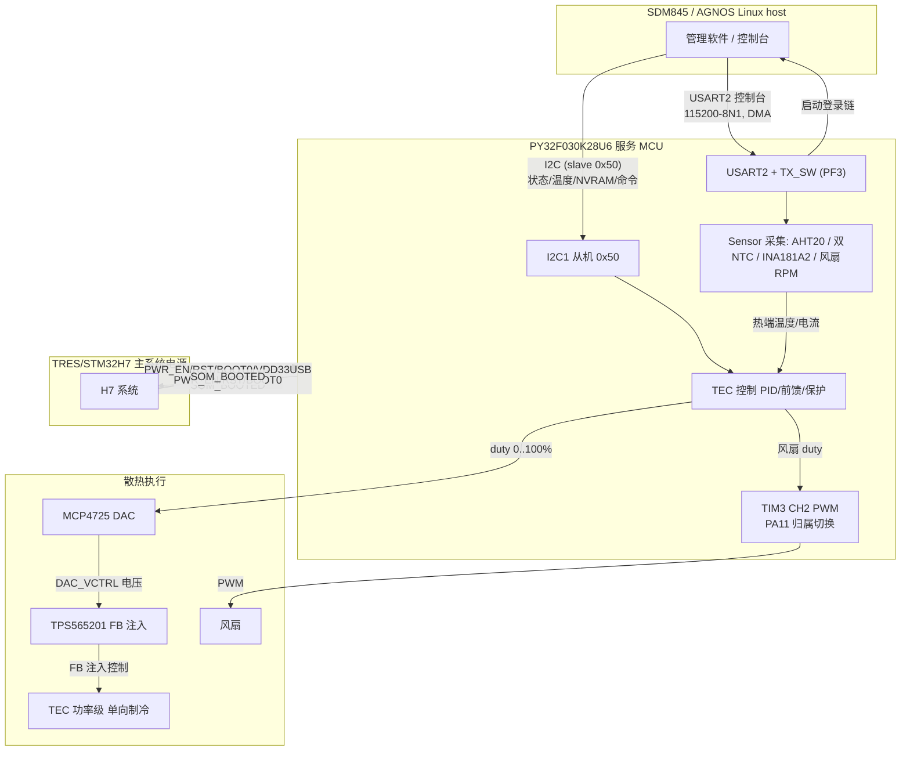
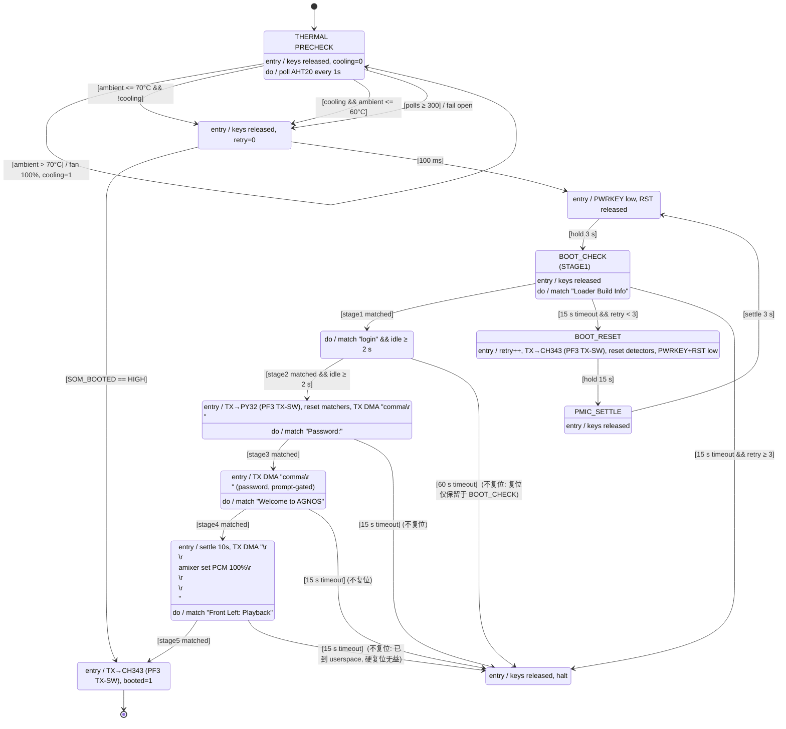
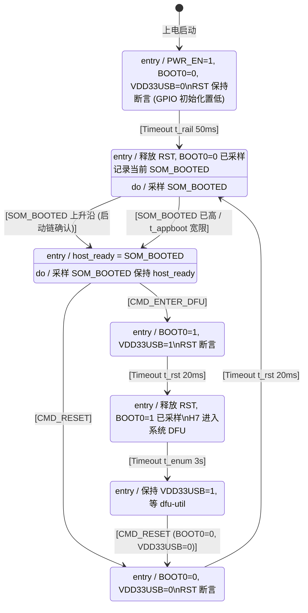
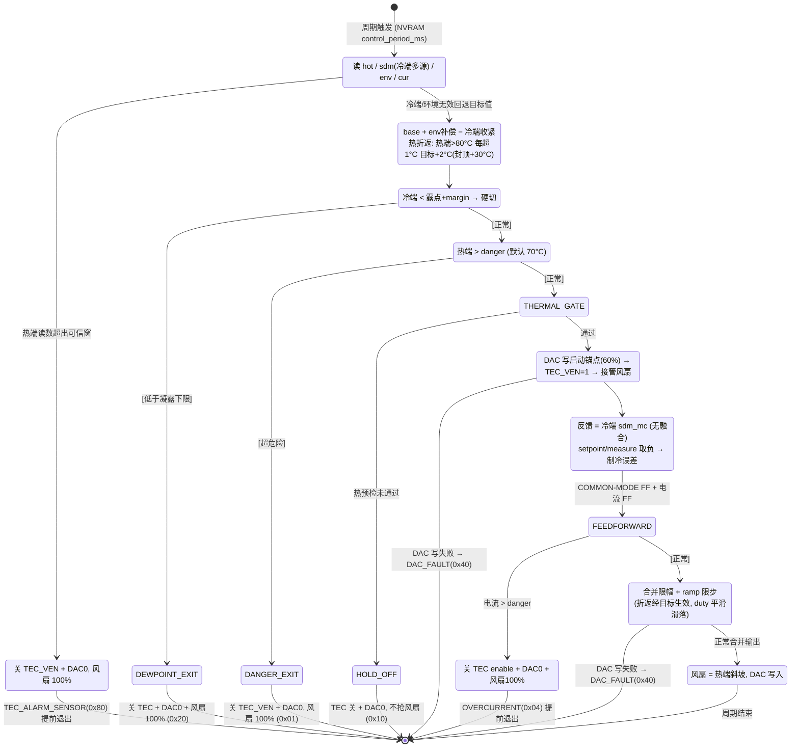
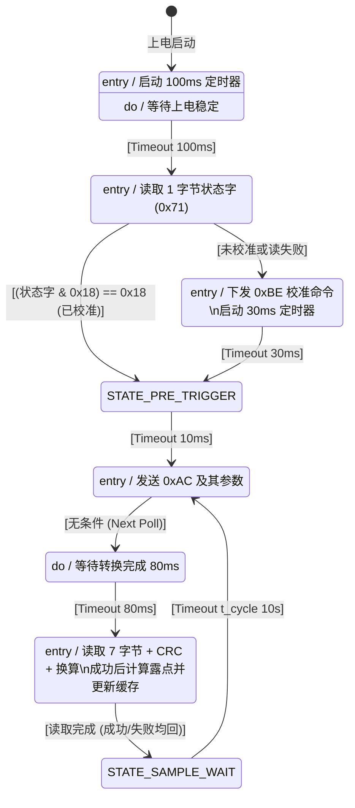

# Mix3_TRES_2 Firmware 当前工作日志（精简版）

## 2026-10-12：露点保护改为最小输出保持

- 基于 `bd6498d`，按用户要求将原先被注释的露点停机逻辑替换为已启用的限功率模式。冷端达到露点 + DEWPOINT_MARGIN（默认 2°C）时进入保持，回升到该阈值以上 1°C 时退出；控制目标也不得低于露点加裕量。保留原调试基础目标 5000 m°C。
- 最小输出采用 EN_OFF_PCT + 4 个百分点，默认 12%，确保越过现有启停死区。进入和退出遵守原输出斜坡，首次启用先强制写入最小 DAC 输出。保护期间不因露点条件切断 TEC EN，禁用附加前馈，冻结 PID 累积；退出时按实际输出重新跟踪，避免积累后突增。
- 露点样本缺失、过期或超出有效范围时维持最小输出并报告 SENSOR / DEWPOINT。过温、过流、冷端测温失败、ADC 异常、DAC 失败及已启用的风扇失速联锁仍优先停机。接口版本及 NVRAM 布局不变。
- 验证：默认、测速开关 0/1 三种构建的主机 C 回归全部通过；覆盖阈值附近 100 次波动不反复使能、80% 向 12% 斜坡下降、回温后斜坡恢复、露点缺失与前馈不绕过限幅、其他故障优先。实际 PID 实现的输出跟踪/无历史跳变测试通过；控制与 PID 在测速 0/1 下均编译生成 Cortex-M0+ 对象文件；差异空白检查通过。
- 限制：尚未进行完整固件链接及实机验证。12% 是现有控制百分比，需台架确认转换器稳定性，并非已测得的最小物理制冷功率；最小输出仍可能过冷，因此此模式不保证绝不结露。

## 2026-10-12：复核 GLM 风扇测速保护开关（116d2ea）

- 已快进到 GLM 的 `116d2ea789bc123e42178912c145dcf07279d6c0`，保留用户请求的无风扇台架开关及默认启用策略。
- 审核结论：正确配置为 0/1 时，条件编译范围覆盖失速状态、宽限、联锁及检测，风扇温控输出与其余保护仍保留；未发现这些路径新增的运行时故障。
- 修复配置缺口：原 `==1` 判断会把 2、-1 等数值静默当作禁用，现加入编译错误校验，只接受数值 0/1。
- 修复回归覆盖缺口：测试原先无条件引用 `s_fan_stalled`，无法构建关闭模式。测试器现在编译并实际执行默认、0、1 三种配置；启用模式保留失速联锁/恢复/死区用例，关闭模式验证 RPM=0 连续 200 轮仍能运行且不查询测速；三种模式均验证过温、冷端传感器、ADC、电流换算、过流和 DAC 故障保护。
- 验证：上述主机 C 断言全部通过，2/-1 配置按预期编译失败；实际设备头文件下 `tec_control.c` 两种模式均生成 Cortex-M0+ 对象文件，`git diff --check` 通过。未做完整固件链接或实机运行。


## 2026-10-12：接口 v3 配套主机工具

新增 `test/tres_host.py`，复用已验证的命令确认与参数协议，提供只读状态/参数查询、JSON 整表备份恢复、单槽修改、整表保存后 Flash 重载校验、默认值/重载、TRES reset/DFU、单次温度写入和 Linux thermal sysfs 持续上报。默认总线 3、地址 0x50；操作前检查接口版本 0x03。温度上报每轮重新读取实际源，读取/总线错误直接退出，不重播旧样本，不自动更改 COLD_SOURCE。

- 新增 `test/HOST_README.md`、`test/requirements-host.txt`，打包时依赖文件命名为 requirements.txt；支持 Python 3.8+。
- 新增 `test/test_host.py` 的 6 项离线测试，覆盖默认只读、保存和负温度编码、备份恢复、损坏备份写入前拒绝、真实温度读取及错误停止、Flash 失败和资源关闭；与原有 8 项探针测试全部通过。
- 提供仓库内独立压缩包 `dist/tres-host-v3.zip`，包含 CLI、协议依赖、低层诊断脚本、说明和离线测试。未连接或操作实际 I2C 硬件。


## 2026-10-12：合并 GLM 修复并关闭复审遗留项

### 基线与分支

- 工作分支：`codex/tec-fault-interlocks`；先合并 GLM 的 `origin/test/tres-sequencer`（`00e2007401566d66eb708c886abb219d215ad94c`），合并提交 `b6fd359`，无冲突。
- 本轮修复基于合并结果；不回退 GLM 已完成的事务写入保护、ADC 有效标志、Flash 加锁、报警清理和启动超时成功优先等改动。
- 保留用户此前确认的调试配置：`target_mc=5000` 以及暂时注释的露点保护；电流校准仍在重启后加载。

### 修复与行为

1. 新发现的组合故障：电流 ADC 超时、可信范围外或换算溢出时关闭 TEC、重置 PID、接管风扇并全速；同轮热端过温也报告 OVERTEMP。恢复依旧经过强制 DAC 锚点。
2. 原 #2：主机温度超过 5000 ms 未更新即失效，直到完整新样本到达；无符号时间差支持计时回绕。主机应至少每秒更新一次。
3. 原 #4：NMI、HardFault、Error_Handler 在死循环前用 GPIO 直接关闭 TEC_VEN，不依赖调度器、I2C 或 DAC。此处不是独立硬件看门狗，任意 CPU 锁死仍需板级保护。
4. 原 #5：电流 uint64 结果超出 uint32 时返回无效而非截断；热端补偿在 int64 内限幅后才缩窄。默认 ADC=4000 的 3516 mA 换算保持不变。
5. 原 #7/#8：命令邮箱在整个执行期间保持 BUSY；满时明确返回 BUSY 错误。保存失败返回 FLASH 错误；新增完成计数和 RELOAD_PARAMS，主机等待命令执行结束后检查结果，再从 Flash 重载验证，避免 RAM 回读冒充持久化。
6. 原 #9：DMA RX 环扩为 512 字节，半传输/整传输 IRQ 维护绝对生产位置。未读绕满、复制期间覆盖、延迟 IRQ 的不确定整圈和 DMA 错误均丢弃不可信数据，计数并重置启动检测器，禁止跨缺口拼接 banner。
7. 原 #11：并线模式下 UART 初始化全过程保持 PA0 高阻、USART2 RX-only，首次主动发送才按 GLM 的隔离顺序接管。
8. 原 #12：NVRAM v5 CRC 覆盖序列号及全部参数；新旧记录比较支持 uint32 回绕；有效 v5 优先于 v4。首次加载有效 v4 校准时向另一个槽写入 v5，保留旧槽；迁移中断可以恢复旧记录，不主动恢复默认校准。
9. 原 #13：AHT20 初始化失败延迟重试，成功后重新检查校准状态；触发失败不继续读取旧结果；数据超过 25 s 失效。ISR 查询状态不修改 FSM 正在使用的初始化/触发结果。
10. 原 #14：NVRAM 仿真从源码读取版本和参数数量，实际模拟逐页擦写，并补充逐字断电、序列号位翻转和 v4 迁移。启动回放改为执行生产 C 回调，不再维护过时的 Python 重试状态机。
11. 原 #15/#16/#17：MCP4725 EEPROM 改发三字节包；Q16 解析先识别十六进制等整数前缀，拒绝无穷大；探针默认只读，REPORT_FAIL 测试必须显式传 `--commands`。

### 接口与升级约定

- I2C VERSION 从 `0x02` 升为 `0x03`，主机脚本随固件一起升级。
- STATUS bit5 为命令 BUSY；LASTERR 新增 3=FLASH、4=BUSY；`0x15` 为已执行命令计数（成功/失败都计数，模 256），`0x16` 为 UART 接收缺口计数（模 256）。
- 命令 6=RELOAD_PARAMS：从有效 Flash 记录重载 RAM，失败不覆盖 RAM。主机协议要求单一写入者串行发命令；参数读取地址保持不变。
- NVRAM v5 保持 36 槽及原字段偏移，升级读取 v4；旧固件不能读取 v5，降级应先导出参数并安排恢复，不能假设双向兼容。
- `--params` 仍是显式修改 Flash 的测试，整体备份/恢复沿用 GLM 修复；进程或设备掉电、总线中断可能使恢复无法完成，不声明异常情况下绝对恢复。

### 验证结果

- 使用工作区独立 Zig 0.16.0 C 编译器实际执行 `test/run_tec_fault_tests.py`：原故障联锁、真实电流 ADC 超时、过流/可信度、组合过温、恢复、64 位补偿限幅通过；另起进程验证首次校准溢出反例，避免静态校准缓存影响用例。
- `test/run_boundary_tests.py`：7 组真实 C 函数测试通过，涵盖启动超时成功优先/终止策略、AHT20 重试与过期、主机温度回绕/失效、命令忙与失败确认、DMA 绕满/延迟 IRQ/错误、NVRAM 记录选择、EEPROM 包格式。
- `test/nv_dualslot_sim.py`：232 项原有断电场景、v4 迁移及代数回绕、65 个逐字断电位置、32 个序列号单比特翻转通过。
- `test/test_probe.py`：8 项离线测试通过，涵盖默认无写入、显式命令、整表恢复、保存失败反馈、忙时拒发、完成计数回绕、保存重载及 Q16 输入。
- 所有 Core C 翻译单元已用 Cortex-M0+ 目标生成临时对象文件，使用真实项目设备头文件和现有 newlib 头文件；这不是 EIDE/GNU ARM 的完整固件链接，也不是上板验证。`git diff --check` 通过。
- 待实机验收：电流故障并发过温、主机断更、AHT20 断开/恢复、MCU 异常、持续 UART 日志及 Flash 操作期间接收缺口、v4 升级断电、UART 上电引脚波形。未烧录或操作设备。

### 复现命令

```text
python test/run_tec_fault_tests.py --cc <zig.exe> cc
python test/run_boundary_tests.py --cc <zig.exe> cc
python test/replay_boot_fsm.py --cc <zig.exe> cc
python -B test/nv_dualslot_sim.py
python -B test/test_probe.py
```

也可将 `--cc <zig.exe> cc` 换为 `--cc gcc`。完整 ARM 构建使用现有 EIDE 工程及正式 GNU ARM 工具链。


## 2026-10-11：TEC 故障联锁修复（codex/tec-fault-interlocks）

基于 af0ce6833fe8224659bfad15c61e02d23ed9ffb5。用户确认 target_mc=5000 和露点保护注释用于调试，本次保持原样。分压还原公式 div_den/div_num 正确，未额外添加 ×2。

- 电流标定：div_num/div_den 的未加载哨兵改为 0，使首次采样加载 NVRAM 中 1/2 的分压配置；保留原有零值回退和整数换算。默认参数、ADC=4000 时应得到 3516mA。
- 风扇失速：持续失速建立独立联锁；在任何重新使能之前检查转速，低于阈值时保持 TEC 禁能并请求风扇全速。主机清报警不能解除联锁。转速恢复后重置 PID，再走强制 DAC 锚点启动。启动宽限在首次 TEC 接管风扇时只发放一次，避免死区或故障反复启停刷新宽限。
- 冷端测量：无效温度立即禁用 TEC、尝试停车 DAC、接管风扇并全速，报告 SENSOR；不再替换为正常目标温度。恢复有效测量时以真实温度重建 PID 历史。
- DAC 运行故障：写失败立即拉低 TEC_VEN、重置 PID、风扇全速并报告 DAC_FAULT；后续恢复必须经过已有强制锚点写入，持续总线失败不能再次开启 TEC。
- 回归测试：新增 test/run_tec_fault_tests.py 与 tec_fault_harness.c，使用实际 C 回调和电流换算函数，模拟外设及 PID 输出，覆盖持续失速、清报警不能绕过联锁、转速恢复、死区循环、冷端开短路及恢复、DAC 失败及恢复。控制回调内电流输入在测试中置零，以独立验证联锁；电流换算单独断言。
- 验证：已有 Xtensa GCC 对该 C 测试单元的语法检查通过，git diff --check 通过。当前环境无可运行的主机 C 编译器或完整 ARM 构建环境，测试断言尚未执行，未完成 ARM 链接或上板验证。具备主机 GCC 后运行 python test/run_tec_fault_tests.py --cc gcc；上板需补充风扇拔除、NTC 开短路和 I2C 写失败注入。


> 本文件只记录当前有效方案、关键硬件事实、已验证的故障修复和待完成事项。
> 完整历史与推翻过的中间方案保留在 `WORKLOG.md`。
>
> 更新时间：2026-10-11

---

## 1. 项目概览

定位：PY32F030K28U6 是 Mix3 平台的**服务/电源管理 MCU**，上承 SDM845（AGNOS Linux 主机，经 I2C 与 USART2 控制台），下辖 STM32H7（TRES 小系统）和 TEC/风扇等外设，用 QuarkTS 协作式调度器串起全部状态机与周期任务。

系统拓扑：



主要职责：

- 管理 TRES/STM32H7 的启动、复位和 DFU 时序；
- 管理 SDM845/AGNOS 的启动、登录和初始化命令链（5 路 KMP 流式匹配）；
- 采集 AHT20、双 NTC（热端/冷端）、TEC 电流（INA181A2）、风扇 RPM；
- 通过 PID + 电流前馈控制 TEC，经 MCP4725 DAC 注入 TPS565201 FB；
- 风扇按热端温度独立调速，归属由 `Fan_SetSource()` 显式管理；
- 通过 I2C 从机向 SDM845 提供状态寄存器、机器状态、NVRAM 参数窗口和命令通道。

核心模块：

| 模块 | 文件 | 职责 |
|---|---|---|
| TRES 时序 FSM | `tres_seq.c` | STM32H7 上电/复位/DFU 状态机 |
| 命令策略 | `tres_cmd.c` | I2C 命令合法性矩阵 + SAVE/DEFAULT 参数 |
| I2C 从机 | `tres_i2c_slave.c` | 寄存器文件 + 状态块 + NVRAM 窗口 |
| SDM845 启动 | `sdm845_boot.c` | 热预检 + 5 阶段登录链 + KMP 匹配 |
| 控制台/检测 | `usart2_dma.c` / `sdm845_detect.c` | USART2 DMA 收发 + 启动成功检测 |
| TEC 控制 | `tec_control.c` | 冷端 PID/前馈/保护/风扇解耦 |
| ADC/NTC | `adc.c` | CHSELR 单通道读取（EOC 带超时）、温度/电流换算 |
| AHT20 | `aht20_task.c` | 非阻塞测量状态机 |
| 风扇 | `fan.c` / `fan_task.c` | PWM 输出 + RPM 采样 |
| NVRAM | `nv_params.c` | FLASH 参数存储（双槽 A/B、seq 交替写、CRC） |

工程与构建：

- 目标：PY32F030K28U6（Cortex-M0+，8 KB RAM / 64 KB FLASH，最后 4 KB 为 NVRAM 双槽参数区）；
- 时钟：16 MHz HSE → PLL ×2 → SYSCLK 32 MHz；ADC 8 MHz；FLASH 擦写时序按 HSI 档位选择；
- 工具链：GNU Arm Embedded GCC 10-2020-q4，EIDE 工程，纯 LL 驱动（不依赖 HAL）；
- 调试工具：`test/tres_i2c_probe.py`（实机 I2C 探针）、`test/replay_boot_fsm.py`（离线重放）、`test/nv_dualslot_sim.py`（NVRAM 双槽掉电模拟）。

原则：

- 周期任务和状态机均不得忙等阻塞；
- 状态机回调统一使用 `switch (h->Signal)`；
- 固定延时使用 QuarkTS timeout；
- 不在 `QSM_SIGNAL_ENTRY` 中设置 `NextState`，迁移放在 NONE/timeout 分支；
- 可调参数优先放入 NVRAM，避免重新编译固件。

---

## 2. 硬件和通信接口

### 2.1 时钟

- 外部晶振：16 MHz；
- PLL 后 SYSCLK：32 MHz；
- 工程全局定义 `HSE_VALUE=16000000U`，避免厂商 LL 默认 24 MHz 导致 USART/I2C 时序错误；
- ADC 时钟使用 PCLK/4 = 8 MHz；
- FLASH 时序根据 `RCC->ICSCR.HSI_FS` 的 HSI 档位选择，不根据 SYSCLK 选择。

### 2.2 USART2 / SDM845 控制台

- USART2：PA0/PA1，115200-8N1；
- DMA1 CH1：USART2_RX，映射 `0x08`；
- DMA1 CH2：USART2_TX，映射 `0x07`；
- PF3：`UART2_TX_SW`，当前硬件用于断开/接回 CH343_TX；
- `USART2_SetTxSource()` 是唯一线路切换 API；
- 当前 `USART2_TXSW_LINEMODE=1` 时还会重配 PA0：
  - PY32 发送：AF9 推挽、TX_RX；
  - CH343 控制台：PA0 高阻、RX-only；
- 将来换成真正 SPDT 后可编译 `USART2_TXSW_LINEMODE=0`，只切换 PF3。

### 2.3 I2C 从机

- PY32 I2C1 从机地址：7-bit `0x50`（写 `0xA0`，读 `0xA1`）；
- 寄存器窗口：

| 地址 | 名称 | 说明 |
|---|---|---|
| `0x00` | CMD | `[0xA5][cmd][param]` |
| `0x10` | STATUS | TRES 状态、host_ready、错误标志 |
| `0x11` | RETRIES | TRES 重试计数 |
| `0x12` | PINS | 控制脚快照 |
| `0x13` | LASTERR | 最近错误 |
| `0x14` | VERSION | 接口版本 |
| `0x20..0x23` | SDM845_TEMP | 4 字节大端、milli-°C |
| `0x30` | BOOTSTATE | SDM845 FSM 状态 |
| `0x31` | BOOTRETRY | SDM845 重试次数 |
| `0x32` | TECFLAGS | TEC 报警位图 |
| `0x33` | AHTSTAT | AHT20 最近状态 |
| `0x34` | FANDUTY | 当前风扇占空比 |
| `0x35` | TECDUTY | TEC 当前控制 duty |
| `0x40..0xC7` | NVRAM | 34 槽 × 4 字节大端 |
| `0xD0..0xDF` | AES challenge | `TRES_AES_ENABLE` 时启用 |
| `0xE0..0xEF` | AES response | AES-128-ECB 实时响应 |

NVRAM 写入只更新 RAM；通过 `SAVE_PARAMS` 命令才写 FLASH：

```text
写 CMD: [0xA5][0x04][0x00]  -> 保存
写 CMD: [0xA5][0x05][0x00]  -> 恢复默认到 RAM
```

---

## 3. SDM845 启动状态机

状态链：

```text
THERMAL_PRECHECK
  -> POWER_ON_WAIT
  -> PWR_PRESS
  -> BOOT_CHECK       (stage1: Loader Build Info)
  -> STAGE2_WAIT      (stage2: login)
  -> STAGE3_WAIT      (发送账号，等待 Password:)
  -> STAGE4_WAIT      (发送密码，等待 Welcome to AGNOS)
  -> STAGE5_WAIT      (等待 10 s 后发送 amixer，匹配 Front Left: Playback)
  -> BOOT_SUCCESS
```

异常状态：`BOOT_RESET`、`PMIC_SETTLE`、`STRAP_FAIL`。

### 当前有效行为

- `THERMAL_PRECHECK`：AHT20 环境温度有效且不超过 70°C 才放行；若超过 70°C，风扇全速，降到 60°C 才放行；预检 timeout 为周期性（`QSM_TSOPT_PERIODIC`，每秒持续轮询），300 s 后 fail-open；
- `BOOT_CHECK` 超时允许有限次数 PMIC 强杀重试；
- stage2~stage5 超时按当前代码/状态图进入 `STRAP_FAIL`，不再盲目复位已进入 userspace 的系统；
- STAGE3 发送 `comma\r\n`，必须等 `Password:`，不能用 `comma` 回显判定；
- STAGE4 在 `Password:` 后立即发送密码 `comma\r\n`；
- STAGE5 entry 后静默 10 s，再发送：

```text
\r\namixer set PCM 100%\r\n\r\n\r\n
```

- STAGE5 匹配 `Front Left: Playback` 后进入 `BOOT_SUCCESS`；
- `BOOT_SUCCESS`、`BOOT_RESET`、`STRAP_FAIL` 将控制台线路交还 CH343；
- 启动检测采用 5 个独立 KMP 流式匹配器。

### 最终状态图（Mermaid，与 `sdm845_boot.c` 一致）



### 关键调试修复

1. TX DMA 必须配置 DMA2_MAP=`0x07`；
2. DMA 普通模式传输结束后 EN 不会自动清零；新发送前必须软件 Disable，再重写地址和 CNDTR；
3. `TxBusy` 判断为 `EN && CNDTR != 0`；
4. 每次真正强杀开始时调用 `Sdm845_Detect_ResetAll()`；冷启动路径不能过早清除已经收到的 loader banner；
5. STAGE3 不能匹配 `comma`，因为主机名 `comma-... login:` 本身包含该字符串；
6. stage3/4/5 发送失败使用 pending + 轮询重试，不静默丢命令。

---

## 4. TRES/STM32H7 时序器

TRES 控制信号：

- `TRES_PWR_EN`：PB6；
- `TRES_RST`：PA8；
- `TRES_BOOT0`：PB5；
- `TRES_VDD33USB_CTRL`：PA15；
- `SOM_BOOTED`：PB4。

主要状态：

```text
PWR_UP
 -> BOOT_WAIT_NORMAL
 -> RUNNING
 -> PULSE_RESET_NORMAL / PULSE_RESET_DFU
 -> BOOT_WAIT_DFU
 -> DFU_ACTIVE
```

- 冷启动无条件进入 NORMAL；
- DFU 通过主机命令触发复位进入，不掉电；
- `REPORT_FAIL` 只计数，不自动迁移；
- I2C 状态寄存器 `0x10..0x14` 对外提供诊断信息。

### 最终状态图（Mermaid，与 `tres_seq.c` 一致）



---

## 5. TEC 控制最终方案

### 5.1 控制链

```text
温度/电流采集
  -> 冷端 PID（反馈 = sdm_mc，多源可选）+ COMMON-MODE 前馈 + 电流前馈
     （热端只做保护/风扇输入，不进 PID 误差；温度融合已废除）
  -> TEC duty (0..100%)
  -> MCP4725 DAC（反向映射到 FB 注入窗口）
  -> TPS565201 FB 注入控制
  -> TEC 功率级（单向制冷）
```

### 5.1.1 控制任务状态图（Mermaid，与 `tec_control.c` 一致）



保护报警位图（`TECFLAGS` 0x32）：`0x01 OVERTEMP / 0x02 HOT_WARNING / 0x04 OVERCURRENT / 0x08 FAN_FAULT / 0x10 THERMAL_WAIT / 0x20 DEWPOINT / 0x40 DAC_FAULT / 0x80 SENSOR`。

风扇与 TEC 解耦：

- 风扇依据热端温度线性调速；
- `PA11=LOW`：风扇由 SDM845 控制；
- `PA11=HIGH`：风扇由 PY32/TIM3 CH2 控制；
- 使用 `Fan_SetSource(FAN_SOURCE_PY32/SDM845)`，不要再用 `Fan_SetEnabled()` 隐含表达归属。

### 5.2 DAC 电压窗口

这是当前最容易误读的部分：

- MCP4725 电气参考/满量程：VDD ≈ **3300 mV**（编译期宏 `MCP4725_VDD_MV`，DAC 换算按此固定值）；
- TEC 功率级有效控制窗口**不是固定 0~1200 mV**；
- `1200 mV` 是早期 TPS63802/VSET 假设留下的默认占位值，不能直接作为量产满量程；
- 当前使用 FB 注入拓扑：DAC 电压越高，FB 越高，TEC 输出电压越低，映射为反向：

```text
duty 0%   -> DAC_MAX_CTRL_MV -> VOUT 最低 / TEC 关闭端
duty 100% -> DAC_MIN_CTRL_MV -> VOUT 分压自然点 / 满制冷端
```

按 R1≈68k、R2=10k、R3≈20k、VFB≈760mV 的理论估算：

- `DAC_MIN_CTRL_MV`：约 **740 mV**，FB=0.76V、TEC 电流接近 0 的端点；
- `DAC_MAX_CTRL_MV`：约 **2360 mV**，把 VOUT 压到低端的端点；
- 上述数值只是理论起点，必须用示波器/万用表在实机标定后写入 NVRAM。

### 5.3 启动策略

- 启动不从 0V 端全范围扫描；
- `NV_TEC_DAC_STARTUP_PCT` 默认 **60%**，表示从满制冷量的 60% 附近起调；
- TPS565201 内部约 1 ms soft-start 负责 0 到锚点的建立；
- 固件每个控制周期最多改变 `RAMP_STEP_PERCENT`，默认 5%；
- 这样避免 D-CAP2 在极低占空比/极低输出电压区工作不稳定。

### 5.4 保护逻辑

- 热端传感器失效（开路 -40°C / 短路 +200°C / ADC 超时）：关 TEC、DAC 置安全端、风扇 100%，置 `SENSOR(0x80)`；冷端/环境无效则回退目标值（不失效保护）；
- 冷端低于 `露点 + DEWPOINT_MARGIN`：硬切（关 TEC + DAC0 + 风扇 100%，`DEWPOINT 0x20`）——独立于 PID 的硬保护层，与 PID 共用同一冷端变量；
- 热端超过 danger 阈值（80°C，NVRAM 可设）：关闭 `TEC_VEN`、DAC 置安全端、风扇全速（`OVERTEMP 0x01`）——最后防线，正常折返到不了；
- 热端超过 overtemp 阈值（80°C）：`HOT_WARNING(0x02)`，**热折返**——冷端目标按增益 2.0/°C 线性抬升（封顶 +30°C），PID 自动减小制冷、热端负荷随之下降，回落后自动恢复；不压 duty=0、不清积分器（避免 bang-bang 振荡）；
- 过流（> `CURRENT_DANGER`）：`OVERCURRENT(0x04)`，**关 TEC enable 线** + DAC0 + 风扇 100%，电流回落经正常启动路径恢复；
- 热预检未通过：`THERMAL_WAIT(0x10)`，TEC 保持关闭，不抢占预检阶段的风扇控制；
- DAC 写失败：`DAC_FAULT(0x40)`，下周期重试，`s_dac_percent` 保持 last-good（不假装已执行）；
- 风扇 duty 较高但 RPM 过低：`FAN_FAULT(0x08)`；
- NVRAM 参数加载时做全套关系/范围校验（DAC 窗口 min<max、风扇斜坡 base<full、警告<危险阈值顺序、PID 增益为正、ramp 步长等），违反回落出厂默认——防主机写坏 NVRAM 或 FLASH 位翻转导致失控。

### 5.5 当前 TEC NVRAM 关键参数

| 参数 | 当前默认/理论值 | 说明 |
|---|---:|---|
| `PID_KP/KI/KD` | 2.0 / 0.1 / 0.5 | Q16 存储 |
| `TARGET_BASE` | 45°C | 冷端（被控对象）基准目标 |
| `HOT_OVERTEMP` | 80°C | 热警告（折返起点） |
| `HOT_DANGER` | 90°C | 危险关断（最后防线，NVRAM 可设） |
| `HOT_FB_GAIN` | 2.0 | 折返增益：热端每超 1°C 冷端目标抬 2°C |
| `HOT_FB_MAX` | +30°C | 折返抬升上限 |
| `DAC_MIN_CTRL` | 0 mV 默认占位 | 需实机标定，理论约 740 mV |
| `DAC_MAX_CTRL` | 1200 mV 默认占位 | 需实机标定，理论约 2360 mV |
| `DAC_STARTUP_PCT` | 60% | 启动锚点 |
| `RAMP_STEP_PERCENT` | 5% | 每控制周期最大变化 |
| `DEWPOINT_MARGIN` | 2000 m°C | 凝露保护下限余量 |
| `FF_GAIN` | 1.0 %/°C | COMMON-MODE 前馈（环境-目标梯度） |
| `CONTROL_PERIOD` | 1000 ms | 控制周期 |
| `CURRENT_DANGER` | 3000 mA | 电流危险阈值 |
| `COLD_SOURCE` | 0 | 0=TEC_COLD NTC，1=SDM845 温度 |

MCP4725 的 VDD 参考**不再是参数**：固定编译期宏 `MCP4725_VDD_MV (3300U)`（`NV_TEC_DAC_VREF_MV` 槽已删除）。

---

## 6. 采集和基础模块

### AHT20

- QuarkTS 8 状态非阻塞测量流程；
- 上电等待 100 ms；
- 未校准时执行一次校准；
- 转换等待约 80 ms；
- 默认 10 s 周期；
- 提供环境温度、露点和状态 getter；
- 未就绪返回 `INT32_MIN`。

### 最终状态图（Mermaid，与 `aht20_task.c` 一致）



### ADC / NTC / TEC 电流

- ADC 不允许每次读取时 Disable/Enable；
- 读取采用 CHSELR 单通道切换流程；
- ADC 时钟 8 MHz；
- 采样时间 239.5 cycles；
- 此修复解决了后续采样固定在 2048 的问题；
- EOC 等待带超时（超时返回 0，上游按传感器故障处理，不再永久阻塞控制任务）；
- 电流链参数（分流电阻、放大倍数、分压、ADC VREF）由 NVRAM 提供，零值守卫回落默认（含 shunt=0 除零防护）。

### 风扇 RPM

- EXTI 实时累计 tach 脉冲；
- 普通周期任务每 2 s 计算 RPM；
- 缓存 getter 供控制层读取；
- 风扇控制归属通过 `Fan_SetSource()` 显式管理。

---

## 7. NVRAM / FLASH（v7 双槽）

- FLASH 顶部 4 KB 预留参数区，基址 `0x0800F000`；**双槽 A/B** 各 256B（A=`0x0800F000`，B=`0x0800F100`）；
- 槽布局 `[magic][version][seq][crc32][params[]]`（当前 148B，`NVM_PAGES` 由块大小自动派生 = 2 页）；`NVM_VERSION=7`；
- **掉电安全**：`Save()` 交替写非 active 槽 → 读回校验 → 翻转 active；`Init()` 双槽各自校验后取 `seq` 大者；任何掉电点至少留一个 CRC 有效块（跨页撕裂块 CRC 拒绝），`test/nv_dualslot_sim.py` 232 项掉电枚举断言通过；
- 首次上电/双槽全损：回默认值并立即写入 slot A；v6→v7 切换后首次上电参数回默认一次（版本不符，预期）；
- 参数枚举使用末尾 sentinel 自动计数（当前 33 槽）；新增参数 = enum sentinel 前加一项 + defaults 加一项；
- 布局变化必须递增 `NVM_VERSION`；双槽总占用有 static_assert 兜底（≤4KB，参数上限 252 个）；
- **加载时全套关系/范围校验**（`tec_params_load()`）：违反不变量回落出厂默认（见 5.4）；
- 擦写时序按 HSI 档位选择；所有 BUSY 等待带超时；失败路径 `LL_FLASH_Lock()` + 恢复 PRIMASK；
- I2C 参数窗口（0x40..0xC7，34 槽）写 RAM，显式 `SAVE_PARAMS` 才落 FLASH；
- 遗留：CRC 只覆盖 `params[]`（magic/version/seq 靠独立比较兜底，翻转走安全降级）。

---

## 8. 已知硬件/软件陷阱

1. QuarkTS `ENTRY` 回调内设置 `NextState` 不会立即迁移；
2. 状态迁移成功条件必须先于 timeout 判断；
3. **QuarkTS 一次性 timeout（无 `QSM_TSOPT_PERIODIC`）在状态自停留时（如 proceed==0 不迁移）触发后即 disarm，状态机永久卡死**——`THERMAL_PRECHECK` 的实际教训；
4. DMA 通道 EN 由软件清除，普通传输结束不会自动清零；
5. DMA CNDTR 在 EN=1 时不能重写；
6. DMA1 RX 和 DMA2 TX 映射字段独立，不能漏配 TX 的 `DMA2_MAP`；
7. `HSE_VALUE` 默认值会污染 USART/I2C 所有时序计算；
8. PY32 ADC 不支持运行时 Disable 后再 Enable 的读取模式；
9. TEC FB 注入拓扑中 DAC 极性与直觉相反：DAC 高，TEC 输出低；
10. `DAC_MAX_CTRL_MV=1200` 只是当前默认占位值，不能当作最终满量程；
11. MCP4725 fast-write 首字节低 4 位就是 12 位数据的高 4 位（D11..D8），PD 位在 bit[5:4]——不要按"命令占低 3 位"理解；
12. SoftI2C 整个事务期间关全局中断（单次 ≤64B 上限强制约束），NVRAM Save（4 页擦写）同理——长临界区会推迟调度器/从机 ISR/tach EXTI。

---

## 9. 当前必须完成的实机验证

1. 用示波器/万用表标定 `DAC_MIN_CTRL_MV` 和 `DAC_MAX_CTRL_MV`；
2. 验证 60% 启动点对应的实际 TEC 电压、电流和热响应；
3. 按热惯性调整 `RAMP_STEP_PERCENT`；
4. 标定 PID 增益、电流前馈与 COMMON-MODE 前馈（`FF_GAIN`）；
5. 标定热折返参数（`HOT_FB_GAIN`/`HOT_FB_MAX`）：验证过热时冷端目标抬升、duty 滑落、热端回落的动态过程，确认不与 danger 硬关断振荡；
6. 验证 TPS565201 在 DAC 两端点和启动锚点的 FB 电压，确保不触发 UVP hiccup；
7. 验证 `Welcome to AGNOS` 确实是登录成功后的可靠标志；
8. 验证 STAGE5 10 s 静默期后 `amixer` 回显是否能在剩余超时窗口内到达；
9. 真机验证 NVRAM 双槽擦写、掉电保持和 SAVE_PARAMS 流程（v8 首次上电参数回默认一次属预期，重写标定值即可）；
10. 确认当前硬件是否最终升级为真正 SPDT，并决定是否切换 `USART2_TXSW_LINEMODE=0`；
11. AES 软件挑战响应仅提供基础防复制能力，密钥可被 JTAG 读取；需要硬件级安全时使用 ATECC608 类安全器件。

已知遗留（安全审查确认、未修复）：

- NVRAM CRC 只覆盖 `params[]`，magic/version/seq 位翻转走安全降级但无告警（S3）；
- AHT20 初始化失败无重试上限，传感器故障时每 10 s 无限重发且无降级标志（H3）；
- 露点 Magnus 公式在 RH≈100% 时结果翻转，可能错误触发/漏触发露点保护（H5）；
- 跨 ISR/任务共享的 `s_alarm`/`s_dac_percent` 等缺 `volatile`（M0+ 单字节读写实际原子，属标准符合性问题）；
- HardFault/NMI 处理为 while(1) 挂死，无 `NVIC_SystemReset()`；全固件无看门狗。

---

## 10. 验证工具

- `test/tres_i2c_probe.py`：I2C 状态、参数读写（33 槽）、SAVE/DEFAULT、可选 AES challenge-response；
- `test/replay_boot_fsm.py`：离线重放 SDM845 启动状态机和故障路径；
- `test/nv_dualslot_sim.py`：NVRAM 双槽掉电点枚举模拟（232 项断言）；
- 当前修改应使用 EIDE 等价 GCC 参数全量编译和链接验证。

